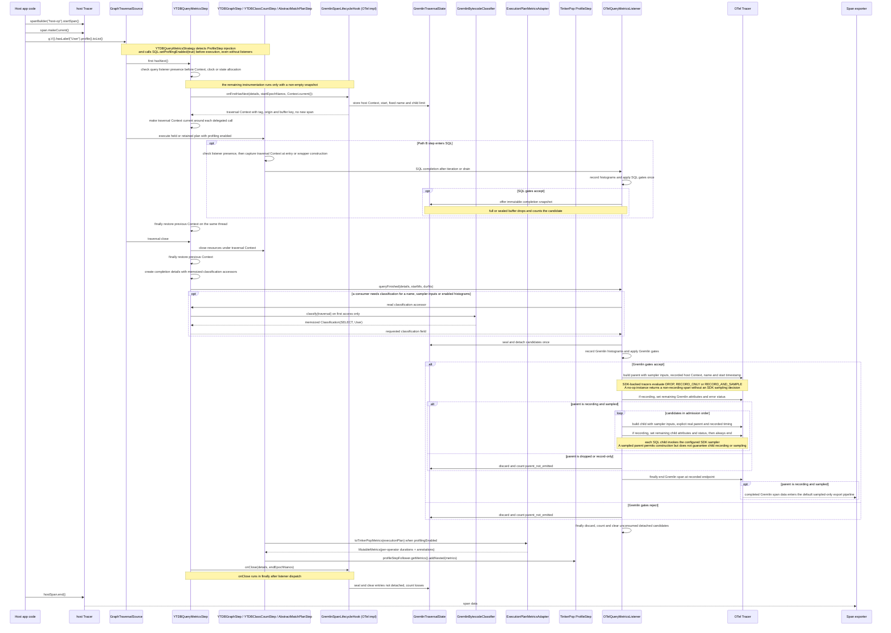
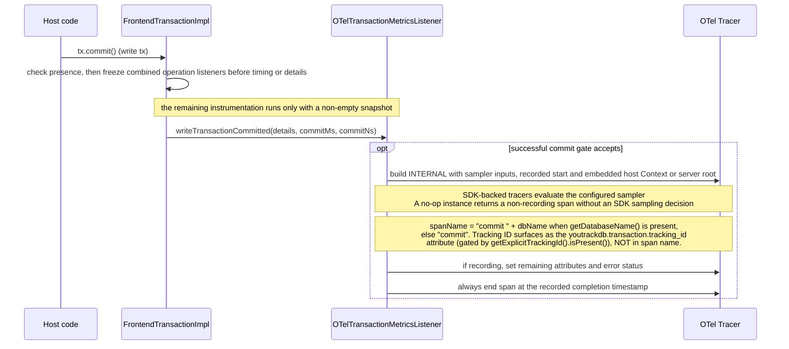
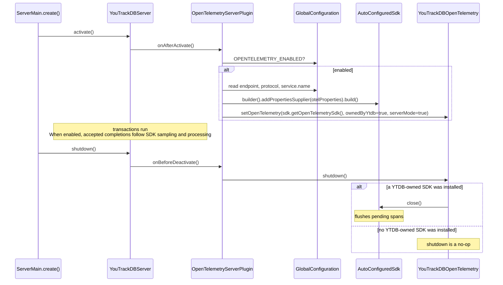

<!-- workflow-sha: 5db61a37462f0b28965113f39a81b6fcb1ed1340 -->
# YTDB-496 OpenTelemetry support — Design

## Overview

This design adds a new optional Maven module `youtrackdb-opentelemetry` that wires YouTrackDB (YTDB) into `OpenTelemetry` across all three signal types: distributed tracing (spans from query and transaction listener callbacks), logs (every record emitted through YTDB's `LogManager` chokepoint, hard-context-correlated with the active span at emission time), and metrics (profiler counters exposed through observable instruments, plus synchronous duration and returned-row histograms recorded by the listeners). The result is that a host running embedded YTDB and an operator running a standalone server both get database telemetry — spans, correlated logs, and counter samples — visible in any `OTel`-compatible viewer. This design assumes familiarity with the existing `QueryMetricsListener` and `TransactionMetricsListener` firing sites in `YTDBQueryMetricsStep` and `FrontendTransactionImpl`, and with the `YTDBTransaction` open / commit / rollback lifecycle. The audience is contributors maintaining the metrics and transaction subsystems in `core`.

Today YTDB has an internal `QueryMetricsListener` service provider interface (SPI) that fires only on traversal close for Gremlin, the Apache TinkerPop graph query language. A `TransactionMetricsListener` fires on write-transaction commit. Both listeners are per-transaction, and the project ships no OTel binding. Native SQL queries (the path used for `db.command(...)`, MATCH, and data definition language (DDL)) currently fire neither listener. The design closes that gap with two load-bearing additions: a global listener registry in `core` so an OTel listener registered once at startup auto-applies to every subsequent transaction; and a new listener fire site (the core code that constructs completion details and invokes listeners) at the SQL session-boundary, applied as a thin wrapper on whatever `ResultSet` each `db.query()` / `db.command()` / `db.execute()` call returns. The wrapper class `InstrumentedSqlResultSet` (new, in `internal.core.db`) is installed inside the private `queryStartedLifecycle(...)` chokepoint that the idempotent SQL entry points on `DatabaseSessionEmbedded` funnel through: both `query(...)` overloads (which route cache hits, cacheable misses, and bypasses through it alike via `return queryStartedLifecycle(serveThroughCache(...))`), the idempotent branch of `executeInternal(...)`, and both `computeScript(...)` overloads; plus one inline wrap at the non-idempotent prefetch branch of `executeInternal(...)`, the sole entry-point return that does not pass through the chokepoint. The wrapper is the outermost layer above any [PR #1077](https://github.com/JetBrains/youtrackdb/pull/1077) cache-view construction. This relies on the verified-current YTDB-820 wiring (the cache result flows through `queryStartedLifecycle(...)`, not around it); §"SQL execution layer hook" carries the per-site detail, the standing assumption, and the re-verify-at-820-merge gate. The constructor captures a wall-clock start; what `executionTimeNanos` measures depends on the resolved `QueryMonitoringMode` (per the original observability design). `LIGHTWEIGHT` reports wall-clock from fire-site start to close via `GranularTicker` at ~10 ms granularity, with consumer idle time between `hasNext()` / `next()` calls included in the duration. `EXACT` instruments each delegated `hasNext()` and `next()` invocation with `System.nanoTime()` and reports the sum of per-call execution times (DB-side active time only, consumer idle gaps excluded). EXACT performs two `System.nanoTime()` reads per delegated call and wall-clock reads at the endpoints. Their cost depends on the JVM and platform. Direct SQL uses the transaction (TX) default. SQL inside a tagged Gremlin traversal inherits its tag through `YTDBContextKeys.QUERY_TAG`. Iteration delegates to the inner result-set with row counting, error capture, and (under `EXACT`) per-call timing accumulation; `close()` closes the delegated result set before capturing the completion endpoint and firing listeners once. It preserves an earlier execution failure for telemetry and reports a close failure only if no earlier failure exists. Delegate exception propagation stays unchanged. The listener receives the mode-appropriate elapsed value. Every SQL statement type (SELECT, INSERT, UPDATE, DELETE, MATCH, DDL) and multi-statement scripts flow through this single outer-boundary fire site. Sub-plans called from MATCH steps, sub-query steps, and IF / WHILE control flow construct their own un-instrumented inner `LocalResultSet` instances via the existing 2-arg constructor and never reach the entry-point wrapper, so they do not double-fire. The exact return-sites, layer ordering, and constructor steps live in §"SQL execution layer hook"; the clock-source rules live in §"Span timing capture".

**Coordination with YTDB-820.** The forthcoming transaction-scoped query result cache ([PR #1077 design, YTDB-820 implementation](https://github.com/JetBrains/youtrackdb/pull/1077)) lands first and changes what these entry points return: on cache hit, and on cache miss for cacheable RECORD / MATCH / AGGREGATE shapes, the caller receives a `CachedResultSetView` rather than a `LocalResultSet`. The wrapper sits one layer above both, so a single fire site covers every inner-type the cache can produce: hits, misses for the cacheable shapes (including the aggregate path), the fallback when planner splicing fails, bypasses for non-deterministic queries, the per-query `NOCACHE` hint, nested calls under WHERE evaluation, and the disabled-cache default in v1. The wrapper has zero changes to `LocalResultSet.java`, which keeps YTDB-820's stream-slot substitution machinery untouched. The full matrix and its consequences live in §"SQL execution layer hook → Coordination with YTDB-820 cache contract".

SQL identity facts come from structured parser metadata already produced for execution. They do not come from parsing exported `db.query.text`. Query-text parsing supplies generated summaries. Any remaining departure from the sem-conv text-extraction recommendation is an explicit YTDB policy. A pair of static-utility classifiers in `core` (`GremlinBytecodeClassifier`, `SqlSyntaxClassifier`), called directly from their respective fire sites, extracts `db.operation.name` and `db.collection.name` so spans carry OpenTelemetry semantic conventions (sem-conv) v1.33.0 attributes. Path B (fallback Gremlin in the [Gremlin-to-MATCH translator](https://github.com/JetBrains/youtrackdb/pull/1038) nomenclature) creates its Gremlin span after traversal resources close and its query gates accept completion. A fallback step can route through the SQL entry points via `YTDBGraphStep` → `YTDBGraphQuery.execute(...)` → `transaction.query(...)` → `InstrumentedSqlResultSet`. A completion is accepted when it passes its own query gates. It then becomes a candidate for retention. Admission means storing that candidate in the bounded per-traversal buffer as an immutable snapshot. Neither acceptance nor admission guarantees span construction or export. The OTel listener emits them under the late Gremlin span only when that parent is recording and sampled. OpenTelemetry (OTel) Context values carry the buffer, query tag and Gremlin-origin marker during execution without an open Gremlin span. Steps that never hit those entry points (`YTDBClassCountStep` calls `session.countClass(...)`; by-id `YTDBGraphStep` lookups) emit the Gremlin span only. Path A (translated Gremlin, post-PR-1038) can emit at most one Gremlin span and creates no SQL child from direct plan execution because the boundary step (`AbstractMatchPlanStep`: `YTDBMatchPlanStep` or `MultiPlanMatchStep`) opens the underlying `SelectExecutionPlan` directly without going through the SQL entry points.

The transaction (TX) listener fires only `writeTransactionCommitted` and `writeTransactionFailed`, both for write transactions. The OTel listener emits a standalone commit span without a TX-lifetime wrapper. Successful commits use the separate `OPENTELEMETRY_COMMIT_SLOW_THRESHOLD_MILLIS` gate, default `0`. Failed commits always reach span construction, subject to the [OpenTelemetry software development kit (SDK) sampling contract](design-mechanics.md#sdk-sampling-contract). Read-only transactions emit nothing on the TX listener and therefore no commit-side span. This matches the existing YTDB read-only-TX semantics (the TX listener never fires on a read-only close) and keeps mostly-read workloads from paying alloc-and-emit cost per query for an empty container span.

On the query side, a configurable slow-query threshold gates span emission inside `OTelQueryMetricsListener.queryFinished` so a host running heavy read traffic can skip SQL span allocation for fast successful queries. Gremlin also applies its gates before span allocation at close. Rejected parents discard and count buffered SQL candidates. The global default is `OPENTELEMETRY_QUERY_SLOW_THRESHOLD_MILLIS=0` (emit-all). It disables duration rejection when no tag rule or per-transaction override supplies a positive threshold. Accepted completions follow normal routing, retention and SDK sampling. Enabling OpenTelemetry does not guarantee a recorded or exported span. Operators on read-heavy workloads opt into a positive value (e.g., `100`) to reject fast successful queries. Per-tag overrides go through `OPENTELEMETRY_QUERY_SLOW_THRESHOLD_TAG_RULES` (same format as the per-tag mode rules), resolved through a parallel `SlowQueryThresholdResolver` consuming `TagRule<Long>` on the same sealed interface. Errors bypass the gate because trace viewers are the primary investigation surface for failures. A 1 ms failing query bypasses its own duration gate. Error completions bypass heartbeat and slow-query checks without advancing the heartbeat clock. Direct SQL and Gremlin error completions proceed to span construction. Nested SQL error completions use the same bounded buffer and parent-retention rules as successful SQL. They can be discarded when the buffer is full, after traversal sealing, or when the Gremlin parent is not retained. Any emitted error span carries the error type and sanitized query text. SDK sampling and export still apply.

A second optional gate selects a wall-clock heartbeat sample: `OPENTELEMETRY_QUERY_HEARTBEAT_SAMPLE_MILLIS` (default `0` = disabled) sets a process-wide interval, and `OTelQueryMetricsListener.queryFinished` allows one successful query completion to bypass the slow-query gate per interval. The two gates compose disjunctively. Heartbeat picks fast queries for visibility, slow-query catches latency outliers, and errors bypass both query gates. The heartbeat carries no per-tag override; it samples the workload as a whole. Operators who need per-tag sampling streams configure downstream filtering on the OTel pipeline against `db.query.summary`. Heartbeat spaces candidate selection over time instead of applying an independent random probability to each completion. It favors tags that complete more often. Retention and SDK sampling can further change the emitted sample.

`YTDBTransaction` exposes a builder-style API for listener wiring: `withQueryMonitoringMode(mode)`, `withSlowQueryThresholdMillis(millis)`, `withTrackingId(id)`, `withQueryListener(listener)`, and `withTransactionListener(listener)` are separate fluent methods. `withTrackingId(String)` remains on `YTDBTransaction` and delegates to storage on `FrontendTransactionImpl`. `FrontendTransaction` exposes `getTrackingId(): String` and `getExplicitTrackingId(): Optional<String>` for both fire sites. Its existing `getId()` remains the fallback source when the host sets no tracking ID.

Other subsystems restructured to fit.

**`QueryDetails` accessors.** Five new accessors on the nested `QueryMetricsListener.QueryDetails` SPI, each mapped one-to-one to a sem-conv v1.33.0 span attribute the OTel listener emits:

| Accessor | Type | Source at fire-site | Sem-conv mapping | Empty when |
|---|---|---|---|---|
| `getOperationName()` | `Optional<String>` | `GremlinBytecodeClassifier` or `SqlSyntaxClassifier`, after the whole-call operation test | `db.operation.name` | no single known operation describes the call |
| `getCollectionName()` | `Optional<String>` | same classifier, after the independent whole-call collection test | `db.collection.name` | structured execution metadata cannot prove one collection |
| `getDatabaseName()` | `Optional<String>` | `session.getDatabaseName()` at wrapper construction (SQL) / step fire (Gremlin) | `db.namespace` | session has no database name |
| `getErrorType()` | `Optional<String>` | fully qualified class name (FQN) of a failure from `statement.execute(...)`, iteration or delegated close | `error.type` plus span status `ERROR` plus slow-query gate bypass | query succeeded |
| `getResultCount()` | `OptionalLong` | row counter on `InstrumentedSqlResultSet` (SQL); row counter on `YTDBQueryMetricsStep` (Gremlin, increments after a successful `super.next()` on the terminal step) | `db.client.response.returned_rows` (embedded) or `youtrackdb.server.response.returned_rows` (server) histogram input | consumer abandoned the result-set without `close()` |

**`getResultCount()` shape.** `OptionalLong.empty()` is distinct from `OptionalLong.of(0L)`: empty means "no signal" and the histogram skips the sample, `of(0L)` means "the query returned no rows" and produces a `0`-bucket sample. Both fire sites populate the counter. On the SQL side it lives on `InstrumentedSqlResultSet` and is correct for every inner result-set type (`LocalResultSet`, `CachedResultSetView`, `LocalResultSetLifecycleDecorator(prefetched)`); cache hits produce the same value as cache misses for the same query. On the Gremlin side it lives on `YTDBQueryMetricsStep` and covers both Path A (translated MATCH) and Path B (fallback bytecode) because the Gremlin traversal strategy `YTDBQueryMetricsStrategy.apply` appends the step at the tail of the pipeline (`traversal.addStep(metricsStep)` at `YTDBQueryMetricsStrategy.java:44`), so every traverser the consumer pulls flows through `super.next()` on this step; the counter increments only on a successful return, which preserves lazy iteration. A Gremlin traversal strategy is a pass that inspects or rewrites a traversal before execution. Bulk-aware online analytical processing (OLAP) semantics are out of scope (YTDB uses online transaction processing (OLTP), traverser bulk is always 1), so `+= 1` per `next()` mirrors what `toList()` returns. See § "Sem-conv attribute mapping" for the full sem-conv table.

**`TransactionDetails` accessor.** The nested `TransactionMetricsListener.TransactionDetails` gains one accessor, `getDatabaseName()`. It maps to `db.namespace` on the commit span and to the bounded-cardinality span name `"commit " + dbName` (see § "Commit span emission"). Operation, collection, errorType, and resultCount are not needed at the TX level: commit is a single operation, write-failure has its own `writeTransactionFailed` callback, and TX-level row counts are not a sem-conv concept.

**Exception isolation widens.** The existing exception-isolation try/catch in `FrontendTransactionImpl` and `YTDBQueryMetricsStep` widens from `Exception` to the narrower-than-`Throwable` union `Exception | LinkageError | AssertionError`. The wider catch covers OTel-specific failure modes (a misconfigured SDK, missing exporter classes on the classpath, assertions firing inside OTel internals) without masking the two failure modes the JVM never recovers from cleanly: `VirtualMachineError` and `ThreadDeath`.

**`FrontendTransaction` accessors.** Six new methods on the `FrontendTransaction` interface so the SQL fire site and the commit fire site read consistent state without downcasting to `YTDBTransaction`:

- `getDefaultQueryMonitoringMode(): QueryMonitoringMode` exposes the per-TX fallback used by commit and by queries whose tag does not match any rule.
- `resolveQueryMonitoringMode(Optional<String> tag): QueryMonitoringMode` delegates to the process-global `QueryMonitoringModeResolver` for per-query mode selection from the query tag.
- `getSlowQueryThresholdOverrideNanos(): OptionalLong` exposes the per-TX slow-query threshold override set via `YTDBTransaction.withSlowQueryThresholdMillis(...)`, empty when unset. The fire site reads it once and carries it on `QueryDetails` so the gate in `OTelQueryMetricsListener` can apply it as the per-TX tier between the query-tag rule and the global default.
- `getTrackingId(): String` returns the explicit tracking ID when set, else `String.valueOf(getId())`.
- `getExplicitTrackingId(): Optional<String>` returns only the host-set tracking ID. It is empty when unset.
- `iterateAllQueryListeners(): Iterable<QueryMetricsListener>` exposes the merged global-snapshot + per-TX-list view captured once at SQL entry, or by the guarded standalone wrapper factory.

**`GlobalConfiguration` entries.** The configuration surface includes SDK and exporter settings, per-tag rules for query mode and slow-query thresholds, a process-wide heartbeat interval, query and commit settings, four log settings and three metric settings. The Configuration surface table is the complete operator-facing inventory.

When enabled in embedded mode, the `YouTrackDBOpenTelemetry` facade resolves the SDK in three steps in priority order: host-provided via `YouTrackDBOpenTelemetry.setOpenTelemetry(otel)`, then the registered global discovered through `GlobalOpenTelemetry.isSet()` and read through `getOrNoop()`, then a YTDB-built SDK auto-configured from `OPENTELEMETRY_*` config when neither host source is present. The flag is never inert; ownership is tracked so `shutdown()` closes only the SDK YTDB created. In server mode YTDB always owns the SDK because the server is a standalone process; an `OpenTelemetrySdk` built from the same config entries wires through a `ServerLifecycleListener`-based plugin.

Alongside the three pillars the PR also ships a quick-start observability stack under `youtrackdb-opentelemetry/examples/docker-compose/` so a first-time operator goes from clone to first span in under five minutes without assembling the Collector / Jaeger / Loki / Prometheus / Grafana wiring from upstream docs. The Collector receives the OpenTelemetry Protocol (OTLP). The stack is example-files-only (zero source-code edits in `core`, `server`, or the OTel module), uses pinned image versions, ships three pre-provisioned Grafana dashboards (overview, queries, storage), and links the selected trace data source to Loki logs by `trace_id` and to Prometheus metrics by `service.name`. Grafana is the chosen operator UI, self-hosted or Grafana Cloud. Production uses Tempo for traces, Loki for logs and a Prometheus-compatible metrics store. YouTrackDB neither embeds nor depends on Grafana. A smoke script (`scripts/smoke.sh`) runs a minimal embedded query and exits non-zero when any pillar fails to land within 30 seconds, giving the optional continuous integration (CI) job a deterministic signal that the example stack and the YTDB-side wiring agree. § "Quick-start observability stack" below covers the full deliverable list and the production-vs-local-dev trade-offs the example deliberately makes. A separate user manual for OpenTelemetry (OTel), the open standard for traces, logs and metrics, is planned at `docs/opentelemetry.md`.

The rest of this document covers: Core Concepts (vocabulary primer), Class Design, Workflow, sem-conv attribute mapping, context propagation in embedded, Gremlin bytecode classification, SQL execution layer hook, OpenTelemetry logs integration, metrics integration, quick-start observability stack with the "User manual (planned)" subsection, SDK lifecycle for embedded vs server, listener registration and ordering, and the exception-isolation contract. The deep-mechanism content for the slow-query gate, the heartbeat sampler, the logs appender, the metrics bridge, and the Collector pipeline shape of the quick-start stack lives in the [`design-mechanics.md`](design-mechanics.md) companion file; the five corresponding sections here keep the TL;DR, the configuration entries operators read at configure time, and a Mechanism overview paragraph pointing into the companion.

## Core Concepts

D-numbers such as D34 identify design decisions. Section References footers summarize them.
SLF4J means Simple Logging Facade for Java. OTLP means OpenTelemetry Protocol.

This design introduces eleven load-bearing ideas. Each is named and used without re-definition later; if a downstream section references one, the relevant definition is here. Each entry pairs the new term with what it replaces, so the delta from the baseline is visible at a glance.

**Span.** An OpenTelemetry record covering one unit of work with a start timestamp, an end timestamp, a name, a kind (CLIENT / SERVER / INTERNAL / PRODUCER / CONSUMER), a status (OK / ERROR), and arbitrary key/value attributes. Replaces "nothing in YTDB" (no prior telemetry primitive). → §"Sem-conv attribute mapping" and §"Class Design".

**Trace and Context.** A trace is a tree of spans bound by a shared `traceId`; each child span carries a `parentSpanId`. `Context` is the OTel mechanism for propagating the current span through the call stack so that a span created inside a method automatically attaches as a child of the surrounding span. Replaces "no parent/child relationship between operations". → §"Context propagation in embedded".

**Listener registry (global).** A pair of `CopyOnWriteArrayList`s of `QueryMetricsListener` and `TransactionMetricsListener` instances held in a process-global `GlobalListenerRegistry` in `core` and exposed via static methods on `YourTracks` (the existing `final` utility class). Snapshotted by `FrontendTransactionImpl.beginInternal()` into per-TX fields before `txStartCounter` increments, so both Gremlin and native-SQL transactions share one fire path. Replaces "per-TX `withQueryListener` only", which made the config flag inert. → §"Listener registration and ordering".

**Sem-conv v1.33.0.** OpenTelemetry's stable semantic conventions for database client spans, dictating attribute names (`db.system.name`, `db.query.text`, etc.), their requirement levels (Required / Conditionally Required / Recommended / Opt-In), and the span-name fallback chain. Replaces "no vendor-neutral attribute schema". → §"Sem-conv attribute mapping".

**Query tagging and per-tag mode resolution.** An enum `QueryMonitoringMode` (co-located with `QueryMetricsListener` / `TransactionMetricsListener` in `internal/common/profiler/monitoring/`) selects what `executionTimeNanos` measures per query, matching the original observability design. `LIGHTWEIGHT` reports wall-clock duration from fire-site start to close via `GranularTicker` at ~10 ms granularity, with no syscall on the hot path and consumer idle time between `hasNext()` / `next()` calls included in the duration. `EXACT` instruments each delegated `hasNext()` and `next()` invocation with `System.nanoTime()` and reports the sum of per-call execution times (DB-side active time only, consumer idle gaps excluded), with two clock reads per delegated call for sub-ms precision. Clock-call cost depends on the JVM and platform. The wall-clock start used for `startedAtMillis` and `getStartedAtEpochNanos()` is captured once at fire-site construction in both modes (via `Instant.now()` under `EXACT`, via the ticker under `LIGHTWEIGHT`); the two modes therefore differ in what duration they report, not just in clock resolution. **Each query resolves its mode independently from its tag** through a process-global `QueryMonitoringModeResolver`: rules configured at startup via `OPENTELEMETRY_QUERY_MODE_TAG_RULES` map tag matchers (exact / prefix / regex) to modes, first-wins; when no rule matches, the resolver falls back to the per-TX default set via `YTDBTransaction.withQueryMonitoringMode(...)`; when no per-TX default is set, the fallback is `LIGHTWEIGHT`. The host supplies tags through `g.with(YTDBQueryConfigParam.querySummary, "X")`. SQL started inside that traversal inherits the tag from `YTDBContextKeys.QUERY_TAG`. Direct SQL has no tag and uses the per-TX default. Two Gremlin traversals in the same transaction with different tags can use different modes; the commit fire site has no query tag and therefore uses the TX default. Replaces "always-EXACT timing" implied by the original design and the per-TX-snapshot scheme from earlier iterations of this design. → §"Query tagging and per-tag rule resolution", §"SQL execution layer hook", and §"Gremlin bytecode classification".

**Query source classification.** Two static helpers in `core` inspect parser output and traversal structure. `SqlSyntaxClassifier` walks the parsed SQL statement or complete SQL script. `GremlinBytecodeClassifier` uses bytecode on fallback Path B and precomputed pattern facts on translated Path A. Both resolve identity attributes independently across the whole call. Emit `db.operation.name` when one known operation describes the call. Emit `db.collection.name` when structured execution metadata proves that the call targets one collection. Omit only the attribute whose eligibility cannot be shown. Never select the first target or a dominant operation. A separate generated summary lists recognized operations and targets in source order. It supplies `db.query.summary` when no host tag is present. It never becomes a tag-rule input. The helpers run lazily at the existing fire sites and memoize their results. See §"Gremlin bytecode classification" and §"SQL execution layer hook" for the conservative eligibility tests.

**Slow-query threshold (per-tag).** A duration threshold in milliseconds resolved per query from the same query tag that drives mode selection. Global default `OPENTELEMETRY_QUERY_SLOW_THRESHOLD_MILLIS=0` (emit-all out of the box; operators opt into a positive threshold to drop fast successful queries); per-tag overrides via `OPENTELEMETRY_QUERY_SLOW_THRESHOLD_TAG_RULES` go through a process-global `SlowQueryThresholdResolver` consuming `TagRule<Long>` on the same sealed interface that powers mode resolution. Between the per-tag rule and the global default sits a per-TX override set via `YTDBTransaction.withSlowQueryThresholdMillis(...)`, mirroring the per-TX mode default; the resolution precedence is query-tag rule → per-TX override → global default. SQL inside tagged Gremlin uses the inherited tag rule. Direct SQL uses the per-TX override when set, else the global default. When the resolved threshold is greater than zero, `OTelQueryMetricsListener.queryFinished` returns early if `executionTimeNanos < thresholdNanos` and the query did not throw. Rejected SQL allocates no span or child snapshot. Rejected Gremlin allocates no span and discards its buffered children. Errors bypass their own duration gate. Buffered error SQL still requires space and a recording, sampled Gremlin parent. The global default is read at OTel listener construction time; the per-TX override and tag-rule resolution are per-query, so a long-running session can hit different thresholds for different tags and for transactions that set their own override. Replaces "all-or-nothing emission gated only on listener presence", which over-emitted on mostly-read workloads. → §"Slow-query threshold gating".

**Time-based query sampling (heartbeat).** A single global wall-clock interval in milliseconds. `OPENTELEMETRY_QUERY_HEARTBEAT_SAMPLE_MILLIS=0` (default, disabled); positive values allow the first successful query completion after the interval to claim one heartbeat slot and bypass its slow-query gate. The race for the "first query after the interval" slot is resolved by `AtomicLong.compareAndSet` on a per-listener `lastHeartbeatNanos` field, so under load exactly one query per window claims the heartbeat slot. No per-tag override: heartbeat samples the workload as a whole, and per-tag streams belong to downstream OTel pipeline filtering on `db.query.summary` if operators need them. Composes disjunctively with the slow-query gate. A successful query passes the query trace gate if either heartbeat claiming or the slow-query check accepts it. Replaces "no sampling beyond the slow-query gate", which biased visibility toward latency outliers and left the fast-query workload invisible. → §"Time-based sampling".

**Explicit transaction tracking ID.** A host-provided string identifier passed to a transaction via `YTDBTransaction.withTrackingId(String)` (pre-existing on `YTDBTransaction` today). YTDB-496 lifts `getTrackingId()` from `YTDBTransaction` onto the `FrontendTransaction` interface so both fire sites read the same value through the interface without downcasting; the same work also moves the storage from `YTDBTransaction.trackingId` to `FrontendTransactionImpl` (one atomic commit) and rewires `withTrackingId(...)` to call the new package-private setter. Two accessors surface the value:

- `FrontendTransaction.getTrackingId(): String` — returns the explicit value when host set one, else falls back to `String.valueOf(getId())`. Used by non-OTel listeners and YTDB-internal logging that always want a stable string.
- `FrontendTransaction.getExplicitTrackingId(): Optional<String>` — returns `Optional.of(explicit)` when host set one via `withTrackingId(...)`, else `Optional.empty()`. The OTel listener uses this accessor to gate the `youtrackdb.transaction.tracking_id` span attribute: `details.getExplicitTrackingId().ifPresent(id -> span.setAttribute(...))`. Hosts that did NOT call the setter pay zero cardinality cost (attribute omitted). Hosts that DID call the setter get cross-system correlation; cardinality is the host's responsibility (a host templating a UUID per request blows cardinality consciously). No separate config flag — the explicit setter call IS the opt-in, by construction.

Both `QueryDetails.getTransactionTrackingId(): String` and `TransactionDetails.getTransactionTrackingId(): String` read through `getTrackingId()` for the always-stable fallback; `QueryDetails.getExplicitTrackingId(): Optional<String>` (new accessor) routes through `getExplicitTrackingId()` for OTel-side gating. → §"Class Design" and §"Listener registration and ordering".

**Log appender chokepoint.** YTDB's process-global `com.jetbrains.youtrackdb.internal.common.log.LogManager` extends `SLF4JLogManager`, whose single `log(...)` method funnels every log call from `core`, `embedded`, `server`, and the new `youtrackdb-opentelemetry` module into one SLF4J emit site at `SLF4JLogManager.log:98` (immediately before `logEventBuilder.log()`). `LogAppenderHook` is a public internal SPI (service provider interface) in the core logging package. It is not part of the supported public product API. The OTel module and host implementations can implement it. The OTel module installs a hook on that emit site at SDK init via `SLF4JLogManager.installAppenderHook(LogAppenderHook)`, so every existing YTDB log call also feeds the OTel `LogRecordBuilder` pipeline without source-side changes and independent of which SLF4J binding is on the classpath (server mode runs on `slf4j-jdk14`; embedded hosts may bind Logback, `log4j-slf4j-impl`, or `slf4j-simple` — the hook fires for all of them because it sits below the facade, on the SLF4J side of every binding). The hook reads `Context.current()` at invocation time. Gremlin, SQL and commit spans are built at completion and never made current. Traversal Context values preserve the host span. Logs during traversal work carry that host span ID when present. Without a host span, they have no trace correlation. Earlier iterations of this design attempted a Java Util Logging (JUL) `Handler` on the root logger, which catches records only when the SLF4J binding routes through JUL. The hook avoids that coupling. **Scope caveat**: the hook captures YTDB's own log calls only (every emit through `LogManager.instance()`). Third-party libraries that call SLF4J directly — Jackson, Netty, Guice, Lucene, the OTel exporter itself — are NOT captured. Operators wanting full coverage of host-process logs install the OTel ecosystem path (`opentelemetry-instrumentation-logback-appender` or its log4j equivalent) on their SLF4J binding alongside YTDB's hook; the recursive-cycle guards (per-thread re-entrance + `OPENTELEMETRY_LOGS_LOGGER_EXCLUSIONS` prefix filter) keep the OTel SDK's own logs from feeding back into YTDB's hook. Replaces "logs not integrated" (prior design scope). → §"OpenTelemetry logs integration".

**Profiler counter bridge.** YTDB's internal `Profiler.getMetricsRegistry()` is a process-global registry of `Metric<T>` instances (concrete shapes: `Gauge<T>`, `Stopwatch`, `TimeRate`, `Ratio`) updated by storage, cache, write-ahead log (WAL), and transaction subsystems on their own threads, independent of OTel state. A new `OTelMetricsBridge` exposes profiler values through observable counters and gauges at `OPENTELEMETRY_METRICS_PERIOD_MILLIS`. Query and commit listeners record synchronous `DoubleHistogram` instruments for duration and returned rows. The metrics use sem-conv v1.33.0 names where defined, plus `youtrackdb.*` for vendor metrics. Embedded caller-facing duration and row histograms use `db.client.*`. Server execution uses `youtrackdb.server.operation.duration` and `youtrackdb.server.response.returned_rows` with the same schemas and buckets. The bridge subscribes without duplicating the underlying writer state. Subscribing is not a zero-core-change read: it requires two new public methods on `MetricsRegistry` (`forEachMetric(MetricVisitor)` for enumeration at `start()` and `addRegistrationListener(...)` for per-database metrics created after `start()`), plus a new `MetricGroup` enum on `MetricDefinition` to drive the `OPENTELEMETRY_METRICS_INCLUDED_GROUPS` filter; none of the three exist today, and §"Metrics integration" carries their shapes. Replaces "metrics not integrated" (prior design scope after M34's logs addition). → §"Metrics integration".

## Class Design

`GremlinTraversalState` is OTel-owned state for one traversal. It holds the captured host Context
and a bounded SQL completion buffer. `PendingSqlSpan` holds captured SQL completion data. It is
not an SDK span. A sealed buffer is closed to all further offers. It rejects subsequent
candidates as `traversal_closed`. This flag is separate from Java sealed interfaces. The late
parent is the real Gremlin SDK span created at traversal completion. To drain the buffer means
to emit its buffered SQL snapshots as child spans. `GREMLIN_ORIGIN` is a boolean provenance
marker set for tagged and untagged Gremlin execution.

```mermaid
classDiagram
    class QueryMetricsListener {
        <<interface>>
        +queryFinished(QueryDetails, long, long) void
    }
    class TransactionMetricsListener {
        <<interface>>
        +writeTransactionCommitted(TransactionDetails, long, long) void
        +writeTransactionFailed(TransactionDetails, long, long, Exception) void
    }
    class QueryDetails["QueryMetricsListener.QueryDetails"] {
        <<interface>>
        +getQuery() String
        +getQuerySummary() String
        +getGeneratedQuerySummary() Optional~String~
        +getTransactionTrackingId() String
        +getExplicitTrackingId() Optional~String~
        +getOperationName() Optional~String~
        +getCollectionName() Optional~String~
        +getDatabaseName() Optional~String~
        +getErrorType() Optional~String~
        +getQuerySource() Optional~QuerySource~
        +getParentContext() Optional~Context~
        +getStartedAtEpochNanos() long
        +getEndedAtEpochNanos() OptionalLong
        +getResultCount() OptionalLong
        +getWherePresent() Optional~Boolean~
        +getOrderPresent() Optional~Boolean~
        +getLimitPresent() Optional~Boolean~
        +getFromClassCount() Optional~Integer~
        +getStepCount() Optional~Integer~
        +getHasSubtraversal() Optional~Boolean~
        +getInvokedVia() Optional~String~
        +getProfileEnabled() Optional~Boolean~
        +getFullScan() Optional~Boolean~
        +getCustomAttrs() Map~String,Object~
    }
    class QuerySource {
        <<enumeration>>
        GREMLIN
        SQL
    }
    class GremlinSpanLifecycleHook {
        <<interface>>
        +onFirstHasNext(QueryDetails, long startEpochNanos, Context parent) Context
        +onClose(QueryDetails, long endEpochNanos) void
    }
    class GremlinTraversalState {
        -Context recordedHostContext
        -long startEpochNanos
        -String spanName
        -int maxBufferedSqlSpans
        -List~PendingSqlSpan~ pending
        -boolean sealed
        +offer(PendingSqlSpan) boolean
        +seal() List~PendingSqlSpan~
    }
    class PendingSqlSpan {
        <<immutable completion snapshot>>
        -long startEpochNanos
        -long endEpochNanos
        -long executionTimeNanos
        -String sanitizedQuery
        -String spanName
        -Map~String,Object~ attributeValues
    }
    class YTDBQueryMetricsStep {
        -long rowCount
        -Context traversalContext
        +setLifecycleHook(GremlinSpanLifecycleHook) void
    }
    class TransactionDetails["TransactionMetricsListener.TransactionDetails"] {
        <<interface>>
        +getTransactionTrackingId() String
        +getDatabaseName() Optional~String~
        +getCommittedAtEpochNanos() long
        +getEndedAtEpochNanos() OptionalLong
    }
    class OTelQueryMetricsListener {
        -Tracer tracer
        -SpanKind requestSpanKind
        -long defaultThresholdNanos
        -long defaultHeartbeatNanos
        -AtomicLong lastHeartbeatNanos
        +queryFinished(QueryDetails, long, long) void
    }
    class OTelTransactionMetricsListener {
        -Tracer tracer
        -SpanKind internalKind
        -long defaultCommitThresholdNanos
        +writeTransactionCommitted(TransactionDetails, long, long) void
        +writeTransactionFailed(TransactionDetails, long, long, Exception) void
    }
    class LogAppenderHook {
        <<interface>>
        +onLog(String requesterName, String dbName, org.slf4j.event.Level level, String formatString, String formattedMessage, Throwable thrown, long eventEpochNanos) void
    }
    class OTelLogAppender {
        -Logger otelLogger
        -int minSeverityNumber
        -boolean includeMessageBody
        -ThreadLocal~Boolean~ reentrant
        +onLog(String requesterName, String dbName, org.slf4j.event.Level level, String formatString, String formattedMessage, Throwable thrown, long eventEpochNanos) void
    }
    class OTelMetricsBridge {
        -Meter meter
        -ScheduledExecutorService scheduler
        -Set~MetricGroup~ includedGroups
        -Map~Metric,AutoCloseable~ registered
        +start() void
        +stop() void
        +refresh() void
    }
    class YouTrackDBOpenTelemetry {
        -OpenTelemetry openTelemetry
        -boolean ownedByYtdb
        -boolean serverMode
        -Tracer tracer
        +setOpenTelemetry(OpenTelemetry) void
        ~setOpenTelemetry(OpenTelemetry, boolean ownedByYtdb, boolean serverMode) void
        +shutdown() void
        ~tracer() Tracer
        ~requestSpanKind() SpanKind
    }
    class GremlinBytecodeClassifier {
        <<utility>>
        +classify(Traversal) Classification$
    }
    class AbstractMatchPlanStep["AbstractMatchPlanStep (PR #1038 base; extended with Classification + profile/explain)"] {
        +getClassification() Classification
        +getWasFullScan() Optional~Boolean~
        +setProfilingEnabled(boolean) void
        +isProfilingEnabled() boolean
        +toString() String
    }
    class YTDBMatchPlanStep["YTDBMatchPlanStep (single-plan boundary)"] {
    }
    class MultiPlanMatchStep["MultiPlanMatchStep (union boundary)"] {
    }
    class YTDBGraphStep["YTDBGraphStep (Path B; SQL via YTDBGraphQuery→query(); profile/explain)"] {
        +getWasFullScan() Optional~Boolean~
        +setProfilingEnabled(boolean) void
        +isProfilingEnabled() boolean
        +toString() String
    }
    class YTDBClassCountStep["YTDBClassCountStep (Path B; countClass(), no SQL entry point)"] {
        +getWasFullScan() Optional~Boolean~
        +setProfilingEnabled(boolean) void
        +isProfilingEnabled() boolean
        +toString() String
    }
    class ExecutionPlanMetricsAdapter {
        <<utility>>
        +toTinkerPopMetrics(ExecutionPlan) MutableMetrics$
    }
    class YTDBQueryMetricsStrategy["YTDBQueryMetricsStrategy (extended by the profile/explain surface for ProfileStep detection)"] {
        +apply(Traversal) void
    }
    class SqlSyntaxClassifier {
        <<utility>>
        +classify(SQLStatement) Classification$
    }
    class SqlSanitizer {
        +sanitize(String rawSql) String
    }
    class Classification {
        +operationName Optional~String~
        +collectionName Optional~String~
        +generatedSummary Optional~String~
        +wherePresent Optional~Boolean~
        +orderPresent Optional~Boolean~
        +limitPresent Optional~Boolean~
        +fromClassCount Optional~Integer~
        +stepCount Optional~Integer~
        +hasSubtraversal Optional~Boolean~
        +customAttrs Map~String,Object~
    }
    class QueryMonitoringModeResolver {
        -List~TagRule~ rules
        +resolve(Optional~String~ tag, QueryMonitoringMode txDefault) QueryMonitoringMode
        +global() QueryMonitoringModeResolver$
    }
    class SlowQueryThresholdResolver {
        -List~TagRule~ rules
        +resolve(Optional~String~ tag, long defaultNanos) long
        +global() SlowQueryThresholdResolver$
    }
    class TagRule {
        <<sealed interface>>
        +matches(String tag) boolean
        +value() T
    }
    class TagRuleExact["TagRule.Exact"] {
        -String tag
        -T value
    }
    class TagRulePrefix["TagRule.Prefix"] {
        -String prefix
        -T value
    }
    class TagRuleRegex["TagRule.Regex"] {
        -Pattern pattern
        -T value
    }
    class FrontendTransaction {
        <<interface>>
        +getDefaultQueryMonitoringMode() QueryMonitoringMode
        +resolveQueryMonitoringMode(Optional~String~ tag) QueryMonitoringMode
        +getSlowQueryThresholdOverrideNanos() OptionalLong
        +getTrackingId() String
        +getExplicitTrackingId() Optional~String~
        +iterateAllQueryListeners() Iterable~QueryMetricsListener~
    }
    class YTDBTransaction {
        +withQueryMonitoringMode(QueryMonitoringMode mode) YTDBTransaction
        +withSlowQueryThresholdMillis(long millis) YTDBTransaction
        +withTrackingId(String trackingId) YTDBTransaction
        +withQueryListener(QueryMetricsListener listener) YTDBTransaction
        +withTransactionListener(TransactionMetricsListener listener) YTDBTransaction
    }
    class InstrumentedSqlResultSet {
        -ResultSet inner
        -SQLStatement statement
        -String rawSql
        -Object args
        -FrontendTransaction currentTx
        -Iterable~QueryMetricsListener~ listeners
        -QueryMonitoringMode mode
        -io.opentelemetry.context.Context capturedContext
        -long startMillis
        -long startEpochNanos
        -long startNanoTime
        -long rowCount
        -Throwable caughtError
        +wrapIfListening(ResultSet, SQLStatement, String, Object, FrontendTransaction, capturedEntryState) ResultSet$
        +hasNext() boolean
        +next() Result
        +close() void
    }
    class OpenTelemetryServerPlugin {
        +onAfterActivate() void
        +onBeforeDeactivate() void
    }
    QueryMetricsListener ..> QueryDetails : nests
    TransactionMetricsListener ..> TransactionDetails : nests
    QueryMetricsListener <|.. OTelQueryMetricsListener
    TransactionMetricsListener <|.. OTelTransactionMetricsListener
    OTelQueryMetricsListener --> YouTrackDBOpenTelemetry : tracer()
    OTelTransactionMetricsListener --> YouTrackDBOpenTelemetry : tracer()
    OTelQueryMetricsListener --> QueryDetails : reads operation / collection / namespace
    GremlinBytecodeClassifier --> Classification : returns
    GremlinBytecodeClassifier ..> AbstractMatchPlanStep : reads precomputed Classification for Path A
    AbstractMatchPlanStep <|-- YTDBMatchPlanStep
    AbstractMatchPlanStep <|-- MultiPlanMatchStep
    SqlSyntaxClassifier --> Classification : returns
    TagRule <|.. TagRuleExact
    TagRule <|.. TagRulePrefix
    TagRule <|.. TagRuleRegex
    QueryMonitoringModeResolver --> TagRule : holds list of
    SlowQueryThresholdResolver --> TagRule : holds list of
    FrontendTransaction --> QueryMonitoringModeResolver : resolveQueryMonitoringMode delegates to global()
    OTelQueryMetricsListener --> SlowQueryThresholdResolver : gate resolves tag rule then per-TX override then global default
    YTDBTransaction --> FrontendTransaction : fluent builder stores tracking-id, mode, and slow-query threshold on
    YouTrackDBOpenTelemetry --> OTelQueryMetricsListener : populates defaultThresholdNanos and defaultHeartbeatNanos from config
    OpenTelemetryServerPlugin --> YouTrackDBOpenTelemetry : setOpenTelemetry(.., ownedByYtdb=true) / shutdown
    LogAppenderHook <|.. OTelLogAppender
    OTelLogAppender --> YouTrackDBOpenTelemetry : loggerProvider()
    OTelMetricsBridge --> YouTrackDBOpenTelemetry : meter()
    InstrumentedSqlResultSet ..> QueryDetails : builds at close()
    InstrumentedSqlResultSet ..> SqlSyntaxClassifier : lazy classify
    InstrumentedSqlResultSet ..> SqlSanitizer : lazy sanitize
    InstrumentedSqlResultSet ..> FrontendTransaction : iterateAllQueryListeners + resolveQueryMonitoringMode
    QueryDetails --> QuerySource : optional source
    GremlinTraversalState o-- PendingSqlSpan : bounded SQL completion buffer
    GremlinSpanLifecycleHook ..> GremlinTraversalState : creates state in a private Context key
    YTDBQueryMetricsStep --> GremlinTraversalState : carries through traversalContext
    OTelQueryMetricsListener ..> GremlinTraversalState : offers SQL snapshots or drains at Gremlin close
    YTDBQueryMetricsStep ..> GremlinSpanLifecycleHook : invokes onFirstHasNext / onClose
    YouTrackDBOpenTelemetry --> GremlinSpanLifecycleHook : installs OTel impl on each YTDBQueryMetricsStep
    YTDBQueryMetricsStrategy ..> AbstractMatchPlanStep : setProfilingEnabled(true) on ProfileStep injection
    YTDBQueryMetricsStrategy ..> YTDBGraphStep : setProfilingEnabled(true) on ProfileStep injection
    YTDBQueryMetricsStrategy ..> YTDBClassCountStep : setProfilingEnabled(true) on ProfileStep injection
    YTDBMatchPlanStep ..> ExecutionPlanMetricsAdapter : toTinkerPopMetrics at close
    MultiPlanMatchStep ..> ExecutionPlanMetricsAdapter : toTinkerPopMetrics at close
    YTDBGraphStep ..> ExecutionPlanMetricsAdapter : toTinkerPopMetrics at close
```



**Listener-first entry rule.** Every instrumentation entry first checks the existing relevant
listener list through a non-allocating presence test. It does this before reading OpenTelemetry
Context, reading any clock or allocating any instrumentation object. An empty list takes the
uninstrumented path. Only a non-empty list permits a listener snapshot, iterator, timing state,
wrapper, details object or hook call. Database execution and ordinary SLF4J logging keep their
own work. The rule applies to instrumentation work added by this design.

Query entry uses `isQueryMetricsEnabled()`. Commit entry uses
`isTransactionMetricsEnabled()` before starting its timer, including the failure path.
Gremlin strategies perform user-requested ProfileStep detection and plan-profiling wiring
independently of listeners. They guard only telemetry metrics-step and lifecycle-hook installation.
First `hasNext()` checks presence before capturing Context, timing or traversal state. SQL entry checks before
preparing early-failure instrumentation. `wrapIfListening` inherits captured entry state.
Without entry state, the standalone factory performs its own guarded capture before construction.
The log entry checks the installed hook list before hook-specific preparation. Metric
registration checks its registration-listener list before constructing an event. Listener
histograms run only for enabled instruments and included groups. Observable callbacks first
check that their bridge registration is active. Existing profiler writers remain independent.

After a positive presence check, capture the iteration snapshot and stop instrumentation if it
is empty. Prepare hook arguments or registration events only for a non-empty captured snapshot.
That snapshot governs iteration, completion and cleanup without rereading mutable listener lists
or the global registry. Later removal does not cancel captured callbacks or their cleanup.
Completion callbacks, including the commit Context lookup, run only from that guarded operation.

The diagram covers the production classes the design introduces. Three interfaces in `core` are extended: `TransactionMetricsListener` and `QueryDetails` gain default methods (among them `QueryDetails.getParentContext(): Optional<Context>`, carrying the `io.opentelemetry.context.Context` the SQL fire site captured at entry or in the guarded standalone factory so the listener can find the traversal buffer for nested SQL or use the captured host parent for embedded direct SQL. Server direct SQL uses explicit root parenting. The accessor is the only OTel type on the `QueryDetails` SPI, and `core` already compiles against `opentelemetry-context` for the wrapper's `capturedContext` field, so it adds no module dependency; and `QueryDetails.getSlowQueryThresholdOverrideNanos(): OptionalLong`, default `OptionalLong.empty()`, populated by the fire site from `FrontendTransaction.getSlowQueryThresholdOverrideNanos()` so the gate can apply the per-TX threshold tier); `QueryMetricsListener` itself stays unchanged but is consumed by a new impl; `FrontendTransaction` gains `getDefaultQueryMonitoringMode()` (renamed from the earlier `getQueryMonitoringMode()`), `resolveQueryMonitoringMode(Optional<String> tag)`, `getSlowQueryThresholdOverrideNanos(): OptionalLong` (the per-TX slow-query threshold override the fire site carries onto `QueryDetails`), `getTrackingId(): String` (returns the explicit ID set via `YTDBTransaction.withTrackingId(...)` when present, else `String.valueOf(getId())`), `getExplicitTrackingId(): Optional<String>` (returns only the host-set ID), and `iterateAllQueryListeners()`. `YTDBTransaction` already exposes four builder-style methods this design relies on (`withQueryMonitoringMode(mode)`, `withTrackingId(id)`, `withQueryListener(listener)`, `withTransactionListener(listener)`); YTDB-496 adds a fifth, `withSlowQueryThresholdMillis(long millis)`, the per-TX slow-query threshold override (parsed to nanos, stored on the transaction, read back through `FrontendTransaction.getSlowQueryThresholdOverrideNanos()`), and changes the `withQueryListener` / `withTransactionListener` storage from single-slot to additive (see §"Listener registration and ordering") but leaves the existing method signatures unchanged. Each method returns `this` so they chain.

Two new static-utility classes (`GremlinBytecodeClassifier`, `SqlSyntaxClassifier`) and one value record (`Classification`) land in `core` next to the existing parsing infrastructure. Gremlin's classifier dispatches by traversal shape: for translated traversals (Path A, when the step list contains an `AbstractMatchPlanStep` boundary — `YTDBMatchPlanStep` or `MultiPlanMatchStep` per [PR #1038](https://github.com/JetBrains/youtrackdb/pull/1038)) it reads `AbstractMatchPlanStep.getClassification()` (a lightweight value record carrying the matched pattern's collection that `GremlinToMatchStrategy` populated at translation time, with operation derived from the traversal verbs — see §"Boundary-step classification field"); for fallback traversals (Path B, when the translator declined) it walks the bytecode the same way `YTDBQueryMetricsStep.produceScript()` already does. The SQL classifier dispatches on the `SQLStatement` abstract syntax tree (AST) that the SQL execution entry points (`db.query()` / `db.command()` / `db.execute()`) already produce via `SQLEngine.parse(...)` before the entry point returns. The classifiers are pure functions, called directly from the existing fire sites; no SPI, no ServiceLoader.

`InstrumentedSqlResultSet` lands in `internal.core.db` next to `DatabaseSessionEmbedded` (`LocalResultSetLifecycleDecorator` and `LocalResultSet` sit in the sibling `internal.core.sql.parser` package). It implements `ResultSet`, holds a single `inner: ResultSet` reference plus snapshot state (start clock, listener iterable, classifier inputs), and delegates `hasNext()` / `next()` to `inner` while incrementing a row counter and capturing any thrown exception. SQL entry first checks `isQueryMetricsEnabled()`. When false, it returns the ordinary result without instrumentation. For an already-started SQL operation, the wrapper receives the entry's listener snapshot and captured entry state. It does not repeat listener selection or Context capture. A standalone call without entry state performs its own guarded capture before allocating the wrapper. `LocalResultSet.java` itself stays unchanged — the wrapper is the only new file the SQL execution layer hook ships on the result-set side.

Two process-global resolvers (both in `core/.../profiler/monitoring/`) reuse the same sealed `TagRule<T>` interface: `QueryMonitoringModeResolver` walks a `List<TagRule<QueryMonitoringMode>>` parsed once at startup from `OPENTELEMETRY_QUERY_MODE_TAG_RULES`; `SlowQueryThresholdResolver` walks a `List<TagRule<Long>>` parsed from `OPENTELEMETRY_QUERY_SLOW_THRESHOLD_TAG_RULES`. Both walk immutable rules with precompiled regex patterns and retain no per-tag results. Resolution needs no lock or shared mutation. Each call applies its own fallback after an unmatched walk, so transaction defaults never leak across transactions. Memory depends on startup configuration and concurrent lookups, not on the number of distinct tags seen. The sealed `TagRule<T>` interface has three concrete shapes (`Exact`, `Prefix`, `Regex`) and is generic so the resolvers share the matcher hierarchy. The heartbeat gate has no resolver because it carries no per-tag override (see §"Time-based sampling"). Six classes in the new OTel module implement the integration (`OTelQueryMetricsListener`, `OTelTransactionMetricsListener`, `OTelLogAppender`, `OTelMetricsBridge`, `YouTrackDBOpenTelemetry`, `OpenTelemetryServerPlugin`), keeping the static dependency arrow one-way (`youtrackdb-opentelemetry` → `core`). `SqlSanitizer` lives in `core` alongside `SqlSyntaxClassifier` because both walk the parser-output AST in that module.

The query listener takes `SpanKind requestSpanKind` for known request boundaries. The facade selects `INTERNAL` for embedded work and `SERVER` for known incoming server requests. Local server SQL uses `INTERNAL`. Captured request provenance establishes that role. Absence of a traversal buffer selects direct completion routing and does not establish a remote request. Buffered SQL children always use `INTERNAL`. The transaction listener uses `INTERNAL` for commit work in both deployments. The server plugin sets `serverMode=true` through the existing three-argument setter. Embedded entry points use `false`. SDK ownership remains a separate flag. See §"Sem-conv attribute mapping" for parentage and role tests.

The producer exposes memoized lazy classification and `QuerySource.GREMLIN` or `QuerySource.SQL`
through `QueryDetails`. The OTel listener uses that source and the captured Context to select one of
three paths: build a late Gremlin parent, buffer nested SQL, or build direct SQL immediately.
`GremlinSpanLifecycleHook` returns a Context at first `hasNext()`. It carries `QUERY_TAG`,
`GREMLIN_ORIGIN` and a private key for the OTel-module `GremlinTraversalState`. That state holds
the host Context, recorded start, fixed name and bounded immutable `PendingSqlSpan` snapshots.
The step stores this traversal Context and exposes it through `QueryDetails.getParentContext()`
at completion. Each SQL wrapper exposes its own captured Context through the same accessor.
The OTel listener can therefore find the buffer without exposing its type in `core`.
The hook interface lives beside `YTDBQueryMetricsStep` in `core`. An OTel finalization strategy
runs after `YTDBQueryMetricsStrategy` and installs the implementation through `setLifecycleHook`.
See §"Context propagation in embedded" for the lifecycle.

`OTelQueryMetricsListener` and `OTelTransactionMetricsListener` are independent. Gremlin captures its parent at first `hasNext()`. SQL captures its entry Context. Embedded direct SQL uses its host parent. Server direct SQL is a root. Nested SQL resolves its real Gremlin parent at drain. Embedded commit reads current Context at completion. Server commit is a root. None takes its parent from TX-side listener state. The two listeners are wired alongside each other by `YouTrackDBOpenTelemetry` but share no fields or callbacks. Query and transaction listeners share no transaction-lifetime state. The static facade manages one active installation per process. Tests that replace it must isolate registration and shut down or reset the installation between fixtures.

`OTelQueryMetricsListener` takes two additional constructor arguments alongside the existing `Tracer` and `SpanKind` pair: `long defaultThresholdNanos` populated by `YouTrackDBOpenTelemetry` from `OPENTELEMETRY_QUERY_SLOW_THRESHOLD_MILLIS` (default `0` = emit-all, multiplied to nanoseconds) and `long defaultHeartbeatNanos` populated from `OPENTELEMETRY_QUERY_HEARTBEAT_SAMPLE_MILLIS` (default `0`, disabled). Both are read once at SDK init. The listener also owns an `AtomicLong lastHeartbeatNanos` field initialized to `0` and updated by `compareAndSet` when a query claims the heartbeat slot.

At each completion the listener records enabled histograms and evaluates the existing heartbeat
and slow-query gates. Their order, tag rules and error bypass stay as specified in
§"Slow-query threshold gating" and §"Time-based sampling". Rejection occurs before span
allocation on both query paths. Accepted nested SQL offers an immutable snapshot to its traversal
buffer without constructing a span. Accepted Gremlin builds the parent after resource close
and drains children only when that parent is recording and sampled. Gate acceptance selects candidates for span construction.
The [SDK sampling contract](design-mechanics.md#sdk-sampling-contract) governs recording and export.

Class Design is a structural reference section; edge cases for each component live in the mechanism sections this section points to.

### References
- D-records: D1, D2, D5, D8, D9
- Invariants: Span kind by role
- Mechanics: [SDK sampling contract](design-mechanics.md#sdk-sampling-contract),
  [Buffered SQL children](design-mechanics.md#buffered-sql-children)

## Workflow

The three diagrams show late query span creation, standalone write-commit emission and server
SDK startup and shutdown. Query fire sites capture Context on the executing thread. Server
traversals run on Gremlin executor workers, including per-session workers. Query parentage uses
the captured Context rather than a completion-thread lookup. Embedded commit reads current Context at completion. Server request and commit builders use
root parenting. See §"Context propagation in embedded" for scope placement.

### Query span lifecycle in embedded



The hook records the host Context at first `hasNext()` without creating a Gremlin span.
Delegated calls install traversal Context values on their execution thread and restore the prior
Context in `finally`. SQL completion offers accepted snapshots for buffer admission.
After traversal resources close, the step creates completion details with memoized classification
accessors and dispatches the captured listeners. The first consumer that needs classification
performs the walk. A name, builder sampler inputs or enabled histograms can require it before
span construction. The OTel listener builds the late Gremlin parent only after its gates accept.
A recording, sampled parent supplies the real parent ID for buffered SQL children. The listener
ends that parent in `finally` and clears any unconsumed detached candidates. After listener
dispatch, the hook seals and clears entries not detached. Both cleanup paths count losses,
including failures. No YTDB query span becomes current during this flow.

The Profile branch uses each step's execution plan. The strategy enables profiling before execution. Path A enables it on the held plan's steps. Path B retains the executed graph-step plan and its costs. `ExecutionPlanMetricsAdapter` forwards those costs to the following `ProfileStep`. ClassCount has no plan and skips the handoff. The OTel listener sets `youtrackdb.profile.enabled=true` on spans from the profiled traversal. See §"Explain and Profile integration".

SQL uses the same completion-listener contract, but nested SQL defers span construction until Gremlin close. `InstrumentedSqlResultSet`, the session-boundary wrapper installed inside the `queryStartedLifecycle(...)` chokepoint the idempotent SQL entry points share (plus the inline wrap at the non-idempotent `executeInternal(...)` branch), so it wraps cache hits, cacheable misses, and bypasses uniformly, plays the role of `YTDBQueryMetricsStep` as the listener fire site: the entry captures one operation listener snapshot before SQL setup, the wrapper inherits it and the captured entry state, and `close()` fires the listener. Successful SQL timestamps cover result consumption from wrapper construction through delegated close. They exclude successful parse, setup and execution work completed before construction. Early failures use the guarded entry window. `SqlSyntaxClassifier` replaces `GremlinBytecodeClassifier` for the accessor population. SQL uses the sem-conv span-name fallback chain. Gremlin keeps the tag or `youtrackdb` name pinned at first `hasNext()`. Both paths use the same attribute mapping. The SQL listener uses the wrapper's captured Context to select buffering or immediate direct-SQL parenting. An SQL entry-point failure before wrapper construction emits one error completion from the entry-point catch. The wrapper holds the inner `ResultSet` reference (`LocalResultSet` today; `LocalResultSet` or `CachedResultSetView` once YTDB-820 lands) without inspecting its concrete type for fire-site purposes. See §"SQL execution layer hook" for the SQL-side anatomy.

### Commit span emission for write transactions



`writeTransactionCommitted` fires only for write transactions per existing YTDB semantics. A read-only transaction's implicit close path emits nothing on the TX listener and therefore no commit span. The participant box represents `FrontendTransactionImpl` because the listener fire happens inside `notifyMetricsListener()` on the committing thread, and `YTDBTransaction.commit()` delegates to it through the Gremlin and native-SQL paths alike. Embedded commit takes its parent from `Context.current()`. Server commit uses `setNoParent()` and stays a root. No transaction wrapper span is created. **Span name is bounded-cardinality** per sem-conv §"Span name SHOULD be of low cardinality": `"commit"` when no database name is available, `"commit " + dbName` when `TransactionDetails.getDatabaseName()` returns a value and `OPENTELEMETRY_COMMIT_SPAN_NAME_INCLUDES_DBNAME` is `true` (the default). Tracking ID is NEVER included in the span name — a monotonic-counter fallback or per-request UUID would blow span-name cardinality the same way it would blow attribute-value cardinality. The tracking ID surfaces only as the `youtrackdb.transaction.tracking_id` attribute, and only when the host explicitly called `withTrackingId(...)` (gated by `getExplicitTrackingId().isPresent()` per D17). Failed commits bypass the duration gate and follow the same [SDK sampling contract](design-mechanics.md#sdk-sampling-contract). `writeTransactionFailed` supplies `error.type` and ERROR status for recording spans.

**Edge case: multi-tenant hosts with thousands of databases.** Default `"commit " + dbName` keeps span-name cardinality bounded for typical deployments (tens to hundreds of databases). Self-hosted multi-tenant SaaS where every tenant owns a separate YouTrackDB database can grow span-name cardinality into the thousands, which strains some trace backends (Tempo, Jaeger) whose default span-name aggregation paths assume low cardinality. Operators in that situation set `OPENTELEMETRY_COMMIT_SPAN_NAME_INCLUDES_DBNAME=false` to drop dbName from the span name; the database identity stays available as the `db.namespace` attribute, where trace backends index it cheaply and filter on it on demand. Default remains `true` because most deployments benefit from per-database span names in the viewer.

### Server-mode SDK lifecycle



The plugin is ServiceLoader-discovered: YTDB-496's server-mode SDK wiring adds a `ServiceLoader.load(ServerLifecycleListener.class)` pass to `YouTrackDBServer.activate()` (today the server honors only explicit `registerLifecycleListener(...)` calls; see §"SDK lifecycle: embedded vs server" server path). When the new module is not on the classpath, the plugin doesn't load and the server runs with no OTel cost.

Workflow is a sequence-diagram reference section; per-mechanism edge cases live in the sections each diagram points to.

### References
- D-records: D1, D2, D4
- Mechanics: [SDK sampling contract](design-mechanics.md#sdk-sampling-contract),
  [Buffered SQL children](design-mechanics.md#buffered-sql-children)

## Sem-conv attribute mapping

**TL;DR.** Every emitted query span carries `db.system.name="youtrackdb"` plus a fallback chain of sem-conv attributes filled in to the extent the source allows. SQL span names prefer `db.query.summary`, then the available operation and target, then `db.system.name`. The target is the collection when eligible, otherwise the database namespace when available. Gremlin pins its name at first `hasNext()` to the host tag or `youtrackdb`. Close-time classification enriches its attributes without renaming it. Query text comes from the source-appropriate sanitizer: `ValueAnonymizingTypeTranslator` for Gremlin (existing), `SqlSanitizer` for SQL (new in `core`).

The [span attribute work](design-mechanics.md#span-attribute-work) contract splits attributes
into sampler inputs on the builder and remaining attributes behind `span.isRecording()`.
Sampler inputs are `db.system.name`, available `db.namespace`, `db.operation.name`,
`db.collection.name`, `db.query.summary`, `error.type`, available `db.response.status_code`,
configured `server.address` and
`server.port`, and the existing source and duration fields `youtrackdb.gremlin.path`,
`youtrackdb.sql.invoked_via` and `youtrackdb.duration_semantics` when applicable.
Commit uses the applicable subset with its known operation. Omit unavailable values.
All other mapped attributes, including query text, parameters, tracking ID, row count,
structural flags and custom attributes, are set only on recording spans. `RECORD_ONLY` still
records and receives them. This split preserves attribute names, the configured sampler and the
SDK decision-handling contract. Only the listed builder attributes are guaranteed sampler inputs.
Deferred attributes are unavailable during sampling. A host that needs equivalent information
must supply independent inputs, such as parent Context values, before query execution.
This design defines no general YTDB builder-customization hook. YTDB deliberately defers
`db.query.text` despite the sem-conv builder-time recommendation. This avoids rendering text
for non-recording spans. Samplers cannot inspect this attribute. Operation and collection
remain independent builder inputs. Omit only the unavailable attribute.

Every query-text value follows the [query-text limit](design-mechanics.md#telemetry-limits-and-loss-counters)
before span attachment or nested-SQL snapshot retention. This includes `db.query.text`, script
text, complete passthrough text and `youtrackdb.gremlin.embedded_sql.N`. The limit applies after
sanitization. A recording span carries `youtrackdb.query.text_truncated=true` if any non-empty
query-text value was shortened or omitted by the limit. This boolean extends the vendor key inventory below.
Tags, summaries and parameter values keep their separate contracts.

The full mapping per attribute:

| Attribute | Requirement | Source | Notes |
|---|---|---|---|
| `db.system.name` | Required | constant `"youtrackdb"` | sem-conv §"Notes" allows custom value when not on well-known list |
| `db.namespace` | Conditionally Required | `QueryDetails.getDatabaseName()` (Gremlin: `session.getDatabaseName()` at the `YTDBQueryMetricsStep` fire site; SQL: same at the `InstrumentedSqlResultSet` fire site, populated when the wrapper is constructed) | this design adds the default accessor on both `QueryDetails` and `TransactionDetails`; omitted when the session has no name |
| `db.collection.name` | Conditionally Required | classifier result `.collectionName` | emit when structured execution metadata proves that the whole call targets one collection, independently of operation eligibility |
| `db.operation.name` | Conditionally Required | classifier result `.operationName` | emit when one known operation describes the whole call, independently of collection eligibility. Commit supplies its known `commit` operation under the same rule. |
| `db.query.text` | Recommended | `QueryDetails.getQuery()` | already sanitized: Gremlin via `ValueAnonymizingTypeTranslator`, SQL via `SqlSanitizer` |
| `db.query.summary` | Recommended | host tag from `getQuerySummary()`, else `getGeneratedQuerySummary()` | generated operations and targets remain separate from the original tag used by resolvers |
| `db.query.parameter.<key>` | Opt-In | bound arguments matched to preserved placeholders | named keys omit the colon and preserve case. Positional keys use the zero-based parameter index. Values are strings. |
| `db.response.status_code` | Conditionally Required (on failure with a typed code) | string form of `ErrorCode.getCode()` from `CoreException.getErrorCode()` | omit when the failure has no typed code. Never parse exception messages. Set on failed query and commit span builders next to `error.type`. |
| `error.type` | Conditionally Required (on failure) | exception class FQN | set on the standalone commit span at `writeTransactionFailed`, on query failures from execution, iteration or delegated close. Also exposed via `QueryDetails.getErrorType()` so the slow-query threshold gate (§"Slow-query threshold gating") can bypass on error |
| `server.address` | Recommended when available | from server config in server mode | embedded mode omits |
| `server.port` | Conditionally Required when `server.address` is present and the port differs from the database system's default port | from server config in server mode | preserve the port as an integer. Embedded mode omits. |
| `db.response.returned_rows` | Opt-In | `QueryDetails.getResultCount()`, populated by both fire sites: `InstrumentedSqlResultSet` on each successful `next()` (SQL), `YTDBQueryMetricsStep` on each successful `super.next()` on the terminal step (Gremlin) | the SQL counter lives on the wrapper and is correct for both `LocalResultSet` and `CachedResultSetView` inner result-sets (§"Coordination with YTDB-820 cache contract"); the Gremlin counter covers both Path A and Path B because the metrics step is appended at the tail of the pipeline |

Typed error codes are completion facts, available alongside `error.type` because spans are built late. Completion details carry the optional code from the captured failure. Buffered SQL snapshots copy it without retaining the exception. Only a minority of YTDB exception types set a code. A null code stays absent. Remote Gremlin `ResponseStatusCode` is outside this change.

`OPENTELEMETRY_QUERY_INCLUDE_RETURNED_ROWS` is a boolean setting with default `false`. Read it at OTel listener installation, like `OPENTELEMETRY_QUERY_INCLUDE_PARAMETERS`. When enabled, attach `db.response.returned_rows` only to recording query spans with a result count. When disabled, omit that span attribute. Both returned-row histograms keep recording present counts independently of this setting, under the existing metrics and group switches.

Generated Gremlin summaries use the same 255-character complete-token cap as SQL summaries. A Gremlin traversal tagged `findActiveUsers` uses that span name. Every untagged Gremlin traversal uses `youtrackdb`, including SQL passthrough. SQL `SELECT FROM User` uses `SELECT User`, and SQL `MATCH {class:User, as:u} RETURN u` uses `MATCH User`. Without a summary, SQL uses `{operation} {target}` when both are available, the operation alone when no target is available, the target alone when no operation is available, and `youtrackdb` when neither is available. This implementation uses collection as the target when eligible, otherwise namespace. Database and routine names can contribute to generated summaries but are not separate span-name fallback targets. The classifier still fills operation, collection and summary attributes on Gremlin spans.

Gremlin domain-specific language (DSL) passthrough (`g.yql(...)` / `g.command(...)`) examples per D40:

- `g.yql("SELECT FROM User WHERE name = ?", "Alice")`: outer Gremlin span uses `youtrackdb` when untagged and carries `SELECT User` as its classified summary, `db.query.text = "SELECT FROM User WHERE name = ?"` (sanitized), `youtrackdb.gremlin.dsl_method = "yql"`, `youtrackdb.gremlin.statement_count = 1`. Inner SQL span carries identical `db.*` attributes plus `youtrackdb.sql.invoked_via = "gremlin_dsl"`. The accepted SQL completion is buffered and later attaches explicitly to the late Gremlin parent.
- `g.command("CREATE INDEX User.email UNIQUE")` (DDL): outer Gremlin span uses `youtrackdb` when untagged and carries the CREATE classification (DDL routes through `acquireSession()` + `schemaSession.command(SQLStatement, Map)` → `executeInternal()` per D39). `youtrackdb.gremlin.dsl_method = "command"`. When retained and emitted, the inner SQL span carries `db.operation.name = "CREATE INDEX"`, `db.collection.name = "User"`, sanitized DDL unchanged.
- `g.yql("BEGIN").yql("INSERT INTO Order SET amount = ?", 100).yql("COMMIT")` (chain): outer Gremlin span uses `youtrackdb` when untagged and carries `BEGIN INSERT Order COMMIT` as its classified summary, omits operation because no single operation describes the chain, and emits collection `Order` when structured metadata proves it is the only collection target. It carries `youtrackdb.gremlin.statement_count = 3`, `youtrackdb.gremlin.has_transaction_control = true`, `youtrackdb.gremlin.statements_summary = "BEGIN; INSERT Order; COMMIT"`. INSERT produces one SQL completion eligible for candidate selection. BEGIN and COMMIT produce no SQL completion at this layer because they short-circuit in `executeCommand` before reaching `session.execute(SQLStatement, Map)`. COMMIT also reaches the existing `TransactionMetricsListener` for standalone commit instrumentation (D3).
- `g.V().has("name", "Alice").yql("UPDATE Order SET status = ?", "shipped")` (mixed shape): outer Gremlin span uses `youtrackdb` when untagged, with a combined graph-and-SQL summary and independently resolved identity attributes. This example omits operation because it combines read and write work. It omits collection because its graph source has no proven class. It carries `youtrackdb.gremlin.has_graph_steps = true`, `youtrackdb.gremlin.statement_count = 1`, `youtrackdb.gremlin.embedded_sql.0 = "UPDATE Order SET status = ?"`. Each traverser invocation of the yql step can produce one SQL candidate, subject to its gates, buffer admission and parent retention.
- `g.yql("BEGIN")` standalone: outer Gremlin span uses `youtrackdb` when untagged and carries `BEGIN` as its summary and operation. It omits collection because it has no collection target. It carries `youtrackdb.gremlin.has_transaction_control = true`. The administrative short-circuit produces no inner SQL span.
- `g.yql("")` empty command: outer Gremlin span produces `youtrackdb` (catch-all), `youtrackdb.gremlin.statement_count = 0`, `youtrackdb.gremlin.no_op = true`; no inner SQL span (YTDBCommandService short-circuits at `command.isEmpty()`).

Span kind follows the instrumented role. Embedded queries and commits use `INTERNAL`. Use `SERVER` for a query boundary known to execute an incoming remote request, including the server's outer Gremlin request. Use `INTERNAL` for local server SQL such as startup or maintenance work. Absence of a traversal buffer selects direct completion routing, not the span role. Request spans cover the existing query boundary and exclude network decoding and response transmission. Buffered SQL and standalone commits use `INTERNAL` in both deployments.

Every server request span is a trace root with no remote parent in this change. Server commit spans are independent roots. Use `setNoParent()` for those builders even if the worker has an ambient span. Buffered SQL keeps its explicit late Gremlin parent. Thus internal children belong to the server request trace without accepting a remote parent. Embedded Gremlin and direct SQL retain their captured host parents. Embedded commit reads current Context at completion. No extra request wrapper is introduced. Tests must assert kinds, root parent IDs, explicit SQL child IDs and rejection of ambient worker parents in server mode.

### YouTrackDB vendor attributes (intro)

**TL;DR.** Current OpenTelemetry naming guidance starts product-specific attributes with the system name. YTDB reserves `youtrackdb.*` for its custom fields alongside standard `db.*` attributes. Classifiers supply structural facts during their existing parser-output walk. Fire sites supply timing semantics, profile state and conditional cache outcome. The host can supply an explicit tracking ID. The inventory below includes those fields and the DSL tables that follow. Numeric values are exact span measurements and never metric dimensions. Higher-resolution fields such as predicate values, sort columns, property keys and per-operator timing stay outside the minimum viable product (MVP). They need a follow-up ticket.

Initial attribute set (MVP):

The `Cardinality` cells distinguish booleans and finite enums from exact numeric values and
host-controlled strings. Exact counts have no artificial cap or bucket. A typical range is
not a cardinality bound. The cardinality policy below documents the key inventory.

| Attribute | Source | Cardinality | Notes |
|---|---|---|---|
| `youtrackdb.where_present` | SQL: presence of WHERE / Gremlin: presence of `has(...)` / `where(...)` step | `boolean` | filter trace by "queries with predicates" vs unconditional scans |
| `youtrackdb.order_present` | SQL: presence of ORDER BY / Gremlin: presence of `order()` step | `boolean` | filter by "sorted queries" |
| `youtrackdb.limit_present` | SQL: presence of LIMIT / Gremlin: presence of `limit(...)` / `range(...)` / `tail(...)` step | `boolean` | filter by "bounded queries" |
| `youtrackdb.from_class_count` | SQL: count of FROM targets / Gremlin: count of top-level `V(...)` / `E(...)` start steps | exact non-negative integer | flag multi-target queries |
| `youtrackdb.step_count` | Gremlin only: count of top-level bytecode instructions | exact non-negative integer | rough complexity proxy; SQL omits |
| `youtrackdb.has_subtraversal` | Gremlin only: presence of any `__.*` sub-traversal or `match(...)` pattern | `boolean` | flag composite Gremlin shapes; SQL omits |
| `youtrackdb.gremlin.path` | Gremlin only: `"A"` when the classifier dispatched to a translated boundary step (`AbstractMatchPlanStep` present — `YTDBMatchPlanStep` or `MultiPlanMatchStep`), `"B"` when the bytecode walk fired (translator declined) | `enum (2 values: "A", "B")` | distinguishes translated and fallback traversals. Public-query totals count spans with this attribute plus SQL with `invoked_via=native`. They exclude Gremlin-origin SQL and commits. |
| `youtrackdb.duration_semantics` | meaning of listener `executionTimeNanos` and threshold input: `"active_time"` for EXACT queries, `"wall_clock"` for LIGHTWEIGHT queries and commits | `enum (2 values)` | identifies the measurement used by gates. Span timestamps and the selected embedded or server duration histogram cover elapsed time for the instrumented window. |
| `youtrackdb.active_time_nanos` | EXACT query `executionTimeNanos`, the unchanged sum of delegated call timings | non-negative `long`, unit ns | set only on recording EXACT query spans. It excludes consumer idle gaps. It is a measurement value and never a metric dimension. |
| `youtrackdb.transaction.tracking_id` | `FrontendTransaction.getExplicitTrackingId(): Optional<String>` — emits attribute iff `Optional.isPresent()`, i.e. iff the host called `withTrackingId(...)` | `host-discipline (host's chosen ID string; UUID-per-request blows cardinality)` | the default fallback `String.valueOf(getId())` is NEVER emitted as an attribute — the OTel listener reads `getExplicitTrackingId()` and skips the attribute when `Optional.empty()`. No config flag: the explicit setter call IS the opt-in, by construction. |

Advisor-foundation namespace (`youtrackdb.advisor.*`). These span fields support Phase 2
recommendations under D42. `cross_class_count` is an exact count from the classifier walk.
`full_scan` is a boolean from the built execution plan. Index selection is a planner decision
that parser output cannot provide. Neither field is a metric dimension. Operators can filter
spans on these fields before the advisory dashboards are available. Initial set:

| Attribute | Source | Cardinality | Recommendation downstream |
|---|---|---|---|
| `youtrackdb.advisor.full_scan` | leaf source step in the built execution plan (collected lazily through `QueryDetails.getFullScan()` at completion): `FetchFromClassExecutionStep` or `FetchFromCollectionExecutionStep` ⇒ `true`; `FetchFromIndexStep` / `FetchFromIndexedFunctionStep` / `FetchFromIndexValuesStep` / `FetchFromRidsStep` ⇒ `false`; metadata virtual tables (`FetchFromIndexManagerStep` / `FetchFromDatabaseMetadataStep` / `FetchFromStorageMetadataStep`) and `FetchFromVariableStep` ⇒ attribute omitted. Path B Gremlin: OR-reduce of per-step `wasFullScan` across `YTDBGraphStep` / `YTDBClassCountStep`. Path A Gremlin: `AbstractMatchPlanStep.getWasFullScan()` walks the MATCH plan's per-alias leaves (same `FetchFrom*` family) with identical precedence. | `boolean` | "Consider adding an index on `<class>.<property>`" |
| `youtrackdb.advisor.cross_class_count` | SQL: multi-target FROM without join hints / Gremlin: multiple `V(...)` start steps | exact non-negative integer (0 = single-class baseline, ≥2 = multi-class candidate) | "Cross-class query may benefit from splitting into two indexed queries" |

`cross_class_count` rides the existing classifier walk and lands as one additional optional field on the `Classification` record per D19's future-extension policy (multi-target FROM and `V(...)` start-step counts are parser-output shape, no schema lookup). `full_scan` does NOT live on `Classification`. The signal is not derivable from parser output: index-vs-class-scan is a planner decision available only after `SelectExecutionPlan.start()` runs. The memoized `QueryDetails.getFullScan(): Optional<Boolean>` accessor walks `ResultSet.getExecutionPlan().getSteps()` on first access at completion. The walk costs O(number of visited execution-plan steps). A recursive implementation uses O(maximum plan depth) stack space. Its relative cost depends on plan shape and listener work. Per-leaf taxonomy:

- `FetchFromClassExecutionStep`, `FetchFromCollectionExecutionStep` ⇒ `Optional.of(true)`: full class or full collection scan; recommendation "add an index" applies.
- `FetchFromIndexStep`, `FetchFromIndexedFunctionStep`, `FetchFromIndexValuesStep`, `FetchFromRidsStep` ⇒ `Optional.of(false)`: indexed fetch (`FetchFromIndexValuesStep` is an index-only sort scan; the recommendation does not apply because an index is in use even when used for ORDER BY only) or explicit-RID lookup.
- `FetchFromIndexManagerStep`, `FetchFromDatabaseMetadataStep`, `FetchFromStorageMetadataStep`, `FetchFromVariableStep` ⇒ `Optional.empty()`: system-metadata virtual tables and context-variable iteration; the advisor's recommendation does not apply, attribute omitted.

When a query reads from a single source the plan has one leaf and `full_scan` is that leaf's verdict from the taxonomy above. Several shapes read from more than one source, so the plan carries several leaves: `UNION`, multi-target `FROM` (`SELECT FROM A, B`), and sub-plans nested inside `ParallelExecStep` / `LetExpressionStep` / `LetQueryStep`. For those, the fire-site descends recursively through the wrapping steps, collects every leaf source-step, and collapses their verdicts into one with the precedence `true` beats `false` beats `empty`: if any leaf is a full scan the query reports `true`; otherwise if any leaf is indexed it reports `false`; only when every leaf is `empty` (metadata virtuals, variable iteration) is the attribute omitted. `true` dominates because a single full-scanning leaf is the actionable signal regardless of what the other leaves did. Example: `SELECT FROM Person WHERE id = ? UNION SELECT FROM Company` reports `true` (Person hits an index, Company scans).

The attribute is omitted when no execution plan is available. This includes scripts without a single plan and abandoned results without a built plan. EXPLAIN and PROFILE use the retained plan object when available. The lazy accessor reads that object through `getExecutionPlan()` or the Gremlin step's held plan. Direct SQL and Gremlin defer this span-only walk until the recording check. Nested SQL snapshots force it at SQL completion because the execution plan cannot be retained. It does not infer a plan from a result-row field.

Gremlin follows the same rule. Path B (per-step fallback) produces one `wasFullScan` per `YTDBGraphStep` / `YTDBClassCountStep` and OR-reduces them; Path A (translated MATCH) walks `AbstractMatchPlanStep.getWasFullScan()` over the MATCH plan's per-alias leaves, same `FetchFrom*` family, same precedence.

Out of MVP (high-cardinality, deferred to follow-up):

- specific predicate values (`age > 30`, `name = "Alice"`) — every distinct literal blows up cardinality
- specific ORDER BY columns or `by(...)` keys — user-controlled, schema-dependent
- specific property keys read via `values(...)` or projection — same cardinality concern as ORDER BY keys
- full execution-plan structure (per-operator timing, per-step row counts) — already covered by the § Non-Goals bullet on per-operator timing; the follow-up ticket sources data from `SQLProfiler` and emits span events rather than span attributes to avoid polluting the per-span attribute set

Additional completion attributes:

| Attribute | Source | Cardinality | Notes |
|---|---|---|---|
| `youtrackdb.profile.enabled` | profile state of the traversal | boolean | set to `true` for a profiled traversal on a recording span |
| `youtrackdb.query.cache.outcome` | cache outcome when the cache accessor is available | enum (`hit`, `miss`, `bypass`) | conditional on the YTDB-820 accessor contract. Otherwise defer to YTDB-707. |
| `youtrackdb.query.text_truncated` | query-text limit processing | boolean | set to `true` when non-empty sanitized text is shortened or omitted. Otherwise absent. |

Cardinality policy. The structural, advisor, completion and two DSL tables define the complete
custom span-key inventory. `youtrackdb.gremlin.embedded_sql.N` expands only for N = 0..2.
Booleans and enums have bounded value sets. Numeric custom attributes preserve exact counts
and durations. They appear only on spans and are never metric dimensions. They are not bounded
cardinality merely because typical queries have low counts. Host-controlled strings retain
cardinality risk, including explicit tracking IDs and sanitized query text. Their documented
limits bound payload size or key count rather than the number of distinct values.
The inventory documents keys, value types and absence rules. It is not a runtime allowlist
for `getCustomAttrs()` or OTel export. Custom listeners keep their access to details.
Custom span attributes have no exact-name collision with the `youtrackdb.*` metric inventory.

Future-extension policy. A new custom attribute needs an explicit inventory entry, source,
value policy and metric-dimension decision. Prefer the existing classifier walk for structural
facts. Execution-plan and completion facts use their documented sources. Detailed per-operator
measurements belong in the span-events follow-up.

Extraction site. The shared `Classification` value record gains additional optional fields for the structural-attribute table and for `advisor.cross_class_count`, with defaults representing "not present". `advisor.full_scan` does NOT live on `Classification`; its source is the execution-plan-leaf walk described in the paragraph immediately above. `GremlinBytecodeClassifier.classify(Traversal)` (dispatching to Path A via the boundary step's precomputed `Classification` or Path B via bytecode walk per §"Gremlin bytecode classification") and `SqlSyntaxClassifier.classify(SQLStatement)` populate the classifier-derived fields during the same walk that already extracts operation and collection. The OTel listener reads the fields from `QueryDetails` accessors (extended by this design alongside the existing operation / collection / namespace / errorType accessors) and sets them on the emitted span; custom (non-OTel) listeners that ignore the new accessors are unaffected.

### YouTrackDB Gremlin DSL passthrough attributes

When a Gremlin traversal embeds SQL via `g.yql(...)` or `g.command(...)`, the outer span carries generated SQL summaries and sanitized text from `CallStep.parameters["command"]`. It resolves operation and collection independently across the complete traversal. It also carries the following YTDB-specific custom attributes (D40). Inner SQL spans emitted by the `InstrumentedSqlResultSet` wrap-site carry one additional disambiguation attribute (`youtrackdb.sql.invoked_via`) so operators can distinguish all Gremlin-origin SQL from direct SQL. A dedicated `YTDBContextKeys.GREMLIN_ORIGIN` marker records provenance independently of whether the traversal has a tag.

**Outer Gremlin span custom attributes (set by `GremlinBytecodeClassifier` extension):**

| Attribute | Type | Description | Cardinality |
|---|---|---|---|
| `youtrackdb.gremlin.dsl_method` | string | which DSL alias the caller used (from `CallStep.serviceName`) | `enum (2 values: "yql", "command")` |
| `youtrackdb.gremlin.statement_count` | int | Number of `CallStep[YTDBCommandService]` in the traversal bytecode | exact non-negative integer |
| `youtrackdb.gremlin.has_graph_steps` | bool | True if the traversal contains non-`CallStep` graph steps (mixed shape) | `boolean` |
| `youtrackdb.gremlin.has_transaction_control` | bool | True if any embedded SQL is BEGIN / COMMIT / ROLLBACK | `boolean` |
| `youtrackdb.gremlin.statements_summary` | string | Semicolon-joined per-statement summary, set only when `statement_count > 1` (e.g., `"BEGIN; INSERT Order; COMMIT"`). **Note**: `statement_count` is the `CallStep[YTDBCommandService]` count in the traversal bytecode, NOT the emitted inner-span count: BEGIN / COMMIT / ROLLBACK short-circuit in `executeCommand` before reaching the SQL execution layer and emit no inner SQL span, so operators correlating span counts to `statement_count` subtract administrative statements (or filter on `youtrackdb.gremlin.has_transaction_control = true` and account for the gap directly). That gives an instrumentation opportunity count, not an emitted-span count. Gates, buffer loss, parent rejection and SDK sampling can reduce the emitted count further. | `host-discipline (YTDB caps at 5 statements then "; +N more"; per-host query shape determines content)` |
| `youtrackdb.gremlin.embedded_sql.N` | string | For mixed shapes, sanitized SQL of the Nth embedded `CallStep`; set when `has_graph_steps = true` | `host-discipline (YTDB caps at N = 0..2, max 3 entries per outer span; per-host SQL structure determines content)` |
| `youtrackdb.gremlin.no_op` | bool | True when `command.isEmpty()` (YTDBCommandService short-circuit case); outer span uses `youtrackdb` catch-all classification | `boolean` |

**Inner SQL span custom attribute (set by `InstrumentedSqlResultSet.close()`):**

| Attribute | Type | Description | Cardinality |
|---|---|---|---|
| `youtrackdb.sql.invoked_via` | string | `"gremlin_dsl"` when the entry context carries `YTDBContextKeys.GREMLIN_ORIGIN`, including untagged graph-step fallback and DSL passthrough. `"native"` for SQL outside a YTDB Gremlin context. Capture the marker before execution and carry it on `QueryDetails`. | `enum (2 values: "gremlin_dsl", "native". "server" reserved for a future binary-protocol path)` |

**Classifier algorithm for outer Gremlin span (Path B branch — Path A keeps reading `AbstractMatchPlanStep.getClassification()` per D9 / D20):**

1. Walk bytecode, collect `callSteps: List<CallStep[YTDBCommandService]>` and `graphSteps: List<other Step kinds>`.
2. **Pure passthrough** (`callSteps.size() >= 1 AND graphSteps.isEmpty()` or only terminal aggregates like `toList` / `count`):
   - Read each command's parsed representation from execution parser metadata, reused through `YqlStatementCache`. Do not derive identity by parsing exported `db.query.text`. Query-text parsing can supply summaries.
   - Generate a summary from all recognized operations and targets in source order, including transaction control.
   - Resolve operation and collection independently across every call. A chain can retain a shared known operation or proven collection without retaining the other attribute. Never select a first target or dominant operation. YTDB scripts and passthrough chains are not sem-conv batches. The sem-conv `BATCH` rules do not apply.
   - Expose complete sanitized passthrough text through a memoized accessor. Sanitize each command's parsed representation and join the complete results with `; ` in source order. If any command cannot be sanitized safely, omit the aggregate text. Never substitute raw command text. Read it only for a recording span.
   - Populate `youtrackdb.gremlin.dsl_method` from `callSteps.first().serviceName`; `statement_count` from `callSteps.size()`; `has_transaction_control` from any administrative statement presence; `statements_summary` when `statement_count > 1`.
3. **Mixed shape** (`callSteps.size() >= 1 AND graphSteps.size() > 0`):
   - Combine recognized graph and SQL summary fragments in source order. Resolve each identity attribute against the complete graph and SQL work. Omit only the attribute whose eligibility cannot be proved.
   - Compute `youtrackdb.gremlin.has_graph_steps = true` and `youtrackdb.gremlin.statement_count`. Expose `youtrackdb.gremlin.embedded_sql.N` through separate memoized text accessors for N = 0..2. Sanitize the first three `CallStep` entries only when read. The OTel listener reads these accessors only for recording spans. Further entries remain excluded by the cardinality bound.
4. **Empty command** (`callSteps.first().parameters["command"]` is null or empty string): outer span classified as `youtrackdb` catch-all; `youtrackdb.gremlin.no_op = true`; `statement_count = 0`. No inner SQL span (YTDBCommandService short-circuits before `session.execute(...)`).
5. **Pure graph-step traversal** (`callSteps.isEmpty()`): normal Path B classification. Passthrough attributes are absent. The outer span still carries `youtrackdb.gremlin.path`, and the lifecycle context still carries `GREMLIN_ORIGIN`.

Classification computes identity fields needed by names, sampler inputs and enabled metrics.
It does not force the separate sanitized-text accessors. Accepted nested SQL copies required snapshot values at completion after delegated cleanup.
It retains no live resources in the snapshot, as defined in the immutable snapshot contract.

**Parameter keys.** Parameter values can contain personally identifiable information (PII). `OPENTELEMETRY_QUERY_INCLUDE_PARAMETERS=false` keeps them off by default. When enabled, use `db.query.parameter.<key>` with string values. Preserve named placeholders such as `:userName` and emit `db.query.parameter.userName`. Preserve positional `?` placeholders and use zero-based indices in parameter order, such as `db.query.parameter.0`. Repeated named placeholders share one key. Never emit unused arguments or attributes for literal-redaction markers. If query text is truncated, omit its parameter attributes. A missing or omitted query text emits no parameters. Multi-statement scripts emit no parameter attributes and have no per-statement SQL instrumentation at this layer. A passthrough chain's separately instrumented SQL calls may emit their own parameters. The outer chain emits none because its bindings can collide. Apply these rules to direct SQL and single-call passthrough alike. Per-tag parameter control remains deferred to YTDB-708. Hosts can filter exported parameters downstream by `db.query.summary`.

### Edge cases / Gotchas

- An empty `db.query.text` (e.g., the rare case where `stringStatement` is null on the SQL path and `statement.getOriginalStatement()` also returns null) is acceptable; the attribute is Recommended, not Required.
- Classifiers MUST NOT throw. Any unexpected bytecode or `SQLStatement` subclass returns `Classification(Optional.empty(), Optional.empty())`. Gremlin tests cover at least: `V`-only (operation `SELECT`, no collection), `addV`, `addE`, `drop()`, chained `hasLabel("A").hasLabel("B")` (operation `SELECT`, no proven collection), and `V().union(...)` (independent eligibility checks). SQL tests cover each statement type plus FROM-with-subquery and multi-target FROM.
- `db.query.summary` cardinality stays low because the classifier output is low-cardinality. A host that sets `querySummary` to a per-request string defeats this; documented as a host responsibility.
- `db.namespace` resolution depends on the database name being readily available from the transaction context. If unavailable, the attribute is omitted, which is allowed by sem-conv ("if available").

### References
- D-records: D5, D6, D8, D9, D16, D19, D40 (GremlinBytecodeClassifier extension for `CallStep[YTDBCommandService]` populates outer Gremlin span with SQL-derived classification + `youtrackdb.gremlin.*` custom attributes; SQL spans carry `youtrackdb.sql.invoked_via` from the construction-time Gremlin-origin marker), D43 (Gremlin `db.query.text` sanitizer choice: existing `ValueAnonymizingTypeTranslator` instead of stock `GroovyTranslator` for PII safety by construction)
- Mechanics: none

## Span timing capture

**TL;DR.** Every query span keeps its recorded real start and completion timestamps. Emit both in `TimeUnit.NANOSECONDS`. EXACT still measures active time through the unchanged per-call accumulator. It exposes that value as `youtrackdb.active_time_nanos` on recording spans. Gates still compare `executionTimeNanos`. The selected embedded or server duration histogram records elapsed time between the real endpoints of the instrumented window.

`QueryDetails` and `TransactionDetails` gain `getEndedAtEpochNanos(): OptionalLong`, default empty for custom producers. Native fire sites populate it before listener dispatch. EXACT captures `Instant.now()` at completion. LIGHTWEIGHT captures the ticker wall-clock at completion. Capture once and reuse the endpoint for metrics, span end and buffered snapshots. Successful SQL captures it after the wrapper closes its delegated result set. Preserve an earlier execution failure. Report a close failure only when no earlier execution failure exists. Emit completion once after cleanup and preserve delegate exception propagation. The active-time accumulator still measures only delegated iteration calls. Close contributes to endpoint duration without changing that gate input. Tests cover a close-only failure, execution plus close failure, successful cleanup, repeated close and normal exception suppression. Early SQL failures capture it in the guarded catch path. Gremlin captures it after resource close and before callbacks. Commit captures it after the commit attempt and before callbacks. An empty accessor falls back to one callback-entry wall-clock read. That compatibility fallback can include callback delay. It never derives an EXACT endpoint from active time.

The mapping inside `OTelQueryMetricsListener.queryFinished(...)`:

```java
long startNanos = details.getStartedAtEpochNanos();
long endNanos = Math.max(startNanos,
    details.getEndedAtEpochNanos().orElseGet(this::currentEpochNanos));
// Embedded direct SQL uses its captured host Context. Gremlin uses its recorded Context.
// Server requests use root parenting regardless of ambient worker Context.
// Nested SQL takes the buffer path instead of this immediate builder. At drain its builder
// uses recordedHostContext.with(gremlinSpan). All paths keep explicit recorded timestamps.
// isKnownServerRequest comes from the captured incoming-request boundary.
// Deployment mode or direct routing alone does not establish that role.
// The fallback covers a fire path that omits captured Context.
Context parentContext = details.getParentContext().orElseGet(Context::current);
SpanBuilder builder = tracer.spanBuilder(name)
    .setSpanKind(isKnownServerRequest && !isBufferedChild
        ? SpanKind.SERVER : SpanKind.INTERNAL)
    .setStartTimestamp(startNanos, TimeUnit.NANOSECONDS);
if (serverMode && !isBufferedChild) {
  builder.setNoParent();
} else {
  builder.setParent(parentContext);
}
// Set only the sampler inputs from Span attribute work on this builder.
Span span = builder.startSpan();
try {
  if (span.isRecording()) {
    // Read and set remaining attributes and status here.
    // EXACT queries also set youtrackdb.active_time_nanos = executionTimeNanos.
  }
} finally {
  span.end(endNanos, TimeUnit.NANOSECONDS);
}
```

Start capture stays at the existing fire-site boundary. EXACT uses `Instant.now()` for real endpoints and paired `System.nanoTime()` reads for each delegated call. LIGHTWEIGHT uses ticker wall-clock endpoints and the existing tick delta for `executionTimeNanos`. The active-time attribute and gates use the accumulator unchanged. Span duration and the selected embedded or server duration histogram use the non-negative endpoint difference. SQL timestamps cover the instrumented result-consumption window from wrapper construction through delegated close. They exclude successful parse, setup and execution work completed before wrapper construction. Early failures use the guarded entry window. Real endpoints are genuine timestamps for these windows and do not promise full API-call coverage. They include consumer idle gaps in both modes. Normalize the captured endpoint once with `max(startEpochNanos, endEpochNanos)` before metrics, snapshots or span building. This clamps a backward wall-clock adjustment consistently. It leaves active time unchanged.

Implicit `now()` would be wrong here. The listener callback fires *after* the operation completes, so `tracer.spanBuilder(...).startSpan()` without an explicit timestamp would record callback-entry time as the span start — losing the relationship between the span and the actual query timing. Passing `setStartTimestamp(...)` and `span.end(endTs)` makes the span match the instrumented timing window.

The standalone write-commit span reads its start from `TransactionDetails.getCommittedAtEpochNanos()` and ends at the recorded completion endpoint. Its threshold still reads `commitTimeNanos`. Read-only transactions do not invoke this listener (existing YTDB semantics, preserved), so no commit span is emitted for them.

### Edge cases / Gotchas

- Span timestamps emit in `TimeUnit.NANOSECONDS` regardless of timing mode; source-clock resolution decides the actual precision a trace viewer renders. Concretely:

  | Mode | Start precision | Duration semantics | Start source | Duration source |
  |---|---|---|---|---|
  | `EXACT` | ns / μs (OS-dependent, `Instant.now()`) | sum of per-call `System.nanoTime()` deltas across every `hasNext()` / `next()` (active time, ns precision, consumer idle excluded) | `Instant.now()` epoch-nanos | per-call `System.nanoTime()` accumulator on the wrapper / step |
  | `LIGHTWEIGHT` | ~10 ms (ticker) | `ticker.approximateNanoTime()` end-minus-start (wall-clock, ~10 ms granularity, consumer idle included) | `ticker.approximateCurrentTimeMillis * 1_000_000L` | `ticker.approximateNanoTime` |

  A query with about 1.2 ms of delegated work and a 50 ms consumer pause has about 51.2 ms of real elapsed time. EXACT exposes about 1.2 ms as active time and keeps the pause in its span duration. LIGHTWEIGHT approximates elapsed time at ticker resolution. Tests must assert real endpoints, unchanged active-time threshold decisions and buffered-child endpoint preservation. Test ticker rounding separately from EXACT precision.
- Exporters serialize the supplied timestamps and do not guarantee clock-skew correction. A wall-clock adjustment during execution can distort elapsed duration. The clamp prevents negative duration but does not recover the lost interval.
- Zero-duration spans are valid, including sub-tick LIGHTWEIGHT queries. An SQL child completed before traversal close retains its real endpoint. A late SQL completion still follows the existing sealed-buffer loss rule.

### References
- D-records: D8, D14, D15
- Invariants: Timing-mode uniformity (per-query)
- Mechanics: none

## Context propagation in embedded

**TL;DR.** Gremlin captures the host Context at first `hasNext()` and creates its span after
traversal resources close. Context values carry tags, provenance and a bounded SQL buffer
during execution. Accepted SQL completions wait for the real Gremlin parent ID at close.
No YTDB query span becomes current. Traversal logs carry the host span ID when present.

The OTel module installs `GremlinSpanLifecycleHook` through a finalization strategy after
`YTDBQueryMetricsStrategy`. The hook returns a derived Context rather than a span or open scope.
The core step stores it and passes it through `QueryDetails.getParentContext()` at completion.
A private OTel-module key identifies `GremlinTraversalState`, the state for one traversal.

Execution-thread placement matters:
- Embedded calls run on the host caller's thread. Capture the host Context there.
- Server traversals run on a Gremlin executor worker, including the per-session executor.
  Create and install traversal Context values on that worker, derived from `Context.root()`.
  Ignore ambient worker spans for parentage. Server request spans remain trace roots.
- Scope each delegated `hasNext()`, `next()` and resource-close call on its executing thread.
  Restore the previous Context in `finally` on that same thread. Keep no scope open across
  consumer idle gaps or thread handoffs.
- `FrontendTransactionImpl.notifyMetricsListener()` runs on the committing thread and reads
  its current Context. Transaction ownership assertions do not propagate OTel Context.

Gremlin lifecycle, step by step:

1. **First `hasNext()`.** Apply the listener-first entry rule. With listeners present,
   record the embedded host Context, or root Context in server mode, with the start and fixed span name in
   `GremlinTraversalState`. The name is the traversal tag or `youtrackdb`. Return a Context
   derived from that recorded Context with the private buffer key and `YTDBContextKeys.GREMLIN_ORIGIN=true`.
   Set `YTDBContextKeys.QUERY_TAG` to the tag or clear an inherited tag for an untagged traversal.
   Add no span. The state takes its configured child limit at this point.
2. **Iteration and SQL completion.** Install that Context around delegated database calls.
   SQL entry points and wrappers capture it and expose it through `getParentContext()`.
   The OTel listener records SQL histograms and applies SQL gates at completion, including
   heartbeat claiming. Accepted completions become immutable `PendingSqlSpan` snapshots.
   Copy sanitized text, recorded timing, classification, errors and configured attribute values.
   Copy row count only when `OPENTELEMETRY_QUERY_INCLUDE_RETURNED_ROWS` is enabled.
   Copy parameters only under the existing opt-in. Histogram recording stays independent of
   the returned-rows setting. Retain no lazy `QueryDetails`, result, execution plan or transaction.
   Custom listeners fire immediately.
3. **Traversal close.** Close resources under the traversal Context, then seal and detach the
   buffer once. Record Gremlin histograms and evaluate its existing gates. On rejection,
   discard the candidates. On acceptance, build the Gremlin span with its recorded host
   Context, fixed name, sampler inputs and explicit start timestamp. Check `isRecording()`
   before setting the remaining attributes and error status. Only a recording, sampled parent
   can drain children. Build each child with
   `recordedHostContext.with(gremlinSpan)` as its explicit parent, in admission order.
   Preserve each child's recorded real start and completion endpoint. Do not rerun SQL callbacks,
   gates, heartbeat claiming or histograms. Each child still uses the configured SDK sampler.
   End the Gremlin span in `finally` at its recorded real completion endpoint. The listener owns
   the detached batch. Its final cleanup discards, counts and clears unconsumed candidates,
   including when parent construction fails.
4. **Final cleanup.** Invoke `hook.onClose` in `finally` after listener dispatch. Seal and clear
   entries not detached by the listener and count them. Listener or builder failures use the
   normal isolation warning. Repeated close cannot emit again. An abandoned traversal without
   close emits no parent or children. Its state becomes collectible with its remaining references.

`OPENTELEMETRY_GREMLIN_MAX_BUFFERED_SQL_SPANS` defaults to `128`. It is a non-negative integer
read at SDK initialization. Invalid values fail configuration. `0` disables child retention
without disabling Gremlin spans or SQL histograms. A full buffer drops the newest candidate,
including error SQL. It does not evict, block or spill. One short synchronized section serializes
offer and seal. Snapshot creation and span emission run outside it. The traversal never waits
for open SQL results. SQL that completes after seal is dropped as `traversal_closed`.

A rejected Gremlin gate or an SDK parent that is not recording and sampled discards children as
`parent_not_emitted`. This includes SDK `DROP` and `RECORD_ONLY` decisions. A child never forces
parent retention, becomes a root or attaches to the host instead. Capacity losses use `capacity`.
One process-wide monotonic total advances even with metric export off. When query metrics are
enabled, expose `youtrackdb.otel.gremlin.sql_spans.dropped` as a `LongCounter`, unit `{span}`,
with only those three bounded `reason` values. Count each rejected offer once and each discarded
remaining entry once. Own-gate rejections and SDK child or exporter losses are outside this count.
No tag, text or transaction ID becomes a counter dimension.

Path B can emit the late Gremlin parent and its retained, accepted SQL children. Steps that call
`countClass` or use by-ID lookup create no SQL child. Path A directly executes its plan and has
no SQL children. Embedded direct SQL uses its captured host Context. Server direct SQL uses
root parenting. Both create their spans at completion.
Late gate rejection creates no Gremlin span. The [SDK sampling contract](design-mechanics.md#sdk-sampling-contract)
governs accepted parents and children. Local buffering needs neither a placeholder span ID nor
Collector tail sampling. The SDK generates the real parent ID at Gremlin completion.

A host using a custom executor must propagate Context with `Context.taskWrapping(...)` or
`Context.wrap(...)`. Explicit captured parents preserve query linkage across completion threads.
They do not make Context current for logs on another thread. Every receiving-thread scope must
close there in `finally`. Regression tests cover thread handoffs, worker placement, scope
restoration, late parent IDs, bounded loss, offer/seal races and one metric sample per completion.

### Edge cases / Gotchas

- Without a host span, the Gremlin span or direct SQL span is a trace root.
- A new query captures a newer host Context when the host changes spans between queries.
- Embedded commit reads current host Context at completion. Server commit is an independent
  root. Neither has a transaction-lifetime wrapper.
- Traversal and nested SQL logs carry the host span ID. They carry no Gremlin or SQL span ID,
  and late emission does not rewrite records. Without a host span they have no trace correlation.
- Public-query time counts outer Gremlin spans where `youtrackdb.gremlin.path` is present,
  plus SQL with `youtrackdb.sql.invoked_via=native`. It excludes Gremlin-origin SQL and commits.
  Do not add diagnostic SQL child durations to traversal time. Parent IDs cannot identify the
  public boundary. Real endpoints describe each instrumented window. Successful SQL covers result consumption and delegated close from wrapper construction. It excludes successful work completed before that boundary.
  Slice totals by `youtrackdb.duration_semantics`. Trace totals cover emitted spans only.
  Metric-backed totals apply the same source selection before trace gates.

### References
- D-records: D4, D34 (host-span log correlation while traversal Context carries values only)
- Mechanics: [`design-mechanics.md §"Slow-query threshold gating"`](design-mechanics.md) → buffered SQL children

## Gremlin bytecode classification

**TL;DR.** Both paths return `Classification` with optional operation, collection and generated summary fields. Path A uses precomputed pattern facts and native suffix steps. Path B inspects the original bytecode. Resolve the two identity attributes independently across the whole traversal. Emit one known operation when it describes the call. Emit a collection only when structured execution metadata proves one collection target. An unavailable attribute does not suppress the other. Generated summaries remain available for complex shapes. Unknown structures fail closed without throwing.

**Path A classification rules** — the boundary step carries only the *pattern* facts (the collection); operation is not a pattern property, so the classifier derives it from the traversal's verbs. PR #1038 translates only the recognized read prefix and leaves any step it does not fold into the plan as a native suffix over the boundary step's emitted traversers, so a translated traversal can be `[AbstractMatchPlanStep, …native suffix…]` (either `YTDBMatchPlanStep` or `MultiPlanMatchStep`). The classifier derives operation eligibility from the complete traversal and collection eligibility from its structured pattern and suffix facts. Path B applies the same independent tests:

| Native suffix shape | Operation | Collection name source |
|---|---|---|
| `addV(X)` in the suffix | `INSERT` | `X` (label argument of addV) |
| `addE(X)` in the suffix | `INSERT` | `X` (label argument of addE) |
| suffix ending with `drop()` | `DELETE` | the pattern collection |
| no mutating suffix step | `SELECT` | the pattern collection |

These are candidate operations. Check whether one known operation describes every pattern source and suffix. Separately prove collection identity across all targets. Joins, multiple aliases and union boundaries do not by themselves suppress a shared known operation or proven collection. Graph transitions, unknown suffixes or additional mutations omit whichever fact they make unprovable. A read prefix locating records for one terminal `drop()` can describe one logical DELETE. Collection still requires its own whole-traversal proof. Build summaries from all recognized operations and static targets in source order.

**Path B (bytecode walk) classification rules** — applied when the translator declined and the original step chain is intact:

| First source step | Operation name | Collection name source |
|---|---|---|
| `V()` | `SELECT` | exactly one explicit `hasLabel(X)` string |
| `E()` | `SELECT` | exactly one explicit `hasLabel(X)` string |
| `addV(X)` | `INSERT` | `X` (label argument of addV) |
| `addV()` (no label) | `INSERT` | `Optional.empty()` |
| `addE(X)` | `INSERT` | `X` (label argument of addE) |
| step chain ending with `drop()` | `DELETE` | one proven collection preserved through the chain |
| anything else | `Optional.empty()` | `Optional.empty()` |

The Path B table also lists candidates. Filters, projections, ordering, limits and terminal aggregates can preserve one known operation without proving a collection. An unlabeled `V()` or `E()` emits operation `SELECT` and no collection. Multiple label constraints can retain `SELECT` while omitting collection. For multiple mutations, branches, subtraversals, lambdas, graph navigation and unknown steps, omit each identity fact that cannot be proved across the complete call. Do not infer facts from an unvisited subtree. Both paths use the same independent eligibility rules.

Implementation lives in `core/.../profiler/monitoring/GremlinBytecodeClassifier.java` as a static utility with one public entry point (`Classification classify(Traversal)`) and two private dispatch targets (`classifyFromBoundaryStep(AbstractMatchPlanStep, List<Step> suffix)` for Path A, which resolves operation from the traversal verbs and independently checks collection using the boundary step's pattern facts and the suffix; `classifyFromBytecode(Bytecode)` for Path B). The dispatcher scans `traversal.getSteps()` for the first `AbstractMatchPlanStep` (`YTDBMatchPlanStep` or `MultiPlanMatchStep` — siblings under PR #1038, not in an inheritance chain); when one is present it takes Path A, passing the steps after the boundary step as the suffix, otherwise Path B. After the listener-first guard, `YTDBQueryMetricsStep.close()` supplies lazy classification through the inline `QueryDetails` and memoizes the complete `Classification` for `QueryDetails.getOperationName()`, `getCollectionName()` and `getGeneratedQuerySummary()`. The same `QueryDetails` instance also carries the `errorType` slot populated from any exception caught around the traversal-close path (the `step.next()` / `step.hasNext()` flow), so the slow-query threshold gate in `OTelQueryMetricsListener` can bypass on error. The first classification accessor computes and memoizes the complete result, including `generatedSummary`. Name, sampler inputs or enabled histograms can require that walk before span construction. Span-only text rendering and plan inspection remain lazy until recording is known. Nested SQL captures required immutable values at completion after delegated cleanup, as defined in the snapshot contract. It retains no live resources in the snapshot.

### Strategy ordering: metrics step after translator

TinkerPop runs strategies in fixed category order (`DecorationStrategy → OptimizationStrategy → ProviderOptimizationStrategy → FinalizationStrategy → VerificationStrategy`), then sorts within each category via `applyPrior()` / `applyPost()` declarations. `YTDBQueryMetricsStrategy` is declared as a `FinalizationStrategy`; PR #1038's `GremlinToMatchStrategy` is declared as a `ProviderOptimizationStrategy`. The category boundary alone guarantees the metrics-step injection runs after the translator on every traversal, without any cross-strategy `applyPost` reference: every `ProviderOptimizationStrategy` completes before any `FinalizationStrategy` starts. The injected step lands as the terminal element of whichever step list the traversal ends up with: an `AbstractMatchPlanStep` boundary (`YTDBMatchPlanStep` or `MultiPlanMatchStep`, Path A) or the original step chain (Path B, when the translator declined).

Symmetric under both landing orders. PR #1038 first: no coordination is required on its side; the `FinalizationStrategy` category placement carries the guarantee. YTDB-496 first: same; the metrics strategy runs after every present `ProviderOptimizationStrategy` whether or not the translator is among them. The reversed-order scenario where the translator wipes the injected metrics step is structurally impossible — the metrics strategy cannot run before any `ProviderOptimizationStrategy` on the traversal because TinkerPop's pipeline schedules them in disjoint passes.

### Boundary-step classification field

Path A reads a precomputed pattern classification stored on each `AbstractMatchPlanStep` instance at boundary-step construction (`YTDBMatchPlanStep` for single-plan boundaries, `MultiPlanMatchStep` for union boundaries — both extend `AbstractMatchPlanStep` per PR #1038, as siblings not in a subclass chain). PR #1038's boundary steps do NOT retain the full `MatchPlanInputs` intermediate representation (IR) — the strategy discards it after `MatchExecutionPlanner` consumes it. This design owns the boundary-step extension on `AbstractMatchPlanStep`: a `private final Classification classification` field carrying the matched pattern's facts (the collection only when all pattern sources prove one class, the generated summary, and the structural attributes of §"Sem-conv attribute mapping"), a constructor parameter on both concrete boundary steps, and a public `getClassification(): Classification` accessor on the base class. `GremlinToMatchStrategy` (PR #1038's translator strategy) populates those pattern facts at translation time and leaves the `operation` slot unset, because operation is a property of the traversal's verbs, not of the matched pattern: in PR #1038 Phase 1 the translator folds only read patterns into the plan, so any write is a native suffix the classifier reads. Any future precomputed operation must pass the same whole-traversal eligibility test as suffix-derived candidates. This field serves telemetry classification only. Before constructing its value, check query-listener presence without allocation. Construct it only when listeners are present. Otherwise use a shared empty value. This guard is independent of the OpenTelemetry switch because custom listeners may need classification. The boundary step retains no full `MatchPlanInputs` record. PR #1038 is merged on `develop` per the YTDB-496 baseline assumption before this design modifies the boundary step.

`MultiPlanMatchStep` (PR #1038 Track 10's union variant) extends `AbstractMatchPlanStep` alongside `YTDBMatchPlanStep`, not as its subclass; both concrete boundary steps carry the same `Classification` field populated by their respective constructors. `GremlinToMatchStrategy` leaves the union variant's precomputed operation unset for the traversal classifier. It retains a collection only when structured facts prove the same collection across all branches. The traversal classifier independently resolves a shared known operation across the union and native suffix. It combines recognized child summary fragments in source order. The classifier's `instanceof AbstractMatchPlanStep` dispatch covers both single-plan and union boundaries with no union-specific branch, and the Path A union classification tests compile against the shared base accessor.

At first `hasNext()`, after the listener guard, the step reads the tag from `traversal.getConfig(YTDBQueryConfigParam.querySummary)`, resolves the mode once and stores it in operation state. Iteration and close use that stored mode without resolving again. Two Gremlin traversals in the same transaction with different tags can therefore record at different precisions. Under Path B fallback, inner SQL spans are emitted only when a step routes through the SQL entry points (`YTDBGraphQuery.execute(...)` → `transaction.query(...)` → `InstrumentedSqlResultSet`); accepted completions enter the Context-carried buffer and later become children of the late Gremlin span (see §"Context propagation in embedded"). Steps that never hit those entry points (`YTDBClassCountStep`, by-id `YTDBGraphStep`) contribute the outer Gremlin span only. Each SQL wrapper uses the mode resolved from `QUERY_TAG` at entry, or by the guarded standalone factory. With the OTel lifecycle hook installed, outer Gremlin and inner SQL inherit the same tag and use the same resolution rules. Each query retains its own captured resolution. Unmatched or empty tags use the TX fallback applicable at that query's capture point.

### Edge cases / Gotchas

- `g.V().hasLabel("A").hasLabel("B")` emits operation `SELECT` and omits collection because the constraints do not prove one class. Its generated summary can list both classes. Tests compare Path A and Path B decisions for the same logical shape.
- `g.V().union(__.hasLabel("A"), __.hasLabel("B"))`: returns `collectionName = Optional.empty()` because the label is inside a sub-traversal, not a top-level instruction. The classifier does not descend into sub-traversals.
- `g.addV().property("label", "X")`: returns `collectionName = Optional.empty()` because the label is not a positional argument of `addV()`. Properties are not inspected.
- Numeric or non-string `hasLabel` argument (TinkerPop allows it via mutation in untyped code): the classifier checks `instanceof String` and returns `Optional.empty()` for non-String arguments.
- Path B inner SQL inherits the outer Gremlin tag through OTel `Context`. `GremlinSpanLifecycleHook` stamps `YTDBContextKeys.QUERY_TAG` at first `hasNext()` without opening a span. An untagged traversal clears an inherited tag and stamps `GREMLIN_ORIGIN=true`. Outer Gremlin and nested SQL use the same resolution rules. Their modes or thresholds are equal when the relevant rule matches, or when the applicable TX fallback remains unchanged between capture points. Each query keeps its own captured resolution. A changed TX fallback applies to later queries, including nested SQL started later. Custom listeners without an equivalent lifecycle hook supply their own inheritance. Slice dashboards by `youtrackdb.duration_semantics` even within a traversal when fallbacks can change.

### References
- D-records: D9
- Invariants: none specific (the classifier is fail-safe by contract)
- Mechanics: none
- External: [PR #1038 — Gremlin-to-MATCH translator design](https://github.com/JetBrains/youtrackdb/pull/1038) (Path A source; provides `AbstractMatchPlanStep` boundary steps (`YTDBMatchPlanStep`, `MultiPlanMatchStep`) and `GremlinToMatchStrategy`; this design extends `AbstractMatchPlanStep` with the lightweight `Classification` field and `getClassification()` accessor)

## Query tagging and per-tag rule resolution

**TL;DR.** Different Gremlin traversals in one transaction can claim different timing modes when the host attaches identifying strings like `"findActiveUsers"` or `"monthly-scan"` to them. Tag source is Gremlin-only at the host-API level: `g.with(YTDBQueryConfigParam.querySummary, "X")`. Direct SQL statements (`db.query`, `db.command`, `db.execute` invoked outside any Gremlin context) have no tag source and resolve via the per-TX default. SQL entered from any YTDB Gremlin context, including graph-step fallback and DSL passthrough, inherits the outer Gremlin traversal's tag via OTel `Context` (stamped by `GremlinSpanLifecycleHook` under `YTDBContextKeys.QUERY_TAG`), so the same tag rule applies to both the outer Gremlin span and the inner SQL span(s). A process-global lookup walks ordered first-wins matchers (exact, prefix, regex) configured at startup via `OPENTELEMETRY_QUERY_MODE_TAG_RULES`, mapping each identifier to a `QueryMonitoringMode` value. Fallback chain: matcher hit → per-TX default (`YTDBTransaction.withQueryMonitoringMode(...)`) → `LIGHTWEIGHT`. The identifier also surfaces as `db.query.summary` for dashboard breakdowns and sampler decisions. Replaces the earlier per-transaction-snapshot timing-mode scheme so one transaction can mix ticker-based wall-clock timing for ordinary queries with per-call active-time timing for hot paths the operator flagged.

The resolver and its rule types live next to the existing listener SPI in `core/.../profiler/monitoring/`:

```java
public final class QueryMonitoringModeResolver {
    private final List<TagRule<QueryMonitoringMode>> rules; // immutable startup configuration

    public QueryMonitoringMode resolve(Optional<String> tag, QueryMonitoringMode txDefault) {
        if (tag.isEmpty()) {
            return txDefault;
        }
        return walkRules(tag.get()).orElse(txDefault);
    }
    // Walk in insertion order and return the first match, or Optional.empty().
    // Regex rules share immutable Pattern objects and create a local Matcher for each lookup.
    // Never retain a tag, a Matcher or a transaction fallback.
}

public sealed interface TagRule<T> {
    boolean matches(String tag);
    T value();

    record Exact<T>(String tag, T value)       implements TagRule<T> { ... }
    record Prefix<T>(String prefix, T value)   implements TagRule<T> { ... }
    record Regex<T>(Pattern pattern, T value)  implements TagRule<T> { ... }
}
```

The sealed `TagRule<T>` is generic so the per-tag slow-query threshold resolver (`SlowQueryThresholdResolver` consuming `TagRule<Long>`) reuses the same matcher hierarchy without duplicating the rule-parsing code.

Configuration format for `OPENTELEMETRY_QUERY_MODE_TAG_RULES`:

```
OPENTELEMETRY_QUERY_MODE_TAG_RULES=findActiveUsers=EXACT,prefix:expensive-=EXACT,regex:^batch-.*$=EXACT
```

- No prefix → `Exact` match.
- `prefix:X` → `Prefix` match against `tag.startsWith("X")`.
- `regex:X` → `Regex` match against `Pattern.compile("X")`.
- Comma-separated, first match wins (insertion order).
- Whitespace around `=` and `,` trimmed.
- Invalid rule (bad regex, unknown mode, malformed entry) logs WARN at startup and is dropped from the list; the resolver continues with the remaining valid rules.

Both resolvers use precompiled regex patterns with lookup-local matchers and no per-tag result
cache. Exact and prefix rules compare strings. Regex rules compile `Pattern` once at startup and use a local `Matcher` per
lookup with the existing matching operation. Every tagged lookup walks rules in the same order
until the first match. No lookup retains its input. Retained resolver memory is bounded by the
configured rules, with zero entries for observed tags. High tag cardinality cannot grow it.
There is no cache-full case or eviction work. Tags remain low-cardinality identifiers for
telemetry consumers. This design trades repeated rule walks for a path without locks, admission
counters or eviction policy. Regex syntax, matching behavior, precedence, invalid-rule handling
and fallback results stay unchanged.

Resolution call site on `FrontendTransaction`:

```java
default QueryMonitoringMode resolveQueryMonitoringMode(Optional<String> tag) {
    return QueryMonitoringModeResolver.global().resolve(tag, getDefaultQueryMonitoringMode());
}
```

After the listener-first entry rule, the fire sites resolve once per query before reading the clock:

```text
Gremlin path (YTDBQueryMetricsStep, first hasNext + per-call timing + close):
    if no query listeners: delegate without instrumentation
    snapshot listeners, then capture Context and prepare timing state
    tag  = traversal.getConfig(YTDBQueryConfigParam.querySummary)
    mode = currentTx.resolveQueryMonitoringMode(tag)
    if LIGHTWEIGHT: ticker reads at first hasNext() and at close() → wall-clock delta
    else (EXACT):   Instant.now() at first hasNext(); per-call System.nanoTime() brackets every
                    hasNext()/next() and feeds an accumulator → active-time total at close()

SQL path (InstrumentedSqlResultSet, constructor + iteration + close):
    entry checks presence, then captures one operation listener snapshot and entry state
    wrapIfListening inherits that state, or performs guarded capture for a standalone call
    capturedContext = entryState.context  // Context.current() was guarded at entry
    tag  = entryState.tag  // captured QUERY_TAG for graph-step fallback and DSL passthrough
           // empty for direct db.query/db.command/db.execute outside tagged Gremlin
    mode = entryState.mode  // resolved once at entry, or by the guarded standalone factory
    if LIGHTWEIGHT: ticker reads at constructor and at close() → wall-clock delta
    else (EXACT):   Instant.now() at constructor; per-call System.nanoTime() brackets every
                    hasNext()/next() and feeds an accumulator → active-time total at close()
```

The commit fire site has no query in flight; it uses `currentTx.getDefaultQueryMonitoringMode()` directly.

**Resolution tiers (mode and threshold).** Mode and the slow-query threshold each resolve per query through an independent first-wins tier chain. Tagged Gremlin and SQL inside it can use the query-tag tier. Direct SQL has no tag and starts at the per-TX tier. Commit uses the TX timing default and its separate global commit threshold. The global tier is always present, so neither dimension ever resolves to nothing. The two chains are independent: a query takes its mode from Table A and its threshold from Table B separately, and only the resolved pair meets at gate time (Table C below).

Table A — mode resolution (`resolveQueryMonitoringMode`):

| Query-tag rule | Per-TX default (`withQueryMonitoringMode`) | Tiers available | Resolved mode | Tier used |
|---|---|---|---|---|
| hit → `EXACT` / `LIGHTWEIGHT` | set or unset | 2–3 | the rule's mode | query-tag |
| no hit / no tag | `EXACT` | 2 (per-TX + global) | `EXACT` | per-TX |
| no hit / no tag | `LIGHTWEIGHT` | 2 (per-TX + global) | `LIGHTWEIGHT` | per-TX |
| no hit / no tag | unset | 1 (global) | `LIGHTWEIGHT` | global fallback |

Table B — slow-query threshold resolution (`withSlowQueryThresholdMillis` adds the per-TX tier this design introduces):

| Query-tag rule | Per-TX override (`withSlowQueryThresholdMillis`) | Global default (`…SLOW_THRESHOLD_MILLIS`) | Tiers available | Resolved threshold | Tier used |
|---|---|---|---|---|---|
| hit → `N` ms | set or unset | `0` shipped / `M` operator-set | 2–3 | `N` | query-tag |
| no hit / no tag | `P` ms | `0` / `M` | 2 (per-TX + global) | `P` | per-TX |
| no hit / no tag | unset | `0` (shipped, emit-all) | 1 (global) | `0` → gate off | global |
| no hit / no tag | unset | `M` > 0 (operator-set) | 1 (global) | `M` | global |

Before this design, threshold had only the query-tag and global tiers; the per-TX override makes it match mode's three tiers. The resolved mode and resolved threshold then combine at gate time, where the threshold's millisecond value is interpreted under whichever mode the query resolved to:

**Mode × threshold combined semantic (Table C).** Per-tag mode rules and per-tag threshold rules (the latter parsed from `OPENTELEMETRY_QUERY_SLOW_THRESHOLD_TAG_RULES` per §"Slow-query threshold gating") share the same `TagRule<T>` matcher infrastructure but resolve independently (Tables A and B above). When operators configure rules for the same tag in both tables, the combined intent is explicit. The threshold value compares against `executionTimeNanos` whose semantic is determined by the resolved mode for the same tag, so the operator-facing interpretation of "threshold in ms" depends on which mode the same tag resolves to:

| Mode rule for tag | Threshold rule for tag | `executionTimeNanos` represents | Threshold compares against | Operator-facing intent |
|---|---|---|---|---|
| `findHotpath=EXACT` | `findHotpath=100` | active-time (consumer idle excluded) | active-time in ns | "duration check accepts hot-path completion with at least 100 ms of DB-side active work" |
| `bulk=LIGHTWEIGHT` | `bulk=5000` | wall-clock (ticker delta, idle included) | wall-clock in ns | "duration check accepts bulk-import completion with at least 5 seconds of wall-clock time" |
| (no mode rule) → per-TX `EXACT` | global default set to `100` (no per-tag rule) | active-time (per-TX mode applies) | active-time in ns | "duration check accepts query completion with at least 100 ms of DB-side active work" |
| (no mode rule) → per-TX `LIGHTWEIGHT` (default) | global default set to `100` (no per-tag rule) | wall-clock (per-TX mode applies) | wall-clock in ns | "duration check accepts query completion with at least 100 ms of wall-clock time" |
| `hot=EXACT` | (no threshold rule) → global default `0` | active-time | gate disabled (`< 0` always false) | "disable duration filtering for hot-path completions" |
| `bulk=LIGHTWEIGHT` | `bulk=0` | wall-clock | gate disabled | "disable duration filtering for bulk completions" |

Duration-check acceptance does not guarantee span construction, recording or export.

Two consequences operators should be aware of:

- A single threshold value cannot be reused across mode tiers as if the semantic were uniform. A threshold of `100ms` paired with `EXACT` filters on active-time; the same value paired with `LIGHTWEIGHT` filters on wall-clock. For a query with substantial consumer idle these two filters yield different gate decisions. Operators tuning thresholds for one tag's mode then copy-pasting to another tag's different mode get unexpected emission rates.
- Cross-tag aggregation can combine populations selected by different gate measurements. The `youtrackdb.duration_semantics` attribute (see §"Sem-conv attribute mapping" MVP table) discriminates per-span. The selected embedded or server duration histogram always measures elapsed time for the instrumented window. Slice on `youtrackdb.duration_semantics` to compare populations with the same gate measurement.

**Tag inheritance via OTel Context.** SQL inside tagged Gremlin inherits its tag through
`YTDBContextKeys.QUERY_TAG`, a `ContextKey<String>` in `core/.../profiler/monitoring/`.
At first `hasNext()`, the lifecycle hook derives a Context from the captured host in embedded mode and from root in server mode. It adds no span.
It sets the tag and `GREMLIN_ORIGIN=true`, plus a private key for the traversal buffer.
The step installs that Context around delegated calls on the execution thread and restores the
previous Context in `finally`. Server execution does this on the Gremlin executor worker.
SQL captures Context at entry, or in its guarded standalone factory. A present tag reaches both rule
tables. An untagged traversal clears an inherited tag and keeps the origin marker, so its SQL
uses the per-TX fallback applicable at its own capture point. Direct SQL has no traversal tag. Tags and thresholds resolve by
the same rules regardless of whether a span is emitted. Custom listeners without an equivalent
lifecycle hook supply their own inheritance if needed.

### Edge cases / Gotchas

- **No tag, no per-TX default** → `LIGHTWEIGHT`. This is the most common path and preserves the existing zero-syscall hot path for hosts that don't engage with monitoring config at all.
- **No tag, per-TX default set** → per-TX default applies. Backwards-compatible with hosts that already call `withQueryMonitoringMode(EXACT)` on every TX they care about.
- **Tag present, no rule matches** → falls back to per-TX default (then to `LIGHTWEIGHT`). A tag that the operator hasn't configured a rule for behaves identically to an untagged query; tagging never raises precision on its own.
- **Rule matches but specifies the same mode as TX default** → idempotent. The matching rule still wins. Each lookup uses the same ordered walk.
- **Mid-TX rule change** → not supported. Rules are compiled once at startup from `OPENTELEMETRY_QUERY_MODE_TAG_RULES`; live reconfiguration is out of scope for YTDB-496. If runtime mutation becomes a requirement later, a snapshot-per-TX (analogous to the listener-registry snapshot) is the cleanest extension point.
- **Conflicting rules (two rules match the same tag)** → first-wins per insertion order. Operators ordering rules from most-specific to most-general is the documented pattern. Two `Exact` rules for the same tag is parsed as the first one only; the second logs WARN and is dropped at startup.
- **Resolver memory under high-cardinality tag input** → neither resolver stores observed tags. Each retains only its immutable startup rules and precompiled patterns. Concurrent lookups use local matchers. Unique tags do not accumulate in either resolver. Resolution and telemetry selection remain unchanged. The heartbeat gate uses neither resolver. Regression tests compare repeated and distinct tags, overlapping exact/prefix/regex rules, no-match fallbacks and different transaction defaults under concurrent lookups.
- **Mode resolution determinism** → identical `(tag, txDefault)` inputs resolve to the same mode under immutable rules. Outer Gremlin and nested SQL capture independently. A matching rule gives them the same mode. Otherwise equality requires an unchanged TX fallback between their capture points. Each query keeps its captured value.

### References
- D-records: D8, D14, D15
- Invariants: Timing-mode uniformity (per-query)
- Mechanics: none

## SQL execution layer hook

**TL;DR.** `InstrumentedSqlResultSet` (new, `internal.core.db`) is the SQL fire site for `QueryMetricsListener`. The wrapper is installed inside the private `queryStartedLifecycle(...)` chokepoint that the idempotent SQL entry points funnel through (covering cache hit, cacheable miss, and bypass uniformly, since `query()` returns `queryStartedLifecycle(serveThroughCache(...))`), plus one inline wrap at the non-idempotent prefetch branch of `executeInternal(...)`. It is the outermost layer above any [PR #1077](https://github.com/JetBrains/youtrackdb/pull/1077) cache-view construction.

**Wrap sites on `DatabaseSessionEmbedded`.** Method signatures are the stable anchors; every line number in this section (this table and the prose that follows) is illustrative against the design's code snapshot and is re-resolved against the merge base (`develop` + PR #1038 + PR #1077) in the implementation plan, since `DatabaseSessionEmbedded` offsets drift.

| # | Method (signature anchor) | `inner` at this site |
|---|---|---|
| 1 | `query(String, Object...)` | `queryStartedLifecycle(original)` → `LocalResultSet` or `LocalResultSetLifecycleDecorator` |
| 2 | `query(String, boolean, Map)` | same as #1 |
| 3 | `executeInternal(...)` (idempotent branch) | same as #1 |
| 4 | `executeInternal(...)` (non-idempotent prefetched branch) | `original` (lazy `LocalResultSet`, wrapped BEFORE the eager `forEachRemaining(...)` drain so `executionTimeNanos` covers the executor's drain work; caller still receives a wrapper-free `LocalResultSetLifecycleDecorator(prefetched)` after the wrapper's `close()` fires) |
| 5 | `computeScript(String, String, Object...)` | same as #1 |
| 6 | `computeScript(String, String, Map<String,?>)` | same as #1 |

Five idempotent return-sites (#1, #2, #3, #5, #6) pass captured entry state with `return InstrumentedSqlResultSet.wrapIfListening(lifecycled, statement, rawSql, args, currentTx, entryState)` where `lifecycled` is whatever `queryStartedLifecycle(original)` produced. The caller receives the wrapper; consumer `close()` fires the listener. The PR #1077 cache hooks into these same entry points and can substitute `CachedResultSetView` for the inner type on hit and cacheable-miss paths; the wrapper composes against the public `ResultSet` interface and does not inspect the concrete type.

The sixth return-site (#4, `executeInternal()` non-idempotent prefetched branch) has a different shape because the existing executor logic eagerly drains the lazy result-set inside `executeInternal()` before returning. The wrapper sits BEFORE that drain so `executionTimeNanos` covers the executor's work:

```java
var prefetched = new InternalResultSet(this);
try (var instrumented =
    InstrumentedSqlResultSet.wrapIfListening(original, statement, rawSql, args, currentTx, entryState)) {
  // The wrapper owns completion on both success and drain failure.
  instrumented.forEachRemaining(prefetched::add);
}
return new LocalResultSetLifecycleDecorator(prefetched);  // caller receives a wrapper-free decorator
```

The listener fires from within `executeInternal()` (before the return), with `executionTimeNanos` reflecting the drain duration. Caller-side iteration over the pre-fetched in-memory `InternalResultSet` does not refire the listener (the wrapper already closed). Without this restructure every INSERT / UPDATE / DELETE / DDL would emit a span with near-zero duration because timing would only cover the consumer's no-op iteration over the already-drained buffer.

**Layering, from engine output outward.**

For the five idempotent sites the wrapper sits at the public API boundary:

```text
LocalResultSet                                          // engine output
  └─ LocalResultSetLifecycleDecorator?                  // queryStartedLifecycle (sites #1-3, #5-6)
       └─ CachedResultSetView?                          // PR #1077 cache (hit / cacheable miss)
            └─ InstrumentedSqlResultSet                 // outermost; returned to the caller; fires on consumer close
```

For site #4 (non-idempotent prefetched) the wrapper lives only inside `executeInternal()`:

```text
LocalResultSet (lazy `original`)                        // engine output, drained inside executeInternal
  └─ InstrumentedSqlResultSet                           // wraps `original`, fires queryFinished after drain
                                                        // not visible to caller

// caller receives:
InternalResultSet (drained in-memory buffer)
  └─ LocalResultSetLifecycleDecorator                   // returned to the caller; no listener fires on its close
```

**Behavior.** SQL entry checks `isQueryMetricsEnabled()` before instrumentation work. When false, it executes ordinary SQL without telemetry state and returns `inner` unchanged. Otherwise it captures one operation listener snapshot, Context, tag, provenance and mode before setup. Pass that entry state to `wrapIfListening(...)`. The wrapper inherits it without repeating listener selection, Context capture or mode resolution. A standalone factory call without entry state performs its own presence check and capture. An empty captured snapshot returns `inner`. Construction retains the entry state and prepares successful-result timing. SQL inside tagged Gremlin uses the tag rules. Direct SQL uses the per-TX default. Under `LIGHTWEIGHT` the constructor captures a wall-clock start from `GranularTicker` (no syscall on the hot path) and reads the ticker again at `close()`; the duration is the tick difference. Under `EXACT` the constructor captures the wall-clock start from one `Instant.now()` read with platform-dependent precision. During iteration each delegated `hasNext()` / `next()` call is bracketed by paired `System.nanoTime()` reads that accumulate into a per-result-set active-time total, and `close()` reports that total as `executionTimeNanos`. The constructor stores the captured Context for completion routing. Embedded direct SQL uses its captured host span as the explicit parent at completion. Server direct SQL uses explicit root parenting. Nested SQL uses the private traversal-state key to offer a snapshot. Its span is built later with `recordedHostContext.with(gremlinSpan)` as the explicit parent. See §"Span timing capture" for the full clock-source rules. Iteration: `hasNext()` / `next()` delegate to `inner`, increment a row counter, capture any thrown exception, and (under `EXACT`) feed the timing accumulator. `tryAdvance` / `forEachRemaining` route through these so `.stream()`, `.toList()`, and the other consumer patterns all see the counter and (when relevant) the accumulator. `close()` closes the delegated result set first. It preserves an earlier execution failure for telemetry and reports a close failure only if no earlier failure exists. Completion fires once after cleanup. Delegate exceptions keep their normal propagation and suppression behavior. It then computes elapsed time per the resolved mode (`endTick - startTick` under `LIGHTWEIGHT`, accumulated active-time total under `EXACT`), builds `QueryDetails` (lazy classification + sanitization, `errorType`, `resultCount`, `parentContext`), and calls `queryFinished` on every listener in the inherited operation snapshot or the standalone factory's snapshot. Listener exceptions are isolated per the existing `Exception | LinkageError | AssertionError` contract.

Two mechanisms keep the listener firing once per outer query. Sub-plans: MATCH steps, sub-query steps, `IF` / `WHILE` flow control, and script-line steps build their own un-instrumented inner `LocalResultSet` via the existing 2-arg constructor; they never traverse the six entry points, so `wrapIfListening` does not see them. Public re-entry: a UDF, sub-query expression, or context-variable resolution that calls `db.query(...)` from inside an outer plan is suppressed by a `ThreadLocal<int[]> sqlEntryDepth` counter on `DatabaseSessionEmbedded`. After the listener-presence guard, each instrumented public entry increments the slot on entry and decrements it in `finally`; `wrapIfListening(...)` returns `inner` unchanged when the slot value is `> 1`. Inner execution time accrues to the outer span. Multi-statement scripts have one outer SQL completion site per script call. Inner statements are not separately instrumented at this layer.

SQL completion uses the captured entry or wrapper Context. Under Gremlin Path B, its private
buffer key routes accepted SQL snapshots to the traversal state. The listener builds no SQL
span until the late Gremlin parent is recording and sampled. Embedded direct SQL uses its captured host
parent at completion. Server direct SQL uses explicit root parenting. The SQL wrapper never makes a span current. Steps that avoid
SQL entry points create no SQL child. `LocalResultSet.java` stays unchanged.

The SQL execution layer hook commits to the chokepoint form per D44: the wrap goes inside `queryStartedLifecycle(...)` plus one inline wrap-before-drain at the non-idempotent prefetch branch. That is correct because `queryStartedLifecycle(...)` is a genuine chokepoint on the verified-current YTDB-820 code: `query()` returns `queryStartedLifecycle(serveThroughCache(...))`, so cache hits, cacheable misses, and bypasses all flow through it (the cache result does not bypass `queryStartedLifecycle`); the idempotent branch of `executeInternal()` and both `computeScript()` overloads return through it too. `executeInternal()` itself never consults the cache, so no `CachedResultSetView` reaches it. The only entry-point return that skips the chokepoint is the non-idempotent prefetch branch of `executeInternal()` (INSERT / UPDATE / DELETE / DDL), which the inline wrap-before-drain covers. Collapsing the five idempotent return-sites into one wrap inside `queryStartedLifecycle(...)` (threading `statement` / `rawSql` / `args` through it; PSI find-usages lists only those five SQL entry-point sites today) reduces five edited return-sites to one method-body change with identical fire semantics. The explicit six-site enumeration in the wrap-sites table above is the verbatim mechanical fallback.

**Standing assumption (re-verify at YTDB-820 merge).** The chokepoint routing is a verified fact of YTDB-820 Track 1 HEAD (the shipped, tested `RECORD` / `K0_NONE` path), not a contract of the YTDB-820 design, which guarantees only that `query()` returns a `CachedResultSetView`. Tracks 2 (aggregate shapes) and 3 (MATCH shapes) are not yet built; their plans wire delta/replay internals inside `serveThroughCache(...)`, not a restructure of the `query()` entry point, so the chokepoint is expected to survive. Re-confirm the `query() → serveThroughCache → queryStartedLifecycle` routing when YTDB-820 merges, especially after the aggregate and MATCH tracks land; if a future change routes a cache view around `queryStartedLifecycle`, fall back to the explicit per-entry-point wrap in the wrap-sites table above, which wraps each return regardless of internal routing.

**Gremlin DSL service-call paths reach `executeInternal()` automatically (D39).** `g.yql(...)` and `g.command(...)` route through `YTDBCommandService.execute(...)` → `YTDBGraphImplAbstract.executeCommand(...)` which dispatches to one of three internal paths: (a) read/write statements call `session.execute(SQLStatement, Map)` (`DatabaseSessionEmbedded.java` line 697); (b) DDL statements acquire a fresh schema session via `acquireSession()` and call `schemaSession.command(SQLStatement, Map)` (line 4517); (c) transaction control (BEGIN / COMMIT / ROLLBACK) short-circuits in `executeCommand` by calling `tx.readWrite()` / `tx.commit()` / `tx.rollback()` directly and returns `SqlCommandExecutionResult.unit()` without producing a `ResultSet`. Paths (a) and (b) both delegate to `executeInternal()` at line 702 — `execute(SQLStatement, Map)` calls `executeInternal(null, statement, args)` directly; `command(SQLStatement, Map)` calls `execute(SQLStatement, Map).close()` which routes through the same `executeInternal()`. The wrap-site at line 702 (covering both return branches) therefore catches every inner SQL execution from Gremlin DSL passthrough without any additional wrap-sites. Path (c) emits no inner SQL span; the outer Gremlin span carries a transaction-control summary and emits a known transaction-control operation when it describes the complete call and omits collection when no collection target exists, and COMMIT additionally produces a standalone commit span via the existing `TransactionMetricsListener` (D3). Six public methods on `DatabaseSessionEmbedded` funnel through `executeInternal()`: `execute(String, Object...)` line 689, `execute(String, Map)` line 693, `execute(SQLStatement, Map)` line 697, `command(String, Object...)` line 4507, `command(String, Map)` line 4512, `command(SQLStatement, Map)` line 4517. Wrapping `executeInternal()` at both return branches covers all of them — `db.query(...)`, `db.command(...)`, `db.execute(...)`, AND every `g.yql(...)` / `g.command(...)` that hits the SQL execution layer.

Hook anatomy in `InstrumentedSqlResultSet` (constructor captures the start clock and stores state; `close()` fires the listener):

```text
wrapIfListening(inner, statement, rawSql, args, currentTx, entryState):
1. If entryState is absent, check listener presence before capturing standalone entry state.
2. If no non-empty operation snapshot exists: return inner.
3. return new InstrumentedSqlResultSet(inner, statement, rawSql, args, entryState, currentTx)

Constructor(inner, statement, rawSql, args, entryState, currentTx):
1. Reuse listeners, capturedContext, tag, invokedVia and mode from entryState.
   // Entry captures Context.current(), QUERY_TAG and GREMLIN_ORIGIN after its listener guard.
   // Entry resolves mode once. The wrapper does not repeat capture or listener selection.
   // Successful-result timing below stays separate from the entry's early-failure clock.
2. if LIGHTWEIGHT:
     ticker          = YouTrackDBEnginesManager.instance().getTicker()
     startMillis     = ticker.approximateCurrentTimeMillis()
     startEpochNanos = startMillis * 1_000_000L          // ms-granular value lifted to ns scale
     startTick       = ticker.approximateNanoTime()      // wall-clock base; read again at close()
     activeNanos     = 0                                  // unused under LIGHTWEIGHT
   else (EXACT):
     now              = Instant.now()                    // one wall-clock read, platform-dependent precision
     startEpochNanos  = now.getEpochSecond() * 1_000_000_000L + now.getNano()
     startMillis      = now.toEpochMilli()               // back-compat for legacy startedAtMillis param
     startTick        = 0                                 // unused under EXACT
     activeNanos      = 0                                 // accumulator for per-call System.nanoTime() deltas
3. Keep the captured Context for completion routing: traversal buffer when present.
   // Embedded direct SQL uses its captured host parent. Server direct SQL uses explicit root parenting.
4. Store: inner, statement, rawSql, args, currentTx, listeners, mode, capturedContext, tag, invokedVia,
          startMillis, startEpochNanos, startTick, activeNanos, rowCount = 0, caughtError = null

Iteration surface — `hasNext` / `next` are the row-counter, error-capture, and (under EXACT) per-call timing entry points; every other read pathway (`tryAdvance`, `forEachRemaining`, `stream`, `toList`, `findFirst`, `detach`, the inherited `Spliterator` and `Iterator` surface) routes back through `hasNext` / `next` so the same accounting runs for every consumer pattern (the dominant YTDB consumer uses `.toList()` or `.stream()`, not direct `hasNext` / `next`):

   next():
     if (mode == EXACT) {
       long t0 = System.nanoTime();
       try {
         result = inner.next(...);                       // delegate
         if (result != null) rowCount++;
         return result;
       } catch (Throwable e) { caughtError = e; rethrow; }
       finally { activeNanos += System.nanoTime() - t0; } // per-call delta into accumulator
     } else {                                            // LIGHTWEIGHT
       try {
         result = inner.next(...);
         if (result != null) rowCount++;
         return result;
       } catch (Throwable e) { caughtError = e; rethrow; }
     }
     // Hot-path cost: LIGHTWEIGHT pays one counter increment per call;
     // EXACT adds two System.nanoTime() reads per call. Cost depends on the JVM and platform.
     // hasNext() follows the same shape with the same per-mode timing.

   tryAdvance(Consumer action):
     if (!hasNext()) return false;
     action.accept(next());                              // routes through our own next() → counters + (EXACT) timing
     return true;

   forEachRemaining(Consumer action):
     while (hasNext()) action.accept(next());            // same routing

close():
1. If completion already ran: return. Mark completion owned before cleanup to prevent re-entry.
   try: inner.close()
   catch Throwable closeFailure:
     if caughtError is null: caughtError = closeFailure
     rethrow closeFailure
   finally: run steps 2-4 below once, after delegated cleanup.
   // Keep an earlier execution failure as telemetry error. Do not replace it with closeFailure.
   // Delegate close failures still propagate. Try-with-resources keeps its normal suppression.
2. Capture endEpochNanos from the mode's wall-clock source before listener dispatch.
   elapsedNanos = (mode == LIGHTWEIGHT)
                    ? ticker.approximateNanoTime() - startTick    // wall-clock delta, includes consumer idle
                    : activeNanos                                  // EXACT: sum of per-call deltas, excludes consumer idle
3. Build QueryDetails (lazy sanitization + classification from statement,
   trackingId from currentTx; errorType from caughtError.getClass().getName() when present;
   resultCount = OptionalLong.of(rowCount);
   startedAtMillis = startMillis; getStartedAtEpochNanos() returns startEpochNanos;
   getEndedAtEpochNanos() returns the captured completion endpoint;
   parentContext = capturedContext; querySummary = inherited tag; invokedVia = captured provenance)
   // The resolver reads the original tag, not the classifier-derived display summary.
4. for each listener in the snapshot:
     try { listener.queryFinished(details, startMillis, elapsedNanos); }
     catch (Exception | LinkageError | AssertionError t) {
       log WARN with listener class name
     }
     // Offer accepted nested SQL snapshots to the buffer.
     // Build embedded direct SQL with its captured host parent or server direct SQL as a root.
     // No makeCurrent() runs here. A sealed traversal buffer drops late SQL completion.
   // Completion does not swallow or replace the delegated close failure.
```

All three SQL execution entry points produce a parsed `SQLStatement`, then call `statement.execute(this, args, true)` (or the pre-parsed overload at line 697 for `executeInternal()`). On the `query()` path the cache lookup runs inside `serveThroughCache(...)`, and `query()` returns `queryStartedLifecycle(serveThroughCache(...))`: every outcome flows through `queryStartedLifecycle(original)` for `activeQueries` tracking — the cache-hit and cacheable-miss `CachedResultSetView`, plus the bypass `LocalResultSet` for non-deterministic / `NOCACHE`-hinted / re-entrant / splice-failure / cache-disabled cases. A `CachedResultSetView` lands inside a `LocalResultSetLifecycleDecorator` there because it is not itself a `LocalResultSet`; the cache result does not bypass `queryStartedLifecycle`. The third entry point, `executeInternal()`, has two return branches with different wrap shapes. The idempotent path ends with `queryStartedLifecycle(original)` (same shape as the other two entries) and gets the standard wrap-after-lifecycle treatment: `return InstrumentedSqlResultSet.wrapIfListening(lifecycled, statement, rawSql, args, currentTx, entryState);`. The non-idempotent path (INSERT / UPDATE / DELETE / DDL / CREATE / DROP) at lines 733-739 eagerly prefetches the result into an `InternalResultSet` because the executor work cannot be deferred past the return. The wrap-site sits BEFORE the eager drain so `executionTimeNanos` covers the executor's work, not the consumer's no-op iteration over the already-drained buffer: `var instrumented = wrapIfListening(original, statement, rawSql, args, currentTx, entryState); instrumented.forEachRemaining(prefetched::add); instrumented.close(); return new LocalResultSetLifecycleDecorator(prefetched);`. The wrapper's `close()` fires `queryFinished` after the drain, inside `executeInternal()`, with the real executor elapsed time. The caller receives a wrapper-free `LocalResultSetLifecycleDecorator(prefetched)` and consumer iteration over the in-memory buffer does not refire the listener. Without this wrap-before-drain placement every `db.execute(...)` write would emit a span with near-zero duration. The wrapper receives the `SQLStatement` (for lazy classification + sanitization), the raw SQL text (from `stringStatement` when non-null, else from `statement.getOriginalStatement()`), the args and captured entry state with its operation listener snapshot, Context, tag, provenance and mode. The constructor prepares successful-result clock readings. The wrapper does not call `statement.execute(...)` or `executionPlan.start()` itself; it only delegates iteration to whatever inner `ResultSet` the entry point produced.

Multi-statement scripts route through `DatabaseSessionEmbedded.computeScript(...)` — two overloads declared at lines 753 and 813, with returns at lines 785 and 847 respectively. The script-engine path builds a `ScriptExecutionPlan` via `executor.execute(...)` and drives `ScriptLineStep` for each inner statement — inner statements run their own `start()` directly without re-entering the three SQL entry points. The wrap point is `computeScript` itself. Both returns call `InstrumentedSqlResultSet.wrapIfListening(...)` so one outer SQL completion fires per completed script invocation. Normal gates and nested-buffer retention determine whether it produces a span. Inner statements accrue to that completion's duration. The wrapper's `statement` field is null for scripts. SQL-script classification walks the complete parsed script. Resolve operation and collection independently across the complete script. Retain a shared known operation or proven collection when eligible. Generate an ordered operation-and-target summary. YTDB scripts are not sem-conv batches, so the sem-conv `BATCH` rules do not apply. Other script languages omit classification. Span naming follows the normal summary and target fallbacks. The guarded script entry state carries the language and, for SQL, its complete parsed script representation. The lazy `getQuery()` branch sanitizes that representation as a whole through `SqlSanitizer`. Scripts in other languages carry no query text. A null statement, missing script representation or sanitizer failure never falls back to raw script text. The OTel query-text limit applies only to successfully sanitized output.

For a single SQL statement, lazy `getQuery()` calls `SqlSanitizer.sanitize(statement)` on first access. A missing statement or sanitizer failure omits text. The operation, collection and generated-summary accessors share one lazy `SqlSyntaxClassifier` result. `QueryDetails.getGeneratedQuerySummary()` defaults to empty for custom producers. SQL scripts use the complete parsed representation. `getQuerySummary()` keeps the original inherited tag for unchanged resolver behavior. These are static utilities in `core` that reuse parser output. Hosts that do not read these accessors pay no sanitizer walk or classification cost. `getResultCount()` returns the existing wrapper row counter without recomputation.

The wrapper uses the mode resolved from the entry's captured `QUERY_TAG`, or by the guarded standalone factory. An inherited tag reaches the rule table. An empty tag resolves to the per-TX default. The same tag is carried on `QueryDetails` for threshold resolution. Under `LIGHTWEIGHT` the constructor reads `GranularTicker` at 10 ms granularity with no syscall on the hot path; `executionTimeNanos` at close is the ticker delta from start to close (wall-clock, consumer idle time included). Under `EXACT` the constructor reads `Instant.now()` for the wall-clock start with platform-dependent precision, iteration brackets each delegated `hasNext()` / `next()` call with paired `System.nanoTime()` reads that accumulate into an `activeNanos` field, and `executionTimeNanos` at close is `activeNanos` (sum of per-call deltas, consumer idle gaps excluded). Either way, the wall-clock start populates both the legacy `startedAtMillis` listener parameter (via `Instant.toEpochMilli()` under `EXACT`, via the ticker under `LIGHTWEIGHT`) and the new `getStartedAtEpochNanos()` accessor at the mode's precision (see §"Span timing capture"). The commit fire site in `FrontendTransactionImpl.notifyMetricsListener` has no per-statement tag context and reads directly from `currentTx.getDefaultQueryMonitoringMode()`, so the commit timer matches whatever default the host set on the transaction; commit operates as a single synchronous step with no streaming consumer, so wall-clock and active-time collapse to the same value in practice. Different statements within one transaction can therefore record under different modes while the commit timer remains aligned with the TX default. Gremlin resolves the traversal tag before timing starts at first `hasNext()`. SQL resolves the inherited context tag before its own timing starts. The OTel lifecycle hook gives outer Gremlin and inner SQL the same tag and resolution rules. Matching rules give equal results. Otherwise equality requires an unchanged applicable TX fallback between their capture points. Each query retains its own captured resolution. Different traversals in one TX can still use different modes.

Path B can produce SQL children through `YTDBGraphQuery.execute(...)` or its EXPLAIN query
path into `transaction.query(...)`. The captured Context holds tag, origin and buffer state
without a Gremlin span. Accepted SQL snapshots wait for traversal close and use the real late
Gremlin span as their explicit parent. `YTDBClassCountStep` and by-ID lookups create no SQL
child. Path A executes `SelectExecutionPlan.start()` directly and creates no SQL child.
Embedded direct SQL uses its captured host span or becomes a root. Server direct SQL always becomes a root.

**Failures before a result set exists.** Each SQL entry first applies the listener-presence guard. An empty list executes the ordinary SQL path without Context capture, clock reads, depth state or error-details allocation for instrumentation. Otherwise capture one operation listener snapshot, Context, tag, Gremlin-origin marker, timing mode and early-failure start clock before parse, setup and cache work. Pass that snapshot and captured entry state to the wrapper. It owns completion after construction and does not repeat listener selection. Successful SQL timing covers result consumption from wrapper construction through delegated close. It excludes successful parse, setup and execution work completed earlier. Early failures use the guarded entry window. A standalone factory captures its own guarded state only when no entry state exists. Their catch path emits one error completion when no wrapper owns completion, then preserves rollback and rethrows the original failure. This covers `query` overloads, `query(plan)`, `executeInternal` and `computeScript`. Missing AST data gives empty classification. Sanitization must fail closed if parsing failed. The completion carries `error.type`, explicit parent context and no returned-row sample. Error spans bypass trace gates. A wrapper that exists owns completion, including drain failures, so the entry catch cannot emit a duplicate. Close the wrapper in a `finally` path or try-with-resources after a drain failure. The early-error details carry the captured tag and provenance, with an empty returned-row sample. Nested SQL re-entry uses the same suppression rule on success and failure.

### Coordination with YTDB-820 cache contract

Placement of the wrapper as the outermost layer at each entry point is what lets YTDB-820 land without re-wiring SQL telemetry. The result-set store from [PR #1077](https://github.com/JetBrains/youtrackdb/pull/1077) hooks into the `query()` entry point through `serveThroughCache(...)` and, depending on its state, yields either an existing `LocalResultSet` (the bypass cases) or a new `CachedResultSetView` (hit and cacheable miss). `query()` then passes whichever one through `queryStartedLifecycle(...)`, so the chokepoint wrap fires on every inner type uniformly (a `CachedResultSetView` is wrapped in a `LocalResultSetLifecycleDecorator` there, since it is not a `LocalResultSet`). `executeInternal()` and `computeScript()` do not consult the cache, so a `CachedResultSetView` only ever appears on the `query()` path. The fire site is uniform across the full inner-type matrix:

| Path | Inner result-set | Wrapper fires `queryFinished`? |
|---|---|---|
| Cache HIT (RECORD, AGGREGATE, MATCH single-alias, K0_NONE) | `CachedResultSetView` | yes |
| Cache MISS, cacheable RECORD / MATCH shape | `CachedResultSetView` ¹ | yes |
| Cache MISS, AGGREGATE shape | `CachedResultSetView` (cache drives `statement.createExecutionPlan(ctx, false)` directly without constructing `LocalResultSet`) | yes |
| Splice failure fallback (planner emitted an unexpected aggregate plan) | `LocalResultSet` (cache falls back to `statement.execute(...)`) | yes |
| Non-deterministic shape (`sysdate`, `$now`, random, uuid, per-row context variables) | `LocalResultSet` (bypassed pre-cache) | yes |
| `NOCACHE`-hinted query | `LocalResultSet` | yes |
| Re-entrant call under WHERE evaluation (`cacheCodeDepth > 0`) | `LocalResultSet` | yes |
| `youtrackdb.query.txResultCache.enabled=false` (default in v1) | `LocalResultSet` | yes |
| `executeInternal()` non-idempotent branch (INSERT / UPDATE / DELETE / DDL / CREATE / DROP) | `original` lazy `LocalResultSet` (wrapper sits BEFORE the eager drain; consumer-facing return is a wrapper-free `LocalResultSetLifecycleDecorator(InternalResultSet)`) | yes (fires inside `executeInternal()` after the drain, before the return; not on consumer close) |
| `computeScript()` script-engine entry (method declarations 753 + 813; returns 785 + 847) | `ResultSet` from `executor.execute(...)` decorated by `queryStartedLifecycle(original)` | yes, one outer completion per completed script call. Inner statements accrue to it. |
| Listener snapshot empty | either inner type returned directly | no — `wrapIfListening` short-circuits |

¹ Under the hood the cache builds a `LocalResultSet` whose stream slot the cache substitutes with an `IdempotentExecutionStream` (per YTDB-820's design). The consumer-facing return value is `CachedResultSetView`; the inner `LocalResultSet` is not directly visible. The wrapper composes against the public `ResultSet` interface regardless.

The wrapper inspects nothing about the inner result-set's concrete type. It delegates iteration and uses the operation listener snapshot and mode captured at entry, or by the guarded standalone factory. `LocalResultSet.java` therefore stays unchanged in the SQL execution layer hook's scope, preserving YTDB-820's freedom to substitute streams inside the constructed `LocalResultSet` (per the cache design's stream-slot mechanism) without colliding with telemetry state. The SQL hook ships exactly one new file on the result-set side — the wrapper.

The wrapper's row counter feeds `QueryDetails.getResultCount(): OptionalLong`. Cache hits expose the same row count an uncached run would expose because the counter is driven by `next()` calls from the consumer, not by executor internals. Operators see correct returned-row samples regardless of cache state. Embedded work uses `db.client.response.returned_rows`. Server work uses `youtrackdb.server.response.returned_rows`.

Cache-outcome attribute (`youtrackdb.query.cache.outcome`, values `hit | miss | bypass`): PR #1077 / YTDB-820 is on `develop` per the YTDB-496 baseline. The wrapper wires the attribute when `CachedResultSetView.getCacheOutcome()` exists on `develop` when the SQL hook lands — the wrapper type-checks the inner result-set against `CachedResultSetView` and stamps the attribute. If the accessor is absent on `develop` (YTDB-820 shipped without it), the attribute lands in YTDB-707 follow-up and the wrapper ships without the type-check. The wrapper itself does not depend on the accessor's presence.

`SqlSyntaxClassifier` covers every concrete `SQLStatement` subclass. The table supplies candidate keywords and collection sources. Use structured parser metadata already produced for execution, not the exported `db.query.text` attribute. Walk nested queries, MATCH sources, write sources and script statements. Resolve operation and collection independently across that complete call. Emit operation when one known operation describes it. Emit collection when structured execution metadata proves one collection target. Additional operations, multiple collections, anonymous or dynamic targets and unknown nodes omit only the identity fact they make unprovable. Never select a first target or dominant operation. A known keyword still contributes to the generated summary. Non-collection objects never become `db.collection.name`.

Generate summaries from recognized operations and known static targets in source order, including collection, database and routine targets where applicable. A non-collection summary target is never eligible for `db.collection.name`. Table keywords identify statement families and do not prescribe output case. Preserve parser-retained application spelling in identity attributes and summaries. Normalize consecutive spaces in multiword operation names. Use canonical spelling only when original spelling is unavailable. Omit aliases, predicates, literals, parameter values and dynamic object names. Stop at 255 characters on a complete operation or target boundary. A missing summary remains absent. A host tag takes priority for `db.query.summary` without changing tag-rule inputs. Tests must cover every concrete statement subclass, multi-target SELECT, multi-class MATCH, INSERT-from-SELECT, nested queries, scripts, unknown nodes and truncation.

| Statement family | Candidate keyword | Candidate collection source |
|---|---|---|
| `SQLSelectStatement`, `SQLQueryStatement` | `SELECT` | one proven FROM class across the whole query |
| `SQLSelectWithoutTargetStatement` | `SELECT` | `Optional.empty()` (no target) |
| `SQLMatchStatement` | `MATCH` | one proven class across all pattern sources |
| `SQLInsertStatement` | `INSERT` | INTO target class |
| `SQLUpdateStatement`, `SQLUpdateEdgeStatement` | `UPDATE` | UPDATE target class |
| `SQLDeleteStatement`, `SQLDeleteVertexStatement` | `DELETE` | DELETE target class |
| `SQLDeleteEdgeStatement`, `SQLDeleteEdgeByRidStatement`, `SQLDeleteEdgeFromToStatement`, `SQLDeleteEdgeToStatement`, `SQLDeleteEdgeVToStatement`, `SQLDeleteEdgeWhereStatement` | `DELETE EDGE` | edge class from the statement, else `Optional.empty()` |
| `SQLCreateVertexStatement` | `CREATE VERTEX` | vertex class from the statement |
| `SQLCreateEdgeStatement` | `CREATE EDGE` | edge class from the statement |
| `SQLCreateClassStatement` | `CREATE CLASS` | class name from the statement |
| `SQLCreatePropertyStatement`, `SQLCreatePropertyAttributeStatement` | `CREATE PROPERTY` | property class name |
| `SQLCreateIndexStatement` | `CREATE INDEX` | index target class when explicit, never the index name |
| `SQLCreateLinkStatement` | `CREATE LINK` | link class name |
| `SQLCreateSequenceStatement` | `CREATE SEQUENCE` | absent, sequence is not a collection |
| `SQLCreateFunctionStatement` | `CREATE FUNCTION` | absent, function is not a collection |
| `SQLCreateUserStatement`, `SQLCreateSystemUserStatement` | `CREATE USER` | absent, user is not a collection |
| `SQLCreateSecurityPolicyStatement` | `CREATE SECURITY POLICY` | absent, policy is not a collection |
| `SQLCreateDatabaseStatement` | `CREATE DATABASE` | absent, database is not a collection |
| `SQLAlterClassStatement` | `ALTER CLASS` | class name from the statement |
| `SQLAlterPropertyStatement` | `ALTER PROPERTY` | property class name |
| `SQLAlterDatabaseStatement` | `ALTER DATABASE` | absent, database is not a collection |
| `SQLAlterSequenceStatement` | `ALTER SEQUENCE` | absent, sequence is not a collection |
| `SQLAlterRoleStatement`, `SQLAlterSystemRoleStatement` | `ALTER ROLE` | absent, role is not a collection |
| `SQLAlterSecurityPolicyStatement` | `ALTER SECURITY POLICY` | absent, policy is not a collection |
| `SQLDropClassStatement` | `DROP CLASS` | class name from the statement |
| `SQLDropPropertyStatement` | `DROP PROPERTY` | property class name |
| `SQLDropIndexStatement` | `DROP INDEX` | absent without an explicit collection, no metadata lookup |
| `SQLDropSequenceStatement` | `DROP SEQUENCE` | absent, sequence is not a collection |
| `SQLDropUserStatement` | `DROP USER` | absent, user is not a collection |
| `SQLDropDatabaseStatement` | `DROP DATABASE` | absent, database is not a collection |
| `SQLTruncateClassStatement` | `TRUNCATE` | class name from the statement |
| `SQLAnalyzeIndexStatement` | `ANALYZE INDEX` | absent without an explicit collection |
| `SQLRebuildIndexStatement` | `REBUILD INDEX` | absent without an explicit collection |
| `SQLGrantStatement`, `SQLRevokeStatement` | `GRANT` / `REVOKE` | absent, security target is not a collection |
| `SQLBeginStatement`, `SQLCommitStatement`, `SQLRollbackStatement` | `BEGIN` / `COMMIT` / `ROLLBACK` | `Optional.empty()` |
| `SQLIfStatement`, `SQLLetStatement`, `SQLReturnStatement`, `SQLExpressionStatement` | `IF` / `LET` / `RETURN` / `EXPRESSION` | `Optional.empty()` (control flow has no target) |
| `SQLExplainStatement`, `SQLProfileStatement`, `SQLProfileStorageStatement` | `EXPLAIN` / `PROFILE` | classify wrapper and inner operations for the summary. Resolve operation and collection independently across both. |
| `SQLOptimizeDatabaseStatement` | `OPTIMIZE DATABASE` | absent, database is not a collection |
| `SQLConsoleStatement`, `SQLSleepStatement`, `SQLServerStatement`, `SQLSimpleExecStatement`, `SQLSimpleExecServerStatement`, `SQLparseServerStatement`, `SQLExistsSystemUserStatement` | matches the statement keyword (`CONSOLE`, `SLEEP`, `SERVER`, etc.) | `Optional.empty()` |
| anything else (the abstract `SQLStatement` base or a future subclass not yet in the dispatch) | `Optional.empty()` | `Optional.empty()` (classification omits unsupported facts. Sanitization has its own fail-closed test.) |

`SqlSanitizer` walks the parsed AST rather than rescanning raw SQL. Classification and sanitization fail independently. An unknown classification node omits unsupported identity facts. If the sanitizer cannot prove safe handling of every rendered node, omit query text without a raw-text fallback. It redacts string, numeric, boolean, date, timestamp, JSON and regex literal values. Preserve `SQLInputParameter` nodes verbatim, including named `:name` and positional `?` placeholders. If the parsed text contains any original input-parameter node, render literals as `<redacted>`. Otherwise render literals as `?`. This switch depends on syntax, not supplied arguments or parameter-export configuration. YTDB applies a stricter privacy policy than the sem-conv recommendation for parameterized text. It preserves original placeholders but redacts remaining literals. Structural identifiers and operators remain unchanged. This rendering is telemetry text and is never executed. Reuse the AST for escaped strings and nested expressions. A memoized accessor performs the walk only when read. The same renderer handles the complete parsed SQL script.

Parameter indices count only original positional input-parameter nodes, in source order, starting at zero. Named keys preserve the placeholder name without its leading colon. Tests must cover named and positional bindings, repeated names, mixed literals and parameters, escaped strings, unused arguments and query-text truncation. Omit parameter attributes whenever text is truncated. This keeps every exported binding matched to a complete placeholder without rescanning partial text.

### Edge cases / Gotchas

- `stringStatement` can be null when an internal recursive call passes a pre-parsed `SQLStatement`. The wrapper falls back to `statement.getOriginalStatement()` for the raw SQL. If both are null (unusual), the wrapper omits query text when no parsed representation is available. Classification remains independent and emits each identity attribute only when its own whole-call test passes.
- Apply the sanitizer to DDL as well as data queries. DDL can contain passwords, defaults and other sensitive literals. A literal-free statement such as `CREATE INDEX User.email UNIQUE` remains unchanged after sanitization.
- Multi-target FROM and MATCH patterns with multiple classes omit collection but retain a known operation when it describes the complete call. For example, `SELECT FROM User, Order` produces summary `SELECT User Order`. Anonymous, dynamic and unknown targets cannot prove a collection.
- The transaction tracking ID comes from `currentTx.getTrackingId()` (the lifted accessor on `FrontendTransaction` per §"Core Concepts" Explicit transaction tracking ID), which returns the explicit ID set via `YTDBTransaction.withTrackingId(...)` when present and `String.valueOf(getId())` otherwise. `FrontendTransaction.getId(): long` remains the fallback source. The interface also exposes `getExplicitTrackingId(): Optional<String>` for explicit-only attribute gating. Both accessors read storage on `FrontendTransactionImpl`.
- An exception thrown during stream iteration (inside `hasNext` / `next`) propagates to the caller. The wrapper captures the exception class on its way out and surfaces it through `QueryDetails.getErrorType()` when `close()` fires the listener; the span carries status ERROR and `error.type`. If the consumer abandons iteration without calling `close()` (rare; `try-with-resources` is the documented usage), no listener fire happens — the same drop-rate the existing per-traversal Gremlin path already has. Under YTDB-820 cache hit the same contract holds because the consumer-facing `CachedResultSetView` is the object the wrapper delegates `close()` to.
- Row count from `QueryDetails.getResultCount()` is the wrapper's own per-`next()` counter. It is correct for every inner result-set type (LocalResultSet, CachedResultSetView, splice-failure fallback) because the count is driven by what the consumer pulled, not by executor internals or cache state.
- Non-idempotent writes (INSERT / UPDATE / DELETE / DDL / CREATE / DROP via `executeInternal()` non-idempotent prefetched branch) fire `queryFinished` from inside `executeInternal()` after the eager `forEachRemaining(...)` drain completes, not on the caller's `close()` of the returned object. The caller receives a wrapper-free `LocalResultSetLifecycleDecorator(prefetched)` and iterating that decorator emits no further listener calls. `executionTimeNanos` reflects the executor's drain duration, which is what operators expect for write spans. Consumer-abandon (caller never calls `close()`) does NOT drop the span on this branch because the listener already fired before the return; this is the opposite of the read-query contract above, where consumer abandon would skip the listener fire entirely. Row count from `getResultCount()` is the number of rows the executor drained into the prefetched buffer (always equal to the full result set size for writes, since the drain pulls every row).
- `LIGHTWEIGHT` and `EXACT` measure different things, not just different precisions, per the original observability design. `LIGHTWEIGHT` records wall-clock from fire-site start to close (consumer idle time included) at ~10 ms granularity. `EXACT` records the sum of per-call execution times across every `hasNext()` / `next()` invocation (consumer idle gaps excluded) at ns precision. EXACT spans keep their real completion endpoints. `youtrackdb.active_time_nanos` exposes the unchanged active measurement. Standard duration histograms use the real endpoint difference. Operators reading "query duration" from a dashboard should know which mode was active to interpret the number. A host selects the per-TX default through `withQueryMonitoringMode(EXACT)`. Tagged Gremlin can override it through `OPENTELEMETRY_QUERY_MODE_TAG_RULES`. SQL inside that traversal inherits the tag. Direct SQL has no per-statement tag API.
- Under `LIGHTWEIGHT` (default), query durations shorter than the ticker's granularity (~10 ms) round to zero or one tick. Acceptable for trace viewers, which render at millisecond resolution anyway.
- Direct SQL has an empty query tag and uses the per-TX default. SQL inside tagged Gremlin inherits the tag and resolves both mode and threshold from it. Capture the tag before execution, including the early-error path.
- Tag rules are immutable after process startup; mid-TX changes to the rule table are not supported in YTDB-496 (see §"Query tagging and per-tag rule resolution" Edge cases). Mid-TX changes to the per-TX default via `YTDBTransaction.withQueryMonitoringMode(...)` apply to the next query because SQL entry, or the guarded standalone factory, reads `getDefaultQueryMonitoringMode()` once per query: no snapshot, no `next begin()` cycle latency.
- Span count depends on gates, SDK sampling and retained candidates. An accepted Path A traversal creates one Gremlin span with no SQL children. SQL re-entry suppression still excludes nested plan calls. Path B can add retained SQL children beneath its late parent. ClassCount and by-ID lookups create none. Buffered children carry sanitized SQL as diagnostic detail. Parent rejection, capacity exhaustion or late completion can discard them. Direct SQL, DDL and scripts each create one candidate per outer call.
- Multi-statement scripts via `DatabaseSessionEmbedded.computeScript(language, script, args)` (script-engine method declarations at lines 753 and 813; returns at lines 785 and 847) produce one outer SQL completion per completed script call because the SQL execution layer hook instruments `computeScript` itself with its own `InstrumentedSqlResultSet.wrapIfListening(...)` call (the script executor builds a `ScriptExecutionPlan` and drives `ScriptLineStep` for each inner statement without re-entering the three SQL entry points, so per-script instrumentation is the correct site). Inner statements accrue to the outer span's duration; the wrapper carries `statement=null` and classification uses the complete SQL-script representation when available. Multiple statements use a generated summary and independently eligible operation and collection attributes. YTDB scripts are not sem-conv batches, and the sem-conv `BATCH` rules do not apply. SQL scripts sanitize their complete parsed script representation before the OTel query-text limit applies. Other script languages carry no query text. A null statement, missing script representation or sanitizer failure never falls back to raw script text. Per-statement breakdown of a script is a future-ticket concern.
- Consumer patterns: every read pathway on the wrapper routes through the wrapper's own `hasNext()` / `next()`. `tryAdvance(Consumer)`, `forEachRemaining(Consumer)`, `stream()`, `toList()`, `findFirst()`, `findFirstOrNull()`, `detach()`, `toDetachedList()`, `detachedStream()`, and every other `BasicResultSet` accessor that drives the `Spliterator` / `Iterator` surface all see the wrapper's row counter and error capture. Without explicit `tryAdvance` / `forEachRemaining` overrides, the dominant YTDB consumer patterns (`.toList()`, `.stream().forEach(...)`) would silently bypass the counter and report `OptionalLong.of(0)` regardless of actual row count. The wrapper overrides both methods to route through its own `next()` / `hasNext()`.
- Cross-thread SQL completion needs no current scope. Embedded direct SQL uses the captured host Context as its explicit parent. Server direct SQL uses root parenting. Nested SQL offers a snapshot to the captured traversal buffer. A sealed buffer rejects it as `traversal_closed`. The OTel wrapper performs no `makeCurrent()` or `Scope.close()` at completion. `OTelResultSetThreadAffinityTest` checks direct-SQL parent identity, buffered child linkage, late drops and absence of scope warnings across completion threads. This telemetry contract does not relax database transaction ownership rules.

### References
- D-records: D8, D9, D15, D39 (Gremlin DSL service-call SQL paths reach `executeInternal()` automatically via `session.execute(SQLStatement, Map)` / `schemaSession.command(SQLStatement, Map)`)
- Invariants: Listener exception isolation, Timing-mode uniformity (equal inherited tags and applicable fallbacks resolve equally, and each query keeps its captured mode)
- Mechanics: none

## Slow-query threshold gating

**TL;DR.** A per-query duration threshold inside `OTelQueryMetricsListener` skips SQL span allocation for fast successful queries. Gremlin also applies the gate before span allocation at close. Its rejected completion discards buffered SQL candidates. Global default `OPENTELEMETRY_QUERY_SLOW_THRESHOLD_MILLIS=0` (emit-all; operators opt into a positive value such as `100` to drop fast queries on read-heavy workloads); per-tag overrides through `OPENTELEMETRY_QUERY_SLOW_THRESHOLD_TAG_RULES` resolve against a process-global `SlowQueryThresholdResolver` consuming `TagRule<Long>` on the same sealed interface that powers mode resolution. Per-tag overrides apply to tagged Gremlin and SQL that inherits its tag. Direct SQL has no tag and uses the per-TX override when set, else the global default. The full resolution precedence is query-tag rule → per-TX override → global default. Errors bypass the YouTrackDB query gates. The configured SDK sampler still decides whether to record and sample each candidate.

Configuration entries:

- `OPENTELEMETRY_QUERY_SLOW_THRESHOLD_MILLIS` (default `0`) — global default wall-clock minimum duration in milliseconds. `0` (default) disables duration-based rejection for completions that reach the listener. Buffer retention, parent acceptance and SDK sampling still apply. Operators on read-heavy workloads opt into a positive value to reject successful completions when `executionTimeNanos < threshold`.
- `OPENTELEMETRY_QUERY_SLOW_THRESHOLD_TAG_RULES` (default empty) — per-tag overrides, same format as `OPENTELEMETRY_QUERY_MODE_TAG_RULES`. Comma-separated, first-wins, with `tag=ms` for exact match, `prefix:X=ms` for prefix match, `regex:X=ms` for regex match. Example: `OPENTELEMETRY_QUERY_SLOW_THRESHOLD_TAG_RULES=findActiveUsers=50,prefix:batch-=1000,regex:^report-.*$=500`. A tag whose rule matches uses that millisecond value; an unset or unmatched tag falls back to the per-TX override (`withSlowQueryThresholdMillis`) when set, else the global default.

Mechanism overview: the gate sits inside `OTelQueryMetricsListener.queryFinished`, evaluated before span allocation or nested SQL buffering, reading the per-query threshold from `SlowQueryThresholdResolver.global().resolve(tag, defaultNanos)` where `tag` is the traversal tag for Gremlin, the captured `QUERY_TAG` for SQL inside Gremlin, and empty for direct SQL, and `defaultNanos` is the per-TX override (`withSlowQueryThresholdMillis`) when the transaction set one, else the cached global default — so the fallback slot below the query-tag rule is the per-TX tier. Commit uses only its separate `OPENTELEMETRY_COMMIT_SLOW_THRESHOLD_MILLIS` gate. Query thresholds, query tags and heartbeat do not govern commit emission.

The [SDK sampling contract](design-mechanics.md#sdk-sampling-contract) defines what gate acceptance
means for SQL, Gremlin and commits. Gates select candidates for span construction. They cannot
override the configured SDK sampler. The emit-all default disables duration rejection only.

Pseudo-code, the in-listener-placement rationale, edge cases (tag cardinality, mid-process rule changes, custom-listener interaction), and the separate commit-gate contract live in [`design-mechanics.md §"Slow-query threshold gating"`](design-mechanics.md).

### References
- D-records: D16 (slow-query threshold inside OTel listener, error bypass, per-tag rules via `TagRule<Long>`)
- D46 — skinny-span export filtering, superseded by late Gremlin span construction:
  The bundled skinny-span filter used `db.system.name` to suppress rejected Gremlin spans at export. Its design included
  `OPENTELEMETRY_GREMLIN_DROP_SKINNY_SPANS` and the public `skinnySpanFilter(SpanProcessor)` factory.
  Late creation supersedes that decision because gate rejection allocates no Gremlin span.
  D46 is retained as decision history only. It defines no current component or API.
- Invariants: Listener exception isolation (the gate sits inside the try/catch wrapper at the fire site, so an exception in the threshold comparison cannot unwind the transaction)
- Mechanics: [`design-mechanics.md §"Slow-query threshold gating"`](design-mechanics.md)

## Time-based sampling

**TL;DR.** A single global wall-clock heartbeat gate inside `OTelQueryMetricsListener` allows one successful query completion after each elapsed interval to bypass its slow-query gate. This selects fast queries as well as latency outliers. Toggle it with `OPENTELEMETRY_QUERY_HEARTBEAT_SAMPLE_MILLIS` (default `0` = disabled). Heartbeat samples the workload as a whole and has no per-tag override. Operators who want per-tag streams configure downstream OTel pipeline filtering on `db.query.summary`. A successful query passes the query trace gate if either heartbeat claiming or the slow-query check accepts it.

Heartbeat claiming occurs at query completion, before buffer admission or span construction.
A successful claim advances the heartbeat clock even if the selected nested SQL candidate is
later discarded because the buffer is full, the traversal is sealed, or the Gremlin parent is
not retained. Discarding the candidate does not refund the slot or select a replacement. Drain
does not evaluate heartbeat claiming again. The [SDK sampling contract](design-mechanics.md#sdk-sampling-contract)
applies to heartbeat candidates. SDK sampling and export can prevent a selected span from appearing.

Configuration entry:

- `OPENTELEMETRY_QUERY_HEARTBEAT_SAMPLE_MILLIS` (default `0`) — global wall-clock interval in milliseconds between successful heartbeat claims. Positive values let the first successful completion after the interval claim a slot and bypass its slow-query check. A winning claim advances the clock immediately. `0` disables heartbeat claiming. Successful queries then rely on the slow-query gate. Errors bypass both gates.

Mechanism overview: the heartbeat gate runs at the top of `OTelQueryMetricsListener.queryFinished`, BEFORE the slow-query gate, with disjunctive composition. A successful query passes the query trace gate if either gate accepts it. The interval comes from a single `defaultHeartbeatNanos` final field populated at SDK init; no resolver lookup, no tag read. An `AtomicLong.compareAndSet` on `lastHeartbeatNanos` resolves the multi-thread race so exactly one query per heartbeat window claims the slot; losers fall through to the slow-query gate.

Pseudo-code, the CAS rationale, and edge cases (error-bypass clock semantics, lookup-cost lower bound, custom-listener interaction) live in [`design-mechanics.md §"Time-based sampling"`](design-mechanics.md).

### References
- D-records: D18 (time-based heartbeat sampling alongside slow-query gate, AtomicLong CAS for one successful heartbeat claim per window, single global interval)
- Invariants: Listener exception isolation (the heartbeat CAS sits inside the same try/catch wrapper at the fire site), Heartbeat-and-threshold disjunctive composition (one successful query emits at most once even when both gates would pass)
- Mechanics: [`design-mechanics.md §"Time-based sampling"`](design-mechanics.md)

## Commit slow-query gating

**TL;DR.** A wall-clock duration gate inside `OTelTransactionMetricsListener` rejects fast
successful commits before span allocation. The global default is `0`, which accepts every
successful commit as a candidate. Failed commits bypass the gate. The [SDK sampling contract](design-mechanics.md#sdk-sampling-contract)
still applies. Commits have no per-tag override or heartbeat variant.

Configuration entry:

- `OPENTELEMETRY_COMMIT_SLOW_THRESHOLD_MILLIS` (default `0`) sets the minimum successful-commit
  duration in milliseconds. `0` disables duration rejection. Positive values reject successful
  commits when `executionTimeNanos < threshold`. Failed commits always reach span construction.
  Gate acceptance does not guarantee SDK recording, sampling or export.

The gate runs inside `OTelTransactionMetricsListener.writeTransactionCommitted` before span
allocation. The listener takes `long defaultCommitThresholdNanos` from the facade at SDK init.
The facade converts the configured milliseconds to nanoseconds. The check remains
`if (defaultCommitThresholdNanos > 0 && executionTimeNanos < defaultCommitThresholdNanos) return;`.
`writeTransactionFailed` bypasses it and supplies `error.type` from the caught cause.

Both global thresholds default to `0` (emit-all). For queries without a matching tag rule or
per-transaction override, this disables duration rejection. The commit default disables
successful-commit duration rejection. Accepted completions still follow routing, retention and
SDK sampling. Read-heavy workloads can raise the query threshold to reject
fast queries. Fast commits show throughput, while slow commits expose lock or fsync contention.
Operators can raise the commit threshold separately when commit volume becomes a bottleneck.
Commits have no per-statement tag source, and their volume is bounded by transaction count.
The query heartbeat remains separate.

Pseudo-code, edge cases (default-zero short-circuit, no per-tag rules in v1, future per-database threshold extension, custom-listener interaction), and the rationale for the listener-side placement live in [`design-mechanics.md §"Commit slow-query gating"`](design-mechanics.md).

### References
- D-records: D38 (commit-side slow-query threshold inside OTel listener, error bypass, single global threshold, no per-tag rules in v1)
- Invariants: Listener exception isolation (the gate sits inside the existing try/catch wrapper at the fire site)
- Mechanics: [`design-mechanics.md §"Commit slow-query gating"`](design-mechanics.md)

## Explain and Profile integration

**TL;DR.** Plan rendering and TinkerPop `.profile()` expose the database work inside Gremlin steps. Both use execution-plan objects. Path A boundary steps already hold their plans. Path B graph steps retain the executed plan. ClassCount has no SQL or plan, so its profiling flag is a no-op. Profile metrics remain separate from OTel emission.

### Explain rendering

`YTDBMatchPlanStep` and `MultiPlanMatchStep` render their held plans through `prettyPrint`. They do not construct EXPLAIN SQL. `YTDBGraphStep` renders `lastExecutionPlan` when available. Before execution it can use its existing graph-query explain path when an active session is available. Rendering never executes the read plan or consumes rows.

Each plan-capable step appends `[plan: <one-line-summary>]` to its standard TinkerPop rendering. Replace line breaks in the plan text with ` | `. Cache the summary in `private volatile String explainCache`. Publish a cache value only after a plan is available. ClassCount keeps the standard rendering without a plan suffix.

### Profile detection at strategy time

`YTDBQueryMetricsStrategy` detects the injected `ProfileStep` instances before execution, even when no query listener exists. User-requested plan-profiling wiring runs independently. Only telemetry metrics-step and lifecycle-hook installation require listeners. It sets `profilingEnabled` on plan-capable steps and records their following `ProfileStep` for the metrics handoff. ClassCount accepts the flag but does no plan work.

Path A applies `AbstractExecutionStep.setProfilingEnabled(true)` to the steps in each held `InternalExecutionPlan`, including child plans, before `start()` runs. Path B enables profiling during construction of the graph-step execution plan and retains that plan in `lastExecutionPlan`. Both preserve the normal result stream. Neither wraps translated Gremlin in a PROFILE statement whose result rows would replace query rows.

### Profile metrics handoff at `step.close()`

After execution, each plan-capable step forwards its plan costs to TinkerPop:

1. Read step costs through `getCost()` and the plan's execution-context statistics.
2. Pass the retained plan to `ExecutionPlanMetricsAdapter.toTinkerPopMetrics(...)`.
3. Add the resulting `MutableMetrics` to the following `ProfileStep.getMetrics()` through `addNested(...)`.

The adapter maps available operator names, IDs and durations to nested metrics. It adds `indexUsed`, `rowsExamined` and `rowsReturned` annotations only when the plan or context supplies them. It does not invent missing statistics. ClassCount has no adapter handoff.

### Path A vs Path B span shape

Path A pushes metrics from its held plan or plans to the boundary step's following `ProfileStep`. When emitted, Path A has one outer Gremlin span and no SQL child from direct plan execution.

Path B keeps the original step chain. Each plan-capable graph step pushes metrics from its retained plan to its following `ProfileStep`. Steps that route through SQL entry points can produce SQL candidates that become children only when retained under an accepted, recording, sampled parent. ClassCount and by-ID graph lookups emit no SQL child. TinkerPop renders traversal, step and available SQL-operator durations as a metrics tree.

### Coordination with the OTel listener

User-requested Profile wiring works without any listener and independently of the OTel switch.
Telemetry listeners retain their normal span selection and buffer rules. Path B steps that enter
SQL can add retained children under the outer Gremlin span. Profiling does not bypass gates,
buffer limits or SDK sampling. Each instrumented completion still fires once. Recording spans
from a profiled traversal carry `youtrackdb.profile.enabled=true`. Per-operator timing stays
in TinkerPop metrics.

### Edge cases / Gotchas

- Scripts do not pass through TinkerPop strategy-time profile detection. Their existing SQL profiling surface remains separate.
- A traversal without `.profile()` keeps profiling disabled and pays no step-cost collection overhead.
- The Gremlin plan-profiling flag applies to read plans. Writes and DDL keep their normal execution.
- Before a plan or active session is available, `toString()` falls back to standard rendering. Leave the cache empty so a later call can render the plan.
- A new traversal materialization uses fresh profile metrics. A step must not forward costs into another materialization's `ProfileStep`.

### References
- D-records: D45 (held-plan rendering, plan-cost handoff to TinkerPop, and the profile-enabled span attribute)
- Invariants: Listener exception isolation. An adapter failure is logged at WARN and does not prevent listener completion.
- Mechanics: none. This section defines the plan-based handoff directly.
- External: [PR #1038 — Gremlin-to-MATCH translator design](https://github.com/JetBrains/youtrackdb/pull/1038) (Path A boundary steps hold execution plans)
- Plan: in the YTDB-496 implementation plan (not yet created)

## OpenTelemetry logs integration

**TL;DR.** YTDB's process-global `LogManager.instance()` extends `SLF4JLogManager`, whose single `log(...)` method is the one site every log call from `core`, `embedded`, `server`, and the OTel module crosses on its way to SLF4J. A new `LogAppenderHook` interface in `core/.../common/log/` is invoked at `SLF4JLogManager.log:98` (immediately before `logEventBuilder.log()`); the OTel module ships `OTelLogAppender` as the only built-in implementation. The hook fires regardless of which SLF4J binding the host has bound (server: `slf4j-jdk14`; embedded: typically Logback or `log4j-slf4j-impl`), so OTel log emission no longer depends on JUL being on the dispatch path. The hook reads `Context.current()` at invocation time. Gremlin, SQL and commit spans are built at completion and never made current. Traversal Context values preserve the host span, so logs during traversal and nested SQL carry the host span ID. Without a host span, they have no trace correlation. Late span emission does not rewrite logs. A severity floor (`OPENTELEMETRY_LOGS_MIN_SEVERITY`, default `INFO`) drops below-threshold records before any OTel allocation, and the master `OPENTELEMETRY_LOGS_ENABLED` flag (default `false`) gates the hook so the existing log path is untouched until an operator opts in.

**PII guard for the log body.** The OTel log `body` defaults to the SLF4J format string (`"Query failed: {} with args {}"`), not the formatted message (`"Query failed: SELECT FROM User WHERE id = 42 with args [42]"`). The default matches the trace pillar's `OPENTELEMETRY_QUERY_INCLUDE_PARAMETERS=false` discipline and keeps raw SQL, record content, user identifiers, and exception messages out of the log body slot. A new opt-in `OPENTELEMETRY_LOGS_INCLUDE_MESSAGE_BODY` (default `false`) ships the full formatted message when flipped to `true`; hosts that flip it accept the same PII risk the trace-side `OPENTELEMETRY_QUERY_INCLUDE_PARAMETERS=true` opt-in carries. Hosts in PII-regulated environments who need full message bodies install a host-side OTel `LogRecordProcessor` that redacts at the collector boundary; the YTDB-side flag is a default-deny knob, not a redaction mechanism. The `exception.stacktrace` and `exception.message` attributes are NOT gated by the same flag because the throwable identity is the load-bearing diagnostic signal for failure investigation; redacting those is also the collector-side `LogRecordProcessor`'s job.

Configuration entries:

- `OPENTELEMETRY_LOGS_ENABLED` (default `false`) — master switch for OTel log emission. When `false`, no `LogAppenderHook` is installed and the existing SLF4J-binding output path is the only sink. When `true` and `OPENTELEMETRY_ENABLED=true`, SDK init constructs an `OTelLogAppender` and registers it via `SLF4JLogManager.installAppenderHook(LogAppenderHook)`.
- `OPENTELEMETRY_LOGS_MIN_SEVERITY` (default `INFO`) — minimum severity that reaches the OTel pipeline. Accepts `TRACE`, `DEBUG`, `INFO`, `WARN`, `ERROR`, `FATAL` (case-insensitive). Records below the threshold are dropped at the top of `onLog(...)` before any `LogRecordBuilder` allocation. Independent from the SLF4J binding's own level filter: SLF4J continues to dispatch every record at or above its bound level; the severity floor only filters what OTel sees.
- `OPENTELEMETRY_LOGS_INCLUDE_MESSAGE_BODY` (default `false`) — body-policy default-deny. When `false`, `OTelLogAppender.onLog(...)` sets the OTel `body` slot from the SLF4J format string (`"Query failed: {} with args {}"`), keeping parameter values out of the OTel log pipeline. When `true`, sets `body` from the already-formatted message (parameter values substituted in). Matches the trace pillar's `OPENTELEMETRY_QUERY_INCLUDE_PARAMETERS=false` default. Hosts in PII-regulated environments leave this `false` and install a host-side OTel `LogRecordProcessor` for any redaction needed at the collector boundary; the hook signature carries both strings on every call so the choice is per-record (cost is one boolean check at emit time).
- `OPENTELEMETRY_LOGS_LOGGER_EXCLUSIONS` (default `io.opentelemetry.,io.youtrackdb.otel.appender`) — comma-separated requester-logger-name prefixes whose records bypass the hook iteration. Defends against the cross-thread recursive-logging cycle that the OTel exporter creates when the host has a `jul-to-slf4j` bridge installed: the exporter writes a log on its own thread pool via JUL, the bridge routes it into SLF4J and back into `LogManager`, where the per-thread `ThreadLocal` re-entrance guard in `OTelLogAppender.onLog(...)` does not apply because we are now on a different thread. Filtering by requester prefix on the `SLF4JLogManager` side, before the hook iteration, prevents the cycle without requiring per-binding configuration.

The log entry applies the listener-first rule before any hook-specific timestamp, Context read,
message preparation or allocation. With no hook installed, ordinary SLF4J logging runs alone.
After a positive hook-presence check, capture the iteration snapshot and stop hook dispatch if
it is empty. Requester exclusions and the appender severity and re-entrance guards precede the
OTel Context read, observation clock and builder. Reuse an event timestamp only when the logging
path explicitly exposes one. Otherwise capture a hook event timestamp after the non-empty snapshot.

Mechanism overview: `OTelLogAppender` implements `LogAppenderHook` and is registered against `SLF4JLogManager` via `installAppenderHook(LogAppenderHook)`. After the hook-presence guard, `SLF4JLogManager.log(...)` checks the `requesterName`-prefix exclusion list. Records that match are emitted by SLF4J normally but skip every installed hook. Otherwise the manager invokes every installed hook's `onLog(requesterName, dbName, slf4jLevel, formatString, formattedMessage, thrown, eventEpochNanos)` after the per-logger `isEnabledForLevel(level)` filter SLF4J already applies and before `logEventBuilder.log()` fires the SLF4J emit. Each hook receives both the SLF4J format string and the corresponding formatted message (the hook picks the body shape its body-policy demands), an event timestamp exposed by the logging path or a guarded hook-dispatch timestamp, the resolved database name, and the optional `Throwable`. The hook maps the slf4j `Level` to an OTel `severityNumber`, applies the severity floor, captures `Context.current()` for trace correlation, picks the body slot per `OPENTELEMETRY_LOGS_INCLUDE_MESSAGE_BODY` (format string when `false` — the default; formatted message when `true`), and emits via `LogRecordBuilder.setSeverity(...).setTimestamp(eventEpochNanos, NS).setObservedTimestamp(...).setBody(body).emit()`. The current `SLF4JLogManager` path exposes no event timestamp before `logEventBuilder.log()`, so its `Timestamp` represents guarded hook-dispatch time. It does not guarantee backend event time or original caller-entry time. `ObservedTimestamp` records when the appender observes the record. A thread-local re-entrance guard catches the same-thread version of the cycle.

slf4j→OTel severity mapping table, full pseudo-implementation, the cross-thread-correlation sub-section, and edge cases (SLF4J-NoOp binding, high-frequency records, hook-exception isolation, SDK swap window, bootstrap-time logs, recursive-logging cycle) live in [`design-mechanics.md §"OpenTelemetry logs integration"`](design-mechanics.md).

### References
- D-records: D34 (single-chokepoint `LogAppenderHook` in `SLF4JLogManager.log`, severity-floor pre-filter, host-span correlation from `Context.current()` during traversal work), D35 (thread-local re-entrance guard against recursive logging from inside the OTel exporter)
- Invariants: Listener exception isolation (the hook follows the same isolation contract; a throw from `onLog` is caught and reported via a fallback `Logger.getLogger("io.youtrackdb.otel.appender")` warn call)
- Mechanics: [`design-mechanics.md §"OpenTelemetry logs integration"`](design-mechanics.md)

## Metrics integration

**TL;DR.** YTDB ships an internal profiler (`internal.common.profiler.Profiler`) whose `MetricsRegistry` (`CoreMetrics.java`) holds two existing rates worth surfacing to operators today — `DiskCacheHitRatio` (global) and `TransactionRate` / `TransactionWriteRate` / `TransactionWriteRollbackRate` (per-database) — plus the disk-read / disk-write byte rates and the stale-TX-monitor gauges. The metrics inventory work grows the registry with the operator-facing counters this design also surfaces (page-read count, WAL pending bytes, WAL flush rate, lock-contention count, per-database storage size) and adds a `MetricGroup` enum to every `MetricDefinition`. A new `OTelMetricsBridge` reads profiler counters and gauges through observable instruments. Query and commit listeners record synchronous `DoubleHistogram` samples for duration and returned rows before trace gates. The SDK has no asynchronous histogram. Embedded caller-facing work uses `db.client.operation.duration` and `db.client.response.returned_rows`. Server request execution and local internal server work use `youtrackdb.server.operation.duration` and `youtrackdb.server.response.returned_rows`. Both families use the same closed query, commit and returned-row schemas and buckets. Never record server completions in client instruments. The remaining curated set uses sem-conv v1.33.0 names where defined and `youtrackdb.*` for vendor metrics. The bridge consumes two new public-API surfaces on `MetricsRegistry` itself: `forEachMetric(MetricVisitor)` for enumeration at `start()` time and `addRegistrationListener(Consumer<MetricRegistrationEvent>)` so per-database metrics created lazily after `start()` register their OTel callback on first emit instead of being silently dropped. `OPENTELEMETRY_METRICS_ENABLED=false` (default) keeps the bridge unwired so the profiler's existing in-JVM consumers are untouched; positive `OPENTELEMETRY_METRICS_PERIOD_MILLIS` drives the collection cadence; `OPENTELEMETRY_METRICS_INCLUDED_GROUPS` lets operators opt into subsets to bound exporter cardinality.

Configuration entries:

- `OPENTELEMETRY_METRICS_ENABLED` (default `false`) — master switch for OTel metrics emission. When `false`, no bridge callbacks or listener histogram samples register. Existing profiler consumers remain unchanged.
- `OPENTELEMETRY_METRICS_PERIOD_MILLIS` (default `10000`) — collection period in milliseconds, fed to the SDK's `PeriodicMetricReader`. Matches OTel's typical 10-second cadence and aligns with the default exporter push interval. Values below `1000` are clamped to `1000` at SDK init to prevent runaway export volume.
- `OPENTELEMETRY_METRICS_INCLUDED_GROUPS` (default empty = all groups enabled when metrics ON) — comma-separated allow-list of metric groups; recognized values are `queries`, `cache`, `storage`, `wal`, `locks`, `transactions`. Empty value means all groups; a non-empty value filters both bridge callbacks and listener instruments by group. Unrecognized group names log one WARN line and are ignored.

Listener histograms reuse immutable, cached OpenTelemetry `Attributes` sets. Their keys contain
exactly the complete attribute schema, types, values and absence markers defined for each histogram in the companion metrics table.
A 1024-slot direct-mapped atomic cache per listener retains at most one entry per slot.
Each key selects one slot. Atomic reads and replacement safely publish immutable entries across
threads. A hit builds no key object or `Attributes` set. A miss builds the exact set and tries one atomic
replacement. Collisions or a lost replacement affect reuse only. Every enabled sample still
records its full attribute set before trace gates, including SDK-dropped spans.
The [histogram attribute reuse](design-mechanics.md#histogram-attribute-reuse) contract defines
lookup, bounds and tests. The cache uses those explicit schemas without adding dimensions.

Both duration instruments include failure-only `db.response.status_code` beside `error.type`
when the failure carries a typed code. The shared query returned-row schema uses the same rule.
The code is a string. Success and untyped failures omit it. Cache keys include its presence and
value. The span returned-rows opt-in does not control histogram recording.
`youtrackdb.cache.page_reads` and `youtrackdb.cache.evictions` require cumulative monotonic
page counters. `TimeRate` supplies only a windowed rate and cannot supply either counter.
The advisory eviction rate counts page evictions. File-handle eviction is a different event.

The bridge subscribes through `addRegistrationListener(...)` before calling `forEachMetric(...)`. Both paths send registration work to one executor and de-duplicate by source metric identity. An identity-keyed map holds `AutoCloseable` callback handles. Shared metric names use a shared instrument with a `db.namespace` attribute per database-scoped observation. Stop removes the listener, cancels work and closes callback handles. Tests drain registration through `refresh()`, then collect through `InMemoryMetricReader.collectAllMetrics()`. `DatabaseSessionRegistry` and the profiler `Counter` primitive are new components with new accounting and writer sites. `Meter` flushes each `TimeRate`/`Ratio` rate window internally every `flushRateTicks`, so the bridge reads current rates through `getRate()`/`getRatio()`; it also schedules a `ScheduledExecutorService` task to re-read those windows independently of the OTel `PeriodicMetricReader` cadence (the task reads only, it does not mutate metric state). A `MetricGroup` annotation on `MetricDefinition` (added by the metrics inventory work — an enum with values `QUERIES`, `CACHE`, `STORAGE`, `WAL`, `LOCKS`, `TRANSACTIONS`) drives the `OPENTELEMETRY_METRICS_INCLUDED_GROUPS` filter.

### JMH benchmark gate

Java Microbenchmark Harness (JMH) scenarios in the existing `jmh-ldbc` benchmark module measure
instrumentation cost against a matched OpenTelemetry-off baseline. The module is named for the
Linked Data Benchmark Council (LDBC). An arm is one workload/configuration side of a comparison.
A fixture is the dataset, operation, setup and configuration used by a benchmark. Each pair runs
the same query, result consumption, transaction pattern and thread count. The off arm has no
telemetry listener or log hook. Enabled query arms include query histograms, their attribute cache and SDK
self-metrics. Heartbeat stays disabled. LIGHTWEIGHT is the timing mode except in the EXACT arm.
The sampler records every accepted root and child, so sampling cannot hide instrumentation cost.

The table defines alert limits as throughput loss: `100 * (1 - enabled_ops / off_ops)`.
A positive value means fewer operations per second. Each SQL and Gremlin variant has its own
off denominator. These are user-accepted engineering budgets, separate from the estimates below.

| Scenario | Matched workload and enabled settings | Alert limit relative to off |
|---|---|---|
| OpenTelemetry off | No listener or hook, tiny SQL and Gremlin queries plus scans. Compare candidate-off with the base revision's off arm. | 1% |
| Positive threshold, mostly rejected | Tiny SQL, Path A and Path B Gremlin. Threshold `100` ms, at least 99% successful completions rejected. Histograms remain enabled. | 10% |
| Emit-all | Same tiny queries, threshold `0`. Path B includes one accepted SQL child per traversal. | 35% for SQL and Path A, 40% for Path B |
| EXACT-mode scans | Fully consume 10,000 rows, threshold `0`, with direct SQL and Path A separately from layered Path B timing. | 30% for one timing layer, 45% for two |
| Concurrent tagged queries | Mostly rejected Gremlin at 1 and 8 threads. Use repeated and distinct tags with 16 ordered exact, prefix and simple regex rules. | 15% at each thread count |
| Logs enabled | One admitted INFO record per operation through `LogManager`, fixed template and arguments, no exception. Compare with the identical SLF4J path without the OTel hook. | 50% |

Use the existing comparison and nightly workflows, `ldbc-jmh-compare.yml` and
`ldbc-jmh-nightly.yml`. Later benchmark code work must extend parsing, rendering, comparison,
nightly suite discovery and `jmh-to-influxdb.sh` persistence together. Preserve full benchmark
identity, all parameters, thread count, mode and score unit through stored history and reports.
Pair scenario and off arms explicitly while retaining every other identity key. Validate score
errors rather than coercing missing or malformed values to zero. Missing, invalid or noisy
evidence is inconclusive, never a pass. Land compatible off fixtures first or use one trusted
compatible harness for both revisions. A base without a matching fixture makes the off
comparison inconclusive. Never substitute another workload.

Preserve the nominal nightly thresholds of 10% run-over-run and 5% rolling-average loss.
Exclude the current run from history and compare only with preceding completed runs.
The current nightly workflow pushes the result before the alerter runs. Its script does not
exclude that run, so the run-over-run alert compares the run with itself and the average includes
it. Correct that script in later benchmark code work. The PR comparison keeps its existing 5%
base-versus-candidate threshold for identical arms.

The OTel performance gate is reporting-only in continuous integration (CI). Budget breaches
produce a visible report and nightly alert without failing the build. The confidence filter
reports a point-estimate budget breach with non-overlapping score intervals. It does not establish
that the loss exceeds the budget at the reported confidence level. Inconclusive evidence gets a
warning and rerun recommendation. Existing execution and artifact-integrity failures retain their
normal CI failure behavior. This design creates no benchmark code or workflow change.

Collect throughput, allocated bytes per operation, garbage-collection time and process CPU cost.
Run a separate JMH sample-time pass for the 99th-percentile latency, called p99. Do not compare
latency with the throughput-loss limits. Publish all values and confidence intervals. Use an
isolated Linux x86-64 runner with the comparison workflow's requested 8-vCPU profile.
A vCPU is a virtual CPU allocated to the benchmark job. Verify actual CPU availability.
Use JDK 21, a fixed heap and collector, a warmed resident dataset and the same allocation for
each pair. Add a matching nightly telemetry job or document an independently verified equivalent
allocation. Existing bare-metal nightly results are not automatically comparable with this
profile. Record actual hardware and VM settings. Run paired arms sequentially with alternating
order. The detailed repetition, noise rules and exporter controls live in the companion section.

### Slowdown estimates

**These are planning estimates, not measurements.** The ranges describe throughput loss under
the stated assumptions for the matched scenarios above. The distinct-tag variant is unestimated.
Off is the denominator for enabled arms. The off row estimates the
candidate's residual cost against the base revision with telemetry disabled. A 20% throughput
loss corresponds to 25% more average time per operation at fixed serial work. These percentages
are not p99 predictions or promises for other hardware.

| Scenario | Estimated throughput loss | Main assumption |
|---|---|---|
| OpenTelemetry off | 0–1% | Listener-first guards avoid telemetry Context, clocks and allocations. |
| Positive threshold, mostly rejected | SQL 0.5–5%, Gremlin 0.5–8% | Warm 10–50 microsecond queries, at least 99% rejected, histograms enabled. Late parents avoid span construction. |
| Emit-all | SQL 2–25%, Path A 3–30%, Path B 5–35% | Warm 10–50 microsecond queries, short text and at most one retained SQL child, healthy exporter. |
| EXACT-mode scans | 2–25% with one timing layer, up to 40% with two | Baseline 0.5–5 microseconds per row. Clock reads occur on each `hasNext()` and `next()`. |
| Concurrent tagged queries, repeated tags | 2–12% | One to eight threads, short tags and 16 simple rules, mostly rejected completions and reusable histogram dimensions. |
| Concurrent tagged queries, distinct tags | Unestimated until measured | Report separately. Distinct inputs may prevent histogram cache reuse. The accepted 15% budget still applies independently. |
| Logs enabled | 10–50% | Cheap 1–5 microsecond local logging path, short INFO records, no exception serialization or console I/O. |

Late Gremlin construction saves eager span work on rejected traversals. Listener-first guards
protect the off path. Recording-only enrichment avoids span-only text and plan work after SDK
rejection. Sampler inputs and enabled histograms still require their own work. Nested SQL still
copies immutable snapshot values before its later SDK decision. Ordered precompiled tag rules
retain no tag cache, so there is no cache lock but each lookup pays its rule walk. Histogram
attribute reuse helps repeated dimensions and loses that benefit on collisions.

Assume a warm JDK 21 JVM, default text and buffer limits, parameters off, no `.profile()`, no
consumer idle gaps and no exporter drops. Enabled query estimates include metrics. They exclude
collector and backend CPU outside the process. SDK workers still share application CPU.
Many accepted children, long text, expensive regex patterns, cache churn, large exceptions and
stalled export can exceed these ranges. Scans below 0.2 microseconds per row can lose 40–60%
under layered EXACT timing. A small export queue limits retention, not allocation rate.
A full queue can make an apparently fast benchmark invalid by dropping its telemetry.

The cost model includes late parents, guarded entry, recording-only attributes, uncached tag
resolution and histogram attribute reuse. They do not establish parity
with another database. The benchmark gate must replace these estimates with measured evidence.

The full sem-conv v1.33.0 / `youtrackdb.*` counter inventory (two tables with stable/experimental markers and existing-vs-new annotations), the `forEachMetric` / `addRegistrationListener` API shape on `MetricsRegistry`, the start/stop/refresh lifecycle, the six-group taxonomy, and edge cases (high-cardinality fan-out, profiler-thread contention, exporter back-pressure, SDK swap window, disabled-with-host-SDK semantics, bootstrap race, late-DB-open registration event) live in [`design-mechanics.md §"Metrics integration"`](design-mechanics.md).

### References
- D-records: D36 (OTelMetricsBridge surfaces `Profiler.getMetricsRegistry()` via OTel async instruments at a configurable period, with a scheduled task re-reading YTDB-side `TimeRate`/`Ratio` rates, flushed internally by `Meter`, independently of the OTel reader), D37 (group-based opt-in via `OPENTELEMETRY_METRICS_INCLUDED_GROUPS` with six-group taxonomy `queries`/`cache`/`storage`/`wal`/`locks`/`transactions`)
- Invariants: Listener exception isolation (exceptions in observable callbacks are caught and reported via OTel's own error handler, never propagating to the profiler), Counter source untouched (the bridge reads; the profiler keeps writing on its own threads independent of OTel state)
- Mechanics: [`design-mechanics.md §"Metrics integration"`](design-mechanics.md),
  [`design-mechanics.md §"JMH benchmark gate"`](design-mechanics.md#jmh-benchmark-gate)

## Quick-start observability stack (operator example)

**TL;DR.** Five containers receive database telemetry through a Collector. The example lives under `youtrackdb-opentelemetry/examples/docker-compose/`. Its settings enable all three signals, and its smoke script checks that each one lands. Grafana is the chosen operator UI, self-hosted or Cloud. The same three dashboards use metrics for latency, rate and count panels and select Jaeger or Tempo for trace views. YouTrackDB does not embed or depend on Grafana.

The stack is **example-files-only**: zero source-code edits in `core`, `server`, or the OTel module. The quick-start stack contributes a directory tree under `youtrackdb-opentelemetry/examples/docker-compose/` plus an optional, label-gated CI workflow under `.github/workflows/otel-example-smoke.yml`. The directory is excluded from the OTel module's Maven `<resources>` so `mvn package` does not copy the example into the built JAR; the example ships as source-tree files discovered by operators who clone the repo or browse the GitHub UI.

Five services, each on a pinned image version with a healthcheck:

| Service | Image (pinned) | Host port | Role |
|---|---|---|---|
| OTel Collector | `otel/opentelemetry-collector-contrib:0.110.0` | `4317` (gRPC), `4318` (HTTP) | Receives OTLP from YTDB; fans out to Jaeger, Loki, Prometheus exporter |
| Jaeger | `jaegertracing/all-in-one:1.62` | `16686` | Traces UI; accepts OTLP from the Collector internally |
| Loki | `grafana/loki:3.2.0` | `3100` | Logs backend; accepts OTLP HTTP from the Collector |
| Prometheus | `prom/prometheus:v2.55.0` | `9090` | Metrics backend; scrapes the Collector's `/metrics` endpoint at 15-second interval |
| Grafana | `grafana/grafana:11.3.0` | `3000` | UI with provisioned datasources and dashboards |

**Grafana decision.** The default YTDB-owned pipeline exports OTLP to an OTel Collector. Standard exporter-selection settings can select other exporters. Production routes traces to Tempo, logs to Loki and metrics to Prometheus or a compatible store such as Mimir or Grafana Cloud metrics. The local example uses Jaeger for traces. Other backends remain usable through exporter settings or a host-owned SDK. Shipped dashboards and first-class setup documentation target Grafana only. The rejected alternative is backend-neutral documentation with no shipped dashboards. It leaves operators to assemble the first usable UI themselves.

The same three dashboard JSON files serve the quick-start, self-hosted production and Grafana Cloud. Import maps their data source inputs to the target instance. Trace views select Jaeger or Tempo. Latency, rate and count panels query Prometheus metrics. Fixed instance UIDs must not enter the committed JSON.

Three pre-provisioned Grafana dashboards as committed JSON under `grafana/dashboards/`:

- **Overview** — metric-backed public-query throughput, P50 / P95 / P99 latency, error rate and top 10 collections by query count. The selected trace source shows the top 10 slowest emitted queries. Loki supplies error-log rate and severity distribution.
- **Queries** — per-operation breakdown (`db.operation.name` SELECT / INSERT / UPDATE / DELETE / MATCH), per-collection breakdown (`db.collection.name`), slow-query gate hit rate, and the six `youtrackdb.*` vendor-attribute distributions from D19 (`where_present`, `order_present`, `limit_present` ratio gauges plus `from_class_count`, `step_count`, `has_subtraversal` histograms).
- **Storage** — the six metric groups from the metrics integration (`queries`, `cache`, `storage`, `wal`, `locks`, `transactions`): cache hit ratio, page read rate, WAL pending bytes plus flush rate, lock-wait count, database size growth.

Trace correlation uses the selected Jaeger or Tempo data source's supported links to Loki by `trace_id` and to Prometheus-compatible metrics by `service.name`. Logs correlate with the current host span. They do not carry completion-built Gremlin, SQL or commit span IDs.

Operator deliverables alongside the stack:

- `README.md` walks an operator from clone to first span: prerequisites (Docker plus Compose v2), one-command bring-up (`docker compose up -d --wait`), link table to the four UIs, the YTDB-side `youtrackdb.properties` snippet that points YTDB at the local Collector, troubleshooting for three common failure modes (Collector won't start because port `4317` is taken; Grafana shows "no data" because YTDB has not run a query yet; Loki rejects logs because of an OTLP HTTP path mismatch), one-command tear-down.
- `sample-youtrackdb.properties` sets `OPENTELEMETRY_ENABLED=true`, `OPENTELEMETRY_LOGS_ENABLED=true` and `OPENTELEMETRY_METRICS_ENABLED=true`, with the local Collector endpoint. Other settings keep their shipped defaults. Commented examples cover query threshold, heartbeat, metrics period and log severity. These sample overrides do not change product defaults.
- Four shell scripts under `scripts/`: `up.sh` and `down.sh` (thin wrappers around `docker compose up -d --wait` / `docker compose down -v`), `logs.sh` (`docker compose logs -f --tail=100`), and `smoke.sh` running a minimal embedded YTDB query with all three switches enabled. It exits non-zero if traces, logs or metrics fail to land within 30 seconds.

The planned user manual's "Connect to Grafana" section covers self-hosted Grafana and Grafana Cloud. It explains Collector endpoints, authentication headers and dashboard import. The YTDB exporter settings or a host-owned SDK also support other hosted backends. Those backends have no first-class setup documentation in this deliverable.

### User manual (planned)

The design plans a user manual for OpenTelemetry (OTel), the open standard for traces, logs and metrics.
The manual will live at `docs/opentelemetry.md`.
Its top-level heading will be "OpenTelemetry Support (User Guide)".
A new row in the documentation index README table will list the manual.
It will serve application developers who embed YouTrackDB and operators who run the YouTrackDB server.
It will be a separate document outside the Query Engine Internals book.

Planned outline:

- Enable OTel support in embedded mode and in server mode.
- Provide a reference table for the `OPENTELEMETRY_*` settings.
- Describe the spans, logs and metrics that the database emits.
- Explain span attributes.
- Explain the slow-query threshold, heartbeat sampling and query tags.
- Connect to Grafana, self-hosted or Grafana Cloud, including endpoints, headers and dashboard import.
- Link to the quick-start Docker Compose example.
- Include a short troubleshooting section.

The manual is distinct from the example-local README for the Docker Compose stack.
It is also distinct from the deferred Phase 2 tuning guide document.
A later implementation track will write the manual.

### Operator guidance: per-TX vs per-tag mode

Two mechanisms select `QueryMonitoringMode` for query timing: a transaction-scoped setter (`tx.withQueryMonitoringMode(EXACT)` invoked on each transaction by the host) and a global rule table (`OPENTELEMETRY_QUERY_MODE_TAG_RULES` parsed once at startup, matching against the Gremlin tag set via `g.with(YTDBQueryConfigParam.querySummary, "X")`). The resolver chain composes them (matcher hit → transaction-scoped default → `LIGHTWEIGHT` fallback), so hosts use one mechanism, the other, or both layered together.

**Default baseline: per-TX uniformity.** The recommended starting point is per-TX. Set `tx.withQueryMonitoringMode(EXACT)` for queries that need active-time measurement. In the absence of a matching mode rule, queries share this mode while the TX fallback stays unchanged. Commit uses the TX default and reports wall-clock semantics. Dashboard aggregation still slices on `youtrackdb.duration_semantics`. Path B parent-child modes stay equal when their applicable per-TX fallback remains unchanged between capture points. Each query keeps its own captured mode. A later fallback change can affect nested SQL started later.

**Per-tag overrides: selective EXACT cost.** Per-tag rules are appropriate when an operator wants to pay for EXACT's two clock reads per delegated `hasNext()` or `next()` call only for a selected set of Gremlin query classes, leaving other queries in the same TX on the cheaper LIGHTWEIGHT path. The canonical use case (matching the original observability spec's intent: *"EXACT mode should be enabled only for a selected set of queries"*) is a long-running session containing both hot-path queries and incidental setup/logging queries: tag the hot paths with `g.with(YTDBQueryConfigParam.querySummary, "findHotpath")`, configure `OPENTELEMETRY_QUERY_MODE_TAG_RULES=findHotpath=EXACT`, and only the tagged queries pay the EXACT cost. Path B inner SQL inherits the outer Gremlin tag via OTel `Context` (see §"Query tagging and per-tag rule resolution" → tag inheritance), so matching rules give parent and child the same mode or threshold. For a dimension without a matching rule, equality requires an unchanged applicable TX fallback between capture points. The `youtrackdb.duration_semantics` slice identifies populations with different gate measurements. Span and standard histogram durations remain elapsed time for both modes. Inspect `youtrackdb.active_time_nanos` for EXACT active work.

**When to use which.**

- **Use per-TX when**: most queries in the TX share a single intent (all hot-path, all bulk, all setup); the cost of EXACT on every query is acceptable; Path B traversals are present and visual consistency in trace viewers matters; operators prefer one knob in the application code over rule-table parsing at config time.
- **Use per-tag when**: a TX mixes hot-path queries with incidental queries the operator does not want to pay EXACT cost on; the host can attach `querySummary` tags to its Gremlin traversals; operators prefer config-tunable behavior at startup over recompiling the host application; the additional cardinality dimension `youtrackdb.duration_semantics` on dashboards is acceptable.
- **Use both when**: per-TX default sets the floor (e.g., `LIGHTWEIGHT` for general traffic) and per-tag rules selectively raise specific query classes to `EXACT` (e.g., `findHotpath=EXACT`). The resolver applies rules first; matching tags get the rule's mode, others fall back to the per-TX default.

Direct SQL has no per-statement tag API and uses the per-TX choice. SQL inside a tagged Gremlin traversal inherits its tag and rule selection.

### Production-vs-local-dev trade-offs

The stack targets local development and smoke testing, not production. Three deliberate omissions an operator productionizing YTDB-OTel must address before deployment:

- **No authentication on the Collector's OTLP receivers**. A production Collector terminates TLS and authenticates the YTDB client. The example binds the receivers to `127.0.0.1` only so the local-only trade-off is safe; operators exposing the Collector beyond localhost MUST add `tls` and `auth` extensions to the Collector config.
- **No retention or storage tuning**. Loki and Prometheus run with default retention (Loki 7 days, Prometheus 15 days) and filesystem storage. Production deployments use object-storage backends (S3 / GCS) and tuned retention; the example's default suits a workstation demo for hours-to-days of investigation.
- **No alerting rules**. The example ships datasources and dashboards but no Grafana alert rules. The "queries with error rate above 1 percent" or "commit P99 above 100 ms" rules an operator wants are workload-dependent and stay out of the example. The example's README points at Grafana's alerting docs and links to the metric names the rules would target.

### Component selection: why Jaeger and Loki (not Tempo, not Elasticsearch)

Jaeger over Tempo for traces: simpler single-binary deployment (Tempo splits the ingester, querier, and compactor into three processes for production storage tiers, none of which a local-dev example needs), OTLP receiver native since Jaeger 1.35, built-in UI sufficient for the demo. Operators preferring Tempo substitute one image and the Collector's `otlp/jaeger` exporter; the YTDB side does not change.

Loki over an Elasticsearch-style log backend for logs: works through the Collector's `otlphttp/loki` exporter without an additional Fluent Bit / Fluentd hop, and Grafana's Loki datasource is the same UI surface as the Jaeger and Prometheus datasources (one viewer, three signal types). An Elasticsearch backend would need a separate Kibana for the log UI, breaking the single-Grafana experience the dashboards rely on.

### Edge cases / Gotchas

- **Port `4317` already in use** (most common failure on developer laptops running other OTel-instrumented apps). `scripts/up.sh` checks the port before starting and prints a remediation hint (override via `OTLP_GRPC_HOST_PORT` env var that the compose file consumes for the host-side mapping).
- **Grafana "no data" right after bring-up**. The stack is up but YTDB has not emitted yet because the host process is not running. The README's troubleshooting bullet covers this with the verification sequence: run `scripts/smoke.sh` first, which emits a known query and confirms a span lands in Jaeger before the operator-supplied workload runs.
- **Image version drift over time**. The pinned tags chosen when the example stack is built bind the example to one known-working set. The Collector config schema changes between minor versions; an unattended `latest` tag bump can silently break the example. Dependabot is not configured against this directory by design; a follow-up ticket (`YTDB-OTel-EXAMPLE-VERSIONS`) covers the periodic refresh with an explicit smoke-script gate.
- **No interaction with `mvn package`**. The directory is excluded from the OTel module's Maven `<resources>` so the example does not ship inside the built JAR. Operators get the example by cloning the repo, not by depending on the published artifact.
- **Coexistence with host-managed OTel stack**. A host running its own Collector / viewer combo SHOULD NOT also bring up the example stack; both compete for port `4317` and for `service.name="youtrackdb"`. The README documents the override path (env-var port remap plus `OPENTELEMETRY_SERVICE_NAME` change) and recommends leaving the example stack down in that case.

### Future: advisory dashboards (Phase 2)

The MVP dashboards (overview, queries, storage) are **diagnostic** — they show operator what is happening. A follow-up Phase 2 layer (separate ticket, post-YTDB-496) adds **advisory** dashboards that recommend operator-tunable settings based on observed metric and span-attribute patterns. The current PR ships the foundation for Phase 2 without shipping the dashboards themselves; the foundation is two pre-positioned additions that would otherwise require retrofitting the core-side classifier additions and the metrics inventory.

**Foundation in this PR (per D42):**

1. **Four advisor-foundation metrics in the metrics inventory** beyond the five baseline operator-diagnostic entries:
   - `youtrackdb.cache.eviction_rate` measures page evictions per second. Pair it with
     `youtrackdb.cache.hit_ratio` to investigate cache pressure. It may move to a follow-up change.
   - `youtrackdb.query.index_lookup_ratio` measures the index-lookup share of index lookups plus
     full scans. A sustained low ratio prompts index review. It may move to a follow-up change.
   - `youtrackdb.transaction.rollback_rate` uses the existing
     `CoreMetrics.TRANSACTION_WRITE_ROLLBACK_RATE`. Compare it with commit rate to review
     transaction scope.
   - `youtrackdb.connection.pool_saturation` measures acquired embedded-pool capacity as a
     ratio in `[0.0, 1.0]`. A sustained high ratio prompts embedded-pool capacity review.
     It may move to a follow-up change. It does not justify a network connection-limit change.

   D42 keeps all four metrics as the advisory foundation. The companion metrics inventory
   defines their instruments, units and labels. Engine sources for the first, second and fourth
   metrics remain open questions. Page eviction events exist without a cumulative counter.
   `FILE_EVICTION_RATE` measures file-handle eviction and cannot supply page eviction telemetry.
   No index-ratio or pool-saturation source exists today. Capacity is available only for the
   embedded database pool. Detailed engine design is outside this change.
   `DatabaseSessionRegistry` separately needs active-session accounting and read sites.

2. **The `youtrackdb.advisor.*` attribute namespace in §"Sem-conv attribute mapping" → "YouTrackDB vendor attributes (intro)"** carrying two flags pre-positioned for Phase 2 recommendations. `cross_class_count` rides the existing classifier walk (multi-target FROM count / `V(...)` start-step count are parser-output shape, no schema lookup). `full_scan` uses a lazy plan walk at completion under the span attribute work contract: leaf source step in `{FetchFromClassExecutionStep, FetchFromCollectionExecutionStep}` ⇒ `true`; in `{FetchFromIndexStep, FetchFromIndexedFunctionStep, FetchFromIndexValuesStep, FetchFromRidsStep}` ⇒ `false`; metadata-virtual-table sources and `FetchFromVariableStep` ⇒ attribute omitted. Each flag maps to a concrete operator recommendation ("add index" / "split into two queries"). Implementation cost: one classifier-record field for `cross_class_count`; one memoized execution-plan leaf walk when `getFullScan()` is read, with O(number of visited steps) runtime and O(maximum plan depth) recursive stack space. Relative cost depends on plan shape and listener work. The per-step `wasFullScan` slot on `YTDBGraphStep` / `YTDBClassCountStep` (Path B) and the `YTDBMatchPlanStep.getWasFullScan()` accessor (Path A) piggyback on the same plan-walk infrastructure that the §"Explain and Profile integration" surface (D45) introduces for `toString()` rendering and TinkerPop `Metrics` handoff.

**What Phase 2 adds (deferred to follow-up ticket, NOT in this PR):**

- **Recommendation dashboard** with Grafana stat panels driven by threshold rules — "Cache hit ratio < 80% for 1h" displays a recommendation text panel "Consider increasing `STORAGE_DISK_CACHE_BUCKET_SIZE` from 1024 to 2048".
- **Tuning guide document** mapping every symptom (Grafana metric / advisor flag combination) to its `GlobalConfiguration` tunable with current default and recommended adjustment magnitude.
- **Workload classification panels** synthesizing read-vs-write ratio, latency profile, and connection patterns into a workload class label (`OLTP-read-heavy`, `OLTP-write-heavy`, `analytics`, `mixed`) which the recommendation rules consume.
- **Alert rules with runbook annotations** pointing at the tuning guide so PagerDuty / Slack alerts carry the same recommendation context the dashboards show.

The Phase 2 deferral is intentional — alert thresholds, recommendation magnitudes, and workload-class boundaries need production data to calibrate. Shipping un-calibrated rules carries a real risk of operators acting on misleading recommendations during the first production rollout. The foundation defines the telemetry Phase 2 needs. The three metrics with unresolved engine
sources may move to a follow-up change before the advisory dashboards are implemented.

### References
- D-records: D41 (Quick-start observability stack lands inside YTDB-496 PR as an example-files-only deliverable; rationale below), D42 (advisory framework foundation: four metrics + two attribute flags pre-positioned for Phase 2 advisory dashboards)
- Work units: the quick-start observability stack (full deliverable list, validation criteria, in-scope file list, follow-up tickets); the metrics inventory (four advisor-foundation metrics); the core-side classifier additions (`cross_class_count` field on `Classification`, `getFullScan()` accessor on `QueryDetails`, `wasFullScan` slot on Gremlin-side YTDB SQL steps); the SQL execution layer hook (SQL-side execution-plan leaf walk inside `InstrumentedSqlResultSet` populating `QueryDetails.getFullScan()`); the profile/explain surface (Path A `YTDBMatchPlanStep.getWasFullScan()` reading MATCH-plan leaves alongside the boundary-step `Classification` extension)
- Plan: in the YTDB-496 implementation plan (not yet created)
- Mechanics: [`design-mechanics.md §"Quick-start observability stack"`](design-mechanics.md) (Collector pipeline shape, trace-to-logs / trace-to-metrics correlator wiring, smoke-script verification semantics)
- Follow-up tickets: `YTDB-OTel-ADVISORY-DASHBOARDS` (Phase 2 advisory dashboard implementation, tuning guide, alert rules, workload classification — calibration depends on production data)

## SDK lifecycle: embedded vs server

**TL;DR.** Hybrid ownership model. The host owns the `OpenTelemetry` instance when it has wired one (either explicitly through the setter or globally via `GlobalOpenTelemetry.set(...)`). When `OPENTELEMETRY_ENABLED=true` and the host has wired nothing, YTDB auto-configures its own SDK from `OPENTELEMETRY_*` config entries — the same path server mode takes. The facade tracks ownership so `shutdown()` closes only the SDK YTDB created. In server mode YTDB always owns the SDK because the server is a standalone process.

The API sketches use OpenTelemetry Java SDK 1.66.0 as the reference release. The implementation plan pins the OpenTelemetry bill of materials (BOM), `opentelemetry-bom`, at 1.66.0 in the Maven project object model (POM), `pom.xml`. Global discovery through `GlobalOpenTelemetry.isSet()` and `getOrNoop()` requires `opentelemetry-api` 1.57 or later. The BOM aligns API and SDK dependency versions. The semconv spec reference remains v1.33.0.

`OPENTELEMETRY_ENABLED=false` disables YouTrackDB instrumentation for every ownership path.
No query or transaction listener, log appender or metrics bridge is activated. When enabled,
resolve the OpenTelemetry instance in this order: explicit setter, registered global, then YTDB
autoconfiguration.

Embedded path — three-step resolution on first listener fire:

1. **Explicit setter wins**: if the host called `YouTrackDBOpenTelemetry.setOpenTelemetry(otel)`, use that instance. Ownership = host. `shutdown()` will not close it.
2. **Global fallback**: check `GlobalOpenTelemetry.isSet()` without initializing the global. If set, use `GlobalOpenTelemetry.getOrNoop()` as host-owned. Do not compare instance identity with `OpenTelemetry.noop()` or cast the returned wrapper to `OpenTelemetrySdk`. A registered no-op is still host-owned. It returns non-recording spans without an SDK sampling decision. Avoid `get()` for discovery because it can register a no-op and prevent later host installation.
3. **YTDB auto-configure**: if no explicit setter or registered global is present, the facade builds an `OpenTelemetrySdk` via `AutoConfiguredOpenTelemetrySdk` using the `OPENTELEMETRY_*` config entries. It configures tracing and the enabled log and metric signals. By default, autoconfiguration creates signal-specific OTLP exporters that share the configured endpoint, protocol and headers, with the required signal-specific routing. The owned SDK also supports standard exporter-selection settings such as `otel.traces.exporter`, `otel.logs.exporter` and `otel.metrics.exporter`, with their environment equivalents. YTDB log and metric switches still govern whether those signals are configured. Ownership = YTDB. `shutdown()` closes this SDK, removes any installed appender and stops any started metrics bridge.

For every ownership path, activate the log appender only when both the master switch and
`OPENTELEMETRY_LOGS_ENABLED` are true. Activate the metrics bridge only when both the master
switch and `OPENTELEMETRY_METRICS_ENABLED` are true. Obtain the providers from the selected
OpenTelemetry instance. When logs are enabled, construct `OTelLogAppender` from its logger
provider and register it on `LogManager.instance()`. When metrics are enabled, construct
`OTelMetricsBridge` from its meter provider and start its scheduled refresh task. Do not infer YouTrackDB switch values from provider identity or
implementation type.

Server path:

1. `ServerMain.create()` builds a `YouTrackDBServer` and calls `activate()`.
2. The server discovers `ServerLifecycleListener` implementations via the `ServiceLoader.load(ServerLifecycleListener.class)` call the server-mode SDK wiring adds to `YouTrackDBServer.activate()` (the existing code only honors explicit `registerLifecycleListener(...)` calls), appends them to the existing `lifecycleListeners` list, and calls `onBeforeActivate` on each.
3. After databases load, the server calls `onAfterActivate` on each lifecycle listener.
4. `OpenTelemetryServerPlugin.onAfterActivate()` reads config: if `OPENTELEMETRY_ENABLED=true`, builds an `AutoConfiguredOpenTelemetrySdk` carrying `SdkTracerProvider` and (when the respective master switches are on) `SdkLoggerProvider` and `SdkMeterProvider` with standard exporter selection. The default OTLP exporters share the configured endpoint. The plugin then calls the package-private 3-arg variant `YouTrackDBOpenTelemetry.setOpenTelemetry(sdk.getOpenTelemetrySdk(), ownedByYtdb=true, serverMode=true)`. The setter installs the log appender and starts the metrics bridge under the same master and signal-switch rules as the embedded path. The `serverMode=true` flag selects the server metric family and root parenting for direct query and commit builders. Only query boundaries known to handle an incoming remote request use `SERVER`. Local server SQL uses `INTERNAL`. Buffered SQL and commit work use `INTERNAL`. The `ownedByYtdb=true` flag causes `shutdown()` to close the SDK on server stop. Embedded entry points (host setter, registered-global fallback, YTDB auto-configure) default `serverMode=false`, so embedded query and commit spans use `SpanKind.INTERNAL`.
5. Transactions run. When OpenTelemetry is enabled, accepted completions follow the SDK sampling and processing pipeline.
6. On shutdown, `server.shutdown()` calls `onBeforeDeactivate` on every plugin. `OpenTelemetryServerPlugin.onBeforeDeactivate()` calls `YouTrackDBOpenTelemetry.shutdown()`. If a YTDB-owned SDK was installed, shutdown unregisters listeners, removes any registered `OTelLogAppender`, stops any started `OTelMetricsBridge` and closes the SDK. `OpenTelemetrySdk.close()` flushes pending spans, log records and the final metrics export cycle. Otherwise shutdown is a no-op.

Idempotence and ownership transitions:
- `setOpenTelemetry` called when YTDB has already auto-configured its own SDK: the facade closes the YTDB-owned SDK first, then installs the host's instance and flips ownership to host.
- `setOpenTelemetry` called twice with host-owned SDKs in a row: the facade does not close anything (host owns lifecycle for both); it just swaps the reference and re-registers listeners against the new tracer.
- `shutdown` called twice is a no-op the second time.
- An exception during SDK shutdown is logged but does not propagate.

YTDB-owned SDKs leave sampler selection to OpenTelemetry SDK autoconfiguration. This includes
`otel.traces.sampler` and `otel.traces.sampler.arg` properties and their `OTEL_TRACES_SAMPLER`
and `OTEL_TRACES_SAMPLER_ARG` environment variables. Without an override, they use the
autoconfiguration default `parentbased_always_on`. YouTrackDB adds no SDK-sampler setting.
Autoconfiguration also supplies the owned processor pipeline. Host-owned instances retain their
existing sampler and processor configuration. Both ownership paths follow the
[SDK sampling contract](design-mechanics.md#sdk-sampling-contract).

### Telemetry limits and loss counters

YTDB-owned SDKs support standard OpenTelemetry exporter-selection settings. The default OTLP
pipeline uses autoconfiguration's bounded `BatchSpanProcessor` and `BatchLogRecordProcessor`.
BSP and BLRP settings apply only to exporters that use those batch processors. Console/logging
exporters can use simple processors instead. Each batch queue defaults to 2048 records and each
export batch to 512 records.
A full queue rejects the new record without waiting for space. This does not imply lock-free
enqueue. SDK 1.66.0 uses a lock in its log queue. Queue capacity bounds record count, not bytes.
The worker batch, serialization and exporter retry state consume additional memory.
YouTrackDB adds no export queue or queue-size alias. Standard SDK settings below control them.
Host-owned SDKs retain their processors, exporters and queue policies without reconfiguration.

`OPENTELEMETRY_QUERY_TEXT_MAX_LENGTH` adds a YTDB-local limit of 4096 Unicode code points per
query-text attribute. Read it when installing the OTel listener. It accepts a non-negative
integer. Invalid values fail configuration. `0` omits query-text attributes. Positive values
keep a prefix at a code-point boundary after sanitization, with no ellipsis or raw-text fallback.
Set `youtrackdb.query.text_truncated=true` on a recording span when any non-empty sanitized
query text is shortened or omitted. At zero, resolve sanitized text only to test whether a
non-empty value was omitted. Attach and retain no text. Sanitizer failure alone sets no marker.
Otherwise omit that marker. Apply the same limit before retaining an
immutable SQL snapshot, and carry its marker to the child. It also applies with a host-owned
SDK because it changes only values produced by YouTrackDB. It never changes host SDK limits,
tags, rule matching, summaries, span names or custom listener results.

The limit bounds each retained text value. It does not bound sanitizer working memory, opted-in
parameters, arbitrary log bodies or stack traces. SDK attribute limits may shorten text further
or remove attributes, including the marker. The marker reports YTDB-side truncation only.
The existing 128-entry nested-SQL buffer and its drop counter keep their retention and counting
rules. Queue limits do not create a total process-memory budget.

SDK self-metrics supply dropped-span, dropped-log-record and export-failure counters. A
self-metric is a metric that the SDK records about its own processing. With YTDB-owned metrics
enabled, use the SDK meter provider already wired by autoconfiguration. Visibility also requires
an exporting metric reader and an enabled metric exporter. Retain SDK 1.66.0's
default `LEGACY` internal telemetry schema and names. These counters need no separate
experimental enable flag when autoconfiguration supplies an exporting meter provider.
`otel.experimental.sdk.telemetry.version=latest` selects different names and labels.
Add no duplicate YTDB counter or exporter wrapper. These SDK metrics are outside the six database
metric groups. For a YTDB-owned installation, metrics off configures no self-metric export path.
For a host-owned SDK, the switch disables only YTDB bridge and listener metrics. Host-configured
SDK self-metrics may continue exporting unchanged. The host owns their wiring.
These counters cover their entire processor or exporter. In a shared SDK they include other
instrumentations and cannot isolate YTDB losses. Missing data means unknown loss. The companion
defines exact series, labels, host wiring and observability limits.

### Configuration surface

These 23 settings are `GlobalConfiguration` entries and support environment variables. The shipped master-switch default keeps YouTrackDB OpenTelemetry instrumentation disabled. Other defaults govern behavior after the operator enables it. The YTDB-496 implementation plan will carry the canonical per-entry types. The table below is the operator-facing summary grouped by signal.

| Group | Entry | Default | Role |
|---|---|---|---|
| SDK | `OPENTELEMETRY_ENABLED` | `false` | master switch; nothing wires until `true` |
| SDK | `OPENTELEMETRY_EXPORTER_ENDPOINT` | protocol-dependent | OTLP Collector URL. When unset, grpc uses `http://localhost:4317`, http/protobuf uses `http://localhost:4318` with signal-specific `/v1/{signal}` paths. |
| SDK | `OPENTELEMETRY_EXPORTER_PROTOCOL` | `grpc` | `grpc` or `http/protobuf` |
| SDK | `OPENTELEMETRY_EXPORTER_HEADERS` | empty | comma-separated `key=value`; e.g. `Authorization=Bearer <token>` for hosted backends |
| SDK | `OPENTELEMETRY_EXPORTER_TIMEOUT_MILLIS` | `10000` | OTLP request timeout. Separate from processor export waits. It does not define a total SDK shutdown deadline. |
| SDK | `OPENTELEMETRY_SERVICE_NAME` | `youtrackdb` | `service.name` resource attribute |
| Query | `OPENTELEMETRY_QUERY_MODE_TAG_RULES` | empty | per-tag LIGHTWEIGHT/EXACT monitoring-mode rules (D15) |
| Query | `OPENTELEMETRY_QUERY_SLOW_THRESHOLD_MILLIS` | `0` | `0` disables the duration gate. Buffer retention, parent acceptance and SDK sampling still apply. Positive values reject fast successful completions (D16). |
| Query | `OPENTELEMETRY_QUERY_SLOW_THRESHOLD_TAG_RULES` | empty | per-tag slow-threshold overrides (D16) |
| Query | `OPENTELEMETRY_QUERY_HEARTBEAT_SAMPLE_MILLIS` | `0` | `0` disables heartbeat claiming. Positive values permit at most one successful heartbeat claim per interval across the listener. Nested SQL remains subject to buffer and parent retention. No per-tag rules apply (D18). |
| Query | `OPENTELEMETRY_QUERY_TEXT_MAX_LENGTH` | `4096` | Non-negative integer code-point limit per query-text attribute. `0` omits text. Sanitize before truncation and mark shortened or omitted non-empty text with `youtrackdb.query.text_truncated=true`. Invalid values fail configuration. Applies to YTDB values under either SDK ownership. |
| Query | `OPENTELEMETRY_QUERY_INCLUDE_PARAMETERS` | `false` | trace-side PII knob; `true` attaches string parameter values as `db.query.parameter.<key>` with preserved named or zero-based positional keys (per-tag deferred to YTDB-708) |
| Query | `OPENTELEMETRY_QUERY_INCLUDE_RETURNED_ROWS` | `false` | boolean opt-in for `db.response.returned_rows` on recording query spans with a present count. Does not control either returned-row histogram. |
| Query | `OPENTELEMETRY_GREMLIN_MAX_BUFFERED_SQL_SPANS` | `128` | Non-negative integer, read at SDK initialization and fixed per traversal at first execution. `0` disables child retention. Drop the newest candidate when full, including errors. Invalid values fail configuration. See [Buffered SQL children](design-mechanics.md#buffered-sql-children) for all retention rules. |
| Commit | `OPENTELEMETRY_COMMIT_SPAN_NAME_INCLUDES_DBNAME` | `true` | `false` drops dbName from commit-span names for high-cardinality multi-tenant hosts |
| Commit | `OPENTELEMETRY_COMMIT_SLOW_THRESHOLD_MILLIS` | `0` | `0` accepts every successful commit candidate. Positive values reject fast successful commits. Failed commits bypass the gate. SDK sampling still applies (D38). |
| Logs | `OPENTELEMETRY_LOGS_ENABLED` | `false` | logs-pillar master switch (D34) |
| Logs | `OPENTELEMETRY_LOGS_MIN_SEVERITY` | `INFO` | severity floor; below-threshold records drop before any OTel allocation |
| Logs | `OPENTELEMETRY_LOGS_INCLUDE_MESSAGE_BODY` | `false` | body-policy default-deny; ships the SLF4J format string, not substituted parameter values |
| Logs | `OPENTELEMETRY_LOGS_LOGGER_EXCLUSIONS` | `io.opentelemetry.,io.youtrackdb.otel.appender` | requester-prefix filter; cross-thread recursive-logging defense |
| Metrics | `OPENTELEMETRY_METRICS_ENABLED` | `false` | metrics-pillar master switch (D36) |
| Metrics | `OPENTELEMETRY_METRICS_PERIOD_MILLIS` | `10000` | collection cadence; clamped to at least `1000` at SDK init |
| Metrics | `OPENTELEMETRY_METRICS_INCLUDED_GROUPS` | empty | empty = all six groups; opt into `queries`/`cache`/`storage`/`wal`/`locks`/`transactions` for cardinality budget (D37) |

The following are existing SDK settings, not additional `GlobalConfiguration` entries. YTDB-owned
autoconfiguration reads JVM properties or their environment-variable equivalents. System
properties take precedence over environment variables. Do not override these with YTDB aliases.
Host-owned SDKs read their own configuration and YouTrackDB leaves it untouched.

| SDK property | Environment variable | SDK 1.66.0 default | Role |
|---|---|---|---|
| `otel.bsp.max.queue.size` | `OTEL_BSP_MAX_QUEUE_SIZE` | `2048` | Maximum queued spans, positive integer. |
| `otel.bsp.max.export.batch.size` | `OTEL_BSP_MAX_EXPORT_BATCH_SIZE` | `512` | Maximum spans per batch, positive integer. |
| `otel.bsp.schedule.delay` | `OTEL_BSP_SCHEDULE_DELAY` | `5000` ms | Span worker scheduled delay after export completion. A full batch can export earlier. |
| `otel.bsp.export.timeout` | `OTEL_BSP_EXPORT_TIMEOUT` | `30000` ms | Span processor wait for export completion. |
| `otel.blrp.max.queue.size` | `OTEL_BLRP_MAX_QUEUE_SIZE` | `2048` | Maximum queued log records, positive integer. |
| `otel.blrp.max.export.batch.size` | `OTEL_BLRP_MAX_EXPORT_BATCH_SIZE` | `512` | Maximum log records per batch, positive integer. |
| `otel.blrp.schedule.delay` | `OTEL_BLRP_SCHEDULE_DELAY` | `1000` ms | Log worker scheduled delay after export completion. A full batch can export earlier. |
| `otel.blrp.export.timeout` | `OTEL_BLRP_EXPORT_TIMEOUT` | `30000` ms | Log processor wait for export completion. |

Retain SDK validation. In 1.66.0 a batch larger than its queue is clamped to the queue size with
a warning. Duration values accept whole numbers with optional `ns`, `us`, `ms`, `s`, `m`, `h` or
`d` suffixes. Unitless values mean milliseconds. Negative values fail configuration. A full batch
can export before its scheduled delay expires. The next delay starts after export completion.
An export timeout of zero means an unbounded processor wait. Processor waits are separate from
the OTLP request timeout configured by `OPENTELEMETRY_EXPORTER_TIMEOUT_MILLIS`. Neither defines
a total SDK shutdown deadline. Neither queue waits for space on the query or log caller.

The tracking-ID attribute `youtrackdb.transaction.tracking_id` has no config flag: it is gated by construction via `QueryDetails.getExplicitTrackingId().isPresent()`, so the host's explicit `withTrackingId(...)` call is the opt-in (M49).

### Open follow-up items

- **Unplanned follow-up idea: per-request Gremlin argument propagation.** This is a design note, not an approved or scheduled implementation. No propagation track is planned by this change. Any implementation requires a separate scope and plan. The note adds no setting or driver change. This proposal is also called option C. Each server request span currently starts a new trace without a remote parent. A future Java driver can inject World Wide Web Consortium (W3C) `traceparent` and `tracestate` values into per-request `RequestMessage` arguments. GraphBinary already carries the argument map. Cover bytecode submissions and direct administrative request builders. The server can extract with the W3C `TextMapPropagator` on the Gremlin executor worker, including per-session workers. Capture state per request. Never store parent Context on a connection or session.
  - Proposed modes are `ignore` by default and `parent` for trusted deployments. Ignore mode does not parse the arguments. Parent mode accepts strings only, enforces input-length limits and validates through the W3C propagator. A malformed `traceparent` acts as no remote context. Cap `tracestate` before parsing and never log or attach its raw value as an attribute. The follow-up must set the exact limits and authenticate the trust boundary.
  - Attach extracted Context on the executing worker. Close each request scope in `finally` on that worker. Cover success, failure, timeout, cancellation and executor rejection. Test different parents on successive requests sharing one connection or session and prove no Context leakage.
  - Parent mode changes SDK sampling inputs. The default ParentBased sampler can record sampled remote parents and drop unsampled ones. A caller can increase tracing cost or suppress slow and error candidates. YouTrackDB gates cannot override this decision. Trusted admission and deployment rate controls must account for that risk without replacing the owned-SDK sampler policy.
  - Before implementation, test new driver with old server and old driver with new server. Verify unknown argument handling for every operation processor and serializer. Choose reserved argument keys only after that check.
  - HTTP extraction, span links, WebSocket handshake parenting, baggage and other-language drivers stay deferred within this follow-up. Handshake headers cannot carry a different parent for each request on a reused connection.

**Non-goals.** This change implements no network trace propagation code. It adds no propagation setting, HTTP extraction, ratio sampler or spans-free slow-query log option.

- **Regex match operation.** The tag-rule contract does not define whether regex rules use
  whole-tag `Matcher.matches()` or substring `Matcher.find()`. Defining that operation would
  change tag rules and is outside this change.
- **Tag-rule separator escaping.** The grammar does not define how commas, equals signs and
  backslashes inside a rule are escaped or split. Defining separator handling would change
  tag rules and is outside this change.
- **Invalid threshold payloads.** The threshold-rule contract does not define negative values,
  malformed numbers or millisecond-to-nanosecond overflow. Defining their handling would
  change tag rules and is outside this change.

- **Lazy embedded bootstrap.** The design resolves an instance on first
  listener fire but does not name what registers that first listener when the host supplies no
  instance. A follow-up must identify the bootstrap entry point and explain how the first
  completion reaches resolution.
- **SDK replacement and transaction snapshots.** Existing transactions
  retain their original listener snapshots when the facade replaces its installation. Closing
  the old YTDB-owned SDK can lose telemetry from those transactions, and the design does not
  define how replacement handles that lifetime overlap.

### Edge cases / Gotchas

- A host that uses the default OTLP exporters and sets `OPENTELEMETRY_ENABLED=true` without wiring any OTel sees YTDB open a network connection to the configured endpoint (grpc default `http://localhost:4317`, http/protobuf default `http://localhost:4318`) on first listener fire. The flag is an explicit opt-in so this is acceptable; the auto-configure path logs one INFO line with the resolved endpoint so the operator sees what happened. Hosts that do not want this MUST keep `OPENTELEMETRY_ENABLED=false`.
- Embedded host that calls `YouTrackDB.close()` without calling `YouTrackDBOpenTelemetry.shutdown()`: when ownership is YTDB the SDK keeps running until the JVM exits and OTel's own shutdown hook flushes pending spans. When ownership is host, the SDK was never ours to close.
- Server with `OPENTELEMETRY_ENABLED=false` (default): the plugin's `onAfterActivate` returns immediately. Zero OTel runtime cost. The listeners never register.
- Race on auto-configure: the facade synchronizes the resolution chain so two concurrent first-listener-fires produce exactly one SDK build.
- An invalid endpoint in `OPENTELEMETRY_EXPORTER_ENDPOINT`: the autoconfigure builder fails fast with a clear log message. In server mode the server does not start; in embedded mode the listener fire fails once (the exception is caught by the isolation wrapper), and subsequent fires re-attempt resolution (which fails the same way until the operator fixes config).

### References
- D-records: D2
- Mechanics: [SDK sampling contract](design-mechanics.md#sdk-sampling-contract),
  [`design-mechanics.md §"Telemetry limits and loss counters"`](design-mechanics.md#telemetry-limits-and-loss-counters)

## Listener registration and ordering

**TL;DR.** A process-global registry in `core` (a pair of `CopyOnWriteArrayList`s for query and transaction listeners, exposed via static methods on `YourTracks`) holds listeners installed before transactions begin. `FrontendTransactionImpl.beginInternal()` snapshots the registry into per-TX fields before `txStartCounter` increments, and the transaction uses that snapshot for its lifetime. `YTDBTransaction.doOpen()` delegates to `beginInternal()`, so Gremlin and native-SQL transactions share the same snapshot site. The per-TX `withQueryListener` / `withTransactionListener` API changes from single-slot to additive (semantic break documented below), so a per-TX listener layered onto the registry snapshot composes instead of overwriting it. The OTel module installs its listeners through this registry.

Ordering rules:
- Within the registry, listeners fire in insertion order.
- For a given transaction, registry-snapshot listeners fire before per-TX listeners added via `withQueryListener`.
- A listener registered after a transaction has begun is not seen by that transaction; it takes effect from the next transaction onward.
- This ordering applies to BOTH fire paths: Gremlin (`YTDBQueryMetricsStep.close()`) and SQL (`InstrumentedSqlResultSet.close()`). SQL entry captures the merged operation snapshot once and passes it to the wrapper. A standalone wrapper factory captures only when no entry state exists. Listener iteration order stays fixed for that operation. Later listener additions do not affect its emission. The yielded order is registry snapshot first, then per-TX list, so per-TX `withQueryListener` listeners fire for SQL statements as well as Gremlin traversals.

### Per-TX `withQueryListener` / `withTransactionListener` semantic break

This design changes `YTDBTransaction`'s per-TX listener fields from single-slot (`QueryMetricsListener queryMetricsListener`, `TransactionMetricsListener transactionMetricsListener`) to lists (`List<QueryMetricsListener> queryMetricsListeners`, `List<TransactionMetricsListener> transactionMetricsListeners`). Existing call sites:

- `withQueryListener(listener)` previously assigned `this.queryMetricsListener = listener` (overwrite). It now calls `this.queryMetricsListeners.add(listener)` (additive). Chained calls like `tx.withQueryListener(l1).withQueryListener(l2)` previously yielded a single per-TX listener `l2`; they now yield both listeners firing in insertion order.
- Symmetric change for `withTransactionListener(listener)`.
- `clearMonitoringState()` (called from `fireOnCommit` / `fireOnRollback`) clears the list instead of resetting a single slot.
- `isQueryMetricsEnabled()` / `isTransactionMetricsEnabled()` return true when either the per-TX list is non-empty OR the snapshot captured at `beginInternal()` is non-empty. This is the gating-widening callers depend on (see §"YTDBQueryMetricsStrategy gating widening" below).
- `getQueryMetricsListener()` is replaced by `getQueryMetricsListeners(): Iterable<QueryMetricsListener>` returning the per-TX list. The merged view (snapshot + per-TX) is exposed via `FrontendTransaction.iterateAllQueryListeners()`.

This is a deliberate backward-incompatible behavior change in an internal SPI. Hosts that wrote `tx.withQueryListener(custom1).withQueryListener(custom2)` expecting overwrite semantics now see both listeners fire. The change is intentional because the global registry use-case (one or more OTel listeners) composes with per-TX listeners only when both can coexist. The single-slot model was the source of the inert-flag bug the global registry exists to fix; reverting to overwrite semantics on the per-TX path would re-introduce the bug for hosts that combine the two.

### Step-injection broadening for global-only listeners

`YTDBQueryMetricsStrategy.apply()` performs user-requested ProfileStep detection and plan-profiling
wiring even without query listeners. It checks `isQueryMetricsEnabled()` only before telemetry
metrics-step and lifecycle-hook installation. That non-allocating check includes both the global
snapshot captured at `beginInternal()` and the per-TX list. Global-only listeners therefore permit
telemetry installation. SQL entry uses the same presence check before capturing its operation
snapshot. The wrapper inherits that snapshot, or performs guarded capture for a standalone call
without entry state. An empty snapshot returns the inner result set without instrumentation.

### `monitoredCommitInternal` signature change

The existing `FrontendTransaction.monitoredCommitInternal(@Nonnull TransactionMetricsListener, @Nonnull QueryMonitoringMode, @Nonnull String trackingId)` (`core/.../tx/FrontendTransaction.java:73`) takes a single listener parameter and `FrontendTransactionImpl.notifyMetricsListener` calls that one listener (`FrontendTransactionImpl.java:712`). This design changes the contract: `monitoredCommitInternal` is replaced by `commitInternal()` (the existing parameterless form already in the interface at line 55) with commit entry checking merged transaction-listener presence before instrumentation. When present, freeze the combined transaction snapshot and per-TX listener list before timing starts. Pass that operation snapshot to `notifyMetricsListener` on success or failure. Notification iterates it inside the `Exception | LinkageError | AssertionError` isolation wrapper and does not reread mutable listener lists. The listener-first entry rule guards commit timing and completion details on success and failure. With no transaction listeners, commit uses its ordinary untimed path. With a non-empty snapshot, mode and trackingId become reads of `currentTx.getDefaultQueryMonitoringMode()` and `currentTx.getTrackingId()` at the fire site. `YTDBTransaction.doCommit()` (line 168) is simplified accordingly — the branch around `isTransactionMetricsEnabled()` is removed because `commitInternal()` always handles listener iteration internally (zero listeners short-circuit with no allocation). `monitoredCommitInternal` is removed from the interface.

Registration API additions — static methods on the existing `final` utility class `YourTracks` (the registry is process-global; the `YouTrackDB` interface gets no new methods, keeping `YouTrackDBRemote` and other implementors untouched):

```java
public static void registerGlobalQueryListener(QueryMetricsListener listener);
public static void unregisterGlobalQueryListener(QueryMetricsListener listener);
public static void registerGlobalTransactionListener(TransactionMetricsListener listener);
public static void unregisterGlobalTransactionListener(TransactionMetricsListener listener);
```

`YouTrackDBOpenTelemetry.setOpenTelemetry(otel)` registers a `OTelQueryMetricsListener` and an `OTelTransactionMetricsListener` instance. Subsequent `setOpenTelemetry` calls first `unregister` the previously-registered instances before registering fresh ones tied to the new SDK. `YouTrackDBOpenTelemetry.shutdown()` unregisters them.

### SDK span processing

YouTrackDB gates run before span construction. For SDK-backed tracers, the configured sampler
decides whether each candidate records and samples. `DROP` creates no recording span for
processors. Both recording decisions can reach span processors. The configured processor
pipeline determines export eligibility and delivery. A no-op OpenTelemetry instance returns
non-recording spans without an SDK sampling decision.
The [SDK sampling contract](design-mechanics.md#sdk-sampling-contract) defines these outcomes.
SDK autoconfiguration supplies the YTDB-owned processor pipeline. Hosts configure their own
pipelines. Listener insertion order does not override an SDK sampler decision.

### Edge cases / Gotchas

- Concurrent `register` and transaction `doOpen`: the registry uses `CopyOnWriteArrayList`, so a `doOpen` reads a consistent snapshot even if a `register` is in flight. The behavior is "either the listener is in the snapshot or it isn't", deterministic per transaction.
- A listener implementation that holds a reference to the YTDB transaction: the listener outlives the transaction (it lives in the global registry). The listener MUST NOT cache transaction-scoped state; if it needs per-TX state, use `TransactionDetails.getTransactionTrackingId()` as the keying value.
- Duplicate registration of the same listener instance: the registry deduplicates by reference identity. A second `register` of the same instance is a no-op.

### References
- D-records: D1
- Mechanics: [SDK sampling contract](design-mechanics.md#sdk-sampling-contract)

## Exception isolation contract

**TL;DR.** Every listener callback fires inside a try/catch in the YTDB firing site. Listener failures covered by `Exception | LinkageError | AssertionError` are logged at WARN and swallowed. `VirtualMachineError`, including `OutOfMemoryError`, and `ThreadDeath` propagate.

Isolation sites:
- `YTDBQueryMetricsStep.close()` wraps `listener.queryFinished(...)` in `try { ... } catch (Exception e) { ... }` today (line 148). This design widens the catch to `catch (Exception | LinkageError | AssertionError t)` and changes the call to iterate the per-TX listener snapshot.
- `FrontendTransactionImpl.notifyMetricsListener()` (line 712) wraps the commit success and failure paths in `try { ... } catch (Exception e) { ... }` today (line 730). This design widens to the same multi-catch union and iterates the snapshot.
- `InstrumentedSqlResultSet.close()` wraps the `listener.queryFinished(...)` call for native SQL fires in the same multi-catch union, iterating over the operation snapshot captured at SQL entry or by the guarded standalone factory.

The wrapper catches the union `Exception | LinkageError | AssertionError` (this design widens both existing wrappers from `Exception` to this narrower-than-Throwable set), because the OTel-typical failure modes would otherwise unwind the transaction: a misconfigured SDK throwing `IllegalStateException`, missing exporter classes throwing `NoClassDefFoundError` (a `LinkageError`), or assertion failures in custom listener implementations. The union deliberately excludes `VirtualMachineError`, so a true `OutOfMemoryError` or `StackOverflowError` still propagates per JLS guidance. The JVM is dying anyway in that case, and silencing the fatal condition would mask the problem. `ThreadDeath` is also outside the union. The log entry uses the listener class name to point the operator at the responsible component.

When one listener in the snapshot throws, subsequent listeners in the iteration still fire. This is important because the OTel listener may be installed alongside a custom host listener; a bug in the host listener must not prevent OTel emission, and vice versa.

### Edge cases / Gotchas

- A listener that throws on every call generates one log line per call. At LDBC benchmark loads (~10k qps) this is a log flood. Acceptable in YTDB-496; if it becomes operationally painful, a follow-up adds rate limiting on the log.
- An exception in `OpenTelemetrySdk.close()` during server shutdown is logged but not propagated; the server shutdown completes regardless.

### References
- D-records: D11 (wrapper widened from `Exception` to the union `Exception | LinkageError | AssertionError`)
- Invariants: Listener exception isolation
- Mechanics: none
