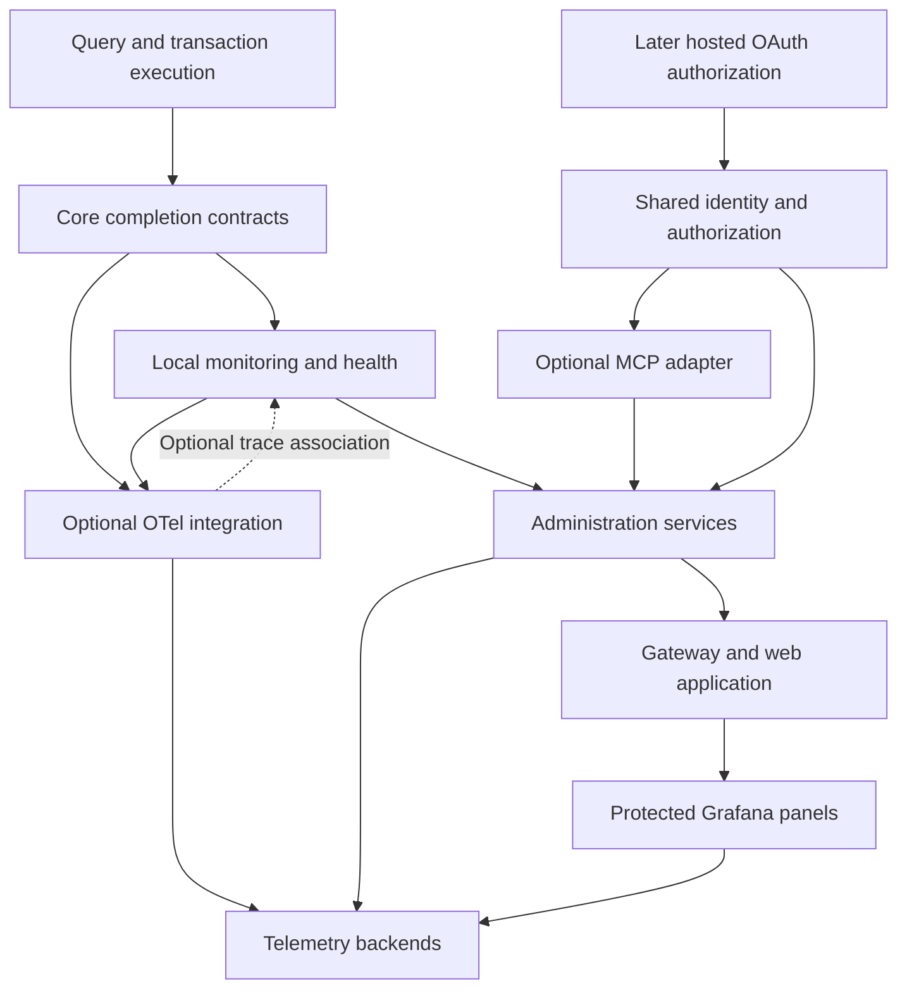

<!-- workflow-sha: 6c1e9a303e3d24c392c844805ecec8aae5ef5677 -->
# YTDB-496 OpenTelemetry support — Implementation plan

## Design Document

- [design.md](design.md) defines the accepted capabilities and boundaries.
- [design-mechanics.md](design-mechanics.md) defines their mechanisms and verification requirements.

This plan covers OpenTelemetry (OTel), local monitoring, administration, the web application and Model Context Protocol (MCP) access.
OTel provides standard interfaces for traces, logs and metrics.
A Collector receives, processes and forwards exported signals.
Docker Compose defines and starts the example's containers together.

A span records one timed operation and its attributes.
OpenTelemetry Context carries the active span and related values across execution boundaries.
MCP lets agent clients call authorized services and read monitoring events.

The user approved this plan structure on 2026-11-09.
The plan contains the complete track list and cross-track decisions.
Each later implementation track writes its detailed track file when it starts.
This is the approved exception to the older process.
Detailed track files remain deferred until their implementation tracks start.

A software development kit (SDK) supplies the protocol libraries used by an integration.
An application programming interface (API) defines how software components call each other.

Gremlin is the graph query language used by YouTrackDB.
SQL means Structured Query Language.
Explain plans a query without executing it.
Profile executes a query with execution measurements.
OAuth lets a user grant restricted access to a client.

Option A uses server-issued, opaque credentials for individual MCP clients.
Option B adds hosted OAuth 2.1 authorization later.
A benchmark fixture defines a workload, dataset and configuration.
An arm is one configuration side of a benchmark comparison.
Off means no telemetry listener, local-capture listener or log hook.

A monitoring owner holds state for one engine activation or database instance.
Its generation is a never-reused identifier for that owner's position sequence.
Within a process, generations increase in allocation order.
See [Generations, history and shutdown](design-mechanics.md#generations-history-and-shutdown).

An authorization lease is a permission decision with a finite deadline.
A gateway forwards authorized requests between clients and internal services.
Transport Layer Security (TLS) encrypts and authenticates network connections.
Grafana displays protected telemetry panels.
A backend stores or queries exported telemetry.

A heartbeat gate lets the first successful query completion after an interval bypass the slow-query gate.
Gates select span candidates before SDK sampling, which can still reject them.
See [Time-based sampling](design-mechanics.md#time-based-sampling) and the [SDK sampling contract](design-mechanics.md#sdk-sampling-contract).

Bounded SQL children are nested SQL observations buffered under finite limits until the Gremlin parent is created.
Only a recording, sampled Gremlin parent permits their construction as child spans.
Each child still receives its own SDK sampling decision.
See [Buffered SQL children](design-mechanics.md#buffered-sql-children).

## Delivery summary

A pull request (PR) is the unit reviewed and merged.
PR #1108 carries the first delivery only.
A new change and PR carry the second delivery.
Every accepted goal remains assigned.

| Delivery | Implementation identifiers |
|---|---|
| First, PR #1108 | I1 to I9, I17a, I21a, I22a |
| Second, new change and PR | I10 to I16, I17b, I18 to I20, I21b, I22b, I23 |

I17, I21 and I22 remain parent scope labels.
Their suffixes identify delivery parts, not new parent identifiers.
A parent is complete only when both parts are complete.
Later issues must name exact parts and must not close a parent after only one part.
Historical design-track identifiers remain separate from implementation identifiers.

## Component Map

Arrows show the complete accepted observation or service flow, not implementation or delivery order.
The gateway, local health and administration paths belong to the second delivery.
I21a uses Grafana login directly under the approved exception below.

Core monitoring does not depend on OTel, Grafana or MCP.
Browser and MCP access share authorization and admission rules.
An admission rule decides whether bounded capacity permits work to start.

Administration telemetry routes and Grafana traffic share backend limits and accounting.
Investigation uses one privacy rule across trace, log and local monitoring capture.

### Component ownership

- Query and transaction contracts belong to I2.
  Query identity and privacy belong to I3.
  Gremlin capture belongs to I4.
  SQL completion belongs to I5.
- The optional OTel integration belongs to I6 to I9.
  I6 owns configuration and SDK ownership.
  I7 owns traces, I8 owns correlated logs and I9 owns metrics and loss visibility.
- Local monitoring belongs to I10 to I12.
  I10 owns lifecycle and retained slow queries.
  I11 owns health and history.
  I12 owns optional trace association and health export.
- Shared identity, authorization and admission belong to I13.
  I14 owns local reads and streams.
  I15 owns investigation.
  I16 owns gateway forwarding, telemetry routes and protected Grafana access.
- I17a owns OTel server lifecycle and distribution packaging.
  I17b owns remaining lifecycle, final-health ordering and the investigation gate.
  I18 owns the monitoring web application.
  I19 owns first-phase MCP credentials.
  I20 owns MCP tools, events and optional server packaging.
  I23 owns later hosted OAuth authorization.
- I21a owns the local OTel stack and OTel guide.
  I21b owns the remaining monitoring stack and guide.
  I1 establishes benchmark comparisons.
  I22a completes OTel measurements.
  I22b completes local-only and combined measurements.

## Checklist

The identifiers I1 to I23 name implementation work, not completed design-authoring tracks.
Every entry is **not started**.
Dependencies are prerequisites for completion and preserve enablement gates.
Each track includes its own tests and relevant documentation.
Entries keep accepted identifier order, not delivery order.
Delivery labels identify the owning PR.

Risk labels name the proved areas:

- **C:** Concurrency defect, where overlapping executions can break a contract or stop required progress.
- **S:** Security weakness, where an actor can break a security property.
- **P:** Performance degradation, where work misses a stated latency, throughput or resource requirement.
- **L:** Unreadable user-facing prose, where readers cannot decide or complete their task.

- [ ] Track I1: Benchmark baseline and comparison tooling
  > **Delivery:** First
  > **Scope:** Establish compatible off fixtures before execution-path changes. Add validated comparisons, complete report identity, history handling and the accepted nightly self-comparison fix.
  > **Depends on:** None
  > **Risks:** P, L

- [ ] Track I2: Core listener contracts
  > **Delivery:** First
  > **Scope:** Add global registration, stable operation snapshots, completion details and listener isolation.
  > **Depends on:** I1
  > **Risks:** C, P

- [ ] Track I3: Query identity and privacy
  > **Delivery:** First
  > **Scope:** Add SQL classification, safe text rendering, parameter rules and query-text limits.
  > **Depends on:** I2
  > **Risks:** S, P

- [ ] Track I4: Gremlin capture and provenance
  > **Delivery:** First
  > **Scope:** Add classification, tags, timing, context and Explain or Profile completion details.
  > **Depends on:** I2
  > **Risks:** C, P

- [ ] Track I5: SQL completion boundary
  > **Delivery:** First
  > **Scope:** Cover cached, uncached, command and script paths with the completion order defined by D3.
  > **Depends on:** I2, I3, I4
  > **Risks:** C, P

- [ ] Track I6: OTel module and SDK lifecycle
  > **Delivery:** First
  > **Scope:** Add dependencies, configuration, ownership resolution and close-once lifecycle behavior under D4. Hide all credential-bearing OTel settings in configuration dumps, including exporter headers. Measure actual close time with pending test spans and recorded test instruments registered through the SDK API. Include an unreachable backend with metrics enabled. Record report-only results in the detailed track file.
  > **Depends on:** I2
  > **Risks:** C, S, P

- [ ] Track I7: Trace production and gates
  > **Delivery:** First
  > **Scope:** Add query and commit spans, threshold and heartbeat gates, sampling and bounded SQL children. Apply the shared investigation privacy rule.
  > **Depends on:** I3, I4, I5, I6
  > **Risks:** C, S, P

- [ ] Track I8: Correlated log export
  > **Delivery:** First
  > **Scope:** Add guarded log capture, context correlation, severity rules and body privacy. Apply the shared investigation privacy rule.
  > **Depends on:** I6, I7
  > **Risks:** C, S, P

- [ ] Track I9: Metrics and loss visibility
  > **Delivery:** First
  > **Scope:** Add profiler instruments, query histograms, signal switches and SDK loss visibility.
  > **Depends on:** I2, I6, I7
  > **Risks:** C, P

- [ ] Track I10: Monitoring owners and slow-query retention
  > **Delivery:** Second
  > **Scope:** Establish owners, generations and atomic non-waiting close start before retaining records. Add close-time reservation release, independent capture controls, bounded admission and visible loss. Apply the shared investigation privacy rule.
  > **Depends on:** I2, I3, I4, I5
  > **Risks:** C, S, P

- [ ] Track I11: Health state and history
  > **Delivery:** Second
  > **Scope:** Add observations, ordered state and paired history on the existing owners. Add non-waiting final publication.
  > **Depends on:** I10
  > **Risks:** C, P

- [ ] Track I12: Local trace association and health export
  > **Delivery:** Second
  > **Scope:** Add bounded trace associations, closure-aware atomic health handoffs and enabled-signal export under D5.
  > **Depends on:** I7, I8, I9, I10, I11
  > **Risks:** C, P

- [ ] Track I13: Shared administration authority
  > **Delivery:** Second
  > **Scope:** Add typed identities, browser sessions, current permission checks, leases and shared admission. Own exact-grant default-deny, cross-site request forgery (CSRF) protection, origin checks, listener TLS and security-ready startup. Disable request-body and sensitive-header logging at the listener.
  > **Depends on:** I2
  > **Risks:** C, S, P

- [ ] Track I14: Administration local reads and streams
  > **Delivery:** Second
  > **Scope:** Add local reads, integrity-protected cursors, bounded streams and lifecycle resets. Do not open telemetry routes here.
  > **Depends on:** I10, I11, I13
  > **Risks:** C, S, P

- [ ] Track I15: Safe query investigation
  > **Delivery:** Second
  > **Scope:** Add caller-bound Explain and Profile, explicit Profile confirmation, cache isolation and internal limits. Add the dedicated bounded worker pool outside the YouTrackDB thread-group hierarchy and restart-safe capacity accounting. Enforce shared capture suppression and shutdown cancellation. Own tests of all accepted limits, including memory, and read-only enforcement in the shared server service.
  > **Depends on:** I3, I5, I7, I8, I10, I13, I14
  > **Risks:** C, S, P

- [ ] Track I16: Gateway, telemetry routes and protected Grafana
  > **Delivery:** Second
  > **Scope:** Own telemetry routes together with backend limits and shared accounting. Add trusted response leases, stream renewals, bounded forwarding and route restrictions. Own the narrow `/mcp` pass-through route and its header and mutual TLS rules below. Disable request-body and sensitive-header logging at the gateway. Keep disabled OAuth paths out of web fallback handling.
  > **Depends on:** I13, I14
  > **Risks:** C, S, P

- [ ] Track I17: Server wiring and packaging
  > **Completion:** Both I17a and I17b.

- [ ] Part I17a: OTel server wiring and packaging
  > **Delivery:** First
  > **Scope:** Start and stop the optional OTel integration in the server. Include its libraries in the standard distribution and Docker image. Verify default-disabled activation, dependency notices and distribution size growth. Repeat D4's close-time measurement with production signals wired. Apply the I17a close rules below.
  > **Depends on:** I6, I8, I9
  > **Risks:** C, S

- [ ] Part I17b: Remaining server wiring and investigation gate
  > **Delivery:** Second
  > **Scope:** Integrate local monitoring and administration lifecycle. Add owner-close and final-health ordering. Prove investigation teardown safety and enforce the shared server-side enablement gate. Require I15's proof of all limits and read-only enforcement before opening it.
  > **Depends on:** I17a, I12, I14, I15, I16
  > **Risks:** C, S

- [ ] Track I18: Monitoring web application
  > **Delivery:** Second
  > **Scope:** Add local views, protected panels, explicit investigation consent and failure states. Respect the shared server-side I17b gate before enabling investigation forms.
  > **Depends on:** I14, I15, I16, I17b
  > **Risks:** S, L

- [ ] Track I19: MCP option A credentials
  > **Delivery:** Second
  > **Scope:** Add shared credential storage, verifier checks, per-client revocation and protected token management. Reject MCP bearers on administration routes. Require recent re-authentication before token creation. Require token expiry and reject nonpositive or unbounded expiry. Own bounded failed-bearer rate limiting before verifier work.
  > **Depends on:** I13, I18
  > **Risks:** C, S, P

- [ ] Track I20: MCP tools and experimental events
  > **Delivery:** Second
  > **Scope:** Add the pinned transport adapter, authorized tools, cursor mapping and bounded cancellation. Join shared limits and the server-side investigation gate. Own per-client sub-quotas inside shared identity budgets. Disable request-body and sensitive-header logging in the MCP listener adapter. Add optional MCP server packaging. Enforce D6 while option B is off.
  > **Depends on:** I14, I15, I16, I17b, I19
  > **Risks:** C, S, P, L

- [ ] Track I21: Quick start and operator documentation
  > **Completion:** Both I21a and I21b.

- [ ] Part I21a: OTel local quick start and guide
  > **Delivery:** First
  > **Scope:** Deliver Docker Compose with YouTrackDB, an OTel Collector, Grafana, Tempo, Loki and Prometheus. Add provisioning, OTel-backed dashboards, signal smoke tests, scripts, configuration guidance and the OTel user guide. Use Grafana's own protected login under the approved exception below. Include no gateway, administration application or MCP. Deliver Overview, Queries, Storage and Logs dashboards. Use the pinned components' local-only default backend query limits. I21a claims no limit of its own and sets no new YouTrackDB limit value. Keep pinned component defaults. The guide names each pinned component with no default bound for a covered query dimension as a local-only exposure. Setting caps and disabling routes that cannot enforce a required limit wait for I16 and I21b. D7 root question 4 stays with I16.
  > **Depends on:** I17a
  > **Risks:** S, L

- [ ] Part I21b: Remaining monitoring quick start and guide
  > **Delivery:** Second
  > **Scope:** Add the application, gateway, administration and MCP integration. Withdraw the first-delivery exception and restore gateway-only Grafana with Viewer access. Complete the Health dashboard, local-monitoring checks, authorization and revocation checks, export-independent operation checks and their documentation. Keep MCP internal behind the gateway. Complete the second-delivery smoke checks below.
  > **Depends on:** I21a, I17b, I18, I20
  > **Risks:** S, L

- [ ] Track I22: Final accepted measurement matrix
  > **Completion:** Both I22a and I22b.

- [ ] Part I22a: OTel measurement matrix
  > **Delivery:** First
  > **Scope:** Complete all accepted off and OTel-enabled measurements for the I1 to I9 paths, including scans, tag resolution and logs. Preserve diagnostic measurements and comparison rules. Apply the full I22a matrix below.
  > **Depends on:** I1, I7, I8, I9
  > **Risks:** C, P, L

- [ ] Part I22b: Remaining measurement matrix
  > **Delivery:** Second
  > **Scope:** Complete local-capture-only and combined local-capture-plus-OTel measurements. Complete associated retention, publication, cursor and slow-consumer validation.
  > **Depends on:** I22a, I10, I12
  > **Risks:** C, P, L

- [ ] Track I23: MCP option B hosted OAuth
  > **Delivery:** Second
  > **Scope:** Add the specified authorization server, client validation, refresh protection and deployment guidance. Require recent re-authentication before consent.
  > **Depends on:** I19, I20, I21b, I22b
  > **Risks:** C, S, P, L

## Sequencing

### Benchmark sequencing

I1 is the first track and has no implementation dependency.

Every track that changes a frequently executed path runs its own applicable benchmark arms.
It compares against the established compatible baseline.
It does not wait for I22a or I22b to discover regressions.

Keep base and candidate comparisons compatible.
A missing compatible arm produces an inconclusive result, not a substitute workload.
As capture capabilities arrive, measure their applicable enabled arms.
Include local-only capture without requiring OTel export.

I22a completes the OTel matrix, and I22b completes the local-only and combined matrix.
Neither part depends on server wiring, the web application or MCP.

Benchmark results remain report-only as accepted.
An inconclusive measurement stays visible and never becomes a pass.
Proposed budgets remain proposed until approved.

### Owner and capture sequencing

I10 establishes owner lifecycle before admitting retained records.
It binds work to the owner active at operation start.
Late completion cannot enter a replacement database owner.

Close marks that owner closed before cleanup releases reservations.
I11 then adds health state and history.
I12 adds correlation and export without creating a second lifecycle authority.

I7, I8 and I10 apply one shared investigation privacy rule.
I15 depends on all three.
Investigation statements and parameters stay out of traces, logs and monitoring records.
The rule also covers request-body and error logging.

I13 disables request-body and sensitive-header logging at the listener.
I16 enforces that ban at the gateway, and I20 preserves it in the MCP adapter.
I13 owns `Cache-Control: no-store` on sensitive administration responses.
I20 owns that header on sensitive MCP responses.
I16 preserves those headers and never caches MCP results in the gateway.

Query completion may construct and end spans and enqueue them through SDK processors as required by the accepted design.
It performs no network requests, backend queries, event delivery, health evaluation or health and export delivery.
Observation handoffs remain bounded and non-waiting.
I7 to I12 preserve that boundary for capture and export.
I14 and I20 deliver events outside query completion and serve already evaluated health.
Reader count must not increase query-completion work.

### Security and route sequencing

I13 owns the shared controls before the first administration route opens.

Exact-grant checks default to deny.
Broad wildcard grants do not satisfy permissions that require an explicit grant.

Cookie-authenticated access includes cross-site request forgery (CSRF) protection.
It also validates the configured origin.
TLS protects the listener.
The listener starts only after security services are ready.

I14 opens local reads and streams only after those controls exist.
I16 alone owns telemetry routes, their backend limits and their shared accounting.
No telemetry route opens before I16 completes.
Later MCP telemetry access joins that same boundary.

I16 owns the narrow pass-through route to the configured `/mcp` destination.
Preserve exactly one Authorization bearer header to the listener over mutually authenticated TLS.
Reject duplicate, folded or conflicting Authorization fields before dispatch.
Strip caller identity and forwarding headers, cookies and browser CSRF headers.

Replace forwarding values only from the trusted peer.
Never convert gateway or browser authority into MCP authority.
Never forward the bearer to Grafana, telemetry stores or another path.
Strip Authorization on every non-MCP gateway route.
I20 supplies the authenticated MCP endpoint behind this route, not a second gateway.

I19 owns administration-route rejection of MCP bearer credentials.
It also owns recent re-authentication before option A token creation and mandatory finite token expiry.
I19 rate-limits failed bearer attempts by source and bounded lookup identifier before verifier work.
Source admission precedes allocation of identifier state.

I20 owns per-client sub-quotas within shared per-identity budgets for tools, polls and streams.
These quotas add no identity capacity and preserve reserved client-management capacity.
I23 owns recent re-authentication before option B consent.

I16 and I20 enforce disabled discovery behavior at their routing boundaries.
Neither page fallback nor transport defaults may advertise option B while it is off.

### Delivery order

I15 first proves all accepted investigation limits and read-only enforcement.
I17b then proves teardown safety before opening the shared server-side gate.
I18 and I20 respect that gate for web and MCP investigation.
Moving optional MCP packaging to I20 avoids a dependency loop through the web application and token management.

Delivery order is:

1. Track 107 completes this split before implementation.
2. I1 starts implementation.
3. I1 to I9, I17a, I21a and I22a complete and merge in PR #1108.
4. A new change and PR carry I10 to I16, I17b, I18 to I20, I21b, I22b and I23.

Within the second delivery, option A precedes option B.
I23 follows I21b and I22b and does not block option A.

I1 has no prerequisite.
Every dependency of I2 to I9 stays within I1 to I9.
I17a depends only on I6, I8 and I9.
I21a depends only on I17a.
I22a depends only on I1, I7, I8 and I9.
No first-delivery part depends on second-delivery work.

Check the complete graph for cycles and all parts for assigned capability coverage.
External translation and cache prerequisites remain visible in Design reference mapping.
This split does not prove that those prerequisites are satisfied.

Security and concurrency tests belong to their implementation tracks.
Do not defer those tests to final measurement.

## Rule applicability by capability

D3 and D4 apply in the first delivery.
Keep shared privacy, sampling, signal-loss and query-completion boundaries for I1 to I9.

### I17a close rules

B6's ownership and close-once rules apply immediately.
Find B1 to B8 in these mechanics sections:

- B1: [Local monitoring](design-mechanics.md#local-monitoring).
- B2: [Slow-query admission and retention](design-mechanics.md#slow-query-admission-and-retention).
- B4: [Health evaluation and ordered publication](design-mechanics.md#health-evaluation-and-ordered-publication).
- B3 and B5 to B8: [Generations, history and shutdown](design-mechanics.md#generations-history-and-shutdown).

D4 supplies the accepted close-duration correction.

- Close only a YouTrackDB-owned SDK.
- Close each SDK instance once.
  A concurrent or later close caller returns without closing it again.
- Disable the owned SDK's independent shutdown hook.
  Do not depend on the order of independent Java Virtual Machine (JVM) shutdown hooks.
- Keep SDK close outside facade resolution synchronization and engine, factory, storage and monitoring locks.
- Add no outer retry, second flush, custom drain or YouTrackDB close deadline.
- Repeat D4's report-only measurement with pending production signals.
  Include an unreachable backend with metrics enabled.
- Do not claim that a returned close proves complete export or that all workers stopped.

B1 to B5 and B8 define monitoring-owner and health behavior.
Their owner-close, final-publication and reader obligations belong to the second delivery.
I17a must not invent health owners or promise final health.
B7's final-health rule belongs to the second delivery.
Its warning against guaranteed export also applies now.

D1's investigation workers and enablement gate belong to the second delivery.
So do D2's gateway leases, D5's health handoff and D6's MCP OAuth routing.
D6 keeps option A before option B within that delivery.

D7 remains the rule for unresolved defaults.
Root questions 1 to 5 do not block the stated first delivery.
This does not waive accepted OTel limits or permit new unapproved defaults.

### I6 credential-bearing configuration

A configuration dump lists runtime settings for diagnosis.
I6 marks every OTel setting that can carry credentials as hidden in configuration dumps.
Exporter headers, such as `OPENTELEMETRY_EXPORTER_HEADERS`, are one example.
They carry metadata with export requests and can include access tokens.
Hidden settings must not reveal their values in startup or signal-triggered dumps.

## I22a measurement obligations

I22a completes the accepted OTel matrix, not a single off-versus-export comparison.
JMH means Java Microbenchmark Harness.
See [JMH benchmark gate](design-mechanics.md#jmh-benchmark-gate).

Path A is translated Gremlin execution.
Path B is fallback Gremlin execution.
LIGHTWEIGHT timing includes consumer idle time in the gate input.
EXACT timing measures active execution intervals and excludes consumer idle time.
INFO is the informational log severity.

| Family | First-delivery measurements |
|---|---|
| Off | Tiny queries and scans without telemetry listeners, local-capture listeners or log hooks |
| Mostly rejected queries | Direct SQL, translated Gremlin Path A and fallback Path B, in LIGHTWEIGHT and EXACT timing modes |
| Emit-all queries | The same paths and modes, including the accepted Path B SQL child |
| Scans | Fully consumed 10,000-row scans for all three paths and both timing modes |
| Concurrent tags | LIGHTWEIGHT Gremlin at 1 and 8 threads, with repeated and distinct tags and early, late and absent rule matches |
| Logs | The accepted admitted INFO workload at 1 and 8 threads |

Keep histograms enabled in OTel query arms and local capture off.
Keep the accepted sampling, child-buffer, fixture and rejection rules.
Mostly rejected arms must reject at least 99% of completions at their own duration gate.
Emit-all arms admit every completion at that gate, subject to the accepted SDK rules.
Use one accepted SQL child per Path B traversal, none on Path A and the default 128-entry buffer.

Concurrent-tag arms use 16 ordered rules and both 32 repeated tags and distinct short tags.
Keep heartbeat zero and transaction threshold overrides absent.
Logs use the accepted admitting log provider with body opt-in off.
Keep the collision-heavy diagnostic and SDK loss reconciliation outside timed measurement.

| Accepted throughput-loss alert budget | Limit |
|---|---|
| Off | 1% |
| LIGHTWEIGHT mostly rejected | 10% |
| LIGHTWEIGHT emit-all, SQL and Path A | 35% |
| LIGHTWEIGHT emit-all, Path B | 40% |
| EXACT scans, one timing layer | 30% |
| EXACT scans, layered Path B | 45% |
| Concurrent tags | 15%, independently for repeated and distinct variants at each thread count |
| Logs | 50% |

The EXACT tiny-query and LIGHTWEIGHT scan budgets remain proposals.
Run those accepted arms without presenting proposed budgets as approved limits.
Primary measurements use real SDK processors with immediate-success counting and discarding exporters.
These exporters count and discard signals without network variance.
Also run the accepted healthy-Collector diagnostic with actual OTel Protocol export.

Keep matched off denominators, confidence rules, full result identity and history handling.
Missing, invalid or noisy evidence is inconclusive, never a pass.
Budget breaches remain report-only.
Execution and artifact failures retain their normal failure behavior.

Local-only and combined arms belong to I22b.
The accepted matrix specifies no separate commit benchmark arm.
Applicable correctness tests and D4 close measurements still apply.
I2 to I9 run applicable measurements as their capabilities arrive.
I22a does not postpone that work.

## Approved first-delivery quick-start exception

The user approved this plan-only exception on 2026-11-13.
The accepted design files remain unchanged.
Do not start Mutation 113.
I21a delivers a local development and smoke-test example, not a production deployment.

### Second-delivery sections

These complete sections bind only their second-delivery owners:

| Accepted section | Exact lines | Owners |
|---|---|---|
| Administration API and web application | `design.md:2141-2348` | I13, I14, I15, I16, I18, I21b |
| MCP module and authorization | `design.md:2349-2539` | I16, I19, I20, I23, I21b |
| Administration API and web application | `design-mechanics.md:1418-1817` | I13, I14, I15, I16, I18, I21b |
| MCP module and authorization | `design-mechanics.md:1818-2383` | I16, I19, I20, I23, I21b |

Each range starts at its level-two heading and ends before the next level-two heading.
I21a implements none of their accepted sentences except rows marked STAYS BINDING below.
Retained controls in PARTLY REPLACED rows also bind I21a where they apply to its local stack.
They do not require I21a to implement a second-delivery component.
I21b restores gateway-only Grafana and all second-delivery obligations.

### Sentence classification

For the first delivery, replace only the conflicting part identified in each row.
STAYS BINDING rows add to the retained controls below.
SECOND DELIVERY rows remain accepted requirements of their named owners, not requirements to implement in I21a.
REPLACED rows substitute the stated first-delivery behavior.
PARTLY REPLACED rows keep the stated nonconflicting part.

An ID gives the frozen file, starting line and sentence number on that line.
The words after each ID identify the sentence.
Sentences split at terminal punctuation followed by whitespace, excluding backticked text and numbered-list markers.
Headings, code fences and table separators are not sentences.
Table records and short labels are included to make the outside-section inventory complete.

The inventory covers `design.md:17-25,86-96,158-160,2540-2614,2655-2678`
and `design-mechanics.md:2384-2418,2522-2558`.
It also includes `design.md:2682.s1-s2`, which describe the baseline dashboards and Health transitions.
Inside the four sections it includes every sentence matching Grafana, anonymous, port, loopback, TLS,
Viewer, Admin, data source, rate, limit, fail closed or smoke.
Matching ignores case and includes plural and hyphenated forms.
Adjacent gateway and backend-limit sentences are included even when they have no keyword.

Backend query limits in I21a are the pinned components' default limits, not new YouTrackDB limits.
The guide calls them local-only defaults and makes no limit claim of its own.
I21a sets no new YouTrackDB limit value and keeps the pinned component defaults.

Setting caps and disabling routes that cannot enforce a required limit wait for I16 and I21b.
I21a need not disable a route solely because its pinned component lacks a default bound.
The guide names each such component and covered query dimension as a local-only exposure.
The duty to disable unsupported expensive search routes stays binding.
D7 and root question 4 remain open with I16 as the backend-limit owner.

| ID | Class | Owner | Replaced part | Kept part |
|---|---|---|---|---|
| `design.md:17.s1` The unified monitoring direction places | PARTLY REPLACED | I12, I21a, I21b | Local state waits for the second delivery. | Exported telemetry remains first-delivery scope. |
| `design.md:18.s1` The quick start uses grafana/otel-lgtm | PARTLY REPLACED | I21a, I21b | Web application waits for I21b. | Pinned telemetry stack and YouTrackDB ship in I21a. |
| `design.md:19.s1` The application embeds Grafana panels | SECOND DELIVERY | I18, I21b | None. | Application embedding and gateway stay in the second delivery. |
| `design.md:20.s1` A separate administration HTTP listener | SECOND DELIVERY | I13, I16, I18, I20, I21b | None. | Entire sentence in the second delivery. |
| `design.md:21.s1` Browser sessions and YouTrackDB roles | PARTLY REPLACED | I13, I16, I21b | Grafana session and role protection becomes its own Admin login. | API session and role protection stays second-delivery scope. |
| `design.md:22.s1` The core database stays independent | STAYS BINDING | I21a | None. | Entire sentence. |
| `design.md:23.s1` The optional Model Context Protocol | SECOND DELIVERY | I13, I16, I18, I20, I21b | None. | Entire sentence in the second delivery. |
| `design.md:24.s1` Per-client MCP tokens and current | SECOND DELIVERY | I13, I16, I18, I20, I21b | None. | Entire sentence in the second delivery. |
| `design.md:25.s1` OAuth is a delegated authorization | SECOND DELIVERY | I13, I16, I18, I20, I21b | None. | Entire sentence in the second delivery. |
| `design.md:86.s1` The quick start under youtrackdb-opentelemetry/examples/docker-compose/ | STAYS BINDING | I21a | None. | Entire sentence. |
| `design.md:88.s1` LGTM names those four telemetry | STAYS BINDING | I21a | None. | Entire sentence. |
| `design.md:88.s2` The complete stack also needs | PARTLY REPLACED | I21a, I21b | Web application waits for I21b. | Pinned telemetry stack and YouTrackDB ship in I21a. |
| `design.md:90.s1` Example files alone are not | STAYS BINDING | I21a | None. | Entire sentence. |
| `design.md:91.s1` Publish host ports on loopback | STAYS BINDING | I21a | None. | Entire sentence. |
| `design.md:92.s1` Provision overview, queries, storage, logs | PARTLY REPLACED | I21a, I21b | Health dashboard waits for I21b. | Four OTel dashboards ship in I21a. |
| `design.md:93.s1` Core stays independent of Grafana. | STAYS BINDING | I21a | None. | Entire sentence. |
| `design.md:93.s2` The application embeds Grafana panels. | SECOND DELIVERY | I18, I21b | None. | Application embedding and gateway stay in the second delivery. |
| `design.md:94.s1` Production can operate the backends | STAYS BINDING | I21a | None. | Entire sentence. |
| `design.md:95.s1` A planned scripts/smoke.sh checks exported | PARTLY REPLACED | I21a, I21b | Independent local-monitoring checks wait for I21b. | Exported-signal smoke checks ship in I21a. |
| `design.md:96.s1` A separate user manual is | STAYS BINDING | I21a | None. | Entire sentence. |
| `design.md:158.s1` Same-origin gateway. The web container | PARTLY REPLACED | I16, I18, I21b | Gateway authentication of Grafana becomes its own protected login. | Static assets and administration forwarding stay second-delivery scope. |
| `design.md:159.s1` One browser origin avoids a | REPLACED | I16, I21b | Use Grafana's own protected Admin login in I21a. | None. I21b restores the accepted sentence. |
| `design.md:160.s1` It is not a second | SECOND DELIVERY | I13, I16, I18, I20, I21b | None. | Entire sentence in the second delivery. |
| `design.md:160.s2` → §"Administration API and web | SECOND DELIVERY | I13, I16, I18, I20, I21b | None. | Entire sentence in the second delivery. |
| `design.md:2542.s1` TL;DR. A pinned grafana/otel-lgtm release | STAYS BINDING | I21a | None. | Entire sentence. |
| `design.md:2543.s1` YouTrackDB and the web application | PARTLY REPLACED | I21a, I21b | Web application waits for I21b. | Pinned telemetry stack and YouTrackDB ship in I21a. |
| `design.md:2544.s1` Local state works independently of | SECOND DELIVERY | I13, I16, I18, I20, I21b | None. | Entire sentence in the second delivery. |
| `design.md:2544.s2` Provision five Grafana dashboards. | PARTLY REPLACED | I21a, I21b | Health dashboard waits for I21b. | Four OTel dashboards ship in I21a. |
| `design.md:2545.s1` The web container provides the | SECOND DELIVERY | I18, I21b | None. | Application embedding and gateway stay in the second delivery. |
| `design.md:2545.s2` Core stays independent of Grafana. | STAYS BINDING | I21a | None. | Entire sentence. |
| `design.md:2547.s1` The complete delivery includes database | SECOND DELIVERY | I13, I16, I18, I20, I21b | None. | Entire sentence in the second delivery. |
| `design.md:2548.s1` The setup files live under | STAYS BINDING | I21a | None. | Entire sentence. |
| `design.md:2549.s1` Keep example files outside Maven | STAYS BINDING | I21a | None. | Entire sentence. |
| `design.md:2550.s1` An optional label-gated CI smoke | STAYS BINDING | I21a | None. | Entire sentence. |
| `design.md:2551.s1` Publish every host port on | STAYS BINDING | I21a | None. | Entire sentence. |
| `design.md:2552.s1` Generate credentials at first start | STAYS BINDING | I21a | None. | Entire sentence. |
| `design.md:2553.s1` Use owner-only permissions on that | STAYS BINDING | I21a | None. | Entire sentence. |
| `design.md:2554.s1` Mount credential files only into | STAYS BINDING | I21a | None. | Entire sentence. |
| `design.md:2554.s2` Do not commit fixed credentials. | STAYS BINDING | I21a | None. | Entire sentence. |
| `design.md:2555.s1` Never print credentials in container | STAYS BINDING | I21a | None. | Entire sentence. |
| `design.md:2556.s1` Set GF_AUTH_ANONYMOUS_ENABLED=false explicitly. | STAYS BINDING | I21a | None. | Entire sentence. |
| `design.md:2556.s2` Do not publish Grafana's port | REPLACED | I21a, I21b | Publish only Grafana's TLS login port on loopback. | I21b removes that host mapping. |
| `design.md:2557.s1` Reach Grafana only through the | REPLACED | I16, I21b | Use Grafana's own protected Admin login in I21a. | None. I21b restores the accepted sentence. |
| `design.md:2558.s1` Use the administration session and | REPLACED | I16, I21b | Use Grafana's own protected Admin login in I21a. | None. I21b restores the accepted sentence. |
| `design.md:2560.s1` Use pinned, tested releases and | STAYS BINDING | I21a | None. | Entire sentence. |
| `design.md:2560.s2` Select the exact LGTM release | STAYS BINDING | I21a | None. | Entire sentence. |
| `design.md:2561.s1` Do not invent a release | STAYS BINDING | I21a | None. | Entire sentence. |
| `design.md:2563.s1` Component Deployment Role | STAYS BINDING | I21a | None. | Entire sentence. |
| `design.md:2565.s1` LGTM grafana/otel-lgtm, pinned tested release | STAYS BINDING | I21a | None. | Entire sentence. |
| `design.md:2566.s1` YouTrackDB Matching database build Local | STAYS BINDING | I21a | None. | Entire sentence. |
| `design.md:2567.s1` Web application React and TypeScript | SECOND DELIVERY | I13, I16, I18, I20, I21b | None. | Entire sentence in the second delivery. |
| `design.md:2569.s1` OTLP ports 4317 and 4318 | STAYS BINDING | I21a | None. | Entire sentence. |
| `design.md:2570.s1` Publish the application's TLS entry | SECOND DELIVERY | I13, I16, I18, I20, I21b | None. | Entire sentence in the second delivery. |
| `design.md:2571.s1` Keep Grafana, Loki, Prometheus and | PARTLY REPLACED | I21a, I21b | Publish Grafana's TLS login port on loopback. | Loki, Prometheus and Tempo stay internal without host mappings. |
| `design.md:2572.s1` Smoke checks use internal container-network | STAYS BINDING | I21a | None. | Entire sentence. |
| `design.md:2574.s1` Grafana decision. The default YTDB-owned | STAYS BINDING | I21a | None. | Entire sentence. |
| `design.md:2575.s1` The local stack uses Tempo | STAYS BINDING | I21a | None. | Entire sentence. |
| `design.md:2576.s1` Production may operate these services | STAYS BINDING | I21a | None. | Entire sentence. |
| `design.md:2577.s1` Exporter selection and host-owned SDK | STAYS BINDING | I21a | None. | Entire sentence. |
| `design.md:2578.s1` The application embeds Grafana panels. | SECOND DELIVERY | I18, I21b | None. | Application embedding and gateway stay in the second delivery. |
| `design.md:2578.s2` The database core does not | STAYS BINDING | I21a | None. | Entire sentence. |
| `design.md:2579.s1` Shipped dashboards and first-class setup | STAYS BINDING | I21a | None. | Entire sentence. |
| `design.md:2581.s1` Five dashboard JSON files serve | PARTLY REPLACED | I21a, I21b | Health dashboard waits for I21b. | Four OTel dashboards ship in I21a. |
| `design.md:2582.s1` JSON means JavaScript Object Notation. | STAYS BINDING | I21a | None. | Entire sentence. |
| `design.md:2582.s2` Import maps data source inputs | STAYS BINDING | I21a | None. | Entire sentence. |
| `design.md:2583.s1` Trace views use Tempo. | STAYS BINDING | I21a | None. | Entire sentence. |
| `design.md:2583.s2` Latency, rate and count panels | STAYS BINDING | I21a | None. | Entire sentence. |
| `design.md:2584.s1` Keep instance-specific unique identifiers (UIDs) | STAYS BINDING | I21a | None. | Entire sentence. |
| `design.md:2586.s1` Operators author dashboard JSON outside | STAYS BINDING | I21a | None. | Entire sentence. |
| `design.md:2586.s2` The gateway exposes no editing | SECOND DELIVERY | I13, I16, I18, I20, I21b | None. | Entire sentence in the second delivery. |
| `design.md:2587.s1` Provision these dashboards under grafana/dashboards/: | STAYS BINDING | I21a | None. | Entire sentence. |
| `design.md:2589.s1` - Overview — metric-backed public-query | STAYS BINDING | I21a | None. | Entire sentence. |
| `design.md:2589.s2` The selected trace source shows | STAYS BINDING | I21a | None. | Entire sentence. |
| `design.md:2589.s3` Loki supplies error-log rate and | STAYS BINDING | I21a | None. | Entire sentence. |
| `design.md:2590.s1` - Queries — per-operation breakdown | STAYS BINDING | I21a | None. | Entire sentence. |
| `design.md:2591.s1` - Storage — the six | STAYS BINDING | I21a | None. | Entire sentence. |
| `design.md:2593.s1` - Logs — bounded-time searches | STAYS BINDING | I21a | None. | Entire sentence. |
| `design.md:2593.s2` Search covers exported content only. | STAYS BINDING | I21a | None. | Entire sentence. |
| `design.md:2594.s1` - Health — exported health | SECOND DELIVERY | I13, I16, I18, I20, I21b | None. | Entire sentence in the second delivery. |
| `design.md:2594.s2` Missing or stale authority shows | SECOND DELIVERY | I13, I16, I18, I20, I21b | None. | Entire sentence in the second delivery. |
| `design.md:2594.s3` Database-owned current state and history | SECOND DELIVERY | I13, I16, I18, I20, I21b | None. | Entire sentence in the second delivery. |
| `design.md:2596.s1` Trace correlation uses Tempo's supported | STAYS BINDING | I21a | None. | Entire sentence. |
| `design.md:2596.s2` Logs correlate with the current | STAYS BINDING | I21a | None. | Entire sentence. |
| `design.md:2596.s3` They do not carry completion-built | STAYS BINDING | I21a | None. | Entire sentence. |
| `design.md:2598.s1` Operator deliverables alongside the stack: | STAYS BINDING | I21a | None. | Entire sentence. |
| `design.md:2600.s1` - README.md covers Docker Compose | STAYS BINDING | I21a | None. | Entire sentence. |
| `design.md:2603.s1` - sample-youtrackdb.properties sets OPENTELEMETRY_ENABLED=true, OPENTELEMETRY_LOGS_ENABLED=true | STAYS BINDING | I21a | None. | Entire sentence. |
| `design.md:2603.s2` Other settings keep their shipped | STAYS BINDING | I21a | None. | Entire sentence. |
| `design.md:2603.s3` Commented examples cover query threshold, | STAYS BINDING | I21a | None. | Entire sentence. |
| `design.md:2603.s4` These sample overrides do not | STAYS BINDING | I21a | None. | Entire sentence. |
| `design.md:2604.s1` - scripts/up.sh, down.sh, logs.sh and | STAYS BINDING | I21a | None. | Entire sentence. |
| `design.md:2605.s1` Smoke checks confirm traces, logs | STAYS BINDING | I21a | None. | Entire sentence. |
| `design.md:2606.s1` Also check log search, metric | PARTLY REPLACED | I21a, I21b | Health, events and local slow-query checks wait for I21b. | Log search, metric graphs and trace lookup ship in I21a. |
| `design.md:2607.s1` Explicitly enable local capture for | SECOND DELIVERY | I13, I16, I18, I20, I21b | None. | Entire sentence in the second delivery. |
| `design.md:2608.s1` The test override does not | SECOND DELIVERY | I13, I16, I18, I20, I21b | None. | Entire sentence in the second delivery. |
| `design.md:2609.s1` Check authenticated panels, denied telemetry | SECOND DELIVERY | I13, I16, I18, I20, I21b | None. | Entire sentence in the second delivery. |
| `design.md:2610.s1` Disable export or stop collection | SECOND DELIVERY | I13, I16, I18, I20, I21b | None. | Entire sentence in the second delivery. |
| `design.md:2611.s1` Fail with a diagnostic naming | STAYS BINDING | I21a | None. | Entire sentence. |
| `design.md:2613.s1` The planned user manual's "Connect | STAYS BINDING | I21a | None. | Entire sentence. |
| `design.md:2613.s2` It explains Collector endpoints, authentication | STAYS BINDING | I21a | None. | Entire sentence. |
| `design.md:2613.s3` The YTDB exporter settings or | STAYS BINDING | I21a | None. | Entire sentence. |
| `design.md:2613.s4` Those backends have no first-class | STAYS BINDING | I21a | None. | Entire sentence. |
| `design.md:2657.s1` The stack targets local development | STAYS BINDING | I21a | None. | Entire sentence. |
| `design.md:2657.s2` Three deliberate omissions an operator | STAYS BINDING | I21a | None. | Entire sentence. |
| `design.md:2659.s1` - No authentication on the | STAYS BINDING | I21a | None. | Entire sentence. |
| `design.md:2659.s2` A production Collector terminates TLS | STAYS BINDING | I21a | None. | Entire sentence. |
| `design.md:2659.s3` The example binds the receivers | STAYS BINDING | I21a | None. | Entire sentence. |
| `design.md:2660.s1` - No retention or storage | STAYS BINDING | I21a | None. | Entire sentence. |
| `design.md:2660.s2` Document the selected LGTM release's | STAYS BINDING | I21a | None. | Entire sentence. |
| `design.md:2660.s3` Local history and backend data | STAYS BINDING | I21a | None. | Entire sentence. |
| `design.md:2660.s4` Production needs its own storage, | STAYS BINDING | I21a | None. | Entire sentence. |
| `design.md:2661.s1` - No alerting rules. | STAYS BINDING | I21a | None. | Entire sentence. |
| `design.md:2661.s2` The example ships datasources and | STAYS BINDING | I21a | None. | Entire sentence. |
| `design.md:2661.s3` The "queries with error rate | STAYS BINDING | I21a | None. | Entire sentence. |
| `design.md:2661.s4` The example's README points at | STAYS BINDING | I21a | None. | Entire sentence. |
| `design.md:2665.s1` Choose grafana/otel-lgtm for the local | STAYS BINDING | I21a | None. | Entire sentence. |
| `design.md:2666.s1` Tempo provides trace lookup in | STAYS BINDING | I21a | None. | Entire sentence. |
| `design.md:2667.s1` Loki retains exported logs and | STAYS BINDING | I21a | None. | Entire sentence. |
| `design.md:2668.s1` Prometheus supplies observed runtime measurements. | STAYS BINDING | I21a | None. | Entire sentence. |
| `design.md:2669.s1` The complete quick start includes | SECOND DELIVERY | I13, I16, I18, I20, I21b | None. | Entire sentence in the second delivery. |
| `design.md:2670.s1` Production can operate the same | STAYS BINDING | I21a | None. | Entire sentence. |
| `design.md:2670.s2` Local packaging is not a | STAYS BINDING | I21a | None. | Entire sentence. |
| `design.md:2674.s1` - Port 4317 already in | STAYS BINDING | I21a | None. | Entire sentence. |
| `design.md:2674.s2` scripts/up.sh checks the port before | STAYS BINDING | I21a | None. | Entire sentence. |
| `design.md:2675.s1` - Grafana "no data" right | STAYS BINDING | I21a | None. | Entire sentence. |
| `design.md:2675.s2` The stack is up but | STAYS BINDING | I21a | None. | Entire sentence. |
| `design.md:2675.s3` The README's troubleshooting bullet covers | STAYS BINDING | I21a | None. | Entire sentence. |
| `design.md:2676.s1` - Image version drift over | STAYS BINDING | I21a | None. | Entire sentence. |
| `design.md:2676.s2` The pinned tags chosen when | STAYS BINDING | I21a | None. | Entire sentence. |
| `design.md:2676.s3` The Collector config schema changes | STAYS BINDING | I21a | None. | Entire sentence. |
| `design.md:2676.s4` Dependabot is not configured against | STAYS BINDING | I21a | None. | Entire sentence. |
| `design.md:2677.s1` - No interaction with mvn | STAYS BINDING | I21a | None. | Entire sentence. |
| `design.md:2677.s2` The directory is excluded from | STAYS BINDING | I21a | None. | Entire sentence. |
| `design.md:2677.s3` Operators get the example by | STAYS BINDING | I21a | None. | Entire sentence. |
| `design.md:2678.s1` - Coexistence with host-managed OTel | STAYS BINDING | I21a | None. | Entire sentence. |
| `design.md:2678.s2` A host running its own | STAYS BINDING | I21a | None. | Entire sentence. |
| `design.md:2678.s3` The README documents the override | STAYS BINDING | I21a | None. | Entire sentence. |
| `design.md:2682.s1` The five dashboards report observations. | PARTLY REPLACED | I21a, I21b | Health dashboard waits for I21b. | Overview, Queries, Storage and Logs dashboards report observations in I21a. |
| `design.md:2682.s2` Health transitions are observational too. | SECOND DELIVERY | I11, I12, I21b | None. | Health transitions and the Health dashboard stay in the second delivery. |
| `design.md:2145.s1` The gateway also authenticates Grafana | REPLACED | I16, I21b | Use Grafana's own protected Admin login in I21a. | None. I21b restores the accepted sentence. |
| `design.md:2146.s1` All access paths have resource | SECOND DELIVERY | I13, I14, I15, I16, I18, I21b | None. | Entire sentence in the second delivery. |
| `design.md:2151.s1` TLS means Transport Layer Security. | SECOND DELIVERY | I13, I14, I15, I16, I18, I21b | None. | Entire sentence in the second delivery. |
| `design.md:2151.s2` The listener uses versioned JSON | SECOND DELIVERY | I13, I14, I15, I16, I18, I21b | None. | Entire sentence in the second delivery. |
| `design.md:2153.s1` Configure its bind address, port, | SECOND DELIVERY | I13, I14, I15, I16, I18, I21b | None. | Entire sentence in the second delivery. |
| `design.md:2154.s1` Require TLS for credentials and | SECOND DELIVERY | I13, I14, I15, I16, I18, I21b | None. | Entire sentence in the second delivery. |
| `design.md:2154.s2` The local example also uses | STAYS BINDING | I21a | None. | Entire sentence. |
| `design.md:2174.s1` Resource under /admin/v1 Operation and | SECOND DELIVERY | I13, I14, I15, I16, I18, I21b | None. | Entire sentence in the second delivery. |
| `design.md:2177.s1` /capabilities GET returns permitted functions | SECOND DELIVERY | I13, I14, I15, I16, I18, I21b | None. | Entire sentence in the second delivery. |
| `design.md:2188.s1` Use HTTP 401 for invalid | SECOND DELIVERY | I13, I14, I15, I16, I18, I21b | None. | Entire sentence in the second delivery. |
| `design.md:2200.s2` It is an administrator permission. | SECOND DELIVERY | I13, I14, I15, I16, I18, I21b | None. | Entire sentence in the second delivery. |
| `design.md:2202.s1` No database filter, dashboard variable | STAYS BINDING | I21a | None. | Entire sentence. |
| `design.md:2207.s1` POST /session accepts credentials, user | SECOND DELIVERY | I13, I14, I15, I16, I18, I21b | None. | Entire sentence in the second delivery. |
| `design.md:2212.s2` Login limits slow attempts without | SECOND DELIVERY | I13, I14, I15, I16, I18, I21b | None. | Entire sentence in the second delivery. |
| `design.md:2221.s1` Iframe Grafana requests and browser | SECOND DELIVERY | I13, I14, I15, I16, I18, I21b | None. | Entire sentence in the second delivery. |
| `design.md:2246.s1` The page byte limit must | SECOND DELIVERY | I13, I14, I15, I16, I18, I21b | None. | Entire sentence in the second delivery. |
| `design.md:2247.s1` At a page limit, stop | SECOND DELIVERY | I13, I14, I15, I16, I18, I21b | None. | Entire sentence in the second delivery. |
| `design.md:2262.s1` The web container serves React | SECOND DELIVERY | I13, I14, I15, I16, I18, I21b | None. | Entire sentence in the second delivery. |
| `design.md:2263.s1` It has no database password | SECOND DELIVERY | I13, I14, I15, I16, I18, I21b | None. | Entire sentence in the second delivery. |
| `design.md:2264.s1` For each Grafana request, validate | REPLACED | I16, I21b | Use Grafana's own protected Admin login in I21a. | None. I21b restores the accepted sentence. |
| `design.md:2265.s1` An internal authorization operation requires | SECOND DELIVERY | I13, I14, I15, I16, I18, I21b | None. | Entire sentence in the second delivery. |
| `design.md:2266.s1` It returns an expiring permit | SECOND DELIVERY | I13, I14, I15, I16, I18, I21b | None. | Entire sentence in the second delivery. |
| `design.md:2267.s1` Session metadata alone grants no | SECOND DELIVERY | I13, I14, I15, I16, I18, I21b | None. | Entire sentence in the second delivery. |
| `design.md:2267.s2` Release the permit on completion | SECOND DELIVERY | I13, I14, I15, I16, I18, I21b | None. | Entire sentence in the second delivery. |
| `design.md:2268.s1` Strip caller identity and forwarding | SECOND DELIVERY | I13, I14, I15, I16, I18, I21b | None. | Entire sentence in the second delivery. |
| `design.md:2269.s1` Strip Authorization on all non-MCP | SECOND DELIVERY | I13, I14, I15, I16, I18, I21b | None. | Entire sentence in the second delivery. |
| `design.md:2270.s1` All /admin/v1 routes, including /admin/v1/gateway/authorize, | SECOND DELIVERY | I13, I14, I15, I16, I18, I21b | None. | Entire sentence in the second delivery. |
| `design.md:2271.s1` The listener enforces this rejection | SECOND DELIVERY | I13, I14, I15, I16, I18, I21b | None. | Entire sentence in the second delivery. |
| `design.md:2272.s1` Grafana cannot reach the listener. | SECOND DELIVERY | I13, I14, I15, I16, I18, I21b | None. | Entire sentence in the second delivery. |
| `design.md:2272.s2` Its routes also strip the | SECOND DELIVERY | I13, I14, I15, I16, I18, I21b | None. | Entire sentence in the second delivery. |
| `design.md:2273.s1` Derive the Grafana identity from | SECOND DELIVERY | I13, I14, I15, I16, I18, I21b | None. | Entire sentence in the second delivery. |
| `design.md:2274.s1` Grafana accepts the identity only | REPLACED | I16, I21b | Use Grafana's own protected Admin login in I21a. | None. I21b restores the accepted sentence. |
| `design.md:2275.s1` Disable anonymous access, direct login | PARTLY REPLACED | I21a, I16, I21b | Permit only Grafana's own protected direct login. | Anonymous access and alternate entry points stay disabled. |
| `design.md:2276.s1` Keep Grafana service credentials server-side. | STAYS BINDING | I21a | None. | Entire sentence. |
| `design.md:2276.s2` Restrict its framing policy to | SECOND DELIVERY | I13, I14, I15, I16, I18, I21b | None. | Entire sentence in the second delivery. |
| `design.md:2278.s1` Allow only the Grafana routes | REPLACED | I16, I21b | Gateway route and query restrictions wait for I16 and I21b. | No I21a gateway-limit claim. Pinned backend defaults still apply. |
| `design.md:2279.s1` Reject unknown data-source identifiers, plugins, | REPLACED | I16, I21b | Gateway route and query restrictions wait for I16 and I21b. | No I21a gateway-limit claim. Pinned backend defaults still apply. |
| `design.md:2280.s1` Validate every data-source query route, | REPLACED | I16, I21b | Gateway route and query restrictions wait for I16 and I21b. | No I21a gateway-limit claim. Pinned backend defaults still apply. |
| `design.md:2281.s1` Enforce per-identity rates, query count, | REPLACED | I16, I21b | Gateway route and query restrictions wait for I16 and I21b. | No I21a gateway-limit claim. Pinned backend defaults still apply. |
| `design.md:2282.s1` Apply a process-wide ceiling too. | REPLACED | I16, I21b | Gateway route and query restrictions wait for I16 and I21b. | No I21a gateway-limit claim. Pinned backend defaults still apply. |
| `design.md:2282.s2` Backend native limits bound scanned | STAYS BINDING | I21a, I16 | None. | I21a uses default limits of the pinned components, documented as local-only defaults. It claims no limit of its own and sets no new YouTrackDB value. I16 owns D7 root question 4. |
| `design.md:2283.s1` A Viewer can submit arbitrary | SECOND DELIVERY | I13, I14, I15, I16, I18, I21b | None. | Entire sentence in the second delivery. |
| `design.md:2283.s2` Viewer is not a query | SECOND DELIVERY | I13, I14, I15, I16, I18, I21b | None. | Entire sentence in the second delivery. |
| `design.md:2284.s1` Use the same limit policy | SECOND DELIVERY | I13, I14, I15, I16, I18, I21b | None. | Entire sentence in the second delivery. |
| `design.md:2285.s1` Fail closed if a route | PARTLY REPLACED | I21a, I16, I21b | Setting caps and disabling routes that cannot enforce a required limit wait for I16 and I21b. | I21a keeps pinned component defaults and claims no limit. It need not disable a route solely for a missing default bound. The guide names each pinned component with no default bound for a covered query dimension as a local-only exposure. |
| `design.md:2287.s1` The application renders local health, | SECOND DELIVERY | I13, I14, I15, I16, I18, I21b | None. | Entire sentence in the second delivery. |
| `design.md:2288.s1` Embed provisioned log and runtime-graph | SECOND DELIVERY | I13, I14, I15, I16, I18, I21b | None. | Entire sentence in the second delivery. |
| `design.md:2288.s2` Keep log search time-bounded in | STAYS BINDING | I21a | None. | Entire sentence. |
| `design.md:2289.s1` Trace links use protected Grafana | SECOND DELIVERY | I13, I14, I15, I16, I18, I21b | None. | Entire sentence in the second delivery. |
| `design.md:2289.s2` A missing trace is not | SECOND DELIVERY | I13, I14, I15, I16, I18, I21b | None. | Entire sentence in the second delivery. |
| `design.md:2290.s1` Backend failure leaves local monitoring | SECOND DELIVERY | I13, I14, I15, I16, I18, I21b | None. | Entire sentence in the second delivery. |
| `design.md:2290.s2` Show unavailable telemetry separately from | SECOND DELIVERY | I13, I14, I15, I16, I18, I21b | None. | Entire sentence in the second delivery. |
| `design.md:2291.s1` Render query text, logs and | SECOND DELIVERY | I13, I14, I15, I16, I18, I21b | None. | Entire sentence in the second delivery. |
| `design.md:2292.s1` Navigation and capability interfaces allow | SECOND DELIVERY | I13, I14, I15, I16, I18, I21b | None. | Entire sentence in the second delivery. |
| `design.md:2293.s1` Do not implement those features. | SECOND DELIVERY | I13, I14, I15, I16, I18, I21b | None. | Entire sentence in the second delivery. |
| `design.md:2293.s2` The cluster capability reports unavailable. | SECOND DELIVERY | I13, I14, I15, I16, I18, I21b | None. | Entire sentence in the second delivery. |
| `design.md:2306.s1` The Profile confirmation names the | SECOND DELIVERY | I13, I14, I15, I16, I18, I21b | None. | Entire sentence in the second delivery. |
| `design.md:2314.s1` Enable query forms only after | SECOND DELIVERY | I13, I14, I15, I16, I18, I21b | None. | Entire sentence in the second delivery. |
| `design.md:2336.s1` - Rerun limits count consumed | SECOND DELIVERY | I13, I14, I15, I16, I18, I21b | None. | Entire sentence in the second delivery. |
| `design.md:2343.s1` - Invariant 1: Current scoped | SECOND DELIVERY | I13, I14, I15, I16, I18, I21b | None. | Entire sentence in the second delivery. |
| `design.md:2345.s1` - Invariant 3: Shared admission | SECOND DELIVERY | I13, I14, I15, I16, I18, I21b | None. | Entire sentence in the second delivery. |
| `design.md:2347.s1` - Mechanics: design-mechanics.md §"Administration API | SECOND DELIVERY | I13, I14, I15, I16, I18, I21b | None. | Entire sentence in the second delivery. |
| `design.md:2352.s1` It delegates to the administration | SECOND DELIVERY | I16, I19, I20, I23, I21b | None. | Entire sentence in the second delivery. |
| `design.md:2360.s1` Register its Streamable HTTP transport | SECOND DELIVERY | I16, I19, I20, I23, I21b | None. | Entire sentence in the second delivery. |
| `design.md:2367.s2` Preserve TLS and bounded streaming | SECOND DELIVERY | I16, I19, I20, I23, I21b | None. | Entire sentence in the second delivery. |
| `design.md:2370.s1` Never forward that header to | SECOND DELIVERY | I16, I19, I20, I23, I21b | None. | Entire sentence in the second delivery. |
| `design.md:2372.s1` The gateway's mutual TLS identity | SECOND DELIVERY | I16, I19, I20, I23, I21b | None. | Entire sentence in the second delivery. |
| `design.md:2374.s1` Local command-line and editor clients | SECOND DELIVERY | I16, I19, I20, I23, I21b | None. | Entire sentence in the second delivery. |
| `design.md:2376.s1` They cannot reach the loopback | SECOND DELIVERY | I16, I19, I20, I23, I21b | None. | Entire sentence in the second delivery. |
| `design.md:2376.s2` Do not publish it automatically | SECOND DELIVERY | I16, I19, I20, I23, I21b | None. | Entire sentence in the second delivery. |
| `design.md:2377.s1` A cloud deployment needs an | SECOND DELIVERY | I16, I19, I20, I23, I21b | None. | Entire sentence in the second delivery. |
| `design.md:2383.s1` Direct access increases the exposed | SECOND DELIVERY | I16, I19, I20, I23, I21b | None. | Entire sentence in the second delivery. |
| `design.md:2395.s1` Health, slow-query and telemetry permissions | SECOND DELIVERY | I16, I19, I20, I23, I21b | None. | Entire sentence in the second delivery. |
| `design.md:2396.s1` Slow-query reads remain administrator-facing across | SECOND DELIVERY | I16, I19, I20, I23, I21b | None. | Entire sentence in the second delivery. |
| `design.md:2400.s1` The browser creates, lists and | SECOND DELIVERY | I16, I19, I20, I23, I21b | None. | Entire sentence in the second delivery. |
| `design.md:2444.s1` Tools cover all five monitoring | SECOND DELIVERY | I16, I19, I20, I23, I21b | None. | Entire sentence in the second delivery. |
| `design.md:2461.s1` Client hosts must obtain user | SECOND DELIVERY | I16, I19, I20, I23, I21b | None. | Entire sentence in the second delivery. |
| `design.md:2463.s2` The separate permission limits this | SECOND DELIVERY | I16, I19, I20, I23, I21b | None. | Entire sentence in the second delivery. |
| `design.md:2493.s1` Administration HTTP returns 409 for | SECOND DELIVERY | I16, I19, I20, I23, I21b | None. | Entire sentence in the second delivery. |
| `design.md:2526.s1` - Root questions 4 and | SECOND DELIVERY | I16, I19, I20, I23, I21b | None. | Entire sentence in the second delivery. |
| `design-mechanics.md:2386.s1` The local Docker Compose setup | PARTLY REPLACED | I21a, I21b | Web application waits for I21b. | Pinned telemetry stack and YouTrackDB ship in I21a. |
| `design-mechanics.md:2387.s1` LGTM supplies Loki, Grafana, Tempo | STAYS BINDING | I21a | None. | Entire sentence. |
| `design-mechanics.md:2388.s1` Choose the exact release during | STAYS BINDING | I21a | None. | Entire sentence. |
| `design-mechanics.md:2389.s1` The complete delivery includes database | SECOND DELIVERY | I13, I18, I20, I21b | None. | Entire sentence in the second delivery. |
| `design-mechanics.md:2390.s1` Example files alone are not | STAYS BINDING | I21a | None. | Entire sentence. |
| `design-mechanics.md:2390.s2` Keep setup files outside module | STAYS BINDING | I21a | None. | Entire sentence. |
| `design-mechanics.md:2392.s1` The web application embeds Grafana | REPLACED | I16, I21b | Use Grafana's own protected Admin login in I21a. | None. I21b restores the accepted sentence. |
| `design-mechanics.md:2393.s1` Core stays independent of Grafana. | STAYS BINDING | I21a | None. | Entire sentence. |
| `design-mechanics.md:2393.s2` Optional MCP uses the gateway | SECOND DELIVERY | I13, I18, I20, I21b | None. | Entire sentence in the second delivery. |
| `design-mechanics.md:2394.s1` Production may run telemetry stores | STAYS BINDING | I21a | None. | Entire sentence. |
| `design-mechanics.md:2395.s1` Exporter selection, host-owned SDK support | STAYS BINDING | I21a | None. | Entire sentence. |
| `design-mechanics.md:2396.s1` Publish only OTLP receivers and | PARTLY REPLACED | I21a, I21b | Add only Grafana's TLS login port to the published-port allowlist. | Loopback mappings remain mandatory. Application entry waits for I21b. |
| `design-mechanics.md:2397.s1` Keep Grafana, Loki, Prometheus and | PARTLY REPLACED | I21a, I21b | Publish Grafana's TLS login port on loopback. | Telemetry-store host ports stay unpublished. |
| `design-mechanics.md:2397.s2` Do not add diagnostic host | STAYS BINDING | I21a | None. | Entire sentence. |
| `design-mechanics.md:2398.s1` Smoke checks run against internal | STAYS BINDING | I21a | None. | Entire sentence. |
| `design-mechanics.md:2399.s1` Set GF_AUTH_ANONYMOUS_ENABLED=false explicitly to override | STAYS BINDING | I21a | None. | Entire sentence. |
| `design-mechanics.md:2400.s1` Reach Grafana only through the | REPLACED | I16, I21b | Use Grafana's own protected Admin login in I21a. | None. I21b restores the accepted sentence. |
| `design-mechanics.md:2401.s1` Generate credentials at first start | STAYS BINDING | I21a | None. | Entire sentence. |
| `design-mechanics.md:2402.s1` Use owner-only permissions on that | STAYS BINDING | I21a | None. | Entire sentence. |
| `design-mechanics.md:2403.s1` Mount each file only into | STAYS BINDING | I21a | None. | Entire sentence. |
| `design-mechanics.md:2403.s2` Keep fixed credentials out of | STAYS BINDING | I21a | None. | Entire sentence. |
| `design-mechanics.md:2404.s1` Never print credentials in container | STAYS BINDING | I21a | None. | Entire sentence. |
| `design-mechanics.md:2405.s1` Document file locations, permissions and | STAYS BINDING | I21a | None. | Entire sentence. |
| `design-mechanics.md:2406.s1` Do not use shared administrator | SECOND DELIVERY | I13, I18, I20, I21b | None. | Entire sentence in the second delivery. |
| `design-mechanics.md:2410.s1` LGTM's collection layer routes OTLP | STAYS BINDING | I21a | None. | Entire sentence. |
| `design-mechanics.md:2411.s1` The selected release determines concrete | STAYS BINDING | I21a | None. | Entire sentence. |
| `design-mechanics.md:2412.s1` The following local example shows | STAYS BINDING | I21a | None. | Entire sentence. |
| `design-mechanics.md:2413.s1` It is not an extra | STAYS BINDING | I21a | None. | Entire sentence. |
| `design-mechanics.md:2414.s1` It uses plaintext and unauthenticated | STAYS BINDING | I21a | None. | Entire sentence. |
| `design-mechanics.md:2415.s1` Production requires Transport Layer Security | STAYS BINDING | I21a | None. | Entire sentence. |
| `design-mechanics.md:2416.s1` Production also requires authenticated TLS | STAYS BINDING | I21a | None. | Entire sentence. |
| `design-mechanics.md:2417.s1` All receiver addresses below are | STAYS BINDING | I21a | None. | Entire sentence. |
| `design-mechanics.md:2417.s2` Publish OTLP receivers on loopback | STAYS BINDING | I21a | None. | Entire sentence. |
| `design-mechanics.md:2418.s1` Keep backend and scrape endpoints | STAYS BINDING | I21a | None. | Entire sentence. |
| `design-mechanics.md:2524.s1` Provision five JSON dashboards: overview, | PARTLY REPLACED | I21a, I21b | Health dashboard waits for I21b. | Four OTel dashboards ship in I21a. |
| `design-mechanics.md:2525.s1` JSON means JavaScript Object Notation. | STAYS BINDING | I21a | None. | Entire sentence. |
| `design-mechanics.md:2525.s2` Use Tempo, Loki and Prometheus | STAYS BINDING | I21a | None. | Entire sentence. |
| `design-mechanics.md:2526.s1` Import maps those inputs to | STAYS BINDING | I21a | None. | Entire sentence. |
| `design-mechanics.md:2527.s1` Do not commit fixed instance | STAYS BINDING | I21a | None. | Entire sentence. |
| `design-mechanics.md:2528.s1` The logs dashboard searches exported | STAYS BINDING | I21a | None. | Entire sentence. |
| `design-mechanics.md:2529.s1` The health dashboard shows exported | SECOND DELIVERY | I13, I18, I20, I21b | None. | Entire sentence in the second delivery. |
| `design-mechanics.md:2530.s1` Missing or stale authority shows | SECOND DELIVERY | I13, I18, I20, I21b | None. | Entire sentence in the second delivery. |
| `design-mechanics.md:2530.s2` Local current health and history | SECOND DELIVERY | I13, I18, I20, I21b | None. | Entire sentence in the second delivery. |
| `design-mechanics.md:2531.s1` The application presents local health, | SECOND DELIVERY | I13, I18, I20, I21b | None. | Entire sentence in the second delivery. |
| `design-mechanics.md:2533.s1` Operators edit dashboard JSON files | STAYS BINDING | I21a | None. | Entire sentence. |
| `design-mechanics.md:2534.s1` The gateway remains Viewer-only and | REPLACED | I16, I21b | I21a's Admin login permits editing and administration APIs. | I21b restores Viewer-only gateway routes. |
| `design-mechanics.md:2535.s1` Run scripts/normalize-dashboard.sh <file> to replace | STAYS BINDING | I21a | None. | Entire sentence. |
| `design-mechanics.md:2536.s1` Commit the normalized file. | STAYS BINDING | I21a | None. | Entire sentence. |
| `design-mechanics.md:2536.s2` The normalize script is a | STAYS BINDING | I21a | None. | Entire sentence. |
| `design-mechanics.md:2540.s1` scripts/smoke.sh exits non-zero when any | STAYS BINDING | I21a | None. | Entire sentence. |
| `design-mechanics.md:2540.s2` The sequence: | STAYS BINDING | I21a | None. | Entire sentence. |
| `design-mechanics.md:2542.s1` 1. Bring up the stack | STAYS BINDING | I21a | None. | Entire sentence. |
| `design-mechanics.md:2543.s1` 2. Run a minimal embedded | STAYS BINDING | I21a | None. | Entire sentence. |
| `design-mechanics.md:2543.s2` The sample settings and smoke | STAYS BINDING | I21a | None. | Entire sentence. |
| `design-mechanics.md:2543.s3` Other settings keep their shipped | STAYS BINDING | I21a | None. | Entire sentence. |
| `design-mechanics.md:2543.s4` These example overrides do not | STAYS BINDING | I21a | None. | Entire sentence. |
| `design-mechanics.md:2543.s5` The query is a fixed | STAYS BINDING | I21a | None. | Entire sentence. |
| `design-mechanics.md:2544.s1` 3. Check Tempo through the | STAYS BINDING | I21a | None. | Entire sentence. |
| `design-mechanics.md:2544.s2` Confirm the known query trace | STAYS BINDING | I21a | None. | Entire sentence. |
| `design-mechanics.md:2544.s3` Use internal container-network endpoints without | STAYS BINDING | I21a | None. | Entire sentence. |
| `design-mechanics.md:2545.s1` 4. Poll Loki over the | STAYS BINDING | I21a | None. | Entire sentence. |
| `design-mechanics.md:2546.s1` 5. Poll Prometheus over the | STAYS BINDING | I21a | None. | Entire sentence. |
| `design-mechanics.md:2547.s1` 6. Check monitoring capabilities: bounded | PARTLY REPLACED | I21a, I21b | Current health, transitions and retained slow queries wait for I21b. | Bounded log search, metric graphs and trace lookup ship in I21a. |
| `design-mechanics.md:2549.s1` Explicitly enable local capture and | SECOND DELIVERY | I13, I18, I20, I21b | None. | Entire sentence in the second delivery. |
| `design-mechanics.md:2550.s1` This test override keeps the | SECOND DELIVERY | I13, I18, I20, I21b | None. | Entire sentence in the second delivery. |
| `design-mechanics.md:2551.s1` Check authenticated panels, denied telemetry | SECOND DELIVERY | I13, I18, I20, I21b | None. | Entire sentence in the second delivery. |
| `design-mechanics.md:2552.s1` Stop collection or disable export | SECOND DELIVERY | I13, I18, I20, I21b | None. | Entire sentence in the second delivery. |
| `design-mechanics.md:2553.s1` 7. Exit 0 only when | STAYS BINDING | I21a | None. | Entire sentence. |
| `design-mechanics.md:2553.s2` Exit non-zero with a diagnostic | STAYS BINDING | I21a | None. | Entire sentence. |
| `design-mechanics.md:2554.s1` Preserve the existing 30-second per-signal | STAYS BINDING | I21a | None. | Entire sentence. |
| `design-mechanics.md:2556.s1` Validate collection, export and scrape | STAYS BINDING | I21a | None. | Entire sentence. |
| `design-mechanics.md:2557.s1` Do not assume that startup | STAYS BINDING | I21a | None. | Entire sentence. |
| `design-mechanics.md:1422.s1` The server adds an optional | SECOND DELIVERY | I13, I14, I15, I16, I18, I21b | None. | Entire sentence in the second delivery. |
| `design-mechanics.md:1424.s1` TLS means Transport Layer Security. | SECOND DELIVERY | I13, I14, I15, I16, I18, I21b | None. | Entire sentence in the second delivery. |
| `design-mechanics.md:1424.s2` Serve credentials and protected resources | SECOND DELIVERY | I13, I14, I15, I16, I18, I21b | None. | Entire sentence in the second delivery. |
| `design-mechanics.md:1425.s1` Configure bind address, port, certificate | SECOND DELIVERY | I13, I14, I15, I16, I18, I21b | None. | Entire sentence in the second delivery. |
| `design-mechanics.md:1439.s1` These executors and administration event | SECOND DELIVERY | I13, I14, I15, I16, I18, I21b | None. | Entire sentence in the second delivery. |
| `design-mechanics.md:1443.s1` AdministrationService is the shared service | SECOND DELIVERY | I13, I14, I15, I16, I18, I21b | None. | Entire sentence in the second delivery. |
| `design-mechanics.md:1453.s1` Method and path under /admin/v1 | SECOND DELIVERY | I13, I14, I15, I16, I18, I21b | None. | Entire sentence in the second delivery. |
| `design-mechanics.md:1458.s1` GET /capabilities Valid identity Permitted | SECOND DELIVERY | I13, I14, I15, I16, I18, I21b | None. | Entire sentence in the second delivery. |
| `design-mechanics.md:1481.s1` The page byte limit must | SECOND DELIVERY | I13, I14, I15, I16, I18, I21b | None. | Entire sentence in the second delivery. |
| `design-mechanics.md:1489.s2` Include the reached execution limit | SECOND DELIVERY | I13, I14, I15, I16, I18, I21b | None. | Entire sentence in the second delivery. |
| `design-mechanics.md:1515.s1` Database-role ResourceGeneric.ALL rules do not | SECOND DELIVERY | I13, I14, I15, I16, I18, I21b | None. | Entire sentence in the second delivery. |
| `design-mechanics.md:1519.s1` Document this permission as administrator-facing | SECOND DELIVERY | I13, I14, I15, I16, I18, I21b | None. | Entire sentence in the second delivery. |
| `design-mechanics.md:1527.s1` POST /session receives credentials only | SECOND DELIVERY | I13, I14, I15, I16, I18, I21b | None. | Entire sentence in the second delivery. |
| `design-mechanics.md:1529.s1` The gateway strips caller-supplied forwarding | SECOND DELIVERY | I13, I14, I15, I16, I18, I21b | None. | Entire sentence in the second delivery. |
| `design-mechanics.md:1530.s1` Accept that address only over | SECOND DELIVERY | I13, I14, I15, I16, I18, I21b | None. | Entire sentence in the second delivery. |
| `design-mechanics.md:1531.s2` Per-identity limits slow attempts without | SECOND DELIVERY | I13, I14, I15, I16, I18, I21b | None. | Entire sentence in the second delivery. |
| `design-mechanics.md:1551.s1` Iframe Grafana requests cannot add | SECOND DELIVERY | I13, I14, I15, I16, I18, I21b | None. | Entire sentence in the second delivery. |
| `design-mechanics.md:1555.s1` Permit frames only from the | SECOND DELIVERY | I13, I14, I15, I16, I18, I21b | None. | Entire sentence in the second delivery. |
| `design-mechanics.md:1558.s1` Choose its numerical value with | SECOND DELIVERY | I13, I14, I15, I16, I18, I21b | None. | Entire sentence in the second delivery. |
| `design-mechanics.md:1572.s1` The gateway obtains route authority | SECOND DELIVERY | I13, I14, I15, I16, I18, I21b | None. | Entire sentence in the second delivery. |
| `design-mechanics.md:1573.s1` Expose this operation only on | SECOND DELIVERY | I13, I14, I15, I16, I18, I21b | None. | Entire sentence in the second delivery. |
| `design-mechanics.md:1575.s1` The server validates the session, | SECOND DELIVERY | I13, I14, I15, I16, I18, I21b | None. | Entire sentence in the second delivery. |
| `design-mechanics.md:1597.s1` Copy at most the configured | SECOND DELIVERY | I13, I14, I15, I16, I18, I21b | None. | Entire sentence in the second delivery. |
| `design-mechanics.md:1600.s1` The page byte limit must | SECOND DELIVERY | I13, I14, I15, I16, I18, I21b | None. | Entire sentence in the second delivery. |
| `design-mechanics.md:1602.s1` An event deferred by the | SECOND DELIVERY | I13, I14, I15, I16, I18, I21b | None. | Entire sentence in the second delivery. |
| `design-mechanics.md:1603.s1` If the page limit stops | SECOND DELIVERY | I13, I14, I15, I16, I18, I21b | None. | Entire sentence in the second delivery. |
| `design-mechanics.md:1622.s1` These are the administration wire | SECOND DELIVERY | I13, I14, I15, I16, I18, I21b | None. | Entire sentence in the second delivery. |
| `design-mechanics.md:1626.s1` The web container serves React | SECOND DELIVERY | I13, I14, I15, I16, I18, I21b | None. | Entire sentence in the second delivery. |
| `design-mechanics.md:1627.s1` Use the configured external origin | SECOND DELIVERY | I13, I14, I15, I16, I18, I21b | None. | Entire sentence in the second delivery. |
| `design-mechanics.md:1628.s1` The gateway forwards administration requests | SECOND DELIVERY | I13, I14, I15, I16, I18, I21b | None. | Entire sentence in the second delivery. |
| `design-mechanics.md:1629.s1` Bound its outbound buffer per | SECOND DELIVERY | I13, I14, I15, I16, I18, I21b | None. | Entire sentence in the second delivery. |
| `design-mechanics.md:1629.s2` Drop unsent bytes only on | SECOND DELIVERY | I13, I14, I15, I16, I18, I21b | None. | Entire sentence in the second delivery. |
| `design-mechanics.md:1630.s1` A normal end of response | SECOND DELIVERY | I13, I14, I15, I16, I18, I21b | None. | Entire sentence in the second delivery. |
| `design-mechanics.md:1630.s2` Delivery still requires an unexpired | SECOND DELIVERY | I13, I14, I15, I16, I18, I21b | None. | Entire sentence in the second delivery. |
| `design-mechanics.md:1631.s1` The listener aborts streams at | SECOND DELIVERY | I13, I14, I15, I16, I18, I21b | None. | Entire sentence in the second delivery. |
| `design-mechanics.md:1632.s1` The gateway cannot retain output | SECOND DELIVERY | I13, I14, I15, I16, I18, I21b | None. | Entire sentence in the second delivery. |
| `design-mechanics.md:1633.s1` Do not accept arbitrary proxy | SECOND DELIVERY | I13, I14, I15, I16, I18, I21b | None. | Entire sentence in the second delivery. |
| `design-mechanics.md:1634.s1` Keep application sessions in the | SECOND DELIVERY | I13, I14, I15, I16, I18, I21b | None. | Entire sentence in the second delivery. |
| `design-mechanics.md:1634.s2` The gateway is not a | SECOND DELIVERY | I13, I14, I15, I16, I18, I21b | None. | Entire sentence in the second delivery. |
| `design-mechanics.md:1636.s1` Every Grafana route validates the | REPLACED | I16, I21b | Use Grafana's own protected Admin login in I21a. | None. I21b restores the accepted sentence. |
| `design-mechanics.md:1637.s1` Strip incoming Grafana identity headers, | SECOND DELIVERY | I13, I14, I15, I16, I18, I21b | None. | Entire sentence in the second delivery. |
| `design-mechanics.md:1638.s1` Also strip the administration session | SECOND DELIVERY | I13, I14, I15, I16, I18, I21b | None. | Entire sentence in the second delivery. |
| `design-mechanics.md:1639.s1` Replace identity and transport headers | SECOND DELIVERY | I13, I14, I15, I16, I18, I21b | None. | Entire sentence in the second delivery. |
| `design-mechanics.md:1640.s1` Map immutable typed user identity | SECOND DELIVERY | I13, I14, I15, I16, I18, I21b | None. | Entire sentence in the second delivery. |
| `design-mechanics.md:1640.s2` Equal names in different scopes | SECOND DELIVERY | I13, I14, I15, I16, I18, I21b | None. | Entire sentence in the second delivery. |
| `design-mechanics.md:1641.s1` Do not forward browser cookies, | STAYS BINDING | I21a | None. | Entire sentence. |
| `design-mechanics.md:1642.s1` Configure Grafana auth proxy to | REPLACED | I16, I21b | Use Grafana's own protected Admin login in I21a. | None. I21b restores the accepted sentence. |
| `design-mechanics.md:1643.s1` Disable anonymous access, direct login, | PARTLY REPLACED | I21a, I16, I21b | Permit only Grafana's own protected direct login. | Anonymous access, session-token shortcuts and unused authentication paths stay disabled. |
| `design-mechanics.md:1644.s1` Do not let a Grafana | REPLACED | I16, I21b | Use Grafana's own protected Admin login in I21a. | None. I21b restores the accepted sentence. |
| `design-mechanics.md:1644.s2` Keep internal service credentials server-side. | STAYS BINDING | I21a | None. | Entire sentence. |
| `design-mechanics.md:1645.s1` Use isolated connections to Grafana | STAYS BINDING | I21a | None. | Entire sentence. |
| `design-mechanics.md:1646.s1` Publish no Grafana or telemetry-store | PARTLY REPLACED | I21a, I21b | Publish Grafana's TLS login port on loopback. | Telemetry-store host ports stay unpublished. |
| `design-mechanics.md:1646.s2` Only the gateway reaches Grafana | REPLACED | I16, I21b | Use Grafana's own protected Admin login in I21a. | None. I21b restores the accepted sentence. |
| `design-mechanics.md:1647.s1` Network policy denies Grafana any | SECOND DELIVERY | I13, I14, I15, I16, I18, I21b | None. | Entire sentence in the second delivery. |
| `design-mechanics.md:1648.s1` Configure embedding and framing for | SECOND DELIVERY | I13, I14, I15, I16, I18, I21b | None. | Entire sentence in the second delivery. |
| `design-mechanics.md:1648.s2` No third-party cookies are needed. | SECOND DELIVERY | I13, I14, I15, I16, I18, I21b | None. | Entire sentence in the second delivery. |
| `design-mechanics.md:1650.s1` Pin Grafana route compatibility to | SECOND DELIVERY | I13, I14, I15, I16, I18, I21b | None. | Entire sentence in the second delivery. |
| `design-mechanics.md:1651.s1` Allowlist the read routes required | REPLACED | I16, I21b | Gateway route and query restrictions wait for I16 and I21b. | No I21a gateway-limit claim. Pinned backend defaults still apply. |
| `design-mechanics.md:1652.s1` Reject unknown routes, plugin resources, | REPLACED | I16, I21b | Gateway route and query restrictions wait for I16 and I21b. | No I21a gateway-limit claim. Pinned backend defaults still apply. |
| `design-mechanics.md:1653.s1` The gateway validates /api/ds/query batches | REPLACED | I16, I21b | Gateway route and query restrictions wait for I16 and I21b. | No I21a gateway-limit claim. Pinned backend defaults still apply. |
| `design-mechanics.md:1654.s1` Bound total queries in a | REPLACED | I16, I21b | Gateway route and query restrictions wait for I16 and I21b. | No I21a gateway-limit claim. Pinned backend defaults still apply. |
| `design-mechanics.md:1655.s1` Validate query time ranges, metrics | REPLACED | I16, I21b | Gateway route and query restrictions wait for I16 and I21b. | No I21a gateway-limit claim. Pinned backend defaults still apply. |
| `design-mechanics.md:1656.s1` Enforce per-identity and global rates | PARTLY REPLACED | I13, I16, I21b | Grafana traffic accounting waits for I16 and I21b. | Administration traffic rates and concurrency stay second-delivery scope. |
| `design-mechanics.md:1657.s1` Use one policy and accounting | SECOND DELIVERY | I13, I14, I15, I16, I18, I21b | None. | Entire sentence in the second delivery. |
| `design-mechanics.md:1657.s2` A later MCP path must | SECOND DELIVERY | I13, I14, I15, I16, I18, I21b | None. | Entire sentence in the second delivery. |
| `design-mechanics.md:1658.s1` Bound response bytes and streamed | REPLACED | I16, I21b | Gateway route and query restrictions wait for I16 and I21b. | No I21a gateway-limit claim. Pinned backend defaults still apply. |
| `design-mechanics.md:1658.s2` Cancel upstream work on disconnect | REPLACED | I16, I21b | Gateway route and query restrictions wait for I16 and I21b. | No I21a gateway-limit claim. Pinned backend defaults still apply. |
| `design-mechanics.md:1659.s1` No server background Grafana jobs | REPLACED | I16, I21b | Gateway route and query restrictions wait for I16 and I21b. | No I21a gateway-limit claim. Pinned backend defaults still apply. |
| `design-mechanics.md:1661.s1` Grafana Viewer permits arbitrary queries | SECOND DELIVERY | I13, I14, I15, I16, I18, I21b | None. | Entire sentence in the second delivery. |
| `design-mechanics.md:1662.s1` The allowlist does not attempt | SECOND DELIVERY | I13, I14, I15, I16, I18, I21b | None. | Entire sentence in the second delivery. |
| `design-mechanics.md:1663.s1` Backend-native limits bound Loki scanned | STAYS BINDING | I21a, I16 | None. | I21a uses default limits of the pinned components, documented as local-only defaults. It claims no limit of its own and sets no new YouTrackDB value. I16 owns D7 root question 4. |
| `design-mechanics.md:1664.s1` Prometheus limits bound samples, time | STAYS BINDING | I21a, I16 | None. | I21a uses default limits of the pinned components, documented as local-only defaults. It claims no limit of its own and sets no new YouTrackDB value. I16 owns D7 root question 4. |
| `design-mechanics.md:1665.s1` Tempo lookup has timeout and | STAYS BINDING | I21a, I16 | None. | I21a uses default limits of the pinned components, documented as local-only defaults. It claims no limit of its own and sets no new YouTrackDB value. I16 owns D7 root question 4. |
| `design-mechanics.md:1665.s2` Disable unsupported expensive search routes. | STAYS BINDING | I21a, I16 | None. | I21a uses default limits of the pinned components, documented as local-only defaults. It claims no limit of its own and sets no new YouTrackDB value. I16 owns D7 root question 4. |
| `design-mechanics.md:1666.s1` Set backend-wide caps covering both | PARTLY REPLACED | I21a, I16, I21b | Setting caps and disabling routes that cannot enforce a required limit wait for I16 and I21b. | I21a keeps pinned component defaults and claims no limit. It need not disable a route solely for a missing default bound. The guide names each pinned component with no default bound for a covered query dimension as a local-only exposure. |
| `design-mechanics.md:1667.s1` Native backend credentials or labels | STAYS BINDING | I21a | None. | Entire sentence. |
| `design-mechanics.md:1668.s1` If the selected version cannot | PARTLY REPLACED | I21a, I16, I21b | Setting caps and disabling routes that cannot enforce a required limit wait for I16 and I21b. | I21a keeps pinned component defaults and claims no limit. It need not disable a route solely for a missing default bound. The guide names each pinned component with no default bound for a covered query dimension as a local-only exposure. |
| `design-mechanics.md:1669.s1` Document backend retention and redaction | STAYS BINDING | I21a | None. | Entire sentence. |
| `design-mechanics.md:1677.s1` The Profile confirmation names the | SECOND DELIVERY | I13, I14, I15, I16, I18, I21b | None. | Entire sentence in the second delivery. |
| `design-mechanics.md:1716.s2` Do not impersonate an administrator. | SECOND DELIVERY | I13, I14, I15, I16, I18, I21b | None. | Entire sentence in the second delivery. |
| `design-mechanics.md:1722.s1` Apply time and consumed-row limits | SECOND DELIVERY | I13, I14, I15, I16, I18, I21b | None. | Entire sentence in the second delivery. |
| `design-mechanics.md:1728.s1` Enable an admitted query form | SECOND DELIVERY | I13, I14, I15, I16, I18, I21b | None. | Entire sentence in the second delivery. |
| `design-mechanics.md:1731.s1` Verified branch evidence for materialization | SECOND DELIVERY | I13, I14, I15, I16, I18, I21b | None. | Entire sentence in the second delivery. |
| `design-mechanics.md:1736.s1` - The existing per-operation element | SECOND DELIVERY | I13, I14, I15, I16, I18, I21b | None. | Entire sentence in the second delivery. |
| `design-mechanics.md:1745.s1` Parsing and planning share the | SECOND DELIVERY | I13, I14, I15, I16, I18, I21b | None. | Entire sentence in the second delivery. |
| `design-mechanics.md:1747.s1` Reject modes or operations that | SECOND DELIVERY | I13, I14, I15, I16, I18, I21b | None. | Entire sentence in the second delivery. |
| `design-mechanics.md:1751.s1` Profile limits count consumed rows | SECOND DELIVERY | I13, I14, I15, I16, I18, I21b | None. | Entire sentence in the second delivery. |
| `design-mechanics.md:1756.s1` It embeds provisioned Grafana log | SECOND DELIVERY | I13, I14, I15, I16, I18, I21b | None. | Entire sentence in the second delivery. |
| `design-mechanics.md:1758.s1` Trace links stay on protected | SECOND DELIVERY | I13, I14, I15, I16, I18, I21b | None. | Entire sentence in the second delivery. |
| `design-mechanics.md:1759.s1` Local monitoring remains usable when | SECOND DELIVERY | I13, I14, I15, I16, I18, I21b | None. | Entire sentence in the second delivery. |
| `design-mechanics.md:1767.s1` The local example generates credentials | STAYS BINDING | I21a | None. | Entire sentence. |
| `design-mechanics.md:1768.s1` Document local certificate trust. | STAYS BINDING | I21a | None. | Entire sentence. |
| `design-mechanics.md:1768.s2` Do not disable browser TLS | STAYS BINDING | I21a | None. | Entire sentence. |
| `design-mechanics.md:1772.s1` - Slow-query read returns other | SECOND DELIVERY | I13, I14, I15, I16, I18, I21b | None. | Entire sentence in the second delivery. |
| `design-mechanics.md:1773.s1` - CSRF rejection covers login, | SECOND DELIVERY | I13, I14, I15, I16, I18, I21b | None. | Entire sentence in the second delivery. |
| `design-mechanics.md:1774.s1` - Caller identity headers, encoded | PARTLY REPLACED | I16, I21b | Gateway-specific bypass checks wait for I16 and I21b. | Alternate entry points must not bypass Grafana's protected login. |
| `design-mechanics.md:1776.s1` - Session absolute and idle | SECOND DELIVERY | I13, I14, I15, I16, I18, I21b | None. | Entire sentence in the second delivery. |
| `design-mechanics.md:1784.s1` - Grafana receives no administration | SECOND DELIVERY | I13, I14, I15, I16, I18, I21b | None. | Entire sentence in the second delivery. |
| `design-mechanics.md:1786.s1` With head 100 and page | SECOND DELIVERY | I13, I14, I15, I16, I18, I21b | None. | Entire sentence in the second delivery. |
| `design-mechanics.md:1787.s2` An event deferred by the | SECOND DELIVERY | I13, I14, I15, I16, I18, I21b | None. | Entire sentence in the second delivery. |
| `design-mechanics.md:1788.s1` The byte limit fits the | SECOND DELIVERY | I13, I14, I15, I16, I18, I21b | None. | Entire sentence in the second delivery. |
| `design-mechanics.md:1790.s1` - Batch and plugin query | SECOND DELIVERY | I13, I14, I15, I16, I18, I21b | None. | Entire sentence in the second delivery. |
| `design-mechanics.md:1794.s2` Plan, execution and byte limits | SECOND DELIVERY | I13, I14, I15, I16, I18, I21b | None. | Entire sentence in the second delivery. |
| `design-mechanics.md:1804.s1` Root question 4 stays open | SECOND DELIVERY | I13, I14, I15, I16, I18, I21b | None. | Entire sentence in the second delivery. |
| `design-mechanics.md:1807.s1` Root question 5 stays open | SECOND DELIVERY | I13, I14, I15, I16, I18, I21b | None. | Entire sentence in the second delivery. |
| `design-mechanics.md:1822.s1` The optional MCP module registers | SECOND DELIVERY | I16, I19, I20, I23, I21b | None. | Entire sentence in the second delivery. |
| `design-mechanics.md:1823.s1` It depends on administration service | SECOND DELIVERY | I16, I19, I20, I23, I21b | None. | Entire sentence in the second delivery. |
| `design-mechanics.md:1831.s1` It preserves exactly one Authorization | SECOND DELIVERY | I16, I19, I20, I23, I21b | None. | Entire sentence in the second delivery. |
| `design-mechanics.md:1838.s1` All /admin/v1 routes, including /admin/v1/gateway/authorize, | SECOND DELIVERY | I16, I19, I20, I23, I21b | None. | Entire sentence in the second delivery. |
| `design-mechanics.md:1863.s1` Local clients reach the loopback | SECOND DELIVERY | I16, I19, I20, I23, I21b | None. | Entire sentence in the second delivery. |
| `design-mechanics.md:1864.s1` Cloud connectors need an operator-approved | SECOND DELIVERY | I16, I19, I20, I23, I21b | None. | Entire sentence in the second delivery. |
| `design-mechanics.md:1865.s1` They do not reach loopback | SECOND DELIVERY | I16, I19, I20, I23, I21b | None. | Entire sentence in the second delivery. |
| `design-mechanics.md:1874.s1` Use the AdministrationService authorization routine | SECOND DELIVERY | I16, I19, I20, I23, I21b | None. | Entire sentence in the second delivery. |
| `design-mechanics.md:1901.s1` Before verifier work, rate-limit failed | SECOND DELIVERY | I16, I19, I20, I23, I21b | None. | Entire sentence in the second delivery. |
| `design-mechanics.md:1905.s2` Fail closed on store failure. | SECOND DELIVERY | I16, I19, I20, I23, I21b | None. | Entire sentence in the second delivery. |
| `design-mechanics.md:1957.s1` Add narrowly scoped self-service routes | SECOND DELIVERY | I16, I19, I20, I23, I21b | None. | Entire sentence in the second delivery. |
| `design-mechanics.md:1968.s2` Do not share administrator credentials. | SECOND DELIVERY | I16, I19, I20, I23, I21b | None. | Entire sentence in the second delivery. |
| `design-mechanics.md:1969.s1` These routes do not edit | SECOND DELIVERY | I16, I19, I20, I23, I21b | None. | Entire sentence in the second delivery. |
| `design-mechanics.md:1971.s1` Return the token once over | SECOND DELIVERY | I16, I19, I20, I23, I21b | None. | Entire sentence in the second delivery. |
| `design-mechanics.md:2002.s1` /oauth/token Authorization code exchange and | SECOND DELIVERY | I16, I19, I20, I23, I21b | None. | Entire sentence in the second delivery. |
| `design-mechanics.md:2031.s1` Fetch metadata only after successful | SECOND DELIVERY | I16, I19, I20, I23, I21b | None. | Entire sentence in the second delivery. |
| `design-mechanics.md:2035.s1` Block loopback, private, link-local, metadata-service | SECOND DELIVERY | I16, I19, I20, I23, I21b | None. | Entire sentence in the second delivery. |
| `design-mechanics.md:2037.s1` Keep original hostname verification and | SECOND DELIVERY | I16, I19, I20, I23, I21b | None. | Entire sentence in the second delivery. |
| `design-mechanics.md:2051.s1` Warn when the redirect is | SECOND DELIVERY | I16, I19, I20, I23, I21b | None. | Entire sentence in the second delivery. |
| `design-mechanics.md:2065.s1` Match registered redirect URIs exactly, | SECOND DELIVERY | I16, I19, I20, I23, I21b | None. | Entire sentence in the second delivery. |
| `design-mechanics.md:2066.s1` Require HTTPS except for permitted | SECOND DELIVERY | I16, I19, I20, I23, I21b | None. | Entire sentence in the second delivery. |
| `design-mechanics.md:2116.s1` Rate-limit discovery fetches, authorization attempts, | SECOND DELIVERY | I16, I19, I20, I23, I21b | None. | Entire sentence in the second delivery. |
| `design-mechanics.md:2122.s1` Use the same action and | SECOND DELIVERY | I16, I19, I20, I23, I21b | None. | Entire sentence in the second delivery. |
| `design-mechanics.md:2130.s1` list_health_history Same scope, optional mode | SECOND DELIVERY | I16, I19, I20, I23, I21b | None. | Entire sentence in the second delivery. |
| `design-mechanics.md:2131.s1` list_slow_queries Required database identifier, optional | SECOND DELIVERY | I16, I19, I20, I23, I21b | None. | Entire sentence in the second delivery. |
| `design-mechanics.md:2132.s1` search_logs Required bounded search expression, | SECOND DELIVERY | I16, I19, I20, I23, I21b | None. | Entire sentence in the second delivery. |
| `design-mechanics.md:2137.s1` Do not accept arbitrary store | SECOND DELIVERY | I16, I19, I20, I23, I21b | None. | Entire sentence in the second delivery. |
| `design-mechanics.md:2140.s1` Capture that owner's generation and | SECOND DELIVERY | I16, I19, I20, I23, I21b | None. | Entire sentence in the second delivery. |
| `design-mechanics.md:2152.s1` Share rate and concurrency limits | SECOND DELIVERY | I16, I19, I20, I23, I21b | None. | Entire sentence in the second delivery. |
| `design-mechanics.md:2154.s1` Charge each grant's tools, polls | SECOND DELIVERY | I16, I19, I20, I23, I21b | None. | Entire sentence in the second delivery. |
| `design-mechanics.md:2179.s1` No annotation bypasses permissions, consent, | SECOND DELIVERY | I16, I19, I20, I23, I21b | None. | Entire sentence in the second delivery. |
| `design-mechanics.md:2188.s1` Map administration gap or reset | SECOND DELIVERY | I16, I19, I20, I23, I21b | None. | Entire sentence in the second delivery. |
| `design-mechanics.md:2251.s1` This preserves the administration rule | SECOND DELIVERY | I16, I19, I20, I23, I21b | None. | Entire sentence in the second delivery. |
| `design-mechanics.md:2256.s1` Use intermediate cursors when count, | SECOND DELIVERY | I16, I19, I20, I23, I21b | None. | Entire sentence in the second delivery. |
| `design-mechanics.md:2306.s1` Block private, loopback, link-local, cloud | SECOND DELIVERY | I16, I19, I20, I23, I21b | None. | Entire sentence in the second delivery. |
| `design-mechanics.md:2308.s1` Bound per-destination and per-principal subscription | SECOND DELIVERY | I16, I19, I20, I23, I21b | None. | Entire sentence in the second delivery. |
| `design-mechanics.md:2326.s1` - Prove that forwarding preserves | SECOND DELIVERY | I16, I19, I20, I23, I21b | None. | Entire sentence in the second delivery. |
| `design-mechanics.md:2327.s2` Direct /admin/v1 routes reject MCP-audience | SECOND DELIVERY | I16, I19, I20, I23, I21b | None. | Entire sentence in the second delivery. |
| `design-mechanics.md:2330.s1` - Test /admin/v1/gateway/authorize rejection without | SECOND DELIVERY | I16, I19, I20, I23, I21b | None. | Entire sentence in the second delivery. |
| `design-mechanics.md:2337.s1` - OAuth code replay, PKCE | SECOND DELIVERY | I16, I19, I20, I23, I21b | None. | Entire sentence in the second delivery. |
| `design-mechanics.md:2339.s2` Source limits and executor saturation | SECOND DELIVERY | I16, I19, I20, I23, I21b | None. | Entire sentence in the second delivery. |
| `design-mechanics.md:2340.s1` - Consent displays the validated | SECOND DELIVERY | I16, I19, I20, I23, I21b | None. | Entire sentence in the second delivery. |
| `design-mechanics.md:2347.s2` Grant limits survive a role | SECOND DELIVERY | I16, I19, I20, I23, I21b | None. | Entire sentence in the second delivery. |
| `design-mechanics.md:2351.s1` - Failed-bearer floods hit source | SECOND DELIVERY | I16, I19, I20, I23, I21b | None. | Entire sentence in the second delivery. |
| `design-mechanics.md:2374.s1` Root questions 4 and 5 | SECOND DELIVERY | I16, I19, I20, I23, I21b | None. | Entire sentence in the second delivery. |
| `design-mechanics.md:2376.s1` Require finite configured limits before | SECOND DELIVERY | I16, I19, I20, I23, I21b | None. | Entire sentence in the second delivery. |

The gateway route allowlist, write and administration route rejection and rate rules belong to I16 and I21b.
The first-delivery Grafana admin login can reach Grafana administration and data-source write APIs.
This access is part of the accepted local risk of the server administrator.

Keep anonymous access, Grafana session-token shortcuts, alternate entry points and unused authentication paths disabled.
The only permitted authentication entry point is Grafana's own protected login.
Keep the published-port allowlist, with only the Grafana TLS login addition.
No diagnostic host mappings are allowed.
The second sentence of `design-mechanics.md:2397` remains binding.

Use Grafana's own admin login with a generated password instead.
Set `GF_AUTH_ANONYMOUS_ENABLED=false` explicitly.
Publish Grafana's TLS login port on loopback, the local host address.
Bind every published host port to loopback, including remapped ports.
Keep telemetry stores internal.
Do not claim gateway authorization, application permissions or multi-user administration protection.

Keep the accepted secrets rules in `design.md:2552-2555` and `design-mechanics.md:2401-2405`.
Apply them to the generated Grafana admin password and TLS private key.
Apply them to any local certificate authority (CA) private key too:

- Generate credentials at first start in untracked `secrets/` beside the Compose file.
- Give only the file owner access to the directory and credential files.
- Pass the admin password to Grafana as a file.
  Mount credential files only into services that need them.
- Never print credentials from scripts, container logs or exported telemetry.
  This includes `scripts/logs.sh`.
- Keep fixed credentials out of example files.
- Tell users where to read the password file.
  Explain permissions and non-disclosure in the guide.

Keep loopback TLS and certificate trust instructions from `design-mechanics.md:1767-1768`.
Grafana's published loopback port must use TLS.
Do not disable browser TLS validation.

Handle an existing Grafana data volume explicitly in setup and the guide.
A data volume stores Grafana's database across container restarts.
Grafana applies the admin password only when it creates that database.
Do not treat a newly generated password as active for an existing database.

Give the single local Grafana user the Admin role on purpose.
The built-in admin user is the Grafana server administrator across all organizations.
Its authority exceeds the organization Admin role.
Accept this wider authority as a local-development risk, not a multi-user protection boundary.

This replaces the accepted Viewer role for this first-delivery local example.
Viewer permits reading dashboards and querying data sources.
See `design.md:21,2274` and `design-mechanics.md:1642,2534`.
The Grafana part of `design.md:21` and the first sentence of `design-mechanics.md:2534` are replaced as listed above.

Require Docker Engine 28.3.3 or later, or document both older loopback exposures.
Before 28.0, another host on the same local network segment can reach a port published on loopback.
Cite `moby/moby#45610` for that exposure.
In versions 28.2.0 to 28.3.2, a firewalld reload removes network isolation rules.
A host with a route to the container bridge can then reach loopback-published ports.
Cite `CVE-2025-54388` for that exposure.

### Smoke checks and guides

Keep pinned tested components, health checks and Collector routing.
Keep data-source provisioning, trace correlation and setup scripts.
Keep the 30-second per-signal smoke timeout.

I21a smoke-tests login denial, anonymous-access denial and credential non-disclosure.
It checks traces, logs and metrics without second-delivery authorization tests.
Startup readiness alone does not prove signal arrival.
Smoke scripts exit non-zero and name each missing signal or capability.
They exit zero only when all applicable checks pass.

I21a delivers Overview, Queries, Storage and Logs dashboards.
I21b adds Health after I11 and I12 provide its data.

I21b withdraws the first-delivery exception and restores the accepted gateway-only Grafana deployment.
Restore the auth proxy with the Viewer role.
Remove Grafana's host-port mapping, disable direct login and retire the first-delivery Admin login.
Smoke-test that Grafana is not reachable directly from the host.
All Grafana access must pass through the authenticated gateway.

Move these smoke checks and matching guide statements to I21b:

- Authenticated panels use the administration session and gateway permissions.
- Users without telemetry permission cannot access telemetry through the gateway.
- Permission removal or session expiry stops delivery on an idle stream.
- Local monitoring shows health, health transitions, retained slow queries and events.
  It works independently of export.
- MCP stays internal behind the gateway.

An idle stream is an open event connection that currently sends no events.
Check revocation even when the stream is idle.
I21b explicitly enables local capture and tests a query above its positive threshold.
That test override keeps the product capture default off.

See the accepted smoke sequence in `design.md:2606-2610` and `design-mechanics.md:2547-2554`.
See gateway and MCP stack requirements in `design-mechanics.md:2392-2400`.
The first-delivery guide must not claim these second-delivery checks pass.

Describe production as the OTel module exporting to the user's own Collector.
Explain Collector endpoint security, authentication and backend responsibility.
Keep Compose described as a local development and smoke-test example.
All delivered READMEs and guides describe the actual first delivery.
Do not copy gateway-only instructions from the frozen design into first-delivery guides.

## Continuation and final artifacts

Apply this change-local workflow exception for PR #1108.
Its active roster is I1 to I9, I17a, I21a and I22a.
During next-track selection, select only unfinished entries in this roster.
Bypass second-delivery entries even if the startup precheck selects one.

When this roster completes, the user selects Phase 4 as the resume point.
This uses the user override in the older workflow's resume rule, `workflow.md:386-387`.
Record the selection and transition to Phase 4 in the workflow state before producing final artifacts.
Do not start I10 or another second-delivery entry by default.

Second-delivery entries and parents I17, I21 and I22 stay unchecked.
This exception replaces the all-tracks-complete Phase 4 gate for this PR only.
It changes no shared workflow file or script.

Use normal Phase 4 final artifacts and cleanup after that transition.
Phase 4 produces final documentation for implemented work before merge.
The final design describes only the implemented first delivery.
The architecture decision record records this split and links to the preserved second-delivery design.

The user approved preservation in the new second-delivery change on 2026-11-13.
Before cleanup, seed and commit the remaining accepted design in that change.
Preserve both design views, relevant D1 to D7 reconciliations, the split mapping and unresolved questions.
Record the source revision.

Confirm that the continuation has a committed home before cleanup removes `_workflow`.
A deleted workflow path or temporary PR commit is not sufficient.
Do not begin second-delivery implementation in PR #1108.
Creating that change, seeding its design and producing final artifacts remain deferred work.

## Reconciliation

### D1. CN-11: Order shutdown signals without adding a worker drain

**Rule:** The administration service owns a dedicated bounded pool for Explain and Profile workers.
Those workers never run on engine executors.
Their threads must be outside the `YouTrackDB` thread-group hierarchy interrupted by engine shutdown.
No shutdown step waits on that pool.

Stop investigation admission before dependent administration services stop.
Signal cancellation to active workers and discard unsent results.
Workers own session cleanup rather than handing it to the response thread.
They keep their capacity reservations until execution and cleanup finish.

Count capacity against an owner that survives a server stop and start in the same Java Virtual Machine (JVM).
Still-running cancelled workers continue to count after restart.
Do not reset their accounting when a new server starts.
Late releases cannot make the count negative.
This capacity owner is distinct from monitoring owners whose lifetimes follow engine activation.

Do not wait for investigation workers before final health publication or SDK shutdown.
A late monitoring publication cannot recreate a closed monitoring owner.

I17b owns the query-form enablement gate in the shared server service.
It keeps each form off until I15 tests prove all accepted limits, including memory, and read-only enforcement.
I17b also proves safe cancellation and resource lifetime through the real teardown sequence.
I18 and I20 respect that server-side gate for the web application and MCP.
Neither client can bypass it.

**Reason:** Cancellation is not proof that execution has stopped.
Engine executors can introduce shutdown waits.
Engine shutdown also interrupts the `YouTrackDB` thread group.
Restarting a server does not prove that its old workers have finished.

**Reject:** Worker joins during shutdown, engine-pool execution, accounting resets, early capacity release and concurrent session cleanup.

**Compatibility:** This preserves non-waiting monitoring close and the accepted cancellation contract.
If safe teardown requires a new shutdown wait, present that change for approval.
Do not add the wait through implementation detail.

### D2. RG22: Keep response authority valid through gateway delivery

**Rule:** Give the gateway trusted lease data before it forwards a protected response.

Lease data comes only from the mutually authenticated listener-to-gateway connection.
Strip lease data from client requests and Grafana responses.
Bind it to one request and one identity.

Protected Grafana requests carry the permit from `/admin/v1/gateway/authorize`.
Their delivery deadline is the earlier of that permit deadline and the latest valid listener deadline.
A listener renewal can replace its earlier deadline but cannot extend delivery beyond the gateway's permit.
A permit-bound stream ends at that permit deadline even if listener revalidation succeeds.

Pass-through administration responses and `/mcp` responses do not acquire that separate gateway permit.
Administration responses include `/admin/v1` event streams and `/admin/v1/telemetry/*` listener routes.
They carry the listener's request-bound lease instead.
The listener sends renewals for long-lived streams over the same mutually authenticated connection.
Only a completed successful revalidation before expiry replaces the listener deadline.

R is the finite positive maximum authorization lease duration.
For browser sessions, each replacement is capped by check-start plus R and both session expiry times.
For MCP, it is capped by check-start plus R and token expiry.
For these pass-through streams, a valid renewal can extend delivery to that replacement deadline.

The gateway uses the earlier of its own permit deadline, when present, and the latest valid listener deadline.
Listener lease data can only shorten the gateway's independent authority and cannot extend its permit.
It is not a new grant of authority.

Keep that effective deadline active while output remains buffered.
Mark authorization aborts as abnormal transport termination.
On such an abort, the gateway discards unsent bytes.

Normal response completion does not discard bytes.
It also does not remove their deadline.
The gateway may flush buffered output only while delivery authority remains valid.
Revalidation does not count as user activity.

**Reason:** Listener completion and browser delivery can occur at different times.
Long-lived streams need trusted renewal signals without a deadline exemption.

**Reject:** Caller-supplied deadlines, Grafana-supplied lease authority, stream exemptions and treating every close as normal.

**Compatibility:** This supplies the missing handoff for the accepted delivery and revocation rules.
It does not extend authority or promise recall of bytes already delivered.

### D3. CR19: Preserve completion order and the accepted cache fallback

**Rule:** On cached query entry paths, resolve the cache result first.
Apply lifecycle handling next.
Place SQL instrumentation outside both.

Other completion sites keep their accepted completion order.
For example, command execution that prefetches results retains completion around its internal drain.
Do not move that completion to a later consumer close.

Instrumentation delegates through the public result interface.
It does not discover cache state by inspecting its immediate delegate.
When cache-outcome metadata is available, pass it explicitly into the operation's completion state.

The current baseline has no cache-outcome accessor.
Retain the accepted fallback and omit the cache-outcome attribute from this delivery.
Its producer and explicit metadata handoff remain in the existing cache-telemetry follow-up.

**Reason:** Lifecycle decoration hides the cache view.
A cache view can represent either a hit or a miss.
A universal wrapper-order rule would also change unrelated completion sites.

**Reject:** Inferring outcome from result type, unwrapping decorators and moving every completion to consumer close.

**Compatibility:** The rule reconciles cached query wrapping with the existing execution path.
The omission follows the accepted accessor-absent fallback.
Requiring the attribute now needs separate approval.

### D4. RG15: Use the pinned SDK close operation once

**Rule:** Call the owned OTel SDK close operation once.
Add no outer retry, second flush or YouTrackDB shutdown deadline.
YouTrackDB adds no bound on that call.
Close can take longer than the SDK's ten-second join because provider shutdown runs synchronous work before that join.
This plan states no exact close duration.

I6 measures actual close time with the pinned SDK 1.66.0.
Register test spans and test instruments through the SDK API, recording data so export work is pending at close.
Include an unreachable backend with metrics enabled and confirm the measurement exercises nonempty export work.
I17a repeats the measurement with production signals wired.
Record report-only results in each detailed track file without introducing a close-time budget.
A returned close call does not prove that every export completed or every worker stopped.

Keep the final publication attempt and SDK close outside all locks excluded by the accepted shutdown rule.
These include facade resolution synchronization and every engine, factory, `YouTrackDBImpl`, storage and monitoring lock.
Never close a host-owned SDK.

**Reason:** The join duration does not include synchronous provider-shutdown work.
Processor and exporter timeouts alone do not describe the whole close call.

**Reject:** A custom drain loop, a final-export guarantee and treating exporter timeouts as a total shutdown deadline.

**Compatibility:** This preserves ownership, close-once behavior and best-effort export.
The user approved this close-duration correction on 2026-11-09.

Some accepted design sentences are inexact about close duration.
These are design.md lines 721, 1700, 2763 and 2877, plus design-mechanics.md lines 80 to 81.
They tie the close wait to configured processor and exporter timeouts.
They also say a zero timeout can make the wait unbounded.
Do not use those sentences to infer an exact duration or total bound.

The accepted design text stays unedited.
Ownership, non-waiting final publication and the rule that YouTrackDB adds no bound remain unchanged.

### D5. RG16: Apply closure and ordering atomically to health handoffs

**Rule:** Each health handoff identifies its scope and owner generation.
Generations distinguish successive owners of the same scope, increase within a process and are never reused.

The handoff carries assigned version, position, timestamp, bounded health data and a final-result marker.
It also carries a lightweight lifecycle reference with live closure state.
That reference must not retain the owner's records, sessions or storage.

The closed-state check, value installation and value release happen in one per-scope atomic update.
That update enforces closure and generation ordering together.
Consumers reject non-final results after owner closure.
At collection, read the live lifecycle reference and release a closed owner's retained non-final value in that same atomic update.
Do not report that non-final value, even if the final handoff was lost.

Release the final metric value after one collection or SDK close, as B4 requires.
Keep a per-scope generation floor only while an older handoff can still arrive.
The floor records the newest accepted generation and retains no metric payload.
A delayed final from an older owner cannot become current after a newer owner's final has been released.

Track pending handoffs and producers that can still issue them before dispatch, using bounded admission and lightweight lifecycle references.
Registration and retirement use the same per-scope atomic ordering boundary as installation and release.
Retire the floor once no retained value, pending handoff or producer can introduce an older result.
After retirement, old producer references cannot register or publish again.
A newer owner uses a fresh increasing generation.

Retained values, pending references and floors all count against bounded handoff memory.
Do not keep a table of every scope ever seen.
On saturation, drop the export handoff rather than weaken ordering or allocate unbounded state.

Preserve the accepted generation and position ordering.
Keep the closure check effective after payload release.

**Reason:** A copied open state becomes stale while a handoff is delayed.
Separate checking and installation can leave a closed scope with a non-final value.
Payload release must not erase the ordering boundary.

**Reject:** Closure snapshots alone, separate check-and-install steps, name-based owner lookup and an unbounded table of closed owners.

**Compatibility:** This implements the accepted late-result rejection rule without adding waits or durable history.

### D6. MCP option B: Deliver hosted OAuth after option A

**Rule:** Deliver option A first with server-issued, opaque, per-client MCP tokens.
Deliver option B later with YouTrackDB-hosted OAuth 2.1 authorization.
OAuth is a protocol through which a user grants restricted access to a client.

Both phases use the accepted credential store, typed identities and authorization adapter.
Option B adds the specified consent, code exchange, refresh and revocation behavior.

While option B is off, discovery and OAuth paths return not found.
They must not fall through to a web application page.
An authentication-required response uses a plain Bearer challenge without metadata links.

**Reason:** Option A remains smaller without creating a separate authority model.
Disabled OAuth must not appear available through discovery or authentication responses.

**Reject:** Folding B into A, using an external identity provider and presenting A as standard OAuth.

**Compatibility:** This follows the accepted two-phase delivery.
It adds neither webhook implementation nor a newer MCP protocol baseline.

### D7. Root questions 1 to 5: Keep explicit decision gates

**Rule:** Keep all five questions open and assign each to its consuming tracks.
A track may implement configurable bounds without choosing unapproved shipping values.

A feature cannot be enabled without the finite limits required by its accepted contract.
Do not substitute unlimited behavior when a value remains undecided.
Zero or sentinel values never mean unlimited.

**Reason:** Planning dependencies does not authorize product defaults.

**Reject:** Silent defaults, unlimited fallback behavior, hidden scope expansion and reopening answered question 6.

**Compatibility:** This preserves the accepted open questions and enablement constraints.
It adds no numerical defaults or performance budgets.

## Design reference mapping

The accepted design keeps its existing track identifiers.
Use this mapping when reading those references.
Design-authoring completion does not mark implementation complete.

| Reference in the accepted design | Implementation owner |
|---|---|
| Track 3, G1: Listener detail contracts | I2 contracts and core Context dependency, I4 and I5 capture, I6 dependency isolation |
| Group 8 activation, Tracks 48–49 | I6 SDK activation, I17a OTel server wiring and I17b remaining lifecycle |
| Forecast Track 102, G8: Server distribution packaging | I17a standard server distribution and Docker image |
| Track 103 local monitoring rules | I10 owners and retention, I11 health, I12 association and export |
| Track 104 administration rules, cancellation and authorization lease duration R | I13 authority, I14 local routes, I15 investigation, I16 gateway, I17b teardown gate, I18 application |
| Track 105 MCP design and event adaptation | I19 option A credentials, I20 adapter and events, I23 option B |
| Track 106 plan rebuild, CN-11, RG22, CR19, RG15 and RG16 | This plan and D1 to D7, carried into the consuming tracks |
| PR #1038 Track 10 union boundary | External Gremlin translation prerequisite, consumed and verified by I4 and I5 |
| YTDB-820 Track 1 and Tracks 2–3 cache routing | External cache prerequisite, reverified by I5 under D3 |

R denotes the finite maximum authorization lease duration.
PR means pull request.
External track numbers do not add implementation tracks to this checklist.

## Accepted capability coverage

The table maps the whole accepted design to work owners.
Section names identify provenance, not substitutes for detailed track plans.
Each owning track carries the applicable edge cases, configuration and verification requirements.

Sem-conv means OpenTelemetry semantic conventions, which define telemetry names and attributes.
A Collector receives, processes and forwards exported signals.
An advisor-foundation metric or attribute supplies observations for later advisory dashboards.

| Accepted design section or capability | Owning tracks |
|---|---|
| Core Concepts, Class Design and Workflow | I2 to I9, I17a, I17b |
| Listener registration and ordering, global snapshots, additive transaction listeners, commit signatures and exception isolation | I2, I4, I5, I6 |
| Core Context compile dependency and exporter exclusion | I2, I6 |
| SQL classification, safe text and summaries, parameter privacy, advisor classification facts | I3, I5, I7 |
| Gremlin bytecode classification, translated and fallback paths, union boundaries | I4 |
| Query tagging and per-tag rule resolution, transaction overrides and tracking identifiers | I2, I3, I4, I5, I7 |
| Span timing capture, active versus wall-clock timing, completion and row counts | I2, I4, I5, I7, I9 |
| SQL execution layer hook, cached and uncached paths, scripts, failures and re-entry suppression | I5 |
| Sem-conv attribute mapping and vendor attributes, Gremlin pass-through attributes | I3, I4, I5, I7, I9 |
| Embedded context propagation, host parenting, explicit server roots and balanced execution scopes | I4, I5, I6, I7 |
| Query slow-threshold gates, heartbeat, SDK sampling, late parents and bounded SQL children | I7 |
| Commit spans, failures and separate commit slow-query gating | I2, I7, I9 |
| Explain and Profile integration, plan rendering and completion metrics | I4, I5, I7 |
| OTel logs integration, one guarded capture path, severity, context and body privacy | I8 |
| Metrics integration, profiler enumeration, lazy registration, asynchronous lifecycle and group filters | I9 |
| Duration and returned-row histograms, bounded reusable attributes and signal switches | I9 |
| Baseline operator metrics, four advisor-foundation metrics and two advisor attribute flags | I3, I4, I5, I7, I9 |
| Telemetry limits and loss counters, native SDK self-metrics and signal-independent visibility | I6, I7, I8, I9 |
| SDK lifecycle: embedded versus server, configuration surface, ownership and best-effort close | I6, I17a for OTel, I12 and I17b for health |
| Standard server distribution and Docker runtime dependencies | I17a |
| Local slow-query admission and retention, independent controls, immutable records and visible loss | I10 |
| Owner generations, close-time reservation release and replacement isolation | I10 |
| Health evaluation, observation authority, ordered state, paired history and final publication | I11 |
| Optional trace correlation, bounded associations and closure-aware health export | I12 |
| Administration listener and service boundary, typed identities, roles, exact grants and ready startup | I13, I17b |
| Browser sessions, cross-site request forgery (CSRF) protection, origin validation, expiry, revocation and shared admission | I13 |
| Administration resource contracts, data shapes, cursors, bounded streams and lifecycle resets | I14 |
| Fresh read-only investigation, explicit Profile consent, cache isolation and internal execution bounds | I15 |
| Dedicated investigation workers, restart-safe reservations, cancellation and shared capture suppression | I7, I8, I10, I15, I17b |
| Gateway authorization, protected Grafana, route restrictions, response leases and bounded backend queries | I13, I16 |
| Shared telemetry backend accounting and limits, including later MCP consumers | I16, I20 |
| Web application views, panels, investigation consent, failure states and shared server-side enablement gate | I17b, I18 |
| MCP option A credential store, verifier index, mandatory finite expiry, typed authority, current roles and per-client revocation | I13, I19 |
| Narrow `/mcp` gateway pass-through, one bearer over mutual TLS, header stripping and duplicate rejection | I16 |
| MCP audience validation and endpoint authentication | I19, I20 |
| Recent re-authentication, failed-bearer source limits and reserved browser capacity | I19 |
| Per-client sub-quotas within shared identity budgets | I20 |
| Request-body and sensitive-header logging ban at listener, gateway and MCP adapter | I13, I16, I20 |
| Pinned MCP transport, seven authorized tools, schemas, untrusted results and bounded cancellation | I20 |
| MCP poll and push events, cursor integrity, retained snapshots, gaps, heartbeats and owner replacement | I14, I20 |
| Disabled OAuth discovery, not-found routes and plain Bearer challenges | I16, I20 |
| Optional MCP server packaging | I20 |
| MCP option B discovery, consent, client validation, code exchange and resource binding | I23 |
| Option B refresh rotation, replay detection, revocation, reserved tombstone capacity and deployment | I23 |
| OTel quick-start stack, Collector pipeline, provisioning, Overview, Queries, Storage and Logs dashboards, and trace correlation | I21a |
| Remaining stack integration and Health dashboard | I21b |
| Protected local Grafana login, generated credentials, TLS on loopback, anonymous-access denial, smoke scripts and OTel signal checks | I21a |
| Gateway-authenticated panels, telemetry permission denial, idle-stream revocation, independent local monitoring, health and events, and MCP behind the gateway | I21b |
| OTel user manual, documentation index, settings reference, operator guidance and production boundaries | I21a |
| Local monitoring, administration, gateway, application and MCP guide | I21b |
| Benchmark fixtures, comparison validation, report identity, workflows, history and nightly self-comparison | I1 |
| Accepted off and OTel-enabled measurements, confidence rules and report-only alerts | I1, I7, I8, I9, I22a |
| Accepted local-only and combined measurements and associated validation | I10, I12, I22b |
| No accepted benchmark arm for I6, I14 or I20. Verify the query-completion work boundary through tests | I6, I14, I20 |
| Required implementation verification for administration and MCP | I13 to I16, I17b, I18 to I20, I23 |

Advisory dashboards and their tuning guide remain deferred.
Unresolved engine sources for foundation metrics stay visible in I9.
They do not authorize invented measurements or automatic scope removal.

The MCP baseline remains protocol 2025-11-25 and Java SDK 2.1.0.
The experimental events sketch remains pinned to commit
`d5316be214be2e76e51462069c1d67e00a5a7619`.
Do not replace it with a later protocol revision.

## Risks

Shutdown tests must distinguish cancellation requests from completed cleanup.
They must cover server restart while cancelled workers still run.
Late cleanup must neither release capacity twice nor make accounting negative.

Investigation tests must prove safe resource lifetime through the real server shutdown sequence.
A dedicated worker pool alone does not prove that storage teardown is safe.

Gateway tests must cover normal completion followed by buffered delivery at lease expiry.
They must also cover stream renewal, forged lease data and stalled revalidation.
A renewal must never extend the gateway's own permit.

Health tests must deliver stale results after closure and after final-value release.
They must race closure, installation and release.
They must deliver an older owner's final after a newer final has been released.
They must race floor retirement with producer registration and delayed handoffs.
Distinct-scope churn must not leave floors after their ordering references retire.

Lose a closed owner's final handoff, then collect and verify release of its non-final value without reporting it.
Verify that its floor retires once ordering references end and retained values count against the bound.

Retention tests must close an owner while observations remain pending.
They must verify reservation release and rejection of publication into replacement owners.

Cache tests must cover lifecycle decoration without relying on concrete result types.
Other completion tests must preserve completion during internal result consumption.

Investigation tests must enforce limits inside planning and materializing execution.
They must verify capture suppression across traces, logs and local monitoring.

OTel-off, local-only and combined configurations need separate verification.
The plan must not convert proposed benchmark budgets into approved thresholds.

Later track sizing may require splits.
Every split must preserve scope, dependencies and enablement gates.

## Scope boundary

This plan assigns every accepted goal to the two deliveries.
Track 107 changes this plan only.
It does not deliver detailed track files, product code or changes to accepted design documents.

Later implementation tracks preserve these boundaries in their detailed plans.
Any required behavior outside the accepted design returns for explicit approval.
This plan does not state an exact SDK close duration.
D4 records the close-duration correction approved by the user on 2026-11-09.

## Open questions

1. **Local capture limits:** I10 needs approved thresholds and count, byte and text limits.
2. **Correlation lifetime:** I12 needs approved association lifetimes and expiry bounds.
3. **Health authority:** I11 needs approved observation sources, state rules and freshness limits.
4. **Access and telemetry limits:** I13 to I16, I17b, I18 to I20 and I23 need approved finite lifetimes, rates, capacities and backend bounds.
5. **Investigation limits:** I15 needs approved parse, plan, execution, memory, row, byte and concurrency limits.

All five questions belong to the second delivery and remain open under D7.
None blocks the stated first delivery.
Question 6 is answered by option A first, option B later and the accepted protocol pins.

Safe investigation cancellation still needs implementation evidence.
If safe teardown requires a new wait, offer either a separately approved bounded drain or reduced enabled query support.

The cache-outcome attribute remains in its accepted follow-up unless the user approves earlier delivery.
