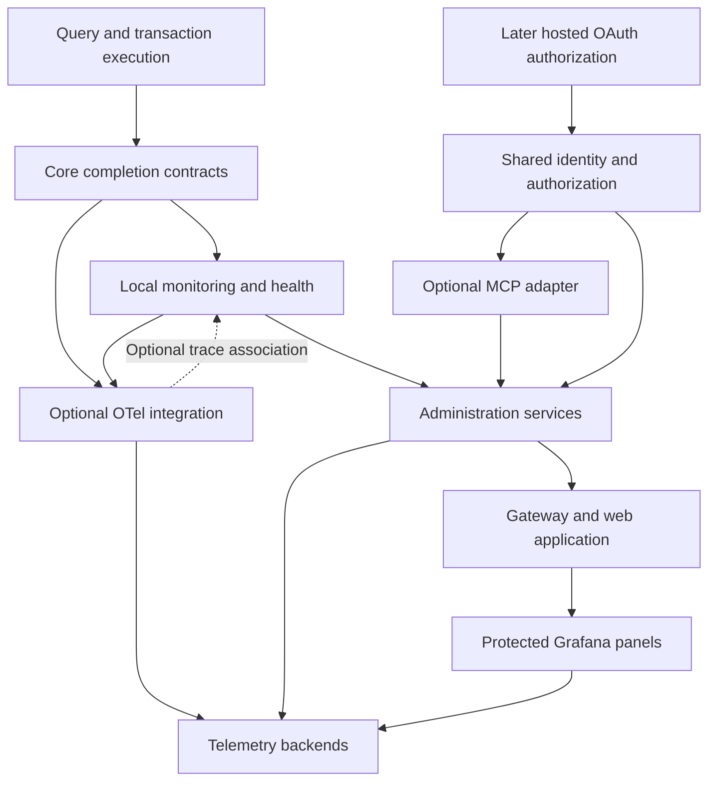

<!-- workflow-sha: 6c1e9a303e3d24c392c844805ecec8aae5ef5677 -->
# YTDB-496 OpenTelemetry support — Implementation plan

## Design Document

- [design.md](design.md) defines the accepted capabilities and boundaries.
- [design-mechanics.md](design-mechanics.md) defines their mechanisms and verification requirements.

This plan covers OpenTelemetry (OTel), local monitoring, administration, the web application and Model Context Protocol (MCP) access.
OTel provides standard interfaces for traces, logs and metrics.
A span records one timed operation and its attributes.
OpenTelemetry Context carries the active span and related values across execution boundaries.
MCP lets agent clients call authorized services and read monitoring events.

The user approved this plan structure on 2026-11-09.
The plan contains the complete track list and cross-track decisions.
Each later implementation track writes its detailed track file when it starts.
This is the approved exception to the older process.
No detailed track file is part of Track 106.

A software development kit (SDK) supplies the protocol libraries used by an integration.
Gremlin is the graph query language used by YouTrackDB.
SQL means Structured Query Language.
Explain plans a query without executing it.
Profile executes a query with execution measurements.
OAuth lets a user grant restricted access to a client.

Option A uses server-issued, opaque credentials for individual MCP clients.
Option B adds hosted OAuth 2.1 authorization later.
A benchmark fixture defines a workload, dataset and configuration.
An arm is one configuration side of a benchmark comparison.
Off means no telemetry listener, local-capture listener or log hook.

A monitoring owner holds state for one engine activation or database instance.
Its generation is a never-reused identifier for that owner's position sequence.
Within a process, generations increase in allocation order.
See [Generations, history and shutdown](design-mechanics.md#generations-history-and-shutdown).

An authorization lease is a permission decision with a finite deadline.
A gateway forwards authorized requests between clients and internal services.
Transport Layer Security (TLS) encrypts and authenticates network connections.
Grafana displays protected telemetry panels.
A backend stores or queries exported telemetry.

A heartbeat gate lets the first successful query completion after an interval bypass the slow-query gate.
Gates select span candidates before SDK sampling, which can still reject them.
See [Time-based sampling](design-mechanics.md#time-based-sampling) and the [SDK sampling contract](design-mechanics.md#sdk-sampling-contract).

Bounded SQL children are nested SQL observations buffered under finite limits until the Gremlin parent is created.
Only a recording, sampled Gremlin parent permits their construction as child spans.
Each child still receives its own SDK sampling decision.
See [Buffered SQL children](design-mechanics.md#buffered-sql-children).

## Component Map

Arrows show observation or service flow, not implementation order.

Core monitoring does not depend on OTel, Grafana or MCP.
Browser and MCP access share authorization and admission rules.
An admission rule decides whether bounded capacity permits work to start.

Administration telemetry routes and Grafana traffic share backend limits and accounting.
Investigation uses one privacy rule across trace, log and local monitoring capture.

### Component ownership

- Query and transaction contracts belong to I2.
  Query identity and privacy belong to I3.
  Gremlin capture belongs to I4.
  SQL completion belongs to I5.
- The optional OTel integration belongs to I6 to I9.
  I6 owns configuration and SDK ownership.
  I7 owns traces, I8 owns correlated logs and I9 owns metrics and loss visibility.
- Local monitoring belongs to I10 to I12.
  I10 owns lifecycle and retained slow queries.
  I11 owns health and history.
  I12 owns optional trace association and health export.
- Shared identity, authorization and admission belong to I13.
  I14 owns local reads and streams.
  I15 owns investigation.
  I16 owns gateway forwarding, telemetry routes and protected Grafana access.
- I17 owns server lifecycle and packaging.
  I18 owns the monitoring web application.
  I19 owns first-phase MCP credentials.
  I20 owns MCP tools, events and optional server packaging.
  I23 owns later hosted OAuth authorization.
- I21 owns the protected local stack and operator documentation.
  I1 establishes benchmark comparisons.
  I22 completes the accepted measurement matrix.

## Checklist

The identifiers I1 to I23 name implementation work, not completed design-authoring tracks.
Every entry is **not started**.
Dependencies are prerequisites for completion and preserve enablement gates.
Each track includes its own tests and relevant documentation.

Risk labels name the proved areas:

- **C:** Concurrency defect, where overlapping executions can break a contract or stop required progress.
- **S:** Security weakness, where an actor can break a security property.
- **P:** Performance degradation, where work misses a stated latency, throughput or resource requirement.
- **L:** Unreadable user-facing prose, where readers cannot decide or complete their task.

- [ ] Track I1: Benchmark baseline and comparison tooling
  > **Scope:** Establish compatible off fixtures before execution-path changes. Add validated comparisons, complete report identity, history handling and the accepted nightly self-comparison fix.
  > **Depends on:** None
  > **Risks:** P, L

- [ ] Track I2: Core listener contracts
  > **Scope:** Add global registration, stable operation snapshots, completion details and listener isolation.
  > **Depends on:** I1
  > **Risks:** C, P

- [ ] Track I3: Query identity and privacy
  > **Scope:** Add SQL classification, safe text rendering, parameter rules and query-text limits.
  > **Depends on:** I2
  > **Risks:** S, P

- [ ] Track I4: Gremlin capture and provenance
  > **Scope:** Add classification, tags, timing, context and Explain or Profile completion details.
  > **Depends on:** I2
  > **Risks:** C, P

- [ ] Track I5: SQL completion boundary
  > **Scope:** Cover cached, uncached, command and script paths with the completion order defined by D3.
  > **Depends on:** I2, I3, I4
  > **Risks:** C, P

- [ ] Track I6: OTel module and SDK lifecycle
  > **Scope:** Add dependencies, configuration, ownership resolution and close-once lifecycle behavior under D4. Measure actual close time with pending test spans and recorded test instruments registered through the SDK API. Include an unreachable backend with metrics enabled. Record report-only results in the detailed track file.
  > **Depends on:** I2
  > **Risks:** C, S, P

- [ ] Track I7: Trace production and gates
  > **Scope:** Add query and commit spans, threshold and heartbeat gates, sampling and bounded SQL children. Apply the shared investigation privacy rule.
  > **Depends on:** I3, I4, I5, I6
  > **Risks:** C, S, P

- [ ] Track I8: Correlated log export
  > **Scope:** Add guarded log capture, context correlation, severity rules and body privacy. Apply the shared investigation privacy rule.
  > **Depends on:** I6, I7
  > **Risks:** C, S, P

- [ ] Track I9: Metrics and loss visibility
  > **Scope:** Add profiler instruments, query histograms, signal switches and SDK loss visibility.
  > **Depends on:** I2, I6, I7
  > **Risks:** C, P

- [ ] Track I10: Monitoring owners and slow-query retention
  > **Scope:** Establish owners, generations and atomic non-waiting close start before retaining records. Add close-time reservation release, independent capture controls, bounded admission and visible loss. Apply the shared investigation privacy rule.
  > **Depends on:** I2, I3, I4, I5
  > **Risks:** C, S, P

- [ ] Track I11: Health state and history
  > **Scope:** Add observations, ordered state and paired history on the existing owners. Add non-waiting final publication.
  > **Depends on:** I10
  > **Risks:** C, P

- [ ] Track I12: Local trace association and health export
  > **Scope:** Add bounded trace associations, closure-aware atomic health handoffs and enabled-signal export under D5.
  > **Depends on:** I7, I8, I9, I10, I11
  > **Risks:** C, P

- [ ] Track I13: Shared administration authority
  > **Scope:** Add typed identities, browser sessions, current permission checks, leases and shared admission. Own exact-grant default-deny, cross-site request forgery (CSRF) protection, origin checks, listener TLS and security-ready startup. Disable request-body and sensitive-header logging at the listener.
  > **Depends on:** I2
  > **Risks:** C, S, P

- [ ] Track I14: Administration local reads and streams
  > **Scope:** Add local reads, integrity-protected cursors, bounded streams and lifecycle resets. Do not open telemetry routes here.
  > **Depends on:** I10, I11, I13
  > **Risks:** C, S, P

- [ ] Track I15: Safe query investigation
  > **Scope:** Add caller-bound Explain and Profile, explicit Profile confirmation, cache isolation and internal limits. Add the dedicated bounded worker pool outside the YouTrackDB thread-group hierarchy and restart-safe capacity accounting. Enforce shared capture suppression and shutdown cancellation. Own tests of all accepted limits, including memory, and read-only enforcement in the shared server service.
  > **Depends on:** I3, I5, I7, I8, I10, I13, I14
  > **Risks:** C, S, P

- [ ] Track I16: Gateway, telemetry routes and protected Grafana
  > **Scope:** Own telemetry routes together with backend limits and shared accounting. Add trusted response leases, stream renewals, bounded forwarding and route restrictions. Own the narrow `/mcp` pass-through route and its header and mutual TLS rules below. Disable request-body and sensitive-header logging at the gateway. Keep disabled OAuth paths out of web fallback handling.
  > **Depends on:** I13, I14
  > **Risks:** C, S, P

- [ ] Track I17: Server wiring and packaging
  > **Scope:** Wire lifecycle discovery, shutdown ordering and required OTel server artifacts. Repeat D4's report-only close-time measurement with production signals wired. Own the shared server-side investigation enablement gate. Require I15's proof of all limits and read-only enforcement plus safe teardown before opening it.
  > **Depends on:** I6, I8, I9, I12, I14, I15, I16
  > **Risks:** C, S

- [ ] Track I18: Monitoring web application
  > **Scope:** Add local views, protected panels, explicit investigation consent and failure states. Respect the shared server-side I17 gate before enabling investigation forms.
  > **Depends on:** I14, I15, I16, I17
  > **Risks:** S, L

- [ ] Track I19: MCP option A credentials
  > **Scope:** Add shared credential storage, verifier checks, per-client revocation and protected token management. Reject MCP bearers on administration routes. Require recent re-authentication before token creation. Require token expiry and reject nonpositive or unbounded expiry. Own bounded failed-bearer rate limiting before verifier work.
  > **Depends on:** I13, I18
  > **Risks:** C, S, P

- [ ] Track I20: MCP tools and experimental events
  > **Scope:** Add the pinned transport adapter, authorized tools, cursor mapping and bounded cancellation. Join shared limits and the server-side investigation gate. Own per-client sub-quotas inside shared identity budgets. Disable request-body and sensitive-header logging in the MCP listener adapter. Add optional MCP server packaging. Enforce D6 while option B is off.
  > **Depends on:** I14, I15, I16, I17, I19
  > **Risks:** C, S, P, L

- [ ] Track I21: Quick start and operator documentation
  > **Scope:** Deliver the protected local stack, provisioning, dashboards, smoke checks and operating guidance. Keep the MCP listener internal behind the gateway.
  > **Depends on:** I17, I18, I20
  > **Risks:** S, L

- [ ] Track I22: Final accepted measurement matrix
  > **Scope:** Complete the accepted off, enabled, local-only and combined measurement matrix using the established fixtures and comparison tooling.
  > **Depends on:** I1, I7, I8, I9, I10, I12
  > **Risks:** C, P, L

- [ ] Track I23: MCP option B hosted OAuth
  > **Scope:** Add the specified authorization server, client validation, refresh protection and deployment guidance. Require recent re-authentication before consent.
  > **Depends on:** I19, I20, I21, I22
  > **Risks:** C, S, P, L

## Sequencing

### Benchmark sequencing

I1 is the first track and has no implementation dependency.

Every track that changes a frequently executed path runs its own applicable benchmark arms.
It compares against the established compatible baseline.
It does not wait for I22 to discover regressions.

Keep base and candidate comparisons compatible.
A missing compatible arm produces an inconclusive result, not a substitute workload.
As capture capabilities arrive, measure their applicable enabled arms.
Include local-only capture without requiring OTel export.

I22 owns only completion of the final accepted measurement matrix.
It does not depend on server wiring, the web application or MCP.

Benchmark results remain report-only as accepted.
An inconclusive measurement stays visible and never becomes a pass.
Proposed budgets remain proposed until approved.

### Owner and capture sequencing

I10 establishes owner lifecycle before admitting retained records.
It binds work to the owner active at operation start.
Late completion cannot enter a replacement database owner.

Close marks that owner closed before cleanup releases reservations.
I11 then adds health state and history.
I12 adds correlation and export without creating a second lifecycle authority.

I7, I8 and I10 apply one shared investigation privacy rule.
I15 depends on all three.
Investigation statements and parameters stay out of traces, logs and monitoring records.
The rule also covers request-body and error logging.

I13 disables request-body and sensitive-header logging at the listener.
I16 enforces that ban at the gateway, and I20 preserves it in the MCP adapter.
I13 owns `Cache-Control: no-store` on sensitive administration responses.
I20 owns that header on sensitive MCP responses.
I16 preserves those headers and never caches MCP results in the gateway.

Query completion may construct and end spans and enqueue them through SDK processors as required by the accepted design.
It performs no network requests, backend queries, event delivery, health evaluation or health and export delivery.
Observation handoffs remain bounded and non-waiting.
I7 to I12 preserve that boundary for capture and export.
I14 and I20 deliver events outside query completion and serve already evaluated health.
Reader count must not increase query-completion work.

### Security and route sequencing

I13 owns the shared controls before the first administration route opens.

Exact-grant checks default to deny.
Broad wildcard grants do not satisfy permissions that require an explicit grant.

Cookie-authenticated access includes cross-site request forgery (CSRF) protection.
It also validates the configured origin.
TLS protects the listener.
The listener starts only after security services are ready.

I14 opens local reads and streams only after those controls exist.
I16 alone owns telemetry routes, their backend limits and their shared accounting.
No telemetry route opens before I16 completes.
Later MCP telemetry access joins that same boundary.

I16 owns the narrow pass-through route to the configured `/mcp` destination.
Preserve exactly one Authorization bearer header to the listener over mutually authenticated TLS.
Reject duplicate, folded or conflicting Authorization fields before dispatch.
Strip caller identity and forwarding headers, cookies and browser CSRF headers.

Replace forwarding values only from the trusted peer.
Never convert gateway or browser authority into MCP authority.
Never forward the bearer to Grafana, telemetry stores or another path.
Strip Authorization on every non-MCP gateway route.
I20 supplies the authenticated MCP endpoint behind this route, not a second gateway.

I19 owns administration-route rejection of MCP bearer credentials.
It also owns recent re-authentication before option A token creation and mandatory finite token expiry.
I19 rate-limits failed bearer attempts by source and bounded lookup identifier before verifier work.
Source admission precedes allocation of identifier state.

I20 owns per-client sub-quotas within shared per-identity budgets for tools, polls and streams.
These quotas add no identity capacity and preserve reserved client-management capacity.
I23 owns recent re-authentication before option B consent.

I16 and I20 enforce disabled discovery behavior at their routing boundaries.
Neither page fallback nor transport defaults may advertise option B while it is off.

### Delivery order

I15 first proves all accepted investigation limits and read-only enforcement.
I17 then proves teardown safety before opening the shared server-side gate.
I18 and I20 respect that gate for web and MCP investigation.
Moving optional MCP packaging to I20 avoids a dependency loop through the web application and token management.

I21 and I22 complete the planned first-delivery package.
I23 follows that package and does not block option A delivery.

Security and concurrency tests belong to their implementation tracks.
Do not defer those tests to final measurement.

## Reconciliation

### D1. CN-11: Order shutdown signals without adding a worker drain

**Rule:** The administration service owns a dedicated bounded pool for Explain and Profile workers.
Those workers never run on engine executors.
Their threads must be outside the `YouTrackDB` thread-group hierarchy interrupted by engine shutdown.
No shutdown step waits on that pool.

Stop investigation admission before dependent administration services stop.
Signal cancellation to active workers and discard unsent results.
Workers own session cleanup rather than handing it to the response thread.
They keep their capacity reservations until execution and cleanup finish.

Count capacity against an owner that survives a server stop and start in the same Java Virtual Machine (JVM).
Still-running cancelled workers continue to count after restart.
Do not reset their accounting when a new server starts.
Late releases cannot make the count negative.
This capacity owner is distinct from monitoring owners whose lifetimes follow engine activation.

Do not wait for investigation workers before final health publication or SDK shutdown.
A late monitoring publication cannot recreate a closed monitoring owner.

I17 owns the query-form enablement gate in the shared server service.
It keeps each form off until I15 tests prove all accepted limits, including memory, and read-only enforcement.
I17 also proves safe cancellation and resource lifetime through the real teardown sequence.
I18 and I20 respect that server-side gate for the web application and MCP.
Neither client can bypass it.

**Reason:** Cancellation is not proof that execution has stopped.
Engine executors can introduce shutdown waits.
Engine shutdown also interrupts the `YouTrackDB` thread group.
Restarting a server does not prove that its old workers have finished.

**Reject:** Worker joins during shutdown, engine-pool execution, accounting resets, early capacity release and concurrent session cleanup.

**Compatibility:** This preserves non-waiting monitoring close and the accepted cancellation contract.
If safe teardown requires a new shutdown wait, present that change for approval.
Do not add the wait through implementation detail.

### D2. RG22: Keep response authority valid through gateway delivery

**Rule:** Give the gateway trusted lease data before it forwards a protected response.

Lease data comes only from the mutually authenticated listener-to-gateway connection.
Strip lease data from client requests and Grafana responses.
Bind it to one request and one identity.

Protected Grafana requests carry the permit from `/admin/v1/gateway/authorize`.
Their delivery deadline is the earlier of that permit deadline and the latest valid listener deadline.
A listener renewal can replace its earlier deadline but cannot extend delivery beyond the gateway's permit.
A permit-bound stream ends at that permit deadline even if listener revalidation succeeds.

Pass-through administration responses and `/mcp` responses do not acquire that separate gateway permit.
Administration responses include `/admin/v1` event streams and `/admin/v1/telemetry/*` listener routes.
They carry the listener's request-bound lease instead.
The listener sends renewals for long-lived streams over the same mutually authenticated connection.
Only a completed successful revalidation before expiry replaces the listener deadline.

R is the finite positive maximum authorization lease duration.
For browser sessions, each replacement is capped by check-start plus R and both session expiry times.
For MCP, it is capped by check-start plus R and token expiry.
For these pass-through streams, a valid renewal can extend delivery to that replacement deadline.

The gateway uses the earlier of its own permit deadline, when present, and the latest valid listener deadline.
Listener lease data can only shorten the gateway's independent authority and cannot extend its permit.
It is not a new grant of authority.

Keep that effective deadline active while output remains buffered.
Mark authorization aborts as abnormal transport termination.
On such an abort, the gateway discards unsent bytes.

Normal response completion does not discard bytes.
It also does not remove their deadline.
The gateway may flush buffered output only while delivery authority remains valid.
Revalidation does not count as user activity.

**Reason:** Listener completion and browser delivery can occur at different times.
Long-lived streams need trusted renewal signals without a deadline exemption.

**Reject:** Caller-supplied deadlines, Grafana-supplied lease authority, stream exemptions and treating every close as normal.

**Compatibility:** This supplies the missing handoff for the accepted delivery and revocation rules.
It does not extend authority or promise recall of bytes already delivered.

### D3. CR19: Preserve completion order and the accepted cache fallback

**Rule:** On cached query entry paths, resolve the cache result first.
Apply lifecycle handling next.
Place SQL instrumentation outside both.

Other completion sites keep their accepted completion order.
For example, command execution that prefetches results retains completion around its internal drain.
Do not move that completion to a later consumer close.

Instrumentation delegates through the public result interface.
It does not discover cache state by inspecting its immediate delegate.
When cache-outcome metadata is available, pass it explicitly into the operation's completion state.

The current baseline has no cache-outcome accessor.
Retain the accepted fallback and omit the cache-outcome attribute from this delivery.
Its producer and explicit metadata handoff remain in the existing cache-telemetry follow-up.

**Reason:** Lifecycle decoration hides the cache view.
A cache view can represent either a hit or a miss.
A universal wrapper-order rule would also change unrelated completion sites.

**Reject:** Inferring outcome from result type, unwrapping decorators and moving every completion to consumer close.

**Compatibility:** The rule reconciles cached query wrapping with the existing execution path.
The omission follows the accepted accessor-absent fallback.
Requiring the attribute now needs separate approval.

### D4. RG15: Use the pinned SDK close operation once

**Rule:** Call the owned OTel SDK close operation once.
Add no outer retry, second flush or YouTrackDB shutdown deadline.
YouTrackDB adds no bound on that call.
Close can take longer than the SDK's ten-second join because provider shutdown runs synchronous work before that join.
This plan states no exact close duration.

I6 measures actual close time with the pinned SDK 1.66.0.
Register test spans and test instruments through the SDK API, recording data so export work is pending at close.
Include an unreachable backend with metrics enabled and confirm the measurement exercises nonempty export work.
I17 repeats the measurement with production signals wired.
Record report-only results in each detailed track file without introducing a close-time budget.
A returned close call does not prove that every export completed or every worker stopped.

Keep the final publication attempt and SDK close outside all locks excluded by the accepted shutdown rule.
These include facade resolution synchronization and every engine, factory, `YouTrackDBImpl`, storage and monitoring lock.
Never close a host-owned SDK.

**Reason:** The join duration does not include synchronous provider-shutdown work.
Processor and exporter timeouts alone do not describe the whole close call.

**Reject:** A custom drain loop, a final-export guarantee and treating exporter timeouts as a total shutdown deadline.

**Compatibility:** This preserves ownership, close-once behavior and best-effort export.
The user approved this close-duration correction on 2026-11-09.

Some accepted design sentences are inexact about close duration.
These are design.md lines 721, 1700, 2763 and 2877, plus design-mechanics.md lines 80 to 81.
They tie the close wait to configured processor and exporter timeouts.
They also say a zero timeout can make the wait unbounded.
Do not use those sentences to infer an exact duration or total bound.

The accepted design text stays unedited.
Ownership, non-waiting final publication and the rule that YouTrackDB adds no bound remain unchanged.

### D5. RG16: Apply closure and ordering atomically to health handoffs

**Rule:** Each health handoff identifies its scope and owner generation.
Generations distinguish successive owners of the same scope, increase within a process and are never reused.

The handoff carries assigned version, position, timestamp, bounded health data and a final-result marker.
It also carries a lightweight lifecycle reference with live closure state.
That reference must not retain the owner's records, sessions or storage.

The closed-state check, value installation and value release happen in one per-scope atomic update.
That update enforces closure and generation ordering together.
Consumers reject non-final results after owner closure.
At collection, read the live lifecycle reference and release a closed owner's retained non-final value in that same atomic update.
Do not report that non-final value, even if the final handoff was lost.

Release the final metric value after one collection or SDK close, as B4 requires.
Keep a per-scope generation floor only while an older handoff can still arrive.
The floor records the newest accepted generation and retains no metric payload.
A delayed final from an older owner cannot become current after a newer owner's final has been released.

Track pending handoffs and producers that can still issue them before dispatch, using bounded admission and lightweight lifecycle references.
Registration and retirement use the same per-scope atomic ordering boundary as installation and release.
Retire the floor once no retained value, pending handoff or producer can introduce an older result.
After retirement, old producer references cannot register or publish again.
A newer owner uses a fresh increasing generation.

Retained values, pending references and floors all count against bounded handoff memory.
Do not keep a table of every scope ever seen.
On saturation, drop the export handoff rather than weaken ordering or allocate unbounded state.

Preserve the accepted generation and position ordering.
Keep the closure check effective after payload release.

**Reason:** A copied open state becomes stale while a handoff is delayed.
Separate checking and installation can leave a closed scope with a non-final value.
Payload release must not erase the ordering boundary.

**Reject:** Closure snapshots alone, separate check-and-install steps, name-based owner lookup and an unbounded table of closed owners.

**Compatibility:** This implements the accepted late-result rejection rule without adding waits or durable history.

### D6. MCP option B: Deliver hosted OAuth after option A

**Rule:** Deliver option A first with server-issued, opaque, per-client MCP tokens.
Deliver option B later with YouTrackDB-hosted OAuth 2.1 authorization.
OAuth is a protocol through which a user grants restricted access to a client.

Both phases use the accepted credential store, typed identities and authorization adapter.
Option B adds the specified consent, code exchange, refresh and revocation behavior.

While option B is off, discovery and OAuth paths return not found.
They must not fall through to a web application page.
An authentication-required response uses a plain Bearer challenge without metadata links.

**Reason:** The first delivery remains smaller without creating a separate authority model.
Disabled OAuth must not appear available through discovery or authentication responses.

**Reject:** Folding B into A, using an external identity provider and presenting A as standard OAuth.

**Compatibility:** This follows the accepted two-phase delivery.
It adds neither webhook implementation nor a newer MCP protocol baseline.

### D7. Root questions 1 to 5: Keep explicit decision gates

**Rule:** Keep all five questions open and assign each to its consuming tracks.
A track may implement configurable bounds without choosing unapproved shipping values.

A feature cannot be enabled without the finite limits required by its accepted contract.
Do not substitute unlimited behavior when a value remains undecided.
Zero or sentinel values never mean unlimited.

**Reason:** Planning dependencies does not authorize product defaults.

**Reject:** Silent defaults, unlimited fallback behavior, hidden scope expansion and reopening answered question 6.

**Compatibility:** This preserves the accepted open questions and enablement constraints.
It adds no numerical defaults or performance budgets.

## Design reference mapping

The accepted design keeps its existing track identifiers.
Use this mapping when reading those references.
Design-authoring completion does not mark implementation complete.

| Reference in the accepted design | Implementation owner |
|---|---|
| Track 3, G1: Listener detail contracts | I2 contracts and core Context dependency, I4 and I5 capture, I6 dependency isolation |
| Group 8 activation, Tracks 48–49 | I6 SDK activation and I17 server lifecycle wiring |
| Forecast Track 102, G8: Server distribution packaging | I17 standard server distribution and Docker image |
| Track 103 local monitoring rules | I10 owners and retention, I11 health, I12 association and export |
| Track 104 administration rules, cancellation and authorization lease duration R | I13 authority, I14 local routes, I15 investigation, I16 gateway, I17 teardown gate, I18 application |
| Track 105 MCP design and event adaptation | I19 option A credentials, I20 adapter and events, I23 option B |
| Track 106 plan rebuild, CN-11, RG22, CR19, RG15 and RG16 | This plan and D1 to D7, carried into the consuming tracks |
| PR #1038 Track 10 union boundary | External Gremlin translation prerequisite, consumed and verified by I4 and I5 |
| YTDB-820 Track 1 and Tracks 2–3 cache routing | External cache prerequisite, reverified by I5 under D3 |

R denotes the finite maximum authorization lease duration.
PR means pull request.
External track numbers do not add implementation tracks to this checklist.

## Accepted capability coverage

The table maps the whole accepted design to work owners.
Section names identify provenance, not substitutes for detailed track plans.
Each owning track carries the applicable edge cases, configuration and verification requirements.

Sem-conv means OpenTelemetry semantic conventions, which define telemetry names and attributes.
A Collector receives, processes and forwards exported signals.
An advisor-foundation metric or attribute supplies observations for later advisory dashboards.

| Accepted design section or capability | Owning tracks |
|---|---|
| Core Concepts, Class Design and Workflow | I2 to I9, I17 |
| Listener registration and ordering, global snapshots, additive transaction listeners, commit signatures and exception isolation | I2, I4, I5, I6 |
| Core Context compile dependency and exporter exclusion | I2, I6 |
| SQL classification, safe text and summaries, parameter privacy, advisor classification facts | I3, I5, I7 |
| Gremlin bytecode classification, translated and fallback paths, union boundaries | I4 |
| Query tagging and per-tag rule resolution, transaction overrides and tracking identifiers | I2, I3, I4, I5, I7 |
| Span timing capture, active versus wall-clock timing, completion and row counts | I2, I4, I5, I7, I9 |
| SQL execution layer hook, cached and uncached paths, scripts, failures and re-entry suppression | I5 |
| Sem-conv attribute mapping and vendor attributes, Gremlin pass-through attributes | I3, I4, I5, I7, I9 |
| Embedded context propagation, host parenting, explicit server roots and balanced execution scopes | I4, I5, I6, I7 |
| Query slow-threshold gates, heartbeat, SDK sampling, late parents and bounded SQL children | I7 |
| Commit spans, failures and separate commit slow-query gating | I2, I7, I9 |
| Explain and Profile integration, plan rendering and completion metrics | I4, I5, I7 |
| OTel logs integration, one guarded capture path, severity, context and body privacy | I8 |
| Metrics integration, profiler enumeration, lazy registration, asynchronous lifecycle and group filters | I9 |
| Duration and returned-row histograms, bounded reusable attributes and signal switches | I9 |
| Baseline operator metrics, four advisor-foundation metrics and two advisor attribute flags | I3, I4, I5, I7, I9 |
| Telemetry limits and loss counters, native SDK self-metrics and signal-independent visibility | I6, I7, I8, I9 |
| SDK lifecycle: embedded versus server, configuration surface, ownership and best-effort close | I6, I12, I17 |
| Standard server distribution and Docker runtime dependencies | I17 |
| Local slow-query admission and retention, independent controls, immutable records and visible loss | I10 |
| Owner generations, close-time reservation release and replacement isolation | I10 |
| Health evaluation, observation authority, ordered state, paired history and final publication | I11 |
| Optional trace correlation, bounded associations and closure-aware health export | I12 |
| Administration listener and service boundary, typed identities, roles, exact grants and ready startup | I13, I17 |
| Browser sessions, cross-site request forgery (CSRF) protection, origin validation, expiry, revocation and shared admission | I13 |
| Administration resource contracts, data shapes, cursors, bounded streams and lifecycle resets | I14 |
| Fresh read-only investigation, explicit Profile consent, cache isolation and internal execution bounds | I15 |
| Dedicated investigation workers, restart-safe reservations, cancellation and shared capture suppression | I7, I8, I10, I15, I17 |
| Gateway authorization, protected Grafana, route restrictions, response leases and bounded backend queries | I13, I16 |
| Shared telemetry backend accounting and limits, including later MCP consumers | I16, I20 |
| Web application views, panels, investigation consent, failure states and shared server-side enablement gate | I17, I18 |
| MCP option A credential store, verifier index, mandatory finite expiry, typed authority, current roles and per-client revocation | I13, I19 |
| Narrow `/mcp` gateway pass-through, one bearer over mutual TLS, header stripping and duplicate rejection | I16 |
| MCP audience validation and endpoint authentication | I19, I20 |
| Recent re-authentication, failed-bearer source limits and reserved browser capacity | I19 |
| Per-client sub-quotas within shared identity budgets | I20 |
| Request-body and sensitive-header logging ban at listener, gateway and MCP adapter | I13, I16, I20 |
| Pinned MCP transport, seven authorized tools, schemas, untrusted results and bounded cancellation | I20 |
| MCP poll and push events, cursor integrity, retained snapshots, gaps, heartbeats and owner replacement | I14, I20 |
| Disabled OAuth discovery, not-found routes and plain Bearer challenges | I16, I20 |
| Optional MCP server packaging | I20 |
| MCP option B discovery, consent, client validation, code exchange and resource binding | I23 |
| Option B refresh rotation, replay detection, revocation, reserved tombstone capacity and deployment | I23 |
| Quick-start stack, Collector pipeline, provisioning, five dashboards and correlator wiring | I21 |
| Protected local deployment, generated credentials, smoke scripts, signal checks and independent local monitoring | I21 |
| User manual, documentation index, settings reference, operator guidance and production boundaries | I21 |
| Benchmark fixtures, comparison validation, report identity, workflows, history and nightly self-comparison | I1 |
| Accepted off, enabled, local-only and combined measurements, confidence rules and report-only alerts | I1, I7, I8, I9, I10, I12, I22 |
| No accepted benchmark arm for I6, I14 or I20. Verify the query-completion work boundary through tests | I6, I14, I20 |
| Required implementation verification for administration and MCP | I13 to I20, I23 |

Advisory dashboards and their tuning guide remain deferred.
Unresolved engine sources for foundation metrics stay visible in I9.
They do not authorize invented measurements or automatic scope removal.

The MCP baseline remains protocol 2025-11-25 and Java SDK 2.1.0.
The experimental events sketch remains pinned to commit
`d5316be214be2e76e51462069c1d67e00a5a7619`.
Do not replace it with a later protocol revision.

## Risks

Shutdown tests must distinguish cancellation requests from completed cleanup.
They must cover server restart while cancelled workers still run.
Late cleanup must neither release capacity twice nor make accounting negative.

Investigation tests must prove safe resource lifetime through the real server shutdown sequence.
A dedicated worker pool alone does not prove that storage teardown is safe.

Gateway tests must cover normal completion followed by buffered delivery at lease expiry.
They must also cover stream renewal, forged lease data and stalled revalidation.
A renewal must never extend the gateway's own permit.

Health tests must deliver stale results after closure and after final-value release.
They must race closure, installation and release.
They must deliver an older owner's final after a newer final has been released.
They must race floor retirement with producer registration and delayed handoffs.
Distinct-scope churn must not leave floors after their ordering references retire.

Lose a closed owner's final handoff, then collect and verify release of its non-final value without reporting it.
Verify that its floor retires once ordering references end and retained values count against the bound.

Retention tests must close an owner while observations remain pending.
They must verify reservation release and rejection of publication into replacement owners.

Cache tests must cover lifecycle decoration without relying on concrete result types.
Other completion tests must preserve completion during internal result consumption.

Investigation tests must enforce limits inside planning and materializing execution.
They must verify capture suppression across traces, logs and local monitoring.

OTel-off, local-only and combined configurations need separate verification.
The plan must not convert proposed benchmark budgets into approved thresholds.

Later track sizing may require splits.
Every split must preserve scope, dependencies and enablement gates.

## Scope boundary

Track 106 delivers the thin plan, component map, complete checklist and reconciliation section.
It does not deliver detailed track files, product code or changes to accepted design documents.

Later implementation tracks preserve these boundaries in their detailed plans.
Any required behavior outside the accepted design returns for explicit approval.
Track 106 does not state an exact SDK close duration.
D4 records the close-duration correction approved by the user on 2026-11-09.

## Open questions

1. **Local capture limits:** I10 needs approved thresholds and count, byte and text limits.
2. **Correlation lifetime:** I12 needs approved association lifetimes and expiry bounds.
3. **Health authority:** I11 needs approved observation sources, state rules and freshness limits.
4. **Access and telemetry limits:** I13 to I20 and I23 need approved finite lifetimes, rates, capacities and backend bounds.
5. **Investigation limits:** I15 needs approved parse, plan, execution, memory, row, byte and concurrency limits.

Question 6 is answered by option A first, option B later and the accepted protocol pins.

Safe investigation cancellation still needs implementation evidence.
If safe teardown requires a new wait, offer either a separately approved bounded drain or reduced enabled query support.

The cache-outcome attribute remains in its accepted follow-up unless the user approves earlier delivery.
